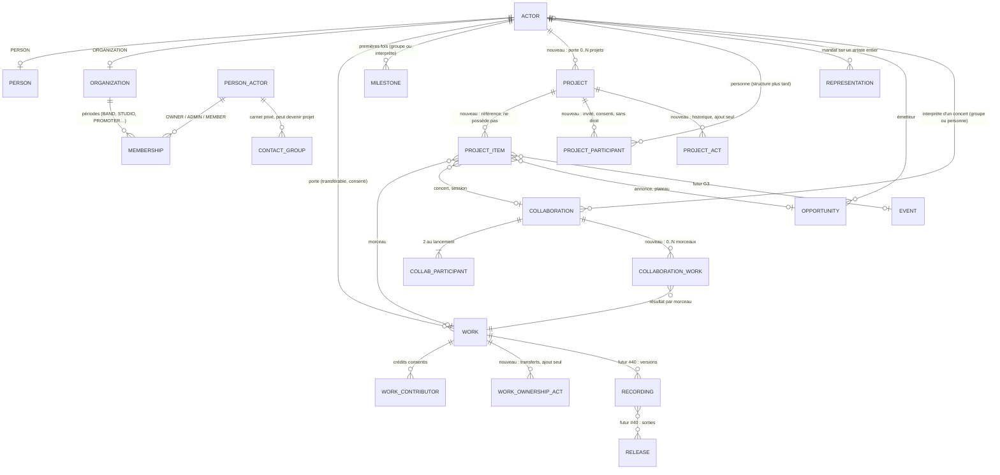
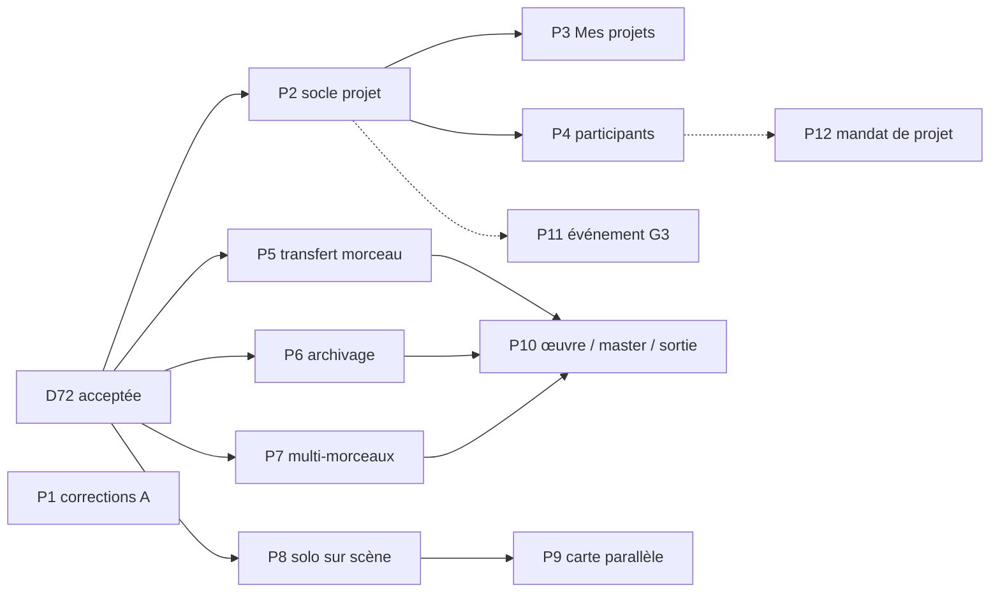

# Architecture métier cible du domaine Collab (G0-02, #83)

> **Statut : proposition.** Ce document détaille la proposition
> [D72](../decisions/D72-architecture-projets-collab.md), en statut
> **Proposée**. Rien n'y est validé tant que le fondateur n'a pas tranché les
> questions du §9. **Aucune ligne de code, aucun schéma, aucune migration
> modifiés.**
>
> **Base** : `main` au commit `9eac062` (18/11/2026), à jour avec
> `origin/main`. Il prolonge l'[audit structurel G0-01](./audit-structurel-collab.md)
> (#84) et reprend ses étiquettes : **[Fait]** (vérifié dans le code),
> **[Hyp.]** (hypothèse), **[Reco.]** (recommandation), **[Décision]** (choix
> produit à trancher). Les faits de l'audit ne sont pas redémontrés : ils sont
> cités par leur numéro (E1 à E14, scénarios A à H).
>
> **Entrées produit prises en compte** : les cadrages de #71 (« le projet
> est l'axe principal du parcours ») et #72 (branches parallèles, sessions
> multi-morceaux, scène sans studio), conservés dans l'[archive du
> backlog](../plan/archive-issues-avant-refonte-2026-11-18.md), et le besoin
> exprimé pour G0-02 : **un groupe porte plusieurs projets distincts**, et un
> artiste solo, un producteur ou un organisateur porte un projet sans groupe.

---

## 1. La question, et la réponse courte

> Comment Melokiva peut-il représenter durablement les groupes, projets,
> œuvres, événements et collaborations, en conservant les acquis techniques,
> et en permettant aux différents acteurs de la musique de travailler
> ensemble ?

**Réponse proposée** [Reco.] : en séparant nettement **cinq relations**
qui sont aujourd'hui en partie confondues, puis en ajoutant **un seul objet
nouveau**, facultatif, qui ne possède rien.

| Relation         | Question à laquelle elle répond                      | Objet qui la porte (cible)                             |
| ---------------- | ---------------------------------------------------- | ------------------------------------------------------ |
| **Appartenance** | Qui fait partie de ce collectif, depuis quand ?      | `Membership` (inchangé)                                |
| **Portage**      | Qui administre cet objet dans l'application ?        | `Work.ownerId`, `Project.ownerId` (un `Actor`)         |
| **Crédit**       | Qui a fait quoi sur cette réalisation ?              | `WorkContributor` + `WorkRole` (inchangés)             |
| **Acte prouvé**  | Qu'est-ce qui a eu lieu, confirmé par qui ?          | `Collaboration` (étendue à plusieurs morceaux)         |
| **Regroupement** | À quel objectif cette réalisation contribue-t-elle ? | **`Project` (nouveau)**, qui _référence_ sans posséder |

La **propriété intellectuelle** (droits d'auteur, droits voisins, master)
n'est portée par aucune de ces relations. Melokiva ne la gère pas au
lancement : elle se déclare à la SACEM, à la SCPP ou au contrat, hors de
l'application (voir [démarches](./09-demarches.md)). Le portage est une
**permission applicative**, jamais un titre de propriété.

Le reste du document justifie ce choix (§2 à §4), le décrit (§5 et §6),
le confronte aux écarts et aux scénarios de l'audit (§7 et §8), puis
propose les lots (§10).

---

## 2. Concepts fondamentaux

Pour chaque concept : identité, responsabilité, cycle de vie, relations.
« Existant » renvoie à l'audit §2.

### 2.1 Acteur (`Actor`) — existant, conservé

- **Identité** : supertype d'une personne ou d'une organisation. Jamais
  supprimé, anonymisé (`deletedAt`).
- **Responsabilité** : porter des objets (morceaux, projets), recevoir des
  crédits, participer à des actes, progresser.
- **Décision proposée** : l'acteur reste le **seul type de porteur et de
  participant**. Partout où le modèle exige aujourd'hui un groupe alors
  qu'un acteur suffirait (le concert, l'étape « Premier concert »), il
  accepte un acteur (§7, E5).

### 2.2 Groupe (`Organization(BAND)`) — existant, conservé

- **Identité** : collectif musical **durable**, avec un nom public, un
  effectif présent et passé, une gouvernance (OWNER, ADMIN, MEMBER).
- **Responsabilité** : appartenance, gouvernance, continuité, page
  publique, « premières fois » (étapes) du collectif.
- **Ce qu'il n'est pas** [Reco.] : un projet. Le groupe **porte** 0 à N
  projets, en parallèle ou successivement. Faire d'un projet un groupe
  (option écartée C1, §3) mettrait de l'adhésion, de l'XP de formation et
  une page publique là où il n'y a qu'un objectif.
- **Formation `SOLO`** [Fait] : `#lib/bands/lineup.ts` la décrit comme « un
  projet porté par une seule personne sur scène ». C'est la trace du
  détournement relevé par l'audit (E5) : le groupe sert aujourd'hui de
  projet scénique à l'artiste solo. [Reco.] Elle reste valable pour un
  **nom de scène** distinct de la personne (une artiste qui joue sous un
  pseudonyme). Elle cesse d'être **obligatoire** pour jouer.

### 2.3 Projet (`Project`) — **nouveau, facultatif**

- **Identité** : un **objectif situé**, nommé par son porteur : un EP, un
  album, un single, une tournée, un concert, un festival, une production,
  une campagne. Il a un nom, un type, des dates facultatives et un état.
- **Responsabilité** : **regrouper** des réalisations existantes et
  **réunir** des personnes autour d'elles. C'est tout. Il ne crédite pas,
  ne prouve pas, ne rapporte pas d'XP, ne donne aucun droit sur ce qu'il
  regroupe.
- **Cycle de vie** : `ACTIVE` → `DONE` (atteint) ou `ABANDONED` (laissé de
  côté), réouvrable. Il naît d'un geste explicite, jamais automatiquement.
- **Relations** : un porteur `Actor` ; des liens N–N vers `Work`,
  `Collaboration`, `Opportunity` (et plus tard `Event`, `Recording`,
  `Release`) ; des participants ; un historique en ajout seul.
- **Pourquoi persistant** : voir §3.2. L'information « ces quatre morceaux
  forment l'EP, ces six dates forment la tournée » vient de l'utilisateur ;
  aucune projection ne peut la calculer.

### 2.4 Œuvre (`Work`) — existant, conservé et clarifié

- **Identité** : un morceau, de l'idée à la composition (`IDEA` →
  `COMPOSED`), avec ses crédits consentis.
- **Responsabilité aujourd'hui** [Fait] : à la fois œuvre, maquette et
  avancement de production (`recordedAt`, `mixedAt`…, `WorkStep`), E8.
- **Cible** [Reco.] : l'œuvre reste l'**unité de création et de crédit**.
  Son porteur devient **transférable avec consentement** (E2). Sa
  suppression devient un **archivage** quand des crédits confirmés d'autrui
  existent (E6). La séparation d'avec l'enregistrement et la sortie est
  décidée ici dans son principe (§2.5) et réalisée dans #40.

### 2.5 Enregistrement et sortie (`Recording`, `Release`) — **futurs, #40**

- **Problème** [Fait] : un morceau n'a qu'une date d'enregistrement, de
  mixage et de mastering (« première fois »), et une seule `WorkStep` par
  type. Une nouvelle version, une prise live ou un remix n'ont pas de place
  (E8, #72 S06 et S07).
- **Principe proposé** [Reco.] :
  - `Recording` (enregistrement, ou master) : une **version enregistrée**
    d'une œuvre, N–1 `Work`. Elle porte ses propres étapes de production,
    ses crédits du son et ses collaborations.
  - `Release` (sortie) : une **publication**, N–N `Recording` (un single,
    un EP). Elle porte la vérification externe (MusicBrainz) aujourd'hui
    rangée dans une étape de groupe.
- **Calendrier** : pas en G0. Les dates actuelles de `Work` deviennent, dans
  #40, la projection « premier enregistrement de cette œuvre ». Aucune
  donnée n'est perdue. Le projet référence `Work` dès son lancement, puis
  `Recording` et `Release` quand ils existeront.

### 2.6 Collaboration (`Collaboration`) — existant, étendu

- **Identité** : un **acte daté et confirmé par chaque participant**. C'est
  la seule preuve de travail commun de la plateforme.
- **Cible** [Reco.] :
  - elle porte **0 à N morceaux** (table de liaison, E3), avec un résultat
    propre à chaque morceau ;
  - l'unicité « une par conversation et par jour » devient « une par
    conversation, par jour **et par morceau** » (E4) ;
  - un concert accepte un **interprète acteur** : un groupe ou une
    personne (E5) ;
  - elle reste **à deux participants** au lancement. Une séance à
    plusieurs intervenants (studio, ingé son et producteur ensemble) se
    représente par plusieurs collaborations, regroupées dans un projet.
    Une collaboration à N participants est un chantier de #36, pas un
    prérequis.
- **Ce qu'elle n'est pas** : un projet, une session de travail planifiée,
  une tâche. Planifier n'est pas prouver (#72, principe 8).

### 2.7 Contribution — concept, pas un objet

- **Définition** [Reco.] : la participation d'un acteur à une réalisation,
  dans un rôle. Elle se lit sur trois objets existants, qui ont chacun leur
  niveau de preuve :
  1. un **crédit** confirmé sur une œuvre (`WorkContributor`), consenti ;
  2. une **participation** à une collaboration terminée
     (`CollaborationParticipant`), prouvée par l'autre partie ;
  3. une **participation à un projet** (`ProjectParticipant`), déclarative,
     qui ne prouve rien.
- **« Mes contributions »** (#71) est une **projection** de ces trois
  sources, sans table, sans double compte : une réalisation apparaît une
  fois, avec sa meilleure preuve.

### 2.8 Opportunité (`Opportunity`) — existant, conservé

- **Identité** : un **besoin ou une proposition** publiée (recrutement,
  session, jam, plateau).
- **Cible** : inchangée. Une annonce peut être **rangée dans un projet**
  (« cherche bassiste pour la tournée »), sans changer son émetteur ni ses
  candidatures.

### 2.9 Événement (`Event`) — **futur, G3 (#77)**

- **Identité** : un **fait public daté** de l'agenda culturel (concert,
  festival et ses éditions, scène ouverte), avec un lieu et un
  organisateur.
- **Distinction clé** [Reco.] :
  - l'**événement** est ce que le public voit dans l'agenda ;
  - le **projet** « Festival 2027 » est le travail interne de
    l'organisateur pour le produire (équipe, techniciens, partenaires,
    plateaux) ;
  - la **collaboration** `GIG` est la preuve qu'un artiste y a joué.
- Le projet référencera l'événement quand G3 l'aura créé. G0 ne le
  modélise pas.

### 2.10 Étape (`Milestone`) — existant, conservé

- **Identité** : une **« première fois »** vérifiable, unique par porteur et
  par étape (`@@unique([bandId, definitionId])`).
- **Cible** [Reco.] :
  - les étapes restent des premières fois. Un deuxième EP ou une deuxième
    tournée ne sont **pas** de nouvelles étapes : ce sont des **projets
    terminés** (E9 résolu par C, sans toucher aux étapes) ;
  - [Fait] la colonne `Milestone.bandId` référence déjà un `Actor`, pas une
    `Organization`. Les étapes de scène peuvent donc être portées par une
    **personne** interprète sans changer de table, si Q-G0-3 l'accepte. Les
    règles (`declareBlocker`, `formsBand`) sont à adapter, pas le schéma de
    cette relation.

### 2.11 Espaces à plusieurs (`ContactGroup`, `GroupDiscussion`) — existants

- `ContactGroup` reste un **carnet privé** (D45). Le commentaire « un projet
  potentiel » du schéma prend un sens concret : un groupe de contacts peut
  **devenir** un projet (« Transformer en projet »), qui invite ses
  membres. Les deux objets restent distincts.
- `GroupDiscussion` pourra être la **discussion d'un projet** (lien
  facultatif), en réutilisant ses invitations et ses règles pour les
  mineur·es (D46). Lot ultérieur.

---

## 3. Options étudiées pour le projet

### 3.1 Les trois options demandées

**A — Modèle existant, corrections ciblées.** On corrige E4, E10 et E11.
Le « projet » reste l'œuvre (« campagne ») ou le groupe. Aucun
regroupement.

**B — Relations enrichies et projection.** On lève les contraintes
artificielles (E2 à E7) et on construit « Mes projets » comme une **vue
calculée** : par porteur (moi, chacun de mes groupes), les morceaux par
état, les concerts à venir, les annonces en cours. Aucune table de projet.

**C — Projet autonome léger.** Un objet `Project` facultatif, porté par un
acteur, qui **référence** des réalisations existantes et réunit des
participants, sans rien posséder.

### 3.2 Pourquoi B seule ne suffit pas

L'audit recommandait B d'abord, et C « seulement si » des utilisateurs
demandent à regrouper (Q-G0-1). Cette condition est **remplie** par
l'énoncé du besoin (#71, #72, mission G0-02). L'argument décisif n'est pas
la richesse fonctionnelle, mais l'**origine de l'information** :

1. Un groupe a sept morceaux : quatre pour l'EP, trois pour l'album en
   composition. Rien dans les données ne permet de **calculer** cette
   répartition. C'est une **intention de l'utilisateur**. Il faut la
   stocker.
2. Une projection « par porteur » regroupe tous les morceaux du groupe
   ensemble. Elle ne distingue pas deux EP, ni une tournée d'une autre
   (scénario A), ni ne donne de dates ou d'intervenants propres à chacune.
3. Toute solution qui stocke ce regroupement est un objet persistant, quel
   que soit son nom. Une étiquette libre sur `Work` (option C2, §3.3) est
   persistante elle aussi, mais plus pauvre : elle ne range ni un concert ni
   une annonce, et n'a ni dates ni équipe.

La projection B6 garde toutefois **son rôle** : elle montre ce qui n'est
rangé dans aucun projet (« Hors projet »), pour que l'utilisateur sans
projet ne voie jamais un écran vide, et pour que rien ne disparaisse.

### 3.3 Pourquoi C seule ne suffit pas

Un projet ne corrige aucune contrainte artificielle relevée par l'audit :

- il ne permet pas à une artiste solo de jouer sans groupe fantôme (E5) ;
- il ne rend pas un morceau transférable au groupe (E2) ;
- il ne protège pas les crédits d'autrui à la suppression (E6, E7) ;
- il ne permet pas une session sur deux morceaux le même jour (E3, E4).

Ranger un mauvais modèle dans une boîte ne le corrige pas. Les corrections
de B sont nécessaires **avec ou sans** projet.

### 3.4 Variantes de C examinées et écartées

| Variante                                                              | Pourquoi elle est écartée                                                                                                                                                                                 |
| --------------------------------------------------------------------- | --------------------------------------------------------------------------------------------------------------------------------------------------------------------------------------------------------- |
| **C1** Projet = une organisation (nouveau `OrgKind`, ou un `BAND`)    | Hérite de l'adhésion, de la gouvernance, de l'XP de formation et de la page publique. Un projet n'a ni effectif public, ni « premières fois ». Pollue l'annuaire, comme les groupes « Solo » aujourd'hui. |
| **C2** Étiquette ou collection sur `Work`                             | Ne range que des morceaux : ni concert, ni annonce, ni équipe, ni dates. Un morceau dans un single et dans l'album demande deux étiquettes, sans structure.                                               |
| **C3** Projet **propriétaire** de ses réalisations (`Work.projectId`) | Double le portage : qui gère le morceau, le groupe ou le projet ? Clore un projet orphelinerait ses morceaux. Migration de tout l'existant. Contraire à « un morceau se crée seul ».                      |
| **C4** Projet hiérarchique (sous-projets, tâches imbriquées)          | #83 scénario 8 : le clip et la campagne sont des activités d'une sortie **ou** des projets autonomes. Une hiérarchie imposerait l'un des deux. Un même morceau dans deux projets suffit, sans arbre.      |
| **C5** Projet à **plusieurs porteurs** (co-portage d'organisations)   | Deux sources de gestion, conflits d'arbitrage, transmission ambiguë. Les autres structures **participent** sans gérer (Q-G0-2). À rouvrir si un vrai cas de coproduction apparaît.                        |

### 3.5 Option retenue : B corrigée + C léger, découplées

[Reco.] **Option « B + C »** : les corrections de B **et** un projet léger
(C, sans les variantes C1 à C5). Contrairement à ce que proposait l'audit,
**B n'est pas un prérequis de C** : les deux chantiers sont indépendants.
Le projet peut être livré avant ou après le transfert de morceau ou le
solo sur scène. Seule contrainte d'ordre : la projection « Hors projet »
(B6) et le projet partagent la même page « Mes projets » (§10, lot P3).

---

## 4. Comparaison argumentée

| Critère                                     | A                           | B                                        | C seule                                 | **B + C (recommandée)**                                    |
| ------------------------------------------- | --------------------------- | ---------------------------------------- | --------------------------------------- | ---------------------------------------------------------- |
| Plusieurs projets par groupe (A, #83 §1)    | Non                         | Non (vue par porteur)                    | Oui                                     | Oui                                                        |
| Artiste solo sans groupe fantôme (B, H)     | Non                         | Oui                                      | Non                                     | Oui                                                        |
| Œuvre antérieure au groupe (G)              | Non                         | Oui (transfert)                          | Partiel (rangée, pas transférée)        | Oui                                                        |
| Prestataire sur plusieurs titres (C)        | Non                         | Oui                                      | Partiel                                 | Oui                                                        |
| Sortie multi-structures (D)                 | Non                         | Non                                      | Partiel                                 | Partiel (complète avec #40 et #47)                         |
| Festival (E)                                | Non                         | Non                                      | Partiel                                 | Partiel (complète avec G3)                                 |
| Preuves préservées (E6, E7)                 | Non                         | Oui                                      | Non                                     | Oui                                                        |
| Nouvelles tables                            | 0                           | 1 à 2 (liaison, actes de transfert)      | 4                                       | 5 à 6                                                      |
| Risque d'élévation de droits                | Nul                         | Faible                                   | Moyen                                   | Moyen, maîtrisé par l'invariant I2 (§6)                    |
| Risque de migration                         | Nul                         | Faible, une recopie (`workId` → liaison) | Nul (tables neuves, rien de rétro-créé) | Faible                                                     |
| Charge UX pour un débutant                  | Inchangée                   | Inchangée                                | Risque de tunnel                        | Inchangée si le projet reste facultatif (I4)               |
| Évolutivité (label, éditeur, international) | Faible                      | Moyenne                                  | Bonne                                   | Bonne : un point d'accroche pour sortie, événement, mandat |
| Maintenabilité                              | Dette croissante (doublons) | Bonne                                    | Moyenne                                 | Bonne si le projet ne possède rien                         |

**Lecture** : A laisse les défauts vérifiés. B les corrige mais ne répond
pas au besoin produit central. C répond au besoin mais conserve les
défauts. B + C coûte plus de tables, mais chaque table a une seule
responsabilité, et le projet n'introduit **aucun nouveau système de
droits** : sa gestion est celle de son porteur.

---

## 5. Modèle conceptuel recommandé

### 5.1 Diagramme

Les entités marquées « nouveau » sont proposées ; « futur » renvoie à un
autre chantier. Les noms sont conceptuels : le lot qui les crée les fixe.

### 5.2 Entités : conservées, modifiées, nouvelles

| Entité                                                     | Sort       | Changement proposé                                                                                            | Lot      |
| ---------------------------------------------------------- | ---------- | ------------------------------------------------------------------------------------------------------------- | -------- |
| `Actor`, `Person`, `Organization`, `Membership`            | Conservées | Aucun                                                                                                         | —        |
| `MembershipDecision`, `Representation`, `ApplicationGrant` | Conservées | Aucun au lancement ; mandat limité à un projet plus tard (Q-G0-8)                                             | —        |
| `Work`                                                     | Modifiée   | Porteur transférable par acte consenti ; archivage au lieu de suppression quand des crédits d'autrui existent | P5, P6   |
| `WorkContributor`, `WorkRole`, `WorkCreditAct`             | Conservées | Survivent à l'archivage du morceau                                                                            | P6       |
| `WorkStep`                                                 | Conservée  | Libérée au départ du responsable (E10) ; passera sur `Recording` dans #40                                     | P1, #40  |
| `Collaboration`                                            | Modifiée   | Liaison N–N avec les morceaux ; unicité par jour et par morceau ; interprète acteur pour un concert           | P7, P8   |
| `Milestone`                                                | Conservée  | Étapes de scène ouvertes à une personne interprète (règles, pas schéma)                                       | P8       |
| `Opportunity`                                              | Conservée  | Rangeable dans un projet ; plateaux ouverts aux personnes selon Q-G0-10                                       | P2, G3   |
| `ContactGroup`, `GroupDiscussion`                          | Conservées | « Transformer en projet » ; discussion de projet facultative                                                  | P4       |
| **`Project`**                                              | Nouvelle   | Porteur, nom, type, dates, état                                                                               | P2       |
| **`ProjectItem`**                                          | Nouvelle   | Lien vers une réalisation existante, avec son auteur et sa date                                               | P2       |
| **`ProjectParticipant`**                                   | Nouvelle   | Personne invitée, rôle libre, consentement, périodes                                                          | P4       |
| **`ProjectAct`**                                           | Nouvelle   | Historique en ajout seul                                                                                      | P2       |
| **`CollaborationWork`**                                    | Nouvelle   | Liaison collaboration ↔ morceau, avec le résultat propre à chaque morceau                                     | P7       |
| **`WorkOwnershipAct`**                                     | Nouvelle   | Demande, acceptation et refus d'un transfert de porteur                                                       | P5       |
| `Recording`, `Release`, `Event`                            | Futures    | Hors G0 : #40 et G3                                                                                           | #40, #77 |

### 5.3 Cardinalités

| Relation                             | Cardinalité | Contrainte                                                                                   |
| ------------------------------------ | ----------- | -------------------------------------------------------------------------------------------- |
| Acteur → Projet (porteur)            | 1 – 0..N    | Exactement un porteur à chaque instant                                                       |
| Projet ↔ Morceau                     | N – N       | Un morceau dans 0..N projets (le single **et** l'album) ; un lien unique par paire           |
| Projet ↔ Collaboration               | N – N       | Un concert dans la tournée **et** dans le festival de l'organisateur, chacun dans son projet |
| Projet ↔ Annonce                     | N – N       | Idem                                                                                         |
| Projet → Participant                 | 1 – 0..N    | Une ligne ouverte au plus par personne et par projet (même règle que `memberships_open_key`) |
| Projet → Projet                      | **aucune**  | Pas de sous-projet (C4 écartée)                                                              |
| Collaboration ↔ Morceau              | N – N       | 0..N morceaux par collaboration ; unicité par conversation, jour et morceau                  |
| Collaboration → Interprète (concert) | N – 1       | Un groupe ou une personne ; l'hôte reste un `VENUE` ou un `PROMOTER`                         |
| Morceau → Porteur                    | N – 1       | Un seul porteur ; transfert par acte consenti ; jamais de co-portage (Q-G0-4)                |
| Groupe → Projets                     | 1 – 0..N    | Plusieurs projets actifs en parallèle, sans limite fonctionnelle (quota anti-abus seulement) |

### 5.4 Invariants métier (proposés)

Ils s'ajoutent aux invariants de `CLAUDE.md`, qui restent tous valables.

- **I1 — Le projet ne possède rien.** Clore, abandonner ou supprimer un
  projet ne modifie, ne supprime et ne transfère aucune réalisation
  référencée. Retirer un lien ne touche pas l'objet lié.
- **I2 — La participation ne donne aucun droit sur les réalisations.**
  Être participant d'un projet n'ouvre ni la gestion d'un morceau, ni son
  équipe, ni un crédit, ni l'adhésion au groupe porteur. Seule exception
  proposée : lire la **fiche du projet** (Q-G0-11).
- **I3 — Le projet ne prouve rien.** Aucun geste sur un projet (créer,
  ranger, inviter, terminer) n'émet d'événement d'XP, n'écrit d'étape, ne
  corrobore ni ne vérifie quoi que ce soit. L'avancement d'un projet est
  **calculé** à la lecture à partir des réalisations liées et de leurs
  preuves, jamais stocké.
- **I4 — Le projet est facultatif.** Créer un morceau, proposer une
  collaboration, rejoindre une jam, candidater, déclarer une étape :
  tout reste possible sans projet. Aucun formulaire ne l'exige.
- **I5 — On ne range que ce à quoi l'on est partie.** Lier une réalisation
  à un projet exige de **gérer le projet** et d'**être partie** à la
  réalisation : gérer son porteur (morceau, annonce) ou en être participant
  (collaboration). On ne peut pas ranger le morceau d'autrui dans son
  projet.
- **I6 — Ce qui est lié se lit avec ses propres droits.** La fiche du
  projet filtre chaque réalisation par **son** prédicat de lecture
  existant (`isTeam`, visibilité publique, blocages, mineur·es). Un lien ne
  révèle rien que le lecteur ne pourrait déjà voir, sauf le résumé de
  Q-G0-11.
- **I7 — Un seul porteur, une gestion héritée.** La gestion d'un projet est
  celle de son porteur, **relue à chaque écriture** : la personne
  elle-même, ou OWNER/ADMIN de l'organisation vivante. Aucun rôle de
  gestion n'est stocké sur le projet.
- **I8 — Historique en ajout seul.** Création, liens, invitations, départs,
  changements d'état et transferts sont des actes `ProjectAct`, jamais
  modifiés ni supprimés, sauf l'anonymisation RGPD de leur auteur.
- **I9 — Crédit ≠ portage ≠ propriété.** Transférer un morceau ou un projet
  ne change aucun crédit ni aucune part de composition. Les crédits ne se
  retirent que par la personne créditée (D40).
- **I10 — Une réalisation prouvée survit à son porteur.** Un morceau qui
  porte un crédit confirmé d'autrui ne disparaît pas : il est archivé, et
  reste dans les crédits publics de ses contributeur·rices.

---

## 6. Responsabilités et autorisations

### 6.1 Quatre notions à ne pas confondre

| Notion                            | Ce que c'est                                                      | Où elle vit                                                      | Ce qu'elle n'implique **pas**                       |
| --------------------------------- | ----------------------------------------------------------------- | ---------------------------------------------------------------- | --------------------------------------------------- |
| **Propriété intellectuelle**      | Droits d'auteur, droits voisins, propriété du master              | Hors application (SACEM, SCPP, contrats) ; jamais déduite        | Aucune permission applicative                       |
| **Crédit artistique**             | « J'ai composé, joué, mixé ce morceau », consenti par la personne | `WorkContributor`, `WorkRole`, collaboration terminée            | Ni gestion, ni adhésion, ni propriété               |
| **Responsabilité opérationnelle** | « Je m'occupe de l'enregistrement », « je coordonne la tournée »  | `WorkStep.assigneeId`, rôle libre de `ProjectParticipant`        | Ni crédit, ni preuve, ni gestion au-delà de l'étape |
| **Permission applicative**        | Ce que le serveur autorise : modifier, inviter, ranger, confirmer | Prédicats existants (`loadManagedWork`, `structureAccess`, etc.) | Aucun titre juridique                               |

### 6.2 Matrice des droits du projet

« Gestion » = la personne porteuse, ou une adhésion ACTIVE OWNER/ADMIN de
l'organisation porteuse vivante, relue en transaction sous verrou.

| Action                          | Qui peut                                                                 | Vérification proposée (réutilisée)                                           | Acte                         |
| ------------------------------- | ------------------------------------------------------------------------ | ---------------------------------------------------------------------------- | ---------------------------- |
| Créer un projet                 | Toute personne, pour elle-même ou pour une organisation qu'elle gère     | `manageableOwnerWhere` (déjà utilisé par `createWork`)                       | `CREATED`                    |
| Renommer, dater, changer l'état | Gestion du porteur                                                       | Relecture du porteur sous verrou `project:` puis `band:`/`org:`              | `UPDATED`, `STATUS_CHANGED`  |
| Ranger une réalisation          | Gestion du projet **et** partie à la réalisation (I5)                    | `loadManagedWork`, participant de la collaboration, émetteur de l'annonce    | `ITEM_ADDED`                 |
| Retirer une réalisation         | Gestion du projet, ou la personne qui l'a rangée tant qu'elle est partie | Idem                                                                         | `ITEM_REMOVED`               |
| Inviter un·e participant·e      | Gestion du projet                                                        | Règles d'invitation de D37 (personne connue) et de D46 (mineur·es), blocages | `INVITED`                    |
| Accepter, refuser, quitter      | La personne invitée                                                      | Elle-même                                                                    | `JOINED`, `DECLINED`, `LEFT` |
| Retirer un·e participant·e      | Gestion du projet                                                        | —                                                                            | `REMOVED`                    |
| Lire la fiche du projet         | Gestion et participant·es actif·ves                                      | Nouveau prédicat `canReadProject`, sans héritage                             | —                            |
| Lire une réalisation liée       | Selon **son** prédicat (I6)                                              | `isTeam`, visibilité publique, blocage                                       | —                            |
| Transférer le projet            | Gestion du porteur, avec accord de la gestion du destinataire            | Même mécanique que le transfert de morceau (P5)                              | `OWNERSHIP_*`                |
| Supprimer un projet             | Gestion du porteur                                                       | I1 : seuls le projet, ses liens et ses participations disparaissent          | (projet supprimé)            |

### 6.3 Délégation et révocation

- **Pas de délégation propre au projet au lancement** [Reco.]. Celui ou
  celle qui doit gérer le projet d'un groupe reçoit la co-gestion du
  groupe (ADMIN), comme aujourd'hui. Un rôle « responsable de la tournée »
  est un **libellé** sur la participation, sans permission (Q-G0-8).
- **Révocation immédiate** : comme rien n'est stocké (I7), perdre la gestion
  du porteur retire aussitôt la gestion du projet. Un retrait de
  participation retire aussitôt la lecture de la fiche.
- **Plus tard** : un mandat (`Representation`) pourra être limité à un
  projet. Son périmètre immuable (D65) s'y prête : un nouveau champ de
  périmètre, pas un nouveau système.

### 6.4 Plusieurs structures sur un projet

- Un projet a **un seul porteur** (C5 écartée). Les autres structures
  (studio, label, salle, partenaire) **participent**.
- Au lancement, seules des **personnes** participent. Une structure
  participante (une organisation `ProjectParticipant`) acceptée par sa
  gestion est prévue dans le modèle, et livrée plus tard (scénarios D et
  E), sans changer les droits : la structure participante voit la fiche et
  ne gère rien.
- Chaque structure garde ses propres objets : le studio ses sessions, le
  label ses sorties (#47), l'organisateur ses plateaux. Le projet les
  référence chacun dans le respect de I5.

### 6.5 Départ d'un responsable, dissolution

| Situation                                           | Conséquence proposée                                                                                                                                           |
| --------------------------------------------------- | -------------------------------------------------------------------------------------------------------------------------------------------------------------- |
| L'OWNER d'un groupe porteur transmet puis part      | Le projet reste au groupe ; la gestion suit la gouvernance du groupe (existant, testé).                                                                        |
| Un ADMIN qui coordonnait le projet quitte le groupe | Il perd la gestion à l'instant (relue) ; s'il était participant, il le reste jusqu'à ce qu'il parte ou soit retiré ; ses étapes `WorkStep` sont libérées (P1). |
| Le groupe porteur est dissous                       | Le projet passe en lecture seule, état figé. Ses réalisations suivent leurs propres règles (archivage, I10).                                                   |
| La personne porteuse supprime son compte            | Ses projets personnels sont supprimés (conteneurs) ; les réalisations liées suivent leurs règles (I10) ; les participations sont effacées avec eux.            |
| Un·e participant·e supprime son compte              | Sa participation est anonymisée (« Compte supprimé »), comme les autres actes.                                                                                 |
| Le projet personnel doit continuer au nom du groupe | Transfert du projet vers le groupe, accepté par sa gestion. Les morceaux restent à leur porteur tant qu'ils ne sont pas transférés à leur tour (I9).           |

### 6.6 Crédits confirmés et données privées

- **Crédits** : aucune opération de projet ne crée, ne modifie ni ne retire
  de crédit (I9). La suppression d'un morceau avec des crédits d'autrui
  devient un archivage (P6, I10).
- **Vie privée** : un projet est **privé** au lancement (gestion et
  participant·es). Pas de page publique de projet : la face publique d'une
  tournée ou d'un festival sera l'**événement** de G3.
- **Invitation** : avant d'accepter, la personne invitée ne voit que le
  nom du projet et son porteur (comme D46).
- **Mineur·es** : les règles de D37 (invitation par une personne connue
  seulement) et de D46 s'appliquent aux projets. Par défaut, une ou un
  mineur·e n'est invité·e qu'à un projet d'un groupe dont elle ou il est
  membre (Q-G0-12).
- **RGPD** : projets portés, participations et actes entrent dans l'export
  et l'anonymisation dès le lot qui les crée (invariant de `CLAUDE.md`).

### 6.7 Concurrence et verrous

Ordre proposé, qui prolonge ARCH-MET-02a : **`project:` → `collaboration:`
→ `work:` → `band:`/`org:` → acteurs (moteur)**. La finalisation d'une
collaboration ne prend **jamais** `project:`, puisque I3 interdit à un
projet de réagir à une preuve. Ranger un morceau prend `project:` puis
`work:` puis `band:`, ce qui respecte l'ordre existant. Tests à barrières
obligatoires dans le lot P2 (rangement concurrent, retrait de gestion
pendant le rangement).

---

## 7. Écarts E1 à E14 : résolution et ticket porteur

« Décidé ici » signifie que G0-02 fixe le **principe** ; l'implémentation
reste dans le ticket indiqué.

| #   | Écart (audit §6)                                      | Résolution proposée                                                                                                              | Principe     | Réalisation    |
| --- | ----------------------------------------------------- | -------------------------------------------------------------------------------------------------------------------------------- | ------------ | -------------- |
| E1  | Aucun regroupement en initiative                      | `Project` léger qui référence (§5)                                                                                               | Décidé ici   | #71 (P2 à P4)  |
| E2  | Porteur immuable                                      | Transfert personne → groupe consenti par la gestion du groupe ; auteur·rices informé·es ; acte en ajout seul ; pas de co-portage | Décidé ici   | #40 (P5)       |
| E3  | Collaboration à deux et à un morceau                  | N morceaux par liaison ; deux participants au lancement ; séance à N intervenants = N collaborations dans un projet              | Décidé ici   | #36 (P7)       |
| E4  | Une collaboration par conversation et par jour        | Unicité par conversation, jour et morceau                                                                                        | Décidé ici   | #36 (P7)       |
| E5  | Scène et étapes réservées à un groupe formé           | Interprète acteur sur un concert ; étapes de scène d'une personne ; groupe `SOLO` réservé au nom de scène                        | Décidé ici   | #36 (P8), #72  |
| E6  | Suppression : crédits d'autrui effacés                | Archivage quand un crédit confirmé d'autrui existe ; maquette retirée ; titre et crédits conservés                               | Décidé ici   | #40 (P6)       |
| E7  | Groupe dissous : crédits publics des externes retirés | Morceaux d'un porteur dissous affichés « groupe dissous » dans les crédits des contributeur·rices                                | Décidé ici   | #40 (P6)       |
| E8  | Œuvre, enregistrement et sortie confondus             | Principe `Work` → `Recording` → `Release` (§2.5) ; aucune perte de données                                                       | Principe ici | #40 (P10)      |
| E9  | Étapes uniques (pas de 2ᵉ EP)                         | Par conception : les répétitions sont des projets terminés, pas des étapes                                                       | Décidé ici   | Aucun code     |
| E10 | Étape d'un membre parti non libérée                   | Libération automatique au départ, avec acte                                                                                      | Correction   | #36 (P1)       |
| E11 | Concert engagé par un simple membre                   | Permis (fait confirmé par un tiers), à consigner en décision                                                                     | Q-G0-7       | #36 (P1)       |
| E12 | Mandat sans portée de projet                          | Non au lancement ; périmètre « projet » d'un mandat plus tard                                                                    | Q-G0-8       | #44, #45 (P12) |
| E13 | Plateau et concert non reliés                         | Relation plateau ↔ concerts dans le modèle d'événement                                                                           | Reporté      | #77 (P11)      |
| E14 | Pas d'organisation label ni éditeur                   | Hors G0 ; le projet les accueillera comme participants                                                                           | Reporté      | #47, #48       |

---

## 8. Les huit scénarios rejoués

Pour chaque scénario : sa représentation dans le modèle recommandé
(B + C), les droits, ce qui reste limité, et la comparaison avec A, B et C
seules.

### A. Groupe de cinq, un EP et une tournée en parallèle

- **Représentation** : deux `Project` portés par le groupe : « EP Lumière »
  (type EP) et « Tournée de printemps » (type tournée, dates). L'EP
  référence quatre `Work` ; la tournée, six `Collaboration(GIG)` et
  l'annonce « cherche ingé son retour ». Un troisième projet « Album 2 »
  référence trois morceaux en idée.
- **Droits** : OWNER et ADMIN gèrent les trois projets. L'ingé son retour
  et le booker de la tournée sont participant·es de la tournée seulement.
  Ils ne voient pas l'EP.
- **Avancement** : chaque projet calcule le sien (2 morceaux masterisés
  sur 4 ; 3 dates jouées sur 6), sans pourcentage inventé.
- **Limites** : la « Première tournée » reste déduite des concerts (≥ 3
  communes en 30 jours), indépendamment du projet tournée (I3).
- **A / B / C seules** : A et B ne distinguent pas les trois initiatives ;
  C seule les distingue.

### B. Artiste indépendante, plusieurs morceaux, sans groupe

- **Représentation** : un projet personnel « Single Été », un morceau
  personnel, une collaboration `PRODUCTION` avec un producteur. Ses
  concerts sont des `Collaboration(GIG)` avec **elle comme interprète**.
- **Droits** : elle gère tout. Le producteur est crédité par la
  collaboration et peut être participant du projet.
- **Progression** : étapes de scène portées par sa personne ; actes III et
  V de la carte franchissables sans groupe (#72).
- **Limites** : la candidature à un plateau reste réservée aux groupes
  tant que Q-G0-10 n'est pas tranchée.
- **A / B / C seules** : A et C seule gardent le groupe « Solo » fantôme ;
  B le supprime mais n'a pas de projet.

### C. Ingé son externe sur deux morceaux d'un groupe

- **Représentation** : une `Collaboration(MIXING)` qui référence **deux**
  morceaux par `CollaborationWork`, chacun avec son résultat. Elle peut
  être rangée dans le projet EP.
- **Droits** : l'interlocuteur doit gérer les deux morceaux (règle
  existante). L'ingé son est crédité sur chacun, sans adhésion.
- **Limites** : si le groupe est dissous, les crédits restent publics avec
  la mention « groupe dissous » (E7).
- **A / B / C seules** : A et C seule exigent deux jours distincts ; B le
  résout.

### D. Groupe, studio, producteur et label sur une même sortie

- **Représentation** : un projet « Sortie EP » porté par le groupe ; une
  collaboration groupe ↔ studio, une groupe ↔ producteur, toutes deux
  rangées dans le projet. Producteur et personne du label sont
  participant·es. Le label comme **structure** participante arrive avec
  #47 ; la sortie comme objet, avec #40.
- **Droits** : chaque collaboration garde ses deux parties. Personne
  d'autre que la gestion du groupe ne gère le projet.
- **Limites** : pas d'acte unique à quatre parties ; pas de `Release`
  avant #40.
- **A / B / C seules** : A et B ne relient rien ; C seule relie, comme
  B + C.

### E. Organisateur, festival, plusieurs groupes, techniciens, partenaires

- **Représentation** : un projet « Festival 2027 » porté par l'organisation
  `PROMOTER`. Il référence les plateaux (`Opportunity GIG_SLOT`), puis les
  concerts confirmés dont l'organisation est hôte. Les technicien·nes sont
  participant·es ; leurs prestations `LIVE_SOUND` sont des collaborations
  rangées dans le projet.
- **Droits** : les groupes programmés **ne deviennent ni membres de la
  structure, ni participants** du projet de l'organisateur, sauf
  invitation acceptée. Le même concert peut aussi être rangé dans la
  tournée du groupe (N–N).
- **Limites** : la face publique (programme, éditions) relève de
  l'événement G3 ; le lien plateau ↔ concert aussi (E13).
- **A / B / C seules** : seul un regroupement (C ou B + C) représente le
  festival côté organisation.

### F. Départ d'un membre fondateur, projets actifs

- **Représentation** : les projets sont au groupe. L'OWNER transmet, part ;
  la gestion des projets suit. Ses étapes `WorkStep` en cours sont
  libérées (P1).
- **Droits** : il perd la gestion à l'instant ; il peut rester participant
  de la tournée s'il continue à y jouer comme invité.
- **Limites** : s'il portait personnellement un morceau du répertoire, le
  transfert (P5) doit avoir eu lieu avant ; sinon le morceau part avec lui.
- **A / B / C seules** : comportement du groupe inchangé partout ; seule
  la libération des étapes (A et B) et le projet (C) ajoutent quelque
  chose.

### G. Morceau composé avant le groupe, joué et enregistré avec lui

- **Représentation** : l'autrice demande le **transfert** du morceau au
  groupe ; la gestion du groupe accepte. Le morceau garde son historique,
  ses crédits et sa date de composition. Il peut alors être rangé dans
  l'EP du groupe et faire avancer ses étapes.
- **Droits** : l'autrice reste créditée (I9). Si elle n'est pas de la
  gestion, elle perd la gestion du morceau : c'est le sens du transfert,
  explicite dans la demande.
- **Limites** : pas de co-portage. Si l'autrice veut garder la main, elle
  ne transfère pas, et le groupe ne peut pas ranger son morceau dans l'EP :
  I5 interdit de ranger le morceau d'autrui. [Hyp.] Un « prêt » (lien vers
  un projet du groupe, accepté par l'autrice, sans transfert) est
  imaginable plus tard.
- **A / B / C seules** : A et C seule obligent à recréer un doublon.

### H. Concerts avant le premier enregistrement, morceaux en composition

- **Représentation** : concerts et morceaux avancent indépendamment, dans
  un ou plusieurs projets, ou sans projet. La carte de carrière propose
  des **épreuves parallèles** (#72) au lieu d'un acte en cours unique.
- **Limites** : la carte reste personnelle ; l'avancement d'un projet est
  une autre lecture (§5.4, I3).
- **A / B / C seules** : A garde le pointeur linéaire ; B et B + C le
  remplacent.

### 8.1 Matrice comparative

| Scénario                  | A               | B                         | C seule         | **B + C**                           | Complexité ajoutée par B + C       |
| ------------------------- | --------------- | ------------------------- | --------------- | ----------------------------------- | ---------------------------------- |
| A EP + tournée            | Non supporté    | Partiel (vue par porteur) | Supporté        | **Supporté**                        | 3 tables projet                    |
| B Artiste solo            | Groupe fantôme  | Supporté                  | Groupe fantôme  | **Supporté** (plateaux : Q-G0-10)   | Interprète acteur, étapes personne |
| C Ingé son, 2 morceaux    | 2 jours requis  | Supporté                  | 2 jours requis  | **Supporté**                        | 1 table de liaison                 |
| D Sortie multi-structures | Non supporté    | Non supporté              | Partiel         | **Partiel** (complet avec #40, #47) | Aucune de plus                     |
| E Festival                | Non supporté    | Non supporté              | Partiel         | **Partiel** (complet avec G3)       | Aucune de plus                     |
| F Départ du fondateur     | Partiel         | Supporté                  | Partiel         | **Supporté**                        | Libération des étapes              |
| G Œuvre préexistante      | Doublon         | Supporté (transfert)      | Doublon         | **Supporté**                        | 1 table d'actes de transfert       |
| H Parcours non linéaire   | Pointeur unique | Supporté                  | Pointeur unique | **Supporté**                        | Carte à épreuves parallèles (#72)  |

### 8.2 Scénarios complémentaires de #83

| Scénario #83                                     | Représentation dans B + C                                                                                             |
| ------------------------------------------------ | --------------------------------------------------------------------------------------------------------------------- |
| 3. Ingé son qui mixe un morceau                  | Collaboration `MIXING` liée au morceau ; crédit confirmé par construction ; pas de participation requise              |
| 4. Manager de plusieurs artistes                 | Mandats inchangés (D65) ; il peut être participant de chaque projet, sans gestion                                     |
| 6. Solo qui produit un single avec un producteur | Scénario B                                                                                                            |
| 7. Professionnel qui retrouve ses contributions  | Projection « Mes contributions » (§2.7), séparée de « Mes projets » : il ne voit pas comme siens les projets d'autrui |
| 8. Clip ou campagne, activité ou projet autonome | Projet « Clip » distinct qui référence le même morceau que le projet « Sortie » ; pas de hiérarchie (C4)              |

---

## 9. Questions à trancher par le fondateur

Elles reprennent Q-G0-1 à Q-G0-9 de l'audit, avec la recommandation de
cette proposition, et en ajoutent trois. **Aucune n'est tranchée.** Tant
qu'elles ne le sont pas, le code garde son comportement actuel.

| #       | Question                                                                                                                    | Recommandation de D72                                                                                                            | Change par rapport à l'audit ? |
| ------- | --------------------------------------------------------------------------------------------------------------------------- | -------------------------------------------------------------------------------------------------------------------------------- | ------------------------------ |
| Q-G0-1  | Regrouper plusieurs réalisations sous un projet nommé, au lancement ?                                                       | **Oui**, projet léger facultatif (B + C), car l'énoncé du besoin remplit la condition que l'audit posait                         | **Oui** (l'audit disait non)   |
| Q-G0-2  | Un porteur unique, ou un co-portage ?                                                                                       | Un seul porteur `Actor` ; les autres structures participent sans gérer                                                           | Non                            |
| Q-G0-3  | Une artiste solo joue-t-elle et franchit-elle « Premier concert » sans groupe ?                                             | Oui : interprète personne sur le concert, étapes de scène portées par la personne                                                | Non                            |
| Q-G0-4  | Un morceau change-t-il de porteur ?                                                                                         | Transfert personne → groupe, demandé par la gestion actuelle, accepté par la gestion du destinataire ; pas de co-portage         | Précisé                        |
| Q-G0-5  | Supprimer un morceau ou un compte efface-t-il les crédits confirmés d'autrui ?                                              | Non : archivage, titre et crédits conservés, maquette retirée                                                                    | Non                            |
| Q-G0-6  | Distinguer œuvre, enregistrement et sortie : quand ?                                                                        | Principe accepté ici, réalisation dans #40, sans bloquer le projet                                                               | Non                            |
| Q-G0-7  | Un simple membre engage-t-il le groupe dans un concert confirmé ?                                                           | Oui (fait confirmé par l'hôte), consigné                                                                                         | Non                            |
| Q-G0-8  | Un mandat peut-il viser un seul projet ?                                                                                    | Pas au lancement ; périmètre « projet » ajouté plus tard au mandat existant                                                      | Non                            |
| Q-G0-9  | La carte de carrière garde-t-elle un « acte en cours » unique ?                                                             | Non : épreuves parallèles (#72)                                                                                                  | Non                            |
| Q-G0-10 | Une personne seule peut-elle candidater à un plateau ? (D64 le réserve aux groupes)                                         | Pas au lancement ; l'organisateur pourra l'ouvrir aux artistes solo dans G3                                                      | Nouvelle                       |
| Q-G0-11 | Un·e participant·e voit-il ou elle le titre et l'état des réalisations du projet qu'il ou elle ne peut pas lire autrement ? | Oui, **titre et état seulement**, pour les réalisations du porteur du projet ; rien d'autre, rien sur une idée privée d'un tiers | Nouvelle                       |
| Q-G0-12 | Une ou un mineur·e peut-il ou elle être invité·e à un projet ?                                                              | Seulement à un projet d'un groupe dont elle ou il est membre, au lancement                                                       | Nouvelle                       |
| Q-G0-13 | Quels porteurs au lancement ?                                                                                               | Personne, `BAND`, `PROMOTER`, `STUDIO`, `VENUE` ; pas `AGENCY` (l'agent travaille par mandat) ni `SCHOOL`                        | Nouvelle                       |
| Q-G0-14 | Le mot affiché : « projet » ?                                                                                               | Oui. La rubrique actuelle « campagnes » (qui liste des morceaux) sera renommée dans #71 pour éviter la confusion                 | Nouvelle                       |

---

## 10. Découpage proposé en lots

Chaque lot est indépendant, testable et réutilise une issue existante.
**Aucune issue n'est créée.** Les numéros P1 à P12 sont provisoires : la
session qui démarre un lot lui donne son identifiant de lot définitif.
Aucun lot ne démarre avant le passage de D72 en **Acceptée**, sauf P1, qui
ne change aucune règle structurante.

### Vue d'ensemble et dépendances

### P1 — Corrections ciblées (option A) · #36

- **Objectif** : libérer les étapes `WorkStep` d'une personne qui quitte le
  groupe ou en est retirée (E10) ; consigner Q-G0-7 en décision (E11).
- **Entités et services** : `WorkStep`, `WorkStepAct` ; `bands/service.ts`
  (`leaveBand`, `removeMember`, anonymisation).
- **Dépendances** : aucune (Q-G0-7 tranchée pour la partie décision).
- **Risques** : verrou `band:` déjà tenu par le départ, `work:` à prendre
  ensuite : **ordre inversé** par rapport à ARCH-MET-02a. Libérer après la
  transaction de départ, ou collecter les morceaux et verrouiller dans
  l'ordre `work:` → `band:`.
- **Migration** : aucune (nouvel acte dans l'enum `WorkStepActKind` :
  migration additive d'enum).
- **Tests** : intégration (départ, retrait, suppression de compte, course
  départ ↔ prise en charge à barrières) ; E2E : l'étape apparaît libre
  pour la gestion.
- **Acceptation** : aucune étape non terminée n'est au nom d'une personne
  qui ne gère plus le morceau ; l'acte de libération est historisé.

### P2 — Socle du projet · #71

- **Objectif** : `Project`, `ProjectItem`, `ProjectAct` ; créer, modifier,
  ranger, retirer, changer l'état, supprimer.
- **Entités et services** : nouveau domaine `src/lib/server/projects/`,
  règles pures `src/lib/projects/`, schémas Zod `src/lib/schema/projects/` ;
  réutilise `manageableOwnerWhere`, `loadManagedWork`, `structureAccess`.
- **Dépendances** : D72 acceptée (Q-G0-1, Q-G0-2, Q-G0-13).
- **Risques** : IDOR au rangement (I5) ; fuite par la fiche (I6) ;
  ordre des verrous (§6.7) ; quota anti-abus (projets actifs, liens).
- **Migration** : tables neuves, additive ; **rien n'est rétro-créé** pour
  les comptes existants. Section `LINKMUSICIAN` de `schema.prisma`,
  migration nettoyée (`db:nettoyer-migration`).
- **Tests** : unitaires (règles d'état, quotas, I5) ; intégration (droits
  croisés porteur/tiers/MEMBER/ADMIN, POST forgés, rangement concurrent,
  gestion retirée pendant le rangement, RGPD export et anonymisation) ;
  E2E : créer un projet, y ranger un morceau, le retirer, et vérifier que
  le morceau est intact.
- **Acceptation** : I1 à I8 démontrés par des tests ; un morceau se crée
  toujours sans projet (I4) ; aucun événement d'XP émis (I3).

### P3 — « Mes projets » · #71

- **Objectif** : entrée « Mes projets » en tuiles Metro (D55) : une tuile
  par projet (nom, état, prochaine action), et une tuile « Hors projet »
  calculée (projection B6) pour ce qui n'est rangé nulle part. État vide :
  « Créer mon projet », sans obligation.
- **Entités et services** : projection serveur `projects/overview.ts` ;
  `career/service.ts:campaigns` réutilisé pour « Hors projet ».
- **Dépendances** : P2 ; maquettes et parcours de #71 ; D50 respectée.
- **Risques** : surcharge d'écran (mémoire « Écrans à l'essentiel ») ;
  données Jam à exclure de Carrière (#71 §6).
- **Migration** : aucune.
- **Tests** : unitaires (priorité de la prochaine action) ; E2E #71 S1 à S5
  (aucun projet, solo, groupe, plusieurs projets, plusieurs morceaux), à
  390 px, clavier et axe.
- **Acceptation** : un compte sans projet voit tout ce qu'il voyait avant ;
  deux projets ne se contaminent pas.

### P4 — Participant·es d'un projet · #71

- **Objectif** : inviter, accepter, refuser, quitter, retirer ; libellé de
  rôle ; « Transformer un groupe de contacts en projet ».
- **Entités et services** : `ProjectParticipant` ; règles d'invitation de
  D37 et D46 ; blocages ; notifications.
- **Dépendances** : P2 ; Q-G0-11 et Q-G0-12.
- **Risques** : élévation implicite (I2) ; spam d'invitations (quota
  comme D66) ; mineur·es.
- **Migration** : table neuve ; index partiel « une ligne ouverte par
  personne et par projet » en SQL brut, à protéger comme
  `memberships_open_key`.
- **Tests** : intégration (participant ne gère rien ; POST forgés sur le
  morceau lié ; retrait immédiat de la lecture ; mineur·e ; blocage) ;
  E2E : invitation acceptée, fiche visible, morceau privé non visible.
- **Acceptation** : aucun droit sur une réalisation n'est dérivé de la
  participation, démontré par tests.

### P5 — Transfert d'un morceau vers un groupe · #40

- **Objectif** : demande par la gestion actuelle, acceptation par la
  gestion du groupe destinataire ; information des crédité·es ; acte en
  ajout seul. Le scénario G devient possible sans doublon.
- **Entités et services** : `Work.ownerId` (seule nouvelle écriture),
  `WorkOwnershipAct` ; `works/service.ts` ; effets sur les étapes du
  groupe (« Première composition » datée de la composition d'origine,
  ramenée à la formation par `creditDate`).
- **Dépendances** : D72 (Q-G0-4).
- **Risques** : verrous `work:` → `band:` pour deux groupes (source et
  destination, triés) ; XP de composition déjà versée jamais reversée
  (D40) ; maquette d'un média du porteur d'origine (droit d'usage).
- **Migration** : table d'actes neuve ; aucune reprise.
- **Tests** : intégration (accord des deux côtés, refus, retrait, gestion
  perdue pendant l'attente, double transfert concurrent, crédits
  inchangés, XP inchangée) ; E2E : scénario G.
- **Acceptation** : après transfert, crédits, historique et XP sont
  identiques ; le groupe gère le morceau ; l'autrice reste créditée.

### P6 — Préserver les réalisations · #40

- **Objectif** : archivage au lieu de suppression quand un crédit confirmé
  d'autrui existe (E6) ; affichage « groupe dissous » ou « Compte
  supprimé » dans les crédits publics (E7).
- **Entités et services** : `Work` (`archivedAt` ou équivalent) ;
  `deleteWork` ; anonymisation (`prisma/actors/person.ts`) ;
  `publicWorksOf`, `loadWork`.
- **Dépendances** : D72 (Q-G0-5).
- **Risques** : RGPD — le titre d'une œuvre co-créditée reste visible après
  la suppression du compte porteur. Il faut confirmer que ce titre n'est
  pas une donnée personnelle à effacer (avis à consigner) ; la maquette,
  elle, est retirée.
- **Migration** : colonne additive ; les tests actuels qui attendent la
  suppression (`works/history.integration.test.ts`, « RGPD : morceaux
  portés supprimés ») sont **réécrits**, ce qui signale un changement de
  règle, consigné dans la conception.
- **Tests** : intégration (suppression avec et sans crédits d'autrui,
  anonymisation, groupe dissous, mineure créditée) ; E2E : crédit d'un
  ingé son conservé après dissolution.
- **Acceptation** : aucune preuve d'un tiers ne disparaît par le geste
  d'un autre.

### P7 — Collaboration sur plusieurs morceaux · #36

- **Objectif** : `CollaborationWork` ; unicité par conversation, jour et
  morceau ; résultat propre à chaque morceau (crédit, date de production).
- **Entités et services** : `collaborations/service.ts`
  (`proposeCollaboration`, `requireAvailableDay`, finalisation),
  `creditFromCollaboration`, `requireWorkStillManaged`.
- **Dépendances** : D72.
- **Risques** : la finalisation verrouille N morceaux (ordre trié) ; un
  morceau qui n'est plus géré à la confirmation (ignoré seul, ou refus
  global : à fixer dans le lot) ; compte des prestations (`CraftSummary`)
  par collaboration, pas par morceau, pour éviter un double comptage.
- **Migration** : table neuve, **recopie** de `Collaboration.workId` ; la
  colonne reste lue pendant la transition, puis est abandonnée dans un lot
  distinct.
- **Tests** : intégration (deux morceaux le même jour ; finalisation
  concurrente ; gestion retirée sur un des morceaux) ; E2E : scénario C.
- **Acceptation** : une séance sur deux morceaux crédite deux fois, compte
  une prestation, et ne crée aucun doublon d'XP.

### P8 — Artiste solo sur scène · #36 (règles de concert), #72 (carte)

- **Objectif** : un concert accepte un interprète personne ; étapes de
  scène portées par une personne ; groupe `SOLO` facultatif.
- **Entités et services** : `checkGigParties`, `gigPartiesOfPair`,
  `verifyGigFromCollaboration`, `milestones/rules.ts`
  (`declareBlocker`), `career/map.ts` (`creditedBands`).
- **Dépendances** : D72 (Q-G0-3) ; une révision explicite de D64 pour la
  partie « personne interprète », en décision distincte.
- **Risques** : double comptage d'une étape « Premier concert » pour une
  personne **et** son groupe le même soir (règles distinctes à tester) ;
  XP de formation jamais versée à un groupe solo (un geste unilatéral ne
  rapporte rien) ; annuaire (D64) : une personne interprète n'apparaît pas
  comme un « groupe prêt à jouer ».
- **Migration** : colonne d'interprète additive, recopiée depuis
  `bandId` ; `Milestone` inchangée (sa colonne référence déjà `Actor`).
- **Tests** : unitaires (règles de concert et d'étape) ; intégration
  (concert d'une personne, vérification, tournée, pas d'XP unilatérale) ;
  E2E : scénario B.
- **Acceptation** : une artiste solo franchit « Premier concert » sans
  créer de groupe.

### P9 — Carte de carrière à épreuves parallèles · #72

- **Objectif** : remplacer « l'acte en cours » par les prochaines épreuves
  possibles (Q-G0-9) ; un avancement par projet, calculé (I3).
- **Dépendances** : P8 pour les actes de scène ; spécification #72.
- **Migration** : aucune (projection).
- **Tests** : unitaires (#72 S01 à S12) ; E2E ciblés.
- **Acceptation** : aucun acte ne reste « en cours » parce qu'un autre
  n'est pas franchi.

### P10 — Œuvre, enregistrement, sortie · #40

- **Objectif** : `Recording` et `Release` (§2.5) ; étapes de production et
  vérification de sortie déplacées sur eux ; projets qui les référencent.
- **Dépendances** : P5, P6, P7 ; décision dédiée de #40.
- **Migration** : la plus lourde : un `Recording` par morceau qui a une
  date de production, recopie des dates ; dates de `Work` gardées en
  projection.
- **Acceptation** : #40 (« œuvre distincte du master ; crédits non
  équivalents à propriété »).

### P11 — Événement et festival · #77 (G3)

- **Objectif** : l'événement public, ses éditions, le lien plateau ↔
  concerts (E13) ; un projet référence un événement.
- **Dépendances** : P2 pour le lien projet ; modèle G3.

### P12 — Mandat limité à un projet · #44, #45

- **Objectif** : périmètre « projet » d'un mandat (Q-G0-8), sur le modèle
  immuable de D65.
- **Dépendances** : P4 ; besoin constaté au pilote.

### Ce qui n'est **pas** proposé

- Aucune table `Task` ni moteur de tâches : les étapes `WorkStep` et les
  états calculés suffisent (#72 §12).
- Aucun projet créé automatiquement pour l'existant.
- Aucune page publique de projet au lancement.
- Aucune collaboration à N participants au lancement.

---

## 11. Compatibilité et migration

- **Additif d'abord** : P2, P4, P5, P7 et P8 n'ajoutent que des tables, des
  colonnes nullables et des valeurs d'enum. Aucune colonne existante n'est
  supprimée dans le lot qui introduit sa remplaçante.
- **Deux recopies seulement** : `Collaboration.workId` → liaison (P7),
  `Collaboration.bandId` → interprète (P8). Chacune est idempotente, testée
  sur la base e2e, et laisse l'ancienne colonne lisible.
- **Un changement de règle visible** : P6 transforme une suppression en
  archivage. Des tests existants changent d'attente : c'est voulu et doit
  être consigné dans la conception.
- **Index SQL brut** : les nouveaux index partiels (P4) sont ajoutés à la
  liste protégée par `db:nettoyer-migration` (`CLAUDE.md`).
- **Routes** : `/morceaux`, `/groupes`, `/espace/campagnes` restent ; « Mes
  projets » s'y ajoute. Aucun lien existant ne casse.
- **Progression** : aucune règle d'XP ne change dans P2 à P4. P8 ouvre des
  étapes à une personne, avec un événement existant (`collaboration.completed`),
  sans nouveau barème.
