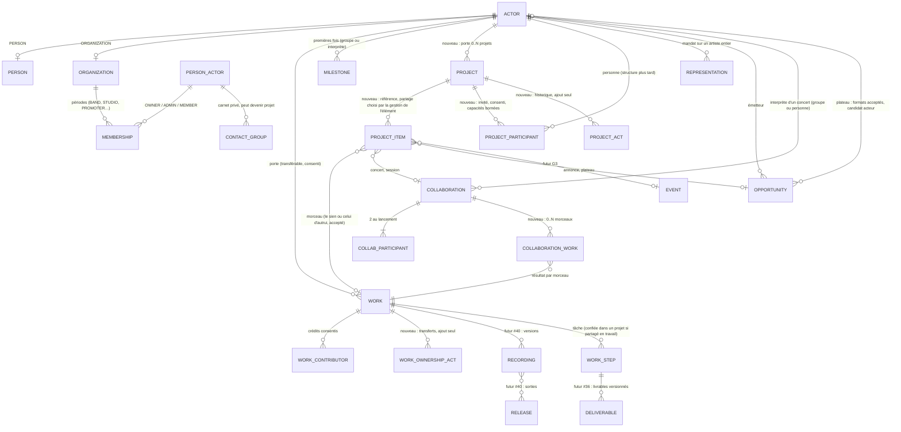
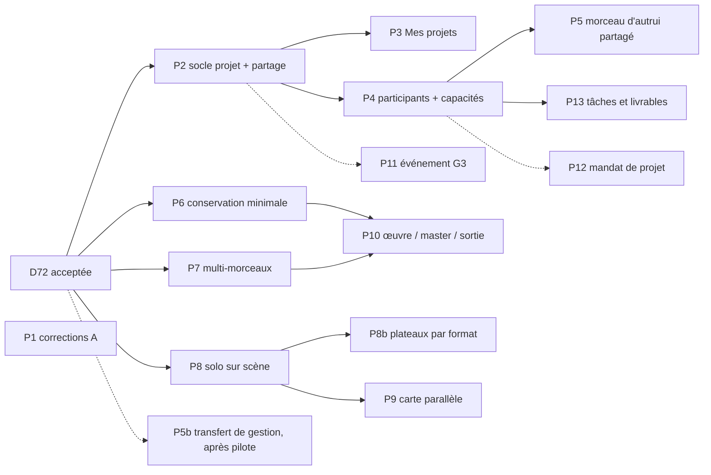

# Architecture métier cible du domaine Collab (G0-02, #83)

> **Statut : architecture cible validée** (18/11/2026). Ce document détaille
> [D72](../decisions/D72-architecture-projets-collab.md), en statut
> **Acceptée — révision 2**, après validation explicite du fondateur.
> Les recommandations du §9 deviennent les arbitrages de référence pour les lots
> prévus, sous réserve de l'avis juridique RGPD avant le lot de conservation.
> **Aucune ligne de code, aucun schéma, aucune migration modifiés.**
>
> **Révision 2 (18/11/2026)**, après la [revue produit de
> #83](https://github.com/Pierre-FABIEN/linkmusician/issues/83) : capacités
> opérationnelles limitées au projet (§9.1), morceau d'autrui partagé sans
> transfert (§9.2), partage explicite au lieu d'une visibilité par défaut
> (§9.3), solo et formats de plateau (§9.4), conservation minimale et
> purgeable (§9.5). Les invariants I2, I5, I6, I7 et I10 changent, I11 et
> I12 sont ajoutés (§5.4) ; les lots sont réordonnés (§10).
>
> **Base** : `main` au commit `9eac062` (18/11/2026), à jour avec
> `origin/main` ; révision 2 sur `a1812b0`. Il prolonge l'[audit structurel G0-01](./audit-structurel-collab.md)
> (#84) et reprend ses étiquettes : **[Fait]** (vérifié dans le code),
> **[Hyp.]** (hypothèse), **[Reco.]** (recommandation), **[Décision]** (choix
> produit à trancher). Les faits de l'audit ne sont pas redémontrés : ils sont
> cités par leur numéro (E1 à E14, scénarios A à H).
>
> **Entrées produit prises en compte** : les cadrages de #71 (« le projet
> est l'axe principal du parcours ») et #72 (branches parallèles, sessions
> multi-morceaux, scène sans studio), conservés dans l'[archive du
> backlog](../plan/archive-issues-avant-refonte-2026-11-18.md), et le besoin
> exprimé pour G0-02 : **un groupe porte plusieurs projets distincts**, et un
> artiste solo, un producteur ou un organisateur porte un projet sans groupe.

---

## 1. La question, et la réponse courte

> Comment Melokiva peut-il représenter durablement les groupes, projets,
> œuvres, événements et collaborations, en conservant les acquis techniques,
> et en permettant aux différents acteurs de la musique de travailler
> ensemble ?

**Réponse proposée** [Reco.] : en séparant nettement **cinq relations**
qui sont aujourd'hui en partie confondues, puis en ajoutant **un seul objet
nouveau**, facultatif, qui ne possède rien, avec deux réglages bornés :
ce qu'une réalisation **partage** au projet, et ce qu'une personne **peut
faire** dans le projet.

| Relation         | Question à laquelle elle répond                      | Objet qui la porte (cible)                             |
| ---------------- | ---------------------------------------------------- | ------------------------------------------------------ |
| **Appartenance** | Qui fait partie de ce collectif, depuis quand ?      | `Membership` (inchangé)                                |
| **Portage**      | Qui administre cet objet dans l'application ?        | `Work.ownerId`, `Project.ownerId` (un `Actor`)         |
| **Crédit**       | Qui a fait quoi sur cette réalisation ?              | `WorkContributor` + `WorkRole` (inchangés)             |
| **Acte prouvé**  | Qu'est-ce qui a eu lieu, confirmé par qui ?          | `Collaboration` (étendue à plusieurs morceaux)         |
| **Regroupement** | À quel objectif cette réalisation contribue-t-elle ? | **`Project` (nouveau)**, qui _référence_ sans posséder |

| Réglage du projet | Question                                               | Qui le décide                       | Où                                       |
| ----------------- | ------------------------------------------------------ | ----------------------------------- | ---------------------------------------- |
| **Partage**       | Que montre ou qu'ouvre cette réalisation à ce projet ? | La gestion **de la réalisation**    | `ProjectItem.share` (§9.3)               |
| **Capacité**      | Que peut faire cette personne dans ce projet ?         | La gestion **du porteur du projet** | `ProjectParticipant.capabilities` (§9.1) |

La capacité dit **qui** agit dans le projet ; le partage dit **sur quoi**.
Aucune des deux ne touche l'appartenance au groupe, le crédit ou la
propriété intellectuelle.

La **propriété intellectuelle** (droits d'auteur, droits voisins, master)
n'est portée par aucune de ces relations. Melokiva ne la gère pas au
lancement : elle se déclare à la SACEM, à la SCPP ou au contrat, hors de
l'application (voir [démarches](./09-demarches.md)). Le portage est une
**permission applicative**, jamais un titre de propriété.

Le reste du document justifie ce choix (§2 à §4), le décrit (§5 et §6),
le confronte aux écarts et aux scénarios de l'audit (§7 et §8), puis
propose les lots (§10).

---

## 2. Concepts fondamentaux

Pour chaque concept : identité, responsabilité, cycle de vie, relations.
« Existant » renvoie à l'audit §2.

### 2.1 Acteur (`Actor`) — existant, conservé

- **Identité** : supertype d'une personne ou d'une organisation. Jamais
  supprimé, anonymisé (`deletedAt`).
- **Responsabilité** : porter des objets (morceaux, projets), recevoir des
  crédits, participer à des actes, progresser.
- **Décision proposée** : l'acteur reste le **seul type de porteur et de
  participant**. Partout où le modèle exige aujourd'hui un groupe alors
  qu'un acteur suffirait (le concert, l'étape « Premier concert »), il
  accepte un acteur (§7, E5).

### 2.2 Groupe (`Organization(BAND)`) — existant, conservé

- **Identité** : collectif musical **durable**, avec un nom public, un
  effectif présent et passé, une gouvernance (OWNER, ADMIN, MEMBER).
- **Responsabilité** : appartenance, gouvernance, continuité, page
  publique, « premières fois » (étapes) du collectif.
- **Ce qu'il n'est pas** [Reco.] : un projet. Le groupe **porte** 0 à N
  projets, en parallèle ou successivement. Faire d'un projet un groupe
  (option écartée C1, §3) mettrait de l'adhésion, de l'XP de formation et
  une page publique là où il n'y a qu'un objectif.
- **Formation `SOLO`** [Fait] : `#lib/bands/lineup.ts` la décrit comme « un
  projet porté par une seule personne sur scène ». C'est la trace du
  détournement relevé par l'audit (E5) : le groupe sert aujourd'hui de
  projet scénique à l'artiste solo. [Reco.] Elle reste valable pour un
  **nom de scène** distinct de la personne (une artiste qui joue sous un
  pseudonyme). Elle cesse d'être **obligatoire** pour jouer.

### 2.3 Projet (`Project`) — **nouveau, facultatif**

- **Identité** : un **objectif situé**, nommé par son porteur : un EP, un
  album, un single, une tournée, un concert, un festival, une production,
  une campagne. Il a un nom, un type, des dates facultatives et un état.
- **Responsabilité** : **regrouper** des réalisations existantes,
  **réunir** des personnes autour d'elles et **organiser** le travail
  qu'elles y font (tâches confiées, coordination, besoins proposés), dans
  les limites de §9.1. Il ne crédite pas, ne prouve pas, ne rapporte pas
  d'XP. Il ne donne sur une réalisation que ce que sa gestion a
  explicitement partagé (§9.3).
- **Cycle de vie** : `ACTIVE` → `DONE` (atteint) ou `ABANDONED` (laissé de
  côté), réouvrable. Il naît d'un geste explicite, jamais automatiquement.
- **Relations** : un porteur `Actor` ; des liens N–N vers `Work`,
  `Collaboration`, `Opportunity` (et plus tard `Event`, `Recording`,
  `Release`) ; des participants ; un historique en ajout seul.
- **Pourquoi persistant** : voir §3.2. L'information « ces quatre morceaux
  forment l'EP, ces six dates forment la tournée » vient de l'utilisateur ;
  aucune projection ne peut la calculer.

### 2.4 Œuvre (`Work`) — existant, conservé et clarifié

- **Identité** : un morceau, de l'idée à la composition (`IDEA` →
  `COMPOSED`), avec ses crédits consentis.
- **Responsabilité aujourd'hui** [Fait] : à la fois œuvre, maquette et
  avancement de production (`recordedAt`, `mixedAt`…, `WorkStep`), E8.
- **Cible** [Reco.] : l'œuvre reste l'**unité de création et de crédit**.
  Elle peut être **partagée dans le projet d'un autre acteur** sans changer
  de porteur (§9.2) ; le transfert de porteur, consenti des deux côtés,
  devient une opération d'exception (E2). Sa suppression devient un
  **archivage minimal et purgeable** quand des crédits confirmés d'autrui
  existent (E6, §9.5). La séparation d'avec l'enregistrement et la sortie est
  décidée ici dans son principe (§2.5) et réalisée dans #40.

### 2.5 Enregistrement et sortie (`Recording`, `Release`) — **futurs, #40**

- **Problème** [Fait] : un morceau n'a qu'une date d'enregistrement, de
  mixage et de mastering (« première fois »), et une seule `WorkStep` par
  type. Une nouvelle version, une prise live ou un remix n'ont pas de place
  (E8, #72 S06 et S07).
- **Principe proposé** [Reco.] :
  - `Recording` (enregistrement, ou master) : une **version enregistrée**
    d'une œuvre, N–1 `Work`. Elle porte ses propres étapes de production,
    ses crédits du son et ses collaborations.
  - `Release` (sortie) : une **publication**, N–N `Recording` (un single,
    un EP). Elle porte la vérification externe (MusicBrainz) aujourd'hui
    rangée dans une étape de groupe.
- **Calendrier** : pas en G0. Les dates actuelles de `Work` deviennent, dans
  #40, la projection « premier enregistrement de cette œuvre ». Aucune
  donnée n'est perdue. Le projet référence `Work` dès son lancement, puis
  `Recording` et `Release` quand ils existeront.

### 2.6 Collaboration (`Collaboration`) — existant, étendu

- **Identité** : un **acte daté et confirmé par chaque participant**. C'est
  la seule preuve de travail commun de la plateforme.
- **Cible** [Reco.] :
  - elle porte **0 à N morceaux** (table de liaison, E3), avec un résultat
    propre à chaque morceau ;
  - l'unicité « une par conversation et par jour » devient « une par
    conversation, par jour **et par morceau** » (E4) ;
  - un concert accepte un **interprète acteur** : un groupe ou une
    personne (E5) ;
  - elle reste **à deux participants** au lancement. Une séance à
    plusieurs intervenants (studio, ingé son et producteur ensemble) se
    représente par plusieurs collaborations, regroupées dans un projet.
    Une collaboration à N participants est un chantier de #36, pas un
    prérequis.
- **Ce qu'elle n'est pas** : un projet, une session de travail planifiée,
  une tâche. Planifier n'est pas prouver (#72, principe 8).

### 2.7 Contribution — concept, pas un objet

- **Définition** [Reco.] : la participation d'un acteur à une réalisation,
  dans un rôle. Elle se lit sur trois objets existants, qui ont chacun leur
  niveau de preuve :
  1. un **crédit** confirmé sur une œuvre (`WorkContributor`), consenti ;
  2. une **participation** à une collaboration terminée
     (`CollaborationParticipant`), prouvée par l'autre partie ;
  3. une **participation à un projet** (`ProjectParticipant`), déclarative,
     qui ne prouve rien.
- **« Mes contributions »** (#71) est une **projection** de ces trois
  sources, sans table, sans double compte : une réalisation apparaît une
  fois, avec sa meilleure preuve.

### 2.8 Opportunité (`Opportunity`) — existant, conservé

- **Identité** : un **besoin ou une proposition** publiée (recrutement,
  session, jam, plateau).
- **Cible** : une annonce peut être **rangée dans un projet** (« cherche
  bassiste pour la tournée »), sans changer son émetteur ni ses
  candidatures. Un·e coordinateur·rice peut **proposer** un besoin ; seule
  la gestion du porteur publie au nom du porteur (§9.1). Un plateau
  (`GIG_SLOT`) indique les **formats acceptés** (solo, duo, trio, groupe),
  choisis par l'organisateur (§9.4).

### 2.9 Événement (`Event`) — **futur, G3 (#77)**

- **Identité** : un **fait public daté** de l'agenda culturel (concert,
  festival et ses éditions, scène ouverte), avec un lieu et un
  organisateur.
- **Distinction clé** [Reco.] :
  - l'**événement** est ce que le public voit dans l'agenda ;
  - le **projet** « Festival 2027 » est le travail interne de
    l'organisateur pour le produire (équipe, techniciens, partenaires,
    plateaux) ;
  - la **collaboration** `GIG` est la preuve qu'un artiste y a joué.
- Le projet référencera l'événement quand G3 l'aura créé. G0 ne le
  modélise pas.

### 2.10 Étape (`Milestone`) — existant, conservé

- **Identité** : une **« première fois »** vérifiable, unique par porteur et
  par étape (`@@unique([bandId, definitionId])`).
- **Cible** [Reco.] :
  - les étapes restent des premières fois. Un deuxième EP ou une deuxième
    tournée ne sont **pas** de nouvelles étapes : ce sont des **projets
    terminés** (E9 résolu par C, sans toucher aux étapes) ;
  - [Fait] la colonne `Milestone.bandId` référence déjà un `Actor`, pas une
    `Organization`. Les étapes de scène peuvent donc être portées par une
    **personne** interprète sans changer de table, si Q-G0-3 l'accepte. Les
    règles (`declareBlocker`, `formsBand`) sont à adapter, pas le schéma de
    cette relation.

### 2.11 Espaces à plusieurs (`ContactGroup`, `GroupDiscussion`) — existants

- `ContactGroup` reste un **carnet privé** (D45). Le commentaire « un projet
  potentiel » du schéma prend un sens concret : un groupe de contacts peut
  **devenir** un projet (« Transformer en projet »), qui invite ses
  membres. Les deux objets restent distincts.
- `GroupDiscussion` pourra être la **discussion d'un projet** (lien
  facultatif), en réutilisant ses invitations et ses règles pour les
  mineur·es (D46). Lot ultérieur.

### 2.12 Tâche et livrable — existant (`WorkStep`) puis étendu, #36

- **Tâche** [Fait] : `WorkStep` est déjà une tâche planifiée de production
  sur un morceau (une par type, un·e responsable `assigneeId`, des actes en
  ajout seul). Seule la gestion du morceau la fait avancer aujourd'hui
  (`applyWorkStep` → `loadManagedWork`), et une tâche planifiée reste
  distincte de l'étape réalisée et prouvée (Q74 de `a-trancher.md`).
- **Cible** [Reco.] : au MVP, une **tâche de projet** est une `WorkStep`
  d'un morceau partagé « en travail » dans le projet (§9.3). Un·e
  coordinateur·rice la crée et la confie ; la personne à qui elle est
  confiée l'accepte, puis la fait avancer **elle-même**. C'est un
  changement de règle de `applyWorkStep`, limité à sa propre tâche.
- **Livrable** [Reco.] : un fichier ou un lien déposé sur une tâche
  (prise, mix, master, fiche technique), **versionné en ajout seul** ; une
  nouvelle version annule la validation précédente. Le valider revient à
  la gestion de la réalisation au MVP. Valider un livrable ne crédite pas,
  ne prouve pas et ne rapporte pas d'XP : la preuve reste la
  collaboration terminée (#72, principe 8). Le modèle détaillé (versions,
  approbations, révision) appartient à #36.
- **Plus tard** : une tâche libre de projet (« réserver le studio »), sans
  morceau, si le pilote en montre le besoin (§9.1, extension).

---

## 3. Options étudiées pour le projet

### 3.1 Les trois options demandées

**A — Modèle existant, corrections ciblées.** On corrige E4, E10 et E11.
Le « projet » reste l'œuvre (« campagne ») ou le groupe. Aucun
regroupement.

**B — Relations enrichies et projection.** On lève les contraintes
artificielles (E2 à E7) et on construit « Mes projets » comme une **vue
calculée** : par porteur (moi, chacun de mes groupes), les morceaux par
état, les concerts à venir, les annonces en cours. Aucune table de projet.

**C — Projet autonome léger.** Un objet `Project` facultatif, porté par un
acteur, qui **référence** des réalisations existantes et réunit des
participants, sans rien posséder.

### 3.2 Pourquoi B seule ne suffit pas

L'audit recommandait B d'abord, et C « seulement si » des utilisateurs
demandent à regrouper (Q-G0-1). Cette condition est **remplie** par
l'énoncé du besoin (#71, #72, mission G0-02). L'argument décisif n'est pas
la richesse fonctionnelle, mais l'**origine de l'information** :

1. Un groupe a sept morceaux : quatre pour l'EP, trois pour l'album en
   composition. Rien dans les données ne permet de **calculer** cette
   répartition. C'est une **intention de l'utilisateur**. Il faut la
   stocker.
2. Une projection « par porteur » regroupe tous les morceaux du groupe
   ensemble. Elle ne distingue pas deux EP, ni une tournée d'une autre
   (scénario A), ni ne donne de dates ou d'intervenants propres à chacune.
3. Toute solution qui stocke ce regroupement est un objet persistant, quel
   que soit son nom. Une étiquette libre sur `Work` (option C2, §3.3) est
   persistante elle aussi, mais plus pauvre : elle ne range ni un concert ni
   une annonce, et n'a ni dates ni équipe.

La projection B6 garde toutefois **son rôle** : elle montre ce qui n'est
rangé dans aucun projet (« Hors projet »), pour que l'utilisateur sans
projet ne voie jamais un écran vide, et pour que rien ne disparaisse.

### 3.3 Pourquoi C seule ne suffit pas

Un projet ne corrige aucune contrainte artificielle relevée par l'audit :

- il ne permet pas à une artiste solo de jouer sans groupe fantôme (E5) ;
- il ne rend pas un morceau transférable au groupe (E2) ;
- il ne protège pas les crédits d'autrui à la suppression (E6, E7) ;
- il ne permet pas une session sur deux morceaux le même jour (E3, E4).

Ranger un mauvais modèle dans une boîte ne le corrige pas. Les corrections
de B sont nécessaires **avec ou sans** projet.

### 3.4 Variantes de C examinées et écartées

| Variante                                                              | Pourquoi elle est écartée                                                                                                                                                                                 |
| --------------------------------------------------------------------- | --------------------------------------------------------------------------------------------------------------------------------------------------------------------------------------------------------- |
| **C1** Projet = une organisation (nouveau `OrgKind`, ou un `BAND`)    | Hérite de l'adhésion, de la gouvernance, de l'XP de formation et de la page publique. Un projet n'a ni effectif public, ni « premières fois ». Pollue l'annuaire, comme les groupes « Solo » aujourd'hui. |
| **C2** Étiquette ou collection sur `Work`                             | Ne range que des morceaux : ni concert, ni annonce, ni équipe, ni dates. Un morceau dans un single et dans l'album demande deux étiquettes, sans structure.                                               |
| **C3** Projet **propriétaire** de ses réalisations (`Work.projectId`) | Double le portage : qui gère le morceau, le groupe ou le projet ? Clore un projet orphelinerait ses morceaux. Migration de tout l'existant. Contraire à « un morceau se crée seul ».                      |
| **C4** Projet hiérarchique (sous-projets, tâches imbriquées)          | #83 scénario 8 : le clip et la campagne sont des activités d'une sortie **ou** des projets autonomes. Une hiérarchie imposerait l'un des deux. Un même morceau dans deux projets suffit, sans arbre.      |
| **C5** Projet à **plusieurs porteurs** (co-portage d'organisations)   | Deux sources de gestion, conflits d'arbitrage, transmission ambiguë. Les autres structures **participent** sans gérer (Q-G0-2). À rouvrir si un vrai cas de coproduction apparaît.                        |

### 3.5 Option retenue : B corrigée + C léger, découplées

[Reco.] **Option « B + C »** : les corrections de B **et** un projet léger
(C, sans les variantes C1 à C5). Contrairement à ce que proposait l'audit,
**B n'est pas un prérequis de C** : les deux chantiers sont indépendants.
Le projet peut être livré avant ou après le transfert de morceau ou le
solo sur scène. Seule contrainte d'ordre : la projection « Hors projet »
(B6) et le projet partagent la même page « Mes projets » (§10, lot P3).

---

## 4. Comparaison argumentée

| Critère                                     | A                           | B                                        | C seule                                 | **B + C (recommandée)**                                    |
| ------------------------------------------- | --------------------------- | ---------------------------------------- | --------------------------------------- | ---------------------------------------------------------- |
| Plusieurs projets par groupe (A, #83 §1)    | Non                         | Non (vue par porteur)                    | Oui                                     | Oui                                                        |
| Artiste solo sans groupe fantôme (B, H)     | Non                         | Oui                                      | Non                                     | Oui                                                        |
| Œuvre antérieure au groupe (G)              | Non                         | Oui (transfert)                          | Partiel (rangée, pas transférée)        | Oui                                                        |
| Prestataire sur plusieurs titres (C)        | Non                         | Oui                                      | Partiel                                 | Oui                                                        |
| Sortie multi-structures (D)                 | Non                         | Non                                      | Partiel                                 | Partiel (complète avec #40 et #47)                         |
| Festival (E)                                | Non                         | Non                                      | Partiel                                 | Partiel (complète avec G3)                                 |
| Preuves préservées (E6, E7)                 | Non                         | Oui                                      | Non                                     | Oui                                                        |
| Nouvelles tables                            | 0                           | 1 à 2 (liaison, actes de transfert)      | 4                                       | 5 à 6                                                      |
| Risque d'élévation de droits                | Nul                         | Faible                                   | Moyen                                   | Moyen, maîtrisé par I2, I11 et I12 (§5.4, §9.1)            |
| Risque de migration                         | Nul                         | Faible, une recopie (`workId` → liaison) | Nul (tables neuves, rien de rétro-créé) | Faible                                                     |
| Charge UX pour un débutant                  | Inchangée                   | Inchangée                                | Risque de tunnel                        | Inchangée si le projet reste facultatif (I4)               |
| Évolutivité (label, éditeur, international) | Faible                      | Moyenne                                  | Bonne                                   | Bonne : un point d'accroche pour sortie, événement, mandat |
| Maintenabilité                              | Dette croissante (doublons) | Bonne                                    | Moyenne                                 | Bonne si le projet ne possède rien                         |

**Lecture** : A laisse les défauts vérifiés. B les corrige mais ne répond
pas au besoin produit central. C répond au besoin mais conserve les
défauts. B + C coûte plus de tables, mais chaque table a une seule
responsabilité. Le projet introduit un **jeu de capacités borné** (§9.1) :
fermé, limité au projet, jamais supérieur aux droits de qui l'accorde, et
sans effet sur un groupe, une œuvre ou un crédit. C'est le prix d'une
collaboration opérationnelle ; la révision 1 n'en avait aucun, et un
producteur ne pouvait travailler qu'en devenant ADMIN du groupe.

---

## 5. Modèle conceptuel recommandé

### 5.1 Diagramme

Les entités marquées « nouveau » sont proposées ; « futur » renvoie à un
autre chantier. Les noms sont conceptuels : le lot qui les crée les fixe.

### 5.2 Entités : conservées, modifiées, nouvelles

| Entité                                                     | Sort       | Changement proposé                                                                                                                                             | Lot          |
| ---------------------------------------------------------- | ---------- | -------------------------------------------------------------------------------------------------------------------------------------------------------------- | ------------ |
| `Actor`, `Person`, `Organization`, `Membership`            | Conservées | Aucun                                                                                                                                                          | —            |
| `MembershipDecision`, `Representation`, `ApplicationGrant` | Conservées | Aucun au lancement ; mandat limité à un projet plus tard (Q-G0-8)                                                                                              | —            |
| `Work`                                                     | Modifiée   | Archivage minimal (titre masquable, maquette retirée, purge quand plus aucun crédit vivant n'en dépend) ; porteur transférable par exception                   | P6, P5b      |
| `WorkContributor`, `WorkRole`, `WorkCreditAct`             | Conservées | Survivent à l'archivage du morceau, tant que la personne créditée les garde                                                                                    | P6           |
| `WorkStep`                                                 | Modifiée   | Libérée au départ du responsable (E10) ; confiable dans un projet et avancée par son assigné·e ; livrables (#36) ; passera sur `Recording` dans #40            | P1, P13, #40 |
| `Collaboration`                                            | Modifiée   | Liaison N–N avec les morceaux ; unicité par jour et par morceau ; interprète acteur pour un concert                                                            | P7, P8       |
| `Milestone`                                                | Conservée  | Étapes de scène ouvertes à une personne interprète (règles, pas schéma)                                                                                        | P8           |
| `Opportunity`                                              | Modifiée   | Rangeable dans un projet ; plateau : formats acceptés choisis par l'organisateur, candidature d'un acteur                                                      | P2, P8b      |
| `ContactGroup`, `GroupDiscussion`                          | Conservées | « Transformer en projet » ; discussion de projet facultative                                                                                                   | P4           |
| **`Project`**                                              | Nouvelle   | Porteur, nom, type, dates, état                                                                                                                                | P2           |
| **`ProjectItem`**                                          | Nouvelle   | Lien vers une réalisation, son auteur, sa date, son **niveau de partage** (rien, résumé, travail) et, pour la réalisation d'autrui, l'accord des deux gestions | P2, P5       |
| **`ProjectParticipant`**                                   | Nouvelle   | Personne invitée, rôle libre, **capacités** (ensemble fermé), consentement, périodes                                                                           | P4           |
| **`ProjectAct`**                                           | Nouvelle   | Historique en ajout seul (liens, partages, invitations, capacités, états)                                                                                      | P2           |
| **`CollaborationWork`**                                    | Nouvelle   | Liaison collaboration ↔ morceau, avec le résultat propre à chaque morceau                                                                                      | P7           |
| **`WorkOwnershipAct`**                                     | Nouvelle   | Demande, acceptation et refus d'un transfert de porteur (exception)                                                                                            | P5b          |
| Livrable de tâche                                          | Future     | Versions en ajout seul, validation par la gestion de la réalisation (#36)                                                                                      | P13          |
| `Recording`, `Release`, `Event`                            | Futures    | Hors G0 : #40 et G3                                                                                                                                            | #40, #77     |

### 5.3 Cardinalités

| Relation                             | Cardinalité | Contrainte                                                                                                                                            |
| ------------------------------------ | ----------- | ----------------------------------------------------------------------------------------------------------------------------------------------------- |
| Acteur → Projet (porteur)            | 1 – 0..N    | Exactement un porteur à chaque instant                                                                                                                |
| Projet ↔ Morceau                     | N – N       | Un morceau dans 0..N projets (le single **et** l'album) ; un lien unique par paire ; le morceau d'un autre acteur exige l'accord de sa gestion (§9.2) |
| Participant → Capacités              | 1 – 0..N    | Ensemble fermé ; vide = participation simple (§9.1)                                                                                                   |
| Projet ↔ Collaboration               | N – N       | Un concert dans la tournée **et** dans le festival de l'organisateur, chacun dans son projet                                                          |
| Projet ↔ Annonce                     | N – N       | Idem                                                                                                                                                  |
| Projet → Participant                 | 1 – 0..N    | Une ligne ouverte au plus par personne et par projet (même règle que `memberships_open_key`)                                                          |
| Projet → Projet                      | **aucune**  | Pas de sous-projet (C4 écartée)                                                                                                                       |
| Collaboration ↔ Morceau              | N – N       | 0..N morceaux par collaboration ; unicité par conversation, jour et morceau                                                                           |
| Collaboration → Interprète (concert) | N – 1       | Un groupe ou une personne ; l'hôte reste un `VENUE` ou un `PROMOTER`                                                                                  |
| Morceau → Porteur                    | N – 1       | Un seul porteur ; jamais de co-portage ; transfert par exception, consenti des deux côtés (Q-G0-4)                                                    |
| Groupe → Projets                     | 1 – 0..N    | Plusieurs projets actifs en parallèle, sans limite fonctionnelle (quota anti-abus seulement)                                                          |

### 5.4 Invariants métier (proposés)

Ils s'ajoutent aux invariants de `CLAUDE.md`, qui restent tous valables.

- **I1 — Le projet ne possède rien.** Clore, abandonner ou supprimer un
  projet ne modifie, ne supprime et ne transfère aucune réalisation
  référencée. Retirer un lien ne touche pas l'objet lié.
- **I2 — La participation seule ne donne aucun droit sur les
  réalisations.** _(révisé)_ Être participant d'un projet, même
  coordinateur·rice, n'ouvre ni la gestion d'un morceau, ni son équipe
  (`isTeam`), ni un crédit, ni l'adhésion au groupe porteur. Ce qu'un
  participant voit ou fait **sur une réalisation** vient uniquement du
  **partage** décidé par la gestion de cette réalisation (§9.3), limité au
  projet et révocable.
- **I3 — Le projet ne prouve rien.** Aucun geste sur un projet (créer,
  ranger, inviter, terminer) n'émet d'événement d'XP, n'écrit d'étape, ne
  corrobore ni ne vérifie quoi que ce soit. L'avancement d'un projet est
  **calculé** à la lecture à partir des réalisations liées et de leurs
  preuves, jamais stocké.
- **I4 — Le projet est facultatif.** Créer un morceau, proposer une
  collaboration, rejoindre une jam, candidater, déclarer une étape :
  tout reste possible sans projet. Aucun formulaire ne l'exige.
- **I5 — Une réalisation n'entre dans un projet qu'avec l'accord de sa
  gestion.** _(révisé)_ Lier une réalisation exige d'**être partie** à
  celle-ci (gérer son porteur, ou être participant d'une collaboration).
  La réalisation d'un autre acteur n'entre que **sur l'initiative de sa
  propre gestion**, acceptée par la gestion ou un·e coordinateur·rice du
  projet (§9.2). Personne ne range le morceau d'autrui de son propre chef.
- **I6 — Un lien ne révèle rien ; seul un partage révèle, et seulement ce
  qu'il dit.** _(révisé)_ La fiche du projet filtre chaque réalisation par
  **son** prédicat de lecture existant (`isTeam`, visibilité publique,
  blocages, mineur·es), puis ajoute ce que son niveau de partage autorise
  (§9.3). Compteurs, avancement, journal et notifications sont calculés
  sur ce que le lecteur peut voir : aucun « élément masqué ».
- **I7 — Un seul porteur ; des capacités explicites.** _(révisé)_ La
  gestion d'un projet est celle de son porteur, **relue à chaque
  écriture** : la personne elle-même, ou OWNER/ADMIN de l'organisation
  vivante. Elle n'est jamais stockée. Les seuls droits stockés sont les
  **capacités** d'un·e participant·e (§9.1), proposées et consenties,
  révocables, et relues elles aussi à chaque écriture.
- **I8 — Historique en ajout seul.** Création, liens, partages,
  invitations, capacités, départs, changements d'état et transferts sont
  des actes `ProjectAct`, jamais modifiés ni supprimés, sauf
  l'anonymisation RGPD de leur auteur.
- **I9 — Crédit ≠ portage ≠ propriété.** Partager, rattacher ou transférer
  un morceau ou un projet ne change aucun crédit ni aucune part de
  composition, et ne cède aucun droit d'auteur. Les crédits ne se retirent
  que par la personne créditée (D40).
- **I10 — Une preuve d'autrui survit à son porteur, sous forme minimale.**
  _(révisé)_ Un morceau qui porte un crédit confirmé d'autrui est archivé au
  lieu d'être supprimé. Il ne garde que ce qui donne sens à ce crédit
  (rôle, date, titre sauf masquage) ; jamais les médias ni les données
  personnelles du porteur. Il est purgé quand plus aucun crédit vivant n'en
  dépend (§9.5).
- **I11 — Non-élévation.** _(nouveau)_ Une capacité de projet ne donne
  jamais plus que ce que détient la personne qui l'accorde, n'ouvre jamais
  la gouvernance d'un groupe, un mandat, un crédit ou la gestion d'une
  réalisation, et n'agit sur une réalisation que dans la limite de son
  partage. Seule la gestion du porteur accorde une capacité ; une capacité
  n'en accorde aucune.
- **I12 — La révocation l'emporte.** _(nouveau)_ Retirer une capacité, un
  partage, une participation ou la gestion prend effet à la **prochaine
  écriture**, relue sous verrou `project:`. Une action préparée sous un
  droit retiré et pas encore aboutie (proposition en attente, tâche
  confiée pas encore acceptée) est refusée à sa confirmation, sans effet
  partiel. Ce que la gestion d'un élément décide sous **son** propre droit
  (valider un livrable déjà déposé) reste possible.

---

## 6. Responsabilités et autorisations

### 6.1 Six notions à ne pas confondre

| Notion                            | Ce que c'est                                                      | Où elle vit                                                      | Ce qu'elle n'implique **pas**                       |
| --------------------------------- | ----------------------------------------------------------------- | ---------------------------------------------------------------- | --------------------------------------------------- |
| **Propriété intellectuelle**      | Droits d'auteur, droits voisins, propriété du master              | Hors application (SACEM, SCPP, contrats) ; jamais déduite        | Aucune permission applicative                       |
| **Crédit artistique**             | « J'ai composé, joué, mixé ce morceau », consenti par la personne | `WorkContributor`, `WorkRole`, collaboration terminée            | Ni gestion, ni adhésion, ni propriété               |
| **Responsabilité opérationnelle** | « Je m'occupe de l'enregistrement », « je coordonne la tournée »  | `WorkStep.assigneeId`, rôle libre de `ProjectParticipant`        | Ni crédit, ni preuve, ni gestion au-delà de l'étape |
| **Permission applicative**        | Ce que le serveur autorise : modifier, inviter, ranger, confirmer | Prédicats existants (`loadManagedWork`, `structureAccess`, etc.) | Aucun titre juridique                               |
| **Capacité de projet**            | « Je coordonne les enregistrements de cet EP »                    | `ProjectParticipant.capabilities` (§9.1)                         | Ni gestion du groupe, ni d'une œuvre, ni crédit     |
| **Partage d'une réalisation**     | « Ce morceau est montré, ou ouvert au travail, dans ce projet »   | `ProjectItem.share`, décidé par la gestion de la réalisation     | Ni transfert, ni accès à la page du morceau         |

### 6.2 Matrice des droits du projet

« Gestion » = la personne porteuse, ou une adhésion ACTIVE OWNER/ADMIN de
l'organisation porteuse vivante, relue en transaction sous verrou.
« Coord. » = participant·e actif·ve avec la capacité `COORDINATE` (§9.1).
« Gestion élt » = gestion de la réalisation concernée (son propre porteur).
✔ permis, ✗ refusé, — sans objet. Le MVP ne prévoit aucune autre case.

| Action                                          | Gestion       | Coord.                                | Participant·e   | Gestion élt      | Vérification                                                           | Acte                         |
| ----------------------------------------------- | ------------- | ------------------------------------- | --------------- | ---------------- | ---------------------------------------------------------------------- | ---------------------------- |
| Créer un projet                                 | ✔             | —                                     | —               | —                | `manageableOwnerWhere` (comme `createWork`)                            | `CREATED`                    |
| Renommer, changer l'état, supprimer, transférer | ✔             | ✗                                     | ✗               | —                | Porteur relu sous `project:` puis `band:`/`org:`                       | `UPDATED`, `STATUS_CHANGED`… |
| Modifier dates et description                   | ✔             | ✔                                     | ✗               | —                | Capacité relue sous `project:`                                         | `UPDATED`                    |
| Ranger sa propre réalisation                    | ✔             | ✔                                     | ✗ (la proposer) | —                | I5 : `loadManagedWork`, participant de la collaboration, émetteur      | `ITEM_ADDED`                 |
| Partager la réalisation d'autrui                | Accepte       | Accepte                               | ✗               | **Initie**       | I5, §9.2 : demande de la gestion élt, acceptée côté projet             | `ITEM_OFFERED`, `ITEM_ADDED` |
| Choisir ou abaisser le niveau de partage        | ✗ ¹           | ✗                                     | ✗               | ✔                | Gestion élt relue sous `project:` → `work:`                            | `SHARE_CHANGED`              |
| Retirer un élément                              | ✔             | Ceux qu'il a rangés                   | ✗               | ✔ (toujours)     | —                                                                      | `ITEM_REMOVED`               |
| Créer et confier une tâche sur un élément       | ✔ ²           | ✔ ²                                   | ✗               | ✔                | Partage `WORK` ; personne participante ; acceptation de l'assigné·e    | `TASK_ASSIGNED`              |
| Faire avancer sa tâche, déposer un livrable     | Si assigné·e  | Si assigné·e                          | Si assigné·e    | Si assigné·e     | Relecture : assignation, participation, partage `WORK`                 | `WorkStepAct`                |
| Valider un livrable                             | ✗ ¹           | ✗ (extension)                         | ✗               | ✔                | Gestion élt ; la personne qui dépose ne valide pas le sien             | `WorkStepAct`                |
| Proposer un besoin ou un intervenant            | ✔             | ✔                                     | ✗               | —                | Quota ; validé par la gestion (besoin) ou gestion/coord. (intervenant) | `PROPOSED`                   |
| Publier une annonce au nom du porteur           | ✔             | ✗ (en son nom propre, puis la ranger) | ✗               | —                | Émetteur = porteur                                                     | `ITEM_ADDED`                 |
| Inviter un·e participant·e simple               | ✔             | ✔                                     | ✗               | —                | D37 (personne connue), D46 (mineur·es), blocages, quota                | `INVITED`                    |
| Accorder ou retirer une capacité                | ✔             | ✗                                     | ✗               | —                | I11 ; acceptation pour un ajout, aucune pour un retrait                | `CAPABILITY_*`               |
| Retirer un·e participant·e                      | ✔             | ✗                                     | ✗               | —                | Effets de §9.1 (révocation)                                            | `REMOVED`                    |
| Accepter, refuser, quitter                      | Pour soi      | Pour soi                              | Pour soi        | —                | La personne elle-même                                                  | `JOINED`, `DECLINED`, `LEFT` |
| Lire la fiche et les résumés partagés           | ✔             | ✔                                     | ✔               | ✔ (ses éléments) | `projectAccess`, sans héritage ; 404 uniforme hors projet              | —                            |
| Lire un élément                                 | Selon partage | Selon partage                         | Selon partage   | ✔                | Son propre prédicat (`isTeam`, visibilité, blocage), puis `share` (I6) | —                            |

¹ Quand la gestion du projet est aussi la gestion de l'élément (le
groupe range son propre morceau), elle agit à ce second titre.
² Seulement sur un élément partagé `WORK`.

### 6.3 Délégation et révocation

- **Capacités de projet au lancement** [Reco., révisé] : deux préréglages,
  « participant·e » et « coordinateur·rice », stockés comme un ensemble de
  capacités extensible (§9.1). Un producteur coordonne l'EP **sans**
  devenir ADMIN du groupe. Le rôle libre (« responsable de la tournée »)
  reste un libellé, sans permission.
- **Révocation immédiate** (I12) : perdre la gestion du porteur retire
  aussitôt la gestion du projet ; retirer une capacité, un partage ou une
  participation prend effet à la prochaine écriture. Le détail des effets
  (propositions annulées, tâches libérées) est en §9.1.
- **Membre du groupe porteur** : une capacité accordée à une personne
  **parce qu'elle est membre** tombe à son départ du groupe (acte
  automatique). Une personne extérieure garde la sienne jusqu'à retrait.
- **Plus tard** : un mandat (`Representation`) pourra être limité à un
  projet (Q-G0-8). Il sert la **représentation extérieure** d'un artiste
  (booking, candidatures), pas l'organisation interne : les deux notions
  restent séparées.

### 6.4 Plusieurs structures sur un projet

- Un projet a **un seul porteur** (C5 écartée). Les autres structures
  (studio, label, salle, partenaire) **participent**.
- Au lancement, seules des **personnes** participent. Une structure
  participante (une organisation `ProjectParticipant`) acceptée par sa
  gestion est prévue dans le modèle, et livrée plus tard (scénarios D et
  E) : la structure participante voit la fiche, et pourra recevoir des
  capacités comme une personne (extension de §9.1), sans jamais gérer le
  projet.
- Chaque structure garde ses propres objets : le studio ses sessions, le
  label ses sorties (#47), l'organisateur ses plateaux. Le projet les
  référence chacun dans le respect de I5.

### 6.5 Départ d'un responsable, dissolution

| Situation                                           | Conséquence proposée                                                                                                                                                                                                              |
| --------------------------------------------------- | --------------------------------------------------------------------------------------------------------------------------------------------------------------------------------------------------------------------------------- |
| L'OWNER d'un groupe porteur transmet puis part      | Le projet reste au groupe ; la gestion suit la gouvernance du groupe (existant, testé).                                                                                                                                           |
| Un ADMIN qui coordonnait le projet quitte le groupe | Il perd la gestion à l'instant (relue) et les capacités reçues comme membre ; s'il était participant, il le reste jusqu'à ce qu'il parte ou soit retiré ; ses étapes `WorkStep` sont libérées (P1).                               |
| Le producteur coordinateur est retiré du projet     | Ses capacités tombent ; ses propositions en attente sont annulées ; les tâches qui lui sont confiées sont libérées ; ses livrables déposés restent à la gestion de l'élément, qui peut encore les valider.                        |
| Le groupe porteur est dissous                       | Le projet passe en lecture seule, état figé. Ses réalisations suivent leurs propres règles (archivage, I10). **P4a** : ses participant·es actif·ves le lisent encore, sans rien y changer ; chaque morceau retire son lien (Q77). |
| La personne porteuse supprime son compte            | Ses projets personnels sont supprimés (conteneurs) ; les réalisations liées suivent leurs règles (I10) ; les participations sont effacées avec eux.                                                                               |
| Un·e participant·e supprime son compte              | Sa participation est anonymisée (« Compte supprimé »), comme les autres actes.                                                                                                                                                    |
| Le projet personnel doit continuer au nom du groupe | Transfert du projet vers le groupe, accepté par sa gestion. Les morceaux restent à leur porteur tant qu'ils ne sont pas transférés à leur tour (I9).                                                                              |

### 6.6 Crédits confirmés et données privées

- **Crédits** : aucune opération de projet ne crée, ne modifie ni ne retire
  de crédit (I9). La suppression d'un morceau avec des crédits d'autrui
  devient un archivage minimal (P6, I10, §9.5).
- **Vie privée** : un projet est **privé** au lancement (gestion et
  participant·es). Pas de page publique de projet : la face publique d'une
  tournée ou d'un festival sera l'**événement** de G3. Ce que voit chaque
  participant·e d'une réalisation dépend de son partage (§9.3).
- **Invitation** : avant d'accepter, la personne invitée voit le nom et le
  type du projet, son porteur, qui l'invite et les capacités proposées ;
  rien des réalisations ni des autres participant·es (§9.3).
- **Mineur·es** : les règles de D37 (invitation par une personne connue
  seulement) et de D46 s'appliquent aux projets. Par défaut, une ou un
  mineur·e n'est invité·e qu'à un projet d'un groupe dont elle ou il est
  membre (Q-G0-12).
- **RGPD** : projets portés, participations et actes entrent dans l'export
  et l'anonymisation dès le lot qui les crée (invariant de `CLAUDE.md`).

### 6.7 Concurrence et verrous

Ordre proposé, qui prolonge ARCH-MET-02a : **`project:` → `collaboration:`
→ `work:` → `band:`/`org:` → acteurs (moteur)**. [P2] Un verrou
`project-owner:` (quota de projets du porteur, création et réouverture)
précède `project:` ; `studio:` se range avec `band:` et `org:`, et ces
verrous de porteurs sont pris triés quand un rangement en demande deux. La finalisation d'une
collaboration ne prend **jamais** `project:`, puisque I3 interdit à un
projet de réagir à une preuve. Ranger un morceau prend `project:` puis
`work:` puis `band:`, ce qui respecte l'ordre existant. Tests à barrières
obligatoires dans le lot P2 (rangement concurrent, retrait de gestion
pendant le rangement).

Toute écriture qui s'appuie sur une capacité ou un partage prend
`project:` **d'abord** et relit participation, capacité et partage sous ce
verrou ; retirer une capacité ou abaisser un partage prend le même verrou.
Les deux sont donc sérialisés (I12). Faire avancer sa tâche prend
`project:` → `work:` ; valider un livrable aussi. Tests à barrières dans
P4 et P13 (retrait de capacité pendant une écriture, partage abaissé
pendant un dépôt de livrable).

---

## 7. Écarts E1 à E14 : résolution et ticket porteur

« Décidé ici » signifie que G0-02 fixe le **principe** ; l'implémentation
reste dans le ticket indiqué.

| #   | Écart (audit §6)                                      | Résolution proposée                                                                                                                                | Principe     | Réalisation        |
| --- | ----------------------------------------------------- | -------------------------------------------------------------------------------------------------------------------------------------------------- | ------------ | ------------------ |
| E1  | Aucun regroupement en initiative                      | `Project` léger qui référence (§5)                                                                                                                 | Décidé ici   | #71 (P2 à P4)      |
| E2  | Porteur immuable                                      | D'abord **partage dans le projet du groupe** sans transfert (§9.2) ; transfert de gestion consenti des deux côtés en exception ; pas de co-portage | Décidé ici   | #71, #40 (P5, P5b) |
| E3  | Collaboration à deux et à un morceau                  | N morceaux par liaison ; deux participants au lancement ; séance à N intervenants = N collaborations dans un projet                                | Décidé ici   | #36 (P7)           |
| E4  | Une collaboration par conversation et par jour        | Unicité par conversation, jour et morceau                                                                                                          | Décidé ici   | #36 (P7)           |
| E5  | Scène et étapes réservées à un groupe formé           | Interprète acteur sur un concert ; étapes de scène d'une personne ; plateaux par formats acceptés (§9.4) ; groupe `SOLO` réservé au nom de scène   | Décidé ici   | #36 (P8, P8b), #72 |
| E6  | Suppression : crédits d'autrui effacés                | Archivage minimal tant qu'un crédit confirmé d'autrui en dépend ; maquette retirée ; titre masquable ; purge ensuite (§9.5)                        | Décidé ici   | #40 (P6)           |
| E7  | Groupe dissous : crédits publics des externes retirés | Morceaux d'un porteur dissous affichés « groupe dissous » dans les crédits des contributeur·rices                                                  | Décidé ici   | #40 (P6)           |
| E8  | Œuvre, enregistrement et sortie confondus             | Principe `Work` → `Recording` → `Release` (§2.5) ; aucune perte de données                                                                         | Principe ici | #40 (P10)          |
| E9  | Étapes uniques (pas de 2ᵉ EP)                         | Par conception : les répétitions sont des projets terminés, pas des étapes                                                                         | Décidé ici   | Aucun code         |
| E10 | Étape d'un membre parti non libérée                   | Libération automatique au départ, avec acte                                                                                                        | Correction   | #36 (P1)           |
| E11 | Concert engagé par un simple membre                   | Permis (fait confirmé par un tiers), à consigner en décision                                                                                       | Q-G0-7       | #36 (P1)           |
| E12 | Mandat sans portée de projet                          | Non au lancement ; périmètre « projet » d'un mandat plus tard                                                                                      | Q-G0-8       | #44, #45 (P12)     |
| E13 | Plateau et concert non reliés                         | Relation plateau ↔ concerts dans le modèle d'événement                                                                                             | Reporté      | #77 (P11)          |
| E14 | Pas d'organisation label ni éditeur                   | Hors G0 ; le projet les accueillera comme participants                                                                                             | Reporté      | #47, #48           |

---

## 8. Les huit scénarios rejoués

Pour chaque scénario : sa représentation dans le modèle recommandé
(B + C), les droits, ce qui reste limité, et la comparaison avec A, B et C
seules.

### A. Groupe de cinq, un EP et une tournée en parallèle

- **Représentation** : deux `Project` portés par le groupe : « EP Lumière »
  (type EP) et « Tournée de printemps » (type tournée, dates). L'EP
  référence quatre `Work` ; la tournée, six `Collaboration(GIG)` et
  l'annonce « cherche ingé son retour ». Un troisième projet « Album 2 »
  référence trois morceaux en idée.
- **Droits** : OWNER et ADMIN gèrent les trois projets. L'ingé son retour
  et le booker de la tournée sont participant·es de la tournée seulement.
  Ils ne voient pas l'EP. Dans la tournée, ils voient les concerts
  partagés en résumé ; les morceaux en idée de l'album, rangés sans
  partage, n'apparaissent pas (§9.3).
- **Avancement** : chaque projet calcule le sien (2 morceaux masterisés
  sur 4 ; 3 dates jouées sur 6), sans pourcentage inventé.
- **Limites** : la « Première tournée » reste déduite des concerts (≥ 3
  communes en 30 jours), indépendamment du projet tournée (I3).
- **A / B / C seules** : A et B ne distinguent pas les trois initiatives ;
  C seule les distingue.

### B. Artiste indépendante, plusieurs morceaux, sans groupe

- **Représentation** : un projet personnel « Single Été », un morceau
  personnel, une collaboration `PRODUCTION` avec un producteur. Ses
  concerts sont des `Collaboration(GIG)` avec **elle comme interprète**.
- **Droits** : elle gère tout. Le producteur est crédité par la
  collaboration et peut être participant du projet.
- **Progression** : étapes de scène portées par sa personne ; actes III et
  V de la carte franchissables sans groupe (#72).
- **Candidatures** : elle candidate **en son nom** aux plateaux dont
  l'organisateur accepte le format « solo » ; les plateaux réservés aux
  groupes lui restent fermés (§9.4). Pas de groupe fictif.
- **Limites** : les plateaux existants restent réservés aux groupes ;
  une mineure ne candidate pas seule à un plateau au lancement.
- **A / B / C seules** : A et C seule gardent le groupe « Solo » fantôme ;
  B le supprime mais n'a pas de projet.

### C. Ingé son externe sur deux morceaux d'un groupe

- **Représentation** : une `Collaboration(MIXING)` qui référence **deux**
  morceaux par `CollaborationWork`, chacun avec son résultat. Elle peut
  être rangée dans le projet EP.
- **Droits** : l'interlocuteur doit gérer les deux morceaux (règle
  existante). L'ingé son est crédité sur chacun, sans adhésion.
- **Limites** : si le groupe est dissous, les crédits restent publics avec
  la mention « groupe dissous » (E7).
- **A / B / C seules** : A et C seule exigent deux jours distincts ; B le
  résout.

### D. Groupe, studio, producteur et label sur une même sortie

- **Représentation** : un projet « Sortie EP » porté par le groupe ; une
  collaboration groupe ↔ studio, une groupe ↔ producteur, toutes deux
  rangées dans le projet. Producteur et personne du label sont
  participant·es. Le label comme **structure** participante arrive avec
  #47 ; la sortie comme objet, avec #40.
- **Droits** : chaque collaboration garde ses deux parties. La gestion du
  groupe gère le projet ; le producteur peut en être **coordinateur**
  (§8.3) ; la personne du label est participante simple.
- **Limites** : pas d'acte unique à quatre parties ; pas de `Release`
  avant #40.
- **A / B / C seules** : A et B ne relient rien ; C seule relie, comme
  B + C.

### E. Organisateur, festival, plusieurs groupes, techniciens, partenaires

- **Représentation** : un projet « Festival 2027 » porté par l'organisation
  `PROMOTER`. Il référence les plateaux (`Opportunity GIG_SLOT`), puis les
  concerts confirmés dont l'organisation est hôte. Les technicien·nes sont
  participant·es ; leurs prestations `LIVE_SOUND` sont des collaborations
  rangées dans le projet.
- **Droits** : les groupes programmés **ne deviennent ni membres de la
  structure, ni participants** du projet de l'organisateur, sauf
  invitation acceptée. Le même concert peut aussi être rangé dans la
  tournée du groupe (N–N). Un·e régisseur·se extérieur·e peut
  **coordonner** le festival sans entrer dans l'organisation `PROMOTER`.
  Une programmation non annoncée est rangée sans partage : les
  technicien·nes ne la voient pas avant l'annonce.
- **Artistes solo** : un plateau qui accepte le format solo reçoit leurs
  candidatures en leur nom (§9.4).
- **Limites** : la face publique (programme, éditions) relève de
  l'événement G3 ; le lien plateau ↔ concert aussi (E13).
- **A / B / C seules** : seul un regroupement (C ou B + C) représente le
  festival côté organisation.

### F. Départ d'un membre fondateur, projets actifs

- **Représentation** : les projets sont au groupe. L'OWNER transmet, part ;
  la gestion des projets suit. Ses étapes `WorkStep` en cours sont
  libérées (P1).
- **Droits** : il perd la gestion à l'instant ; il peut rester participant
  de la tournée s'il continue à y jouer comme invité.
- **Limites** : s'il portait personnellement un morceau partagé dans un
  projet du groupe, le morceau reste à lui : il peut le laisser partagé,
  retirer le partage, ou le transférer au groupe (P5b). Ses capacités
  reçues comme membre tombent ; ses tâches confiées sont libérées.
- **A / B / C seules** : comportement du groupe inchangé partout ; seule
  la libération des étapes (A et B) et le projet (C) ajoutent quelque
  chose.

### G. Morceau composé avant le groupe, joué et enregistré avec lui

- **Représentation** _(révisée)_ : l'autrice **partage** son morceau dans
  l'EP du groupe, au niveau « travail » ; la gestion du groupe accepte
  (§9.2). Le morceau reste à elle, avec son historique, ses crédits et sa
  date de composition. Les tâches d'enregistrement peuvent y être confiées
  dans le projet ; les collaborations qui prouvent l'enregistrement sont
  proposées par elle, qui gère le morceau (règle existante).
- **Droits** : l'autrice reste créditée et garde la gestion (I9). Le
  groupe n'obtient ni le titre modifiable, ni les crédits, ni la
  suppression : seulement ce que le partage ouvre, dans ce projet. Elle
  peut retirer le partage à tout moment.
- **Transfert** : si l'autrice veut que le groupe administre durablement
  le morceau, elle demande un **transfert de gestion** (exception, P5b),
  accepté par la gestion du groupe. Il ne cède aucun droit d'auteur.
- **Limites** : pas de co-portage. Le morceau n'apparaît pas dans le
  répertoire public du groupe au lancement (Q-G0-16).
- **A / B / C seules** : A et C seule obligent à recréer un doublon.

### H. Concerts avant le premier enregistrement, morceaux en composition

- **Représentation** : concerts et morceaux avancent indépendamment, dans
  un ou plusieurs projets, ou sans projet. La carte de carrière propose
  des **épreuves parallèles** (#72) au lieu d'un acte en cours unique.
- **Limites** : la carte reste personnelle ; l'avancement d'un projet est
  une autre lecture (§5.4, I3).
- **A / B / C seules** : A garde le pointeur linéaire ; B et B + C le
  remplacent.

### 8.1 Matrice comparative

| Scénario                       | A               | B                         | C seule         | **B + C**                              | Complexité ajoutée par B + C                                        |
| ------------------------------ | --------------- | ------------------------- | --------------- | -------------------------------------- | ------------------------------------------------------------------- |
| A EP + tournée                 | Non supporté    | Partiel (vue par porteur) | Supporté        | **Supporté**                           | 3 tables projet                                                     |
| B Artiste solo                 | Groupe fantôme  | Supporté                  | Groupe fantôme  | **Supporté** (plateaux par format)     | Interprète acteur, étapes personne, formats de plateau              |
| C Ingé son, 2 morceaux         | 2 jours requis  | Supporté                  | 2 jours requis  | **Supporté**                           | 1 table de liaison                                                  |
| D Sortie multi-structures      | Non supporté    | Non supporté              | Partiel         | **Partiel** (complet avec #40, #47)    | Aucune de plus                                                      |
| E Festival                     | Non supporté    | Non supporté              | Partiel         | **Partiel** (complet avec G3)          | Aucune de plus                                                      |
| F Départ du fondateur          | Partiel         | Supporté                  | Partiel         | **Supporté**                           | Libération des étapes                                               |
| G Œuvre préexistante           | Doublon         | Supporté (transfert)      | Doublon         | **Supporté** (partage, sans transfert) | Accord des deux gestions sur `ProjectItem` ; transfert en exception |
| Producteur coordinateur (§8.3) | ADMIN du groupe | ADMIN du groupe           | Sans droit      | **Supporté**                           | Capacités, partage `WORK`, tâches confiées                          |
| H Parcours non linéaire        | Pointeur unique | Supporté                  | Pointeur unique | **Supporté**                           | Carte à épreuves parallèles (#72)                                   |

### 8.2 Scénarios complémentaires de #83

| Scénario #83                                     | Représentation dans B + C                                                                                             |
| ------------------------------------------------ | --------------------------------------------------------------------------------------------------------------------- |
| 3. Ingé son qui mixe un morceau                  | Collaboration `MIXING` liée au morceau ; crédit confirmé par construction ; pas de participation requise              |
| 4. Manager de plusieurs artistes                 | Mandats inchangés (D65) ; il peut être participant de chaque projet, sans gestion                                     |
| 6. Solo qui produit un single avec un producteur | Scénario B                                                                                                            |
| 7. Professionnel qui retrouve ses contributions  | Projection « Mes contributions » (§2.7), séparée de « Mes projets » : il ne voit pas comme siens les projets d'autrui |
| 8. Clip ou campagne, activité ou projet autonome | Projet « Clip » distinct qui référence le même morceau que le projet « Sortie » ; pas de hiérarchie (C4)              |

### 8.3 Scénario de la revue : un producteur coordonne l'EP

Le groupe Lumière porte le projet « EP Lumière » (quatre morceaux : trois
au groupe, un composé par Léa avant le groupe). Il invite Sam,
producteur, pour coordonner les enregistrements. Sam n'est pas membre.

| Étape                                                                               | Qui agit                         | Ce qui est vérifié                                          |
| ----------------------------------------------------------------------------------- | -------------------------------- | ----------------------------------------------------------- |
| L'ADMIN invite Sam comme **coordinateur** ; Sam voit nom, porteur, capacité         | Gestion du groupe                | D37 (personne connue), blocage, quota                       |
| Sam accepte : il voit la fiche et les éléments partagés, rien d'autre               | Sam                              | Consentement à la capacité                                  |
| L'ADMIN partage les trois morceaux du groupe en « travail »                         | Gestion des morceaux (le groupe) | Niveau choisi par la gestion de chaque élément              |
| Léa partage son morceau en « travail » ; l'ADMIN accepte                            | Léa, puis gestion du projet      | I5 : initiative de la gestion de l'élément                  |
| Sam confie « Enregistrement » des quatre titres à l'ingé son Inès, invitée          | Sam (coord.)                     | Partage `WORK` ; Inès participante ; elle accepte la tâche  |
| Sam propose « cherche violoncelliste » ; l'ADMIN publie l'annonce du groupe         | Sam propose, gestion publie      | Seule la gestion publie au nom du porteur                   |
| Inès dépose une prise (v1), puis une v2 ; la v1 n'est plus validable                | Inès (assignée)                  | Livrable versionné (#36)                                    |
| L'ADMIN valide la v2 pour les trois titres du groupe ; Léa pour le sien             | Gestion de chaque élément        | Validation ≠ crédit ≠ preuve                                |
| Collaborations `RECORDING` ADMIN ↔ Inès (trois titres, P7) et Léa ↔ Inès confirmées | Les deux parties de chacune      | Preuve inchangée : crédit, étape, `collaboration.completed` |
| Le groupe retire Sam ; ses propositions en attente tombent                          | Gestion du groupe                | I12 : écriture suivante refusée, tâches de Sam libérées     |

À aucun moment Sam ne devient membre ou ADMIN du groupe. Il ne voit pas
le projet « Album 2 », ni la page `/morceaux/[id]` des titres, ni le titre
d'un morceau rangé sans partage. Il ne gagne aucune XP de projet : son
crédit naîtrait d'une collaboration terminée avec lui, comme aujourd'hui.

---

## 9. Arbitrages validés par le fondateur (18/11/2026)

Elles reprennent Q-G0-1 à Q-G0-9 de l'audit, avec la recommandation de
cette proposition, et en ajoutent sept. **Aucune n'est tranchée.** Tant
qu'elles ne le sont pas, le code garde son comportement actuel.

La revue produit du 18/11 (#83) a demandé de reprendre cinq points. Ils
sont traités en fiches (§9.1 à §9.5), chacune sur le même plan : problème,
options, recommandation, conséquences techniques, scénarios couverts,
décisions restantes. Le §9.6 récapitule toutes les questions.

### 9.1 Capacités opérationnelles dans un projet (Q-G0-15 ; révise I2, I7)

**Problème métier.** Un groupe porte l'EP et invite un producteur pour
coordonner les enregistrements. La révision 1 ne lui laissait que deux
statuts. Participant, il ne pouvait rien faire. ADMIN du groupe, il
recevait la gouvernance, les adhésions, tous les morceaux et tous les
projets du groupe. Aucun des deux ne convient à une collaboration
professionnelle.

**Quatre périmètres, quatre décideurs.** Une capacité de projet n'ouvre
jamais l'un des trois autres.

| Périmètre   | Ce qu'il couvre                                                    | Qui décide                   | Objet                             |
| ----------- | ------------------------------------------------------------------ | ---------------------------- | --------------------------------- |
| Groupe      | Adhésions, gouvernance, page publique, étapes, création en son nom | OWNER / ADMIN                | `Membership`                      |
| Projet      | Fiche, organisation, invitations, tâches **dans ce projet**        | Gestion du porteur du projet | `ProjectParticipant.capabilities` |
| Réalisation | Titre, crédits ouverts, maquette, état, suppression, transfert     | Gestion de la réalisation    | `Work.ownerId` ; partage (§9.3)   |
| Crédit      | Qui a fait quoi                                                    | La personne créditée         | `WorkContributor`                 |

Seul le **partage** fait le lien entre le projet et une réalisation. Il
est décidé par la gestion de la réalisation (§9.3).

**Options.**

| Option                                                    | Avantages                       | Limites                                                                                                                                      |
| --------------------------------------------------------- | ------------------------------- | -------------------------------------------------------------------------------------------------------------------------------------------- |
| 1. Participant sans droit, gestion = porteur (révision 1) | Aucun droit nouveau à sécuriser | Le producteur ne peut rien faire, ou devient ADMIN du groupe : élévation massive                                                             |
| 2. Rôles fixes stockés (participant, coordinateur)        | Simple à expliquer et à tester  | Rigide : ajouter un cas intermédiaire demande une migration de règle                                                                         |
| 3. Capacités unitaires combinables                        | Fin, extensible                 | Combinatoire de tests ; écran trop riche pour un débutant                                                                                    |
| 4. Mandat limité au projet (`Representation`, Q-G0-8)     | Réutilise D65                   | Un mandat sert la **représentation extérieure** d'un artiste (booking, candidatures) et se consent par l'artiste, pas l'organisation interne |

**Recommandation : option 3 dans les données, option 2 à l'écran.** On
stocke un **ensemble fermé de capacités** sur la participation. Le MVP
n'affiche que deux préréglages. L'extension ajoute des capacités sans
changer le modèle.

| Capacité                        | Permet                                                                                                                                                                                                                                                                                     | Ne permet jamais                                                                                                                                                                             | MVP                                         |
| ------------------------------- | ------------------------------------------------------------------------------------------------------------------------------------------------------------------------------------------------------------------------------------------------------------------------------------------ | -------------------------------------------------------------------------------------------------------------------------------------------------------------------------------------------- | ------------------------------------------- |
| _Participer_ (implicite)        | Lire la fiche, les résumés partagés, la liste des participant·es, ses propres tâches ; quitter                                                                                                                                                                                             | Voir un élément non partagé ; inviter ; proposer                                                                                                                                             | ✔                                           |
| _Réaliser sa tâche_ (implicite) | Découle d'une tâche **acceptée**, pas d'une capacité : la faire avancer, déposer un livrable                                                                                                                                                                                               | Toucher une autre tâche ; valider son propre livrable                                                                                                                                        | ✔                                           |
| `COORDINATE`                    | Modifier dates et description ; créer, confier, réordonner les tâches des éléments partagés « travail » ; inviter des participant·es simples ; accepter un élément proposé par sa gestion ; ranger ses propres réalisations ; proposer un besoin ; valider la proposition d'un intervenant | Changer le nom ou l'état final, supprimer ou transférer le projet ; accorder une capacité ; changer un partage ; toucher titre, crédits ou maquette d'un élément ; publier au nom du porteur | ✔ (« coordinateur·rice »)                   |
| `PROPOSE`                       | Proposer un besoin ou un intervenant, validé par la gestion                                                                                                                                                                                                                                | Publier, inviter                                                                                                                                                                             | Extension (inclus dans `COORDINATE` au MVP) |
| `APPROVE`                       | Valider les livrables d'un élément **dont la gestion a délégué la validation** au projet                                                                                                                                                                                                   | Valider sans cette délégation                                                                                                                                                                | Extension                                   |

La **gestion du porteur** fait tout cela, et seule elle accorde ou retire
une capacité, change le nom ou l'état final, supprime ou transfère le
projet.

**MVP minimal** : deux préréglages (participant·e, coordinateur·rice) ;
tâches = `WorkStep` des éléments partagés « travail » (§2.12) ;
validation des livrables par la gestion de l'élément seulement ; aucune
tâche libre. **Extension**, sans migration de modèle : capacités à la
carte (`PROPOSE` seule, `APPROVE` déléguée élément par élément) ; tâche
libre de projet ; structure participante avec capacités (studio, label) ;
échéance d'une capacité ; mandat limité au projet (Q-G0-8), pour la
représentation extérieure.

**Consentement.** Les capacités proposées figurent dans l'invitation et
sont acceptées avec elle. En ajouter plus tard demande une nouvelle
acceptation ; en retirer, non. Une tâche confiée s'accepte comme une
prise en charge. Une ou un mineur·e ne reçoit pas `COORDINATE` (comme la
co-gestion d'agence, D66) ; on peut lui confier une tâche dans un projet
de son groupe.

**Révocation** (I12). Retirer une capacité ou une participation prend
effet à l'écriture suivante, relue sous `project:`. Effets : les
propositions en attente de la personne sont annulées ; les tâches qu'elle
a confiées et déjà acceptées restent au projet, celles pas encore
acceptées tombent ; celles qui lui sont confiées sont libérées (comme
E10) ; ses livrables déposés restent à la gestion de
l'élément, qui peut encore les valider. Une capacité reçue **comme membre** du groupe
porteur tombe au départ du groupe. Un projet `DONE` ou `ABANDONED` passe
en lecture seule : les capacités sont gelées.

**Non-élévation** (I11). Une capacité ne vaut que dans son projet ; elle
ne s'accorde que par la gestion du porteur ; elle n'en accorde aucune ;
elle n'agit sur un élément que dans la limite de son partage ; elle ne
change ni adhésion, ni mandat, ni crédit, ni droit d'auteur.

**Granularité.** Projet × capacité, croisé avec le partage de chaque
élément. Pas de capacité par élément au MVP. `APPROVE` déléguée par
élément est la seule granularité plus fine prévue.

**Tests de sécurité exigés** (P4, P13). POST forgés pour chaque action de
la matrice §6.2 et chaque profil : gestion, coordinateur·rice,
participant·e, assigné·e, membre `MEMBER` du groupe non participant,
ancien·ne participant·e, tiers. Un·e coordinateur·rice qui tente
d'accorder une capacité, de changer un partage, de modifier un titre, de
supprimer, de ranger le morceau d'autrui, d'agir sur un élément partagé
« résumé » : refusé. Révocation concurrente à barrières (retrait pendant
une écriture : l'écriture échoue, ou se termine strictement avant).
Départ du groupe, projet clos, mineur·e, export et anonymisation des
capacités et de leurs actes.

**Conséquences techniques.** `ProjectParticipant.capabilities` (ensemble
d'une enum) ; actes `CAPABILITY_GRANTED` et `CAPABILITY_REVOKED` ; un
prédicat unique `projectAccess(projet, personne)` qui renvoie gestion et
capacités, relu sous verrou ; `applyWorkStep` accepte l'assigné·e pour sa
propre tâche dans un projet (#36) ; livrables versionnés (#36, P13).

**Scénarios couverts.** Producteur coordinateur (§8.3), D (producteur,
label), E (régie extérieure du festival).

**Décisions restantes.** Q-G0-15 : deux préréglages au MVP, coordinateur
qui invite des participant·es simples, validation déléguée reportée.

### 9.2 Morceau d'autrui : rattacher, autoriser, transférer (Q-G0-4 révisée, Q-G0-16)

**Problème métier.** Scénario G : Léa a composé un morceau avant le
groupe, qui le joue et va l'enregistrer. La révision 1 ne connaissait que
le **transfert** de porteur pour éviter un doublon : Léa perdait la
gestion de son morceau pour que le groupe puisse y travailler. La revue
relève une confusion entre plusieurs opérations distinctes.

**Cinq opérations, à ne pas confondre.**

| Opération                                      | Effet                                                       | Qui consent                                                          | Change le porteur ? | Change crédits ou droits d'auteur ? | Objet                              |
| ---------------------------------------------- | ----------------------------------------------------------- | -------------------------------------------------------------------- | ------------------- | ----------------------------------- | ---------------------------------- |
| 1. Associer à un projet                        | L'élément figure dans le projet, selon son partage          | Gestion de l'élément (initie), gestion ou coord. du projet (accepte) | Non                 | Non                                 | `ProjectItem`                      |
| 2. Autoriser à y travailler                    | Les coordinateur·rices organisent ses tâches dans ce projet | Gestion de l'élément                                                 | Non                 | Non                                 | `ProjectItem.share = WORK`         |
| 3. Intégrer au répertoire d'un groupe          | Le groupe affiche publiquement qu'il joue ce morceau        | Gestion de l'élément et gestion du groupe                            | Non                 | Non                                 | Pas au lancement (Q-G0-16, #40)    |
| 4. Transférer la responsabilité administrative | Un autre acteur gère le morceau dans l'application          | Les deux gestions                                                    | **Oui**             | Non                                 | `Work.ownerId`, `WorkOwnershipAct` |
| 5. Propriété intellectuelle                    | Droits d'auteur, parts, master                              | Contrats, SACEM, SCPP                                                | —                   | —                                   | Hors application                   |

**Options.** (a) Transfert seul (révision 1) : un seul mécanisme, mais il
retire la gestion à l'autrice pour un besoin de travail commun. (b)
**Association et partage, transfert en exception** : l'autrice garde la
main ; le transfert reste pour une volonté durable. (c) Co-portage :
écarté (C5, Q-G0-2). (d) Copie liée du morceau dans le groupe : c'est le
doublon qu'on veut éviter.

**Recommandation : (b).** Relations minimales :

- **aucune table nouvelle** pour les opérations 1 et 2 : `ProjectItem`
  porte le niveau de partage et, pour l'élément d'autrui, l'acte d'offre
  et l'acte d'acceptation (`ProjectAct`) ;
- **le côté de l'élément initie** : la gestion du morceau choisit «
  Partager dans un projet » parmi les projets où elle est participante. Le
  côté du projet ne peut ni chercher ni demander un morceau qu'il ne voit
  pas : pas d'énumération, pas d'IDOR ;
- **chacun retire** le lien quand il veut ; abaisser le partage libère
  les tâches du projet sur cet élément ; les livrables restent attachés au
  morceau, donc à sa gestion ;
- **la preuve ne bouge pas** : une collaboration sur le morceau est
  proposée par sa gestion, comme aujourd'hui (`requireWorkStillManaged`).
  Plus tard, un·e coordinateur·rice pourra la préparer, contresignée par
  la gestion du morceau ;
- **le transfert** (opération 4) devient un lot distinct, P5b, après le
  pilote. Il est possible entre deux acteurs quelconques (personne →
  groupe, groupe → personne au départ d'un membre, groupe → groupe), avec
  l'accord des deux gestions. Les personnes créditées sont informées. Une
  demande en attente tombe si l'une des deux parties perd la gestion.

**Comportement des crédits.** Aucune des opérations 1 à 4 ne crée, ne
modifie ni ne retire de crédit, de part de composition ou d'XP (I9).
**Changement par rapport à la révision 1** : un transfert ne donne pas au
groupe l'étape « Première composition ». C'est un acte administratif, pas
un fait de création ; un geste qui ne prouve rien ne franchit rien
(I3 appliqué aux transferts).

**Conséquences techniques.** `ProjectItem` : `share`, `offeredById`,
`acceptedById` ; actes `ITEM_OFFERED`, `ITEM_ADDED`, `SHARE_CHANGED`,
`ITEM_REMOVED` ; verrous `project:` → `work:` → `band:`. P5b seul écrit
`Work.ownerId`.

**Scénarios couverts.** G sans transfert ; F (le fondateur qui part
reprend son morceau par transfert, ou le laisse partagé) ; §8.3.

**Décisions restantes.** Q-G0-4 : transfert hors MVP (P5b) ? Q-G0-16 :
répertoire public partagé au lancement (recommandé : non) ?

### 9.3 Confidentialité des réalisations (Q-G0-11 révisée ; révise I6)

**Problème métier.** La révision 1 montrait à tout·e participant·e le
titre et l'état des réalisations du porteur. Or un titre peut révéler
beaucoup : un album non annoncé, un featuring secret, une collaboration
en négociation. L'ingé son de la tournée n'a pas à connaître les titres
de l'EP. Et la réalisation d'un autre acteur n'a pas à apparaître du seul
fait qu'elle est liée.

**Principe : un lien ne révèle rien ; seul un partage révèle, et
seulement ce qu'il dit.**

| Niveau de partage | Ce que voient les participant·es                                                                                              | Ce qu'ils ne voient jamais                                                          |
| ----------------- | ----------------------------------------------------------------------------------------------------------------------------- | ----------------------------------------------------------------------------------- |
| `NONE` (lié)      | Rien. L'élément n'apparaît qu'à qui peut déjà le lire par ses propres droits (I6). Les autres ne savent pas qu'il existe      | —                                                                                   |
| `SUMMARY`         | Le titre, ou un **titre de travail** saisi à la place (« Titre 3 ») ; l'étape d'avancement calculée ; la prochaine étape      | Maquette, notes, crédits non confirmés, collaborations, autres projets où il figure |
| `WORK`            | Le résumé, plus les tâches et livrables **de ce projet** sur cet élément ; ouvre l'organisation aux coordinateur·rices (§9.1) | Page `/morceaux/[id]`, titre modifiable, crédits, maquette, suppression             |

**Valeur par défaut** au moment de ranger, en un seul contrôle visible :
un élément **déjà public** (morceau composé publié, annonce publique,
concert public) est proposé en `SUMMARY`, puisque rien de nouveau n'est
révélé ; un élément **privé** (idée, brouillon) est proposé en `NONE`. Le
passage à `WORK` est toujours un choix explicite.

**Métadonnées du projet** (nom, type, dates, description, participant·es
et leurs rôles libres) : visibles de tous les participant·es actif·ves.
Les règles d'affichage des mineur·es (D46) s'appliquent à la liste.

**Invitations avant acceptation** : nom et type du projet, porteur, qui
invite, capacités proposées. Ni éléments, ni participant·es, ni
description. L'invitation dit que la liste des participant·es sera
visible des autres. L'écran de création rappelle que le nom du projet
sera lu par les personnes invitées.

**Retrait et révocation** : abaisser un partage, quitter le projet ou en
être retiré·e prend effet à la lecture suivante. Les pages de projet ne
sont jamais mises en cache partagé. Un résumé déjà envoyé par
notification ne peut pas être repris : les notifications ne portent donc
que le minimum, et le résumé quotidien réévalue les droits à l'envoi.

**Divulgations indirectes et parades.**

| Voie                                               | Parade                                                                                               |
| -------------------------------------------------- | ---------------------------------------------------------------------------------------------------- |
| `/projets/[id]` d'un projet dont on n'est pas      | 404 uniforme (pas de 403 qui confirme l'existence), même temps de réponse                            |
| Identifiant d'élément d'un autre projet dans l'URL | L'élément est chargé **par** le `ProjectItem` du projet courant, puis filtré par partage et prédicat |
| Page du morceau après un partage                   | Le partage n'ouvre jamais `/morceaux/[id]` : vue d'élément dans le projet seulement                  |
| Compteurs et avancement (« 2 sur 4 »)              | Calculés sur les seuls éléments visibles du lecteur ; aucun « éléments masqués »                     |
| Journal du projet (`ProjectAct`)                   | Les actes sur un élément invisible sont omis pour ce lecteur                                         |
| Notifications, courriels, résumé quotidien         | Contenu minimal, droits réévalués à l'envoi                                                          |
| Recherche ou suggestion au moment de ranger        | Ne liste que ses propres éléments (I5)                                                               |
| Export RGPD d'un·e participant·e                   | Sa participation, ses capacités, tâches, livrables et propositions ; rien des éléments non partagés  |
| Élément archivé ou purgé (§9.5)                    | Le résumé suit les règles de conservation de l'élément                                               |

**Tests exigés** (P2, P4, P5). Pour chaque voie de lecture (page de
projet, vue d'élément, journal, notification, export, actions) : chaque
profil croisé avec chaque niveau de partage ; partage abaissé entre le
chargement et l'action (barrière) ; identifiants forgés d'un autre
projet ; ancien·ne participant·e.

**Conséquences techniques.** `ProjectItem.share` (enum), `workingTitle`
facultatif ; une fonction de lecture unique `projectView(projet,
lecteur)` qui applique I6 ; vue d'élément sous `/projets/[id]/…`.

**Scénarios couverts.** A (l'ingé son de la tournée ne voit pas l'EP), E
(programmation non annoncée), G (Léa partage en `WORK`), §8.3.

**Décisions restantes.** Q-G0-11 révisée : valeurs par défaut (public →
résumé, privé → rien) et titre de travail dès le MVP ?

### 9.4 Artistes solo, concerts et plateaux (Q-G0-3, Q-G0-10 révisées)

**Problème métier.** La révision 1 laissait une artiste solo **jouer** un
concert en son nom (Q-G0-3 : oui), mais pas **candidater** à un plateau
(Q-G0-10 : non). Pour obtenir la date, elle devait donc recréer le groupe
« Solo » fictif qu'on voulait supprimer. À l'inverse, ouvrir tous les
plateaux aux personnes trahirait des organisateurs qui cherchent un
groupe.

**Options.**

| Option                                                           | Avantages                                                      | Limites                                                              |
| ---------------------------------------------------------------- | -------------------------------------------------------------- | -------------------------------------------------------------------- |
| 1. Groupe `SOLO` obligatoire partout (existant)                  | Aucun changement                                               | Groupes fantômes, étapes jamais franchies (E5)                       |
| 2. Personne interprète partout, tous les plateaux ouverts        | Simple                                                         | Ouvre des plateaux pensés pour un groupe ; bruit pour l'organisateur |
| 3. **Interprète `Actor` ; formats acceptés choisis par plateau** | Cohérent concert et candidature ; l'organisateur garde la main | Un champ de plus sur le plateau ; révision partielle de D64          |
| 4. Groupe `SOLO` créé automatiquement et caché                   | Aucune règle de groupe à toucher                               | Fantôme invisible : données faussées, étapes de groupe sans groupe   |

**Recommandation : option 3.**

- **Interprète** : un `Actor`, personne ou groupe, sur le concert (`GIG`)
  comme sur la candidature à un plateau. La preuve ne change pas : le
  concert est confirmé par l'hôte (`VENUE` ou `PROMOTER`). La personne
  interprète est elle-même partie de la collaboration.
- **Formats acceptés** : l'organisateur coche, sur chaque plateau, solo,
  duo, trio, groupe (vocabulaire de D64). « Solo » accepte une personne
  ou un groupe `SOLO`. Les **plateaux existants** restent réservés aux
  groupes : rien n'est rouvert sans l'organisateur. Un nouveau plateau
  est proposé en « groupe », l'organisateur ajoute « solo » s'il le
  veut.
- **Visibilité de la personne** : elle déclare « je me produis en solo »
  sur son profil. Elle apparaît alors dans une recherche d'artistes solo,
  jamais comme un « groupe prêt à jouer » (D64 préservée sur ce point).
  Cette déclaration est une donnée personnelle de plus : export et
  anonymisation.
- **Mandats** : le droit de candidater pour autrui (D71) s'étend au
  plateau pour une personne quand le plateau accepte le solo ; il reste
  accordé par l'artiste majeur·e. Une ou un mineur·e ne candidate pas
  seul·e à un plateau au lancement.
- **Règles de groupe préservées** : les étapes de groupe exigent toujours
  un groupe formé (`formsBand`) ; un concert du groupe compte pour le
  groupe ; un concert solo compte pour la personne. Un concert du groupe
  ne franchit **pas** les étapes de scène personnelles (pas de double
  compte). Aucun barème nouveau : l'événement existant
  `collaboration.completed` suffit ; rien d'unilatéral ne rapporte.
- **Groupe `SOLO`** : conservé pour un nom de scène distinct ; les
  groupes `SOLO` existants ne sont pas migrés.

**Conséquences techniques.** Interprète acteur sur `Collaboration`
(recopie depuis `bandId`) ; formats acceptés sur `Opportunity(GIG_SLOT)` ;
candidat acteur (le lot vérifie le modèle actuel de candidature) ;
`grantableKinds` d'une personne étendu à `GIG_SLOT` ; déclaration solo
sur le profil ; décision distincte révisant D64, prise dans le lot P8.

**Scénarios couverts.** B, H, E (festival qui programme des solos).

**Décisions restantes.** Q-G0-3 (confirmée) ; Q-G0-10 révisée : formats
par plateau, plateaux existants inchangés, pas de candidature solo
mineure.

### 9.5 Conservation des réalisations (Q-G0-5 précisée ; révise I10)

**Problème métier.** Aujourd'hui, supprimer un morceau ou son compte
efface les crédits confirmés d'autrui (E6). Un groupe dissous fait aussi
disparaître les crédits publics de ses contributeur·rices extérieur·es
(E7). La révision 1 proposait « archivage, titre et crédits conservés » :
c'est trop large, et cela ressemble à une conservation indéfinie, y
compris de données du porteur.

**Options.** (a) Suppression totale (existant) : détruit la preuve du
travail d'autrui. (b) Archivage complet sans limite (révision 1) : risque
RGPD, aucune purge. (c) **Conservation minimale, conditionnelle et
purgeable**. (d) Copie du titre dans le crédit de chaque personne : des
données dupliquées, plus difficiles à purger.

**Recommandation : (c).** On garde ce qui donne sens au crédit d'autrui,
le temps qu'il existe, et rien d'autre.

| Élément                                          | Quand le porteur supprime le morceau ou son compte                                                                                        | Combien de temps                                                           | Qui peut demander le retrait                                                                                              |
| ------------------------------------------------ | ----------------------------------------------------------------------------------------------------------------------------------------- | -------------------------------------------------------------------------- | ------------------------------------------------------------------------------------------------------------------------- |
| Crédit confirmé d'autrui                         | Conservé sur le profil de la personne créditée                                                                                            | Tant qu'elle le garde (D40)                                                | La personne créditée ; la modération en cas de contestation                                                               |
| Contribution (rôle, date, collaboration prouvée) | Conservée avec le crédit ; l'autre partie apparaît « Compte supprimé »                                                                    | Idem                                                                       | Idem                                                                                                                      |
| Titre et métadonnées (genre, date, état)         | Conservés **seulement** si un crédit confirmé d'autrui en dépend ; masquables (« Morceau non publié »)                                    | Jusqu'au retrait ou à l'effacement du dernier crédit dépendant, puis purge | Le porteur avant suppression (masquer le titre) ; toute personne si le titre contient une donnée personnelle (modération) |
| Médias (maquette, livrables)                     | **Jamais conservés** au-delà de leur déposant : la maquette est retirée à l'archivage ; un livrable part avec le compte de qui l'a déposé | —                                                                          | Le déposant                                                                                                               |
| Données personnelles du porteur                  | Effacées ou anonymisées comme aujourd'hui ; le porteur devient « Compte supprimé »                                                        | —                                                                          | —                                                                                                                         |
| Projet, liens, partages                          | Supprimés avec le projet ; participations et actes anonymisés                                                                             | —                                                                          | —                                                                                                                         |

- **Retrait de publication** (porteur vivant) : « Retirer » archive le
  morceau. Il quitte les listes publiques du porteur ; les crédits
  d'autrui restent sur leurs profils, avec le titre ou « Morceau non
  publié » si le porteur l'a masqué. Le porteur peut le rétablir.
- **Contestation** : un crédit contesté suit la modération ; le porteur
  ne retire pas seul un crédit confirmé (D40). Un titre qui contient une
  donnée personnelle se masque sur signalement.
- **Groupe dissous** : les crédits restent publics, avec « groupe
  dissous » (E7).
- **Mineur·es** : un crédit de mineur·e sur un morceau archivé suit les
  règles d'affichage existantes ; la personne peut le retirer.
- **Aucune promesse de conservation indéfinie** : la politique de
  confidentialité dit « tant qu'un crédit d'une autre personne en
  dépend », et la purge est automatique.
- **Base légale** : intérêt légitime de la personne créditée à garder la
  trace de son travail, avec minimisation. À **faire confirmer** avant P6
  (avis consigné dans le lot, comme V1 de `a-trancher.md`).

**Conséquences techniques.** `Work.archivedAt`, `titleHidden` ;
l'anonymisation (`prisma/actors/person.ts`) archive au lieu de
`work.deleteMany` quand un crédit d'autrui existe ; une purge planifiée
supprime un morceau archivé dont plus aucun crédit vivant ne dépend ; les
tests qui attendent la suppression sont réécrits (changement de règle
consigné).

**Scénarios couverts.** C (crédit de l'ingé son après dissolution), F, E7.

**Décisions restantes.** Q-G0-5 précisée : valider la politique et faire
confirmer la base légale.

### 9.6 Tableau récapitulatif

« Rév. » indique ce qui change depuis la révision 1 de D72.

| #       | Question                                                                         | Options                                                      | Conséquence principale de la recommandation                        | Recommandation                                                                                                 | Rév.         |
| ------- | -------------------------------------------------------------------------------- | ------------------------------------------------------------ | ------------------------------------------------------------------ | -------------------------------------------------------------------------------------------------------------- | ------------ |
| Q-G0-1  | Regrouper plusieurs réalisations sous un projet nommé, au lancement ?            | Non (projection seule) ; projet persistant léger             | 4 tables projet ; un objet de plus dans l'interface                | **Oui**, projet léger facultatif (B + C)                                                                       | —            |
| Q-G0-2  | Un porteur unique, ou un co-portage ?                                            | Porteur unique ; co-portage                                  | Pas d'arbitrage entre structures ; les autres participent          | Un seul porteur `Actor`                                                                                        | —            |
| Q-G0-3  | Une artiste solo joue-t-elle et franchit-elle « Premier concert » sans groupe ?  | Groupe obligatoire ; interprète personne                     | Recopie `bandId` → interprète ; révision partielle de D64          | Oui (§9.4)                                                                                                     | —            |
| Q-G0-4  | Un morceau change-t-il de porteur ?                                              | Jamais ; transfert seul ; partage puis transfert d'exception | Le scénario G passe par le partage ; le transfert sort du MVP      | **Partage dans le projet d'abord ; transfert consenti des deux côtés en exception (P5b)** (§9.2)               | **Révisée**  |
| Q-G0-5  | Supprimer un morceau ou un compte efface-t-il les crédits confirmés d'autrui ?   | Suppression ; archivage complet ; conservation minimale      | Archivage, titre masquable, médias retirés, purge ; avis juridique | **Conservation minimale, conditionnelle et purgeable** (§9.5)                                                  | **Précisée** |
| Q-G0-6  | Distinguer œuvre, enregistrement et sortie : quand ?                             | Maintenant ; dans #40                                        | Le projet référence `Work`, puis `Recording`, `Release`            | Principe ici, réalisation dans #40                                                                             | —            |
| Q-G0-7  | Un simple membre engage-t-il le groupe dans un concert confirmé ?                | Oui ; gestion seulement                                      | Aucun code, une décision consignée                                 | Oui (fait confirmé par l'hôte)                                                                                 | —            |
| Q-G0-8  | Un mandat peut-il viser un seul projet ?                                         | Oui au lancement ; plus tard                                 | Distinct des capacités de projet (§9.1)                            | Plus tard ; il sert la représentation extérieure                                                               | Précisée     |
| Q-G0-9  | La carte de carrière garde-t-elle un « acte en cours » unique ?                  | Oui ; épreuves parallèles                                    | Projection, aucune migration                                       | Non : épreuves parallèles (#72)                                                                                | —            |
| Q-G0-10 | Une personne seule peut-elle candidater à un plateau ?                           | Jamais ; toujours ; selon le plateau                         | Champ « formats acceptés » ; plateaux existants inchangés          | **Oui, si l'organisateur accepte le format solo** ; pas de mineur·e seul·e (§9.4)                              | **Révisée**  |
| Q-G0-11 | Que voit un·e participant·e d'une réalisation qu'il ne peut pas lire autrement ? | Titre et état d'office ; rien ; partage explicite            | Niveau de partage par élément ; une fonction de lecture unique     | **Rien sans partage explicite** ; défaut public → résumé, privé → rien ; titre de travail (§9.3)               | **Révisée**  |
| Q-G0-12 | Une ou un mineur·e peut-il ou elle être invité·e à un projet ?                   | Oui ; non ; projet de son groupe seulement                   | Règles D37, D46 réutilisées                                        | Projet d'un groupe dont elle ou il est membre ; ni `COORDINATE`, ni candidature solo                           | Précisée     |
| Q-G0-13 | Quels porteurs au lancement ?                                                    | Tous ; une liste                                             | Quotas par type                                                    | Personne, `BAND`, `PROMOTER`, `STUDIO`, `VENUE`                                                                | —            |
| Q-G0-14 | Le mot affiché : « projet » ?                                                    | Projet ; campagne ; initiative                               | Rubrique « campagnes » renommée (#71)                              | « Projet »                                                                                                     | —            |
| Q-G0-15 | Un·e participant·e peut-il ou elle agir dans le projet sans gérer le groupe ?    | Sans droit ; rôles fixes ; capacités ; mandat de projet      | Un jeu de capacités borné à sécuriser (I11, I12)                   | **Oui : deux préréglages, participant·e et coordinateur·rice, sur un ensemble de capacités extensible** (§9.1) | **Nouvelle** |
| Q-G0-16 | Un groupe affiche-t-il publiquement le morceau d'un membre qu'il joue ?          | Oui au lancement ; plus tard                                 | Pas de relation de répertoire au MVP                               | Pas au lancement ; à voir dans #40                                                                             | **Nouvelle** |

---

## 10. Découpage validé en principe, lots à implémenter

Chaque lot est indépendant, testable et réutilise une issue existante.
**Aucune issue n'est créée** : chaque lot entre dans une issue existante
(#36, #40, #71, #72, #77, #44/#45). Les numéros P1 à P13 sont provisoires :
la session qui démarre un lot lui donne son identifiant définitif. Aucun
lot ne démarre avant le passage de D72 en **Acceptée**, sauf P1, qui ne
change aucune règle structurante. La révision 2 renomme l'ancien P5
(transfert) en **P5b** et le sort du MVP. Le nouveau **P5** porte le
partage d'un morceau d'autrui. Elle ajoute **P8b** (plateaux par format)
et **P13** (tâches et livrables).

### Vue d'ensemble et dépendances

### Ordre proposé

| Rang | Lot                             | Pourquoi à ce rang                                                                       | Issue              |
| ---- | ------------------------------- | ---------------------------------------------------------------------------------------- | ------------------ |
| 1    | P1 corrections ciblées          | Aucune décision structurante ; corrige un défaut avéré (E10)                             | #36                |
| 2    | P6 conservation minimale        | Le seul défaut qui **détruit** des preuves d'autrui (E6, E7) ; indépendant du projet     | #40                |
| 3    | P2 socle projet et partage      | Fondation du besoin central ; I1 à I12 testés au plus tôt                                | #71                |
| 4    | P3 « Mes projets »              | Rend le projet visible ; l'UX du lancement s'y joue                                      | #71                |
| 5    | P4 participants et capacités    | Débloque la collaboration opérationnelle (producteur, régie)                             | #71, #36           |
| 6    | P8 solo sur scène               | Supprime le groupe fantôme ; attendu des artistes solo du pilote                         | #36, #72           |
| 7    | P7 collaboration multi-morceaux | Séance studio réaliste (scénario C)                                                      | #36                |
| 8    | P5 morceau d'autrui partagé     | Scénario G sans doublon ni transfert                                                     | #71, #40           |
| 9    | P13 tâches et livrables         | Termine la boucle de coordination (§8.3)                                                 | #36                |
| 10   | P9 carte à épreuves parallèles  | Dépend de P8 ; projection pure                                                           | #72                |
| 11   | P8b plateaux par format         | Après P8 ; peut rejoindre G3 si le modèle d'événement avance                             | #77                |
| 12   | P10, P5b, P11, P12              | Chantiers lourds ou à besoin non constaté : œuvre / master, transfert, événement, mandat | #40, #77, #44, #45 |

### P1 — Corrections ciblées (option A) · #36

- **Objectif** : libérer les étapes `WorkStep` d'une personne qui quitte le
  groupe ou en est retirée (E10) ; consigner Q-G0-7 en décision (E11).
- **Entités et services** : `WorkStep`, `WorkStepAct` ; `bands/service.ts`
  (`leaveBand`, `removeMember`, anonymisation).
- **Dépendances** : aucune (Q-G0-7 tranchée pour la partie décision).
- **Risques** : verrou `band:` déjà tenu par le départ, `work:` à prendre
  ensuite : **ordre inversé** par rapport à ARCH-MET-02a. Libérer après la
  transaction de départ, ou collecter les morceaux et verrouiller dans
  l'ordre `work:` → `band:`.
- **Migration** : aucune (nouvel acte dans l'enum `WorkStepActKind` :
  migration additive d'enum).
- **Tests** : intégration (départ, retrait, suppression de compte, course
  départ ↔ prise en charge à barrières) ; E2E : l'étape apparaît libre
  pour la gestion.
- **Acceptation** : aucune étape non terminée n'est au nom d'une personne
  qui ne gère plus le morceau ; l'acte de libération est historisé.
- **Livré** (19/11/2026, P1) : départ, retrait, **rétrogradation en simple
  membre** et suppression de compte libèrent les étapes non terminées
  (acte `AUTO_RELEASED`), dans la transaction de départ sous le `band:`
  déjà tenu : toute écriture d'étape de groupe prend `work:` puis `band:`
  avant de relire l'étape, donc aucun `work:` n'est pris après `band:`.
  L'anonymisation verrouille d'abord les `work:` triés. Une étape terminée
  reste intacte. Détail : [fin du projet, P1](../plan/fin-du-projet.md).
  Q-G0-7 (E11) passe en P1b.

### P2 — Socle du projet · #71

- **Objectif** : `Project`, `ProjectItem` (avec son niveau de partage
  `NONE` / `SUMMARY` / `WORK` et un titre de travail), `ProjectAct` ;
  créer, modifier, ranger ses propres réalisations, choisir le partage,
  retirer, changer l'état, supprimer ; fonction de lecture unique
  `projectView` (I6, §9.3).
- **Entités et services** : nouveau domaine `src/lib/server/projects/`,
  règles pures `src/lib/projects/`, schémas Zod `src/lib/schema/projects/` ;
  réutilise `manageableOwnerWhere`, `loadManagedWork`, `structureAccess`.
- **Dépendances** : D72 acceptée (Q-G0-1, Q-G0-2, Q-G0-13).
- **Risques** : IDOR au rangement (I5) ; fuite par la fiche (I6) ;
  ordre des verrous (§6.7) ; quota anti-abus (projets actifs, liens).
- **Migration** : tables neuves, additive ; **rien n'est rétro-créé** pour
  les comptes existants. Section `LINKMUSICIAN` de `schema.prisma`,
  migration nettoyée (`db:nettoyer-migration`).
- **Tests** : unitaires (règles d'état, quotas, I5, valeurs par défaut du
  partage) ; intégration (droits croisés porteur/tiers/MEMBER/ADMIN, POST
  forgés, rangement concurrent, gestion retirée pendant le rangement,
  divulgations indirectes de §9.3 : 404 uniforme, compteurs, journal ; RGPD
  export et anonymisation) ; E2E : créer un projet, y ranger un morceau,
  le retirer, et vérifier que le morceau est intact.
- **Acceptation** : I1 à I8 et I6 révisé démontrés par des tests ; un
  morceau se crée toujours sans projet (I4) ; aucun événement d'XP émis
  (I3).
- **[Livré le 19/11/2026]** Détail : [docs/projets](../projets/README.md).
  Tables `projects`, `project_items`, `project_acts` (migration additive
  `20261118185848_projects_foundation`, trigger d'ajout seul sur le
  journal) ; seuls des **morceaux** se rangent. Lecture : seule la gestion
  du porteur lit un projet tant que P4 n'existe pas. Verrous : un niveau
  `project-owner:` (quota du porteur) précède `project:` ; les verrous de
  porteurs (`band:`, `studio:`, `org:`) sont triés. Quotas et journal :
  défauts Q76, Q77. Interface minimale `/projets`, `/projets/nouveau`,
  `/projets/[id]` ; U2 reste à faire. Invariants testés : I1 à I8 ; I11
  sans objet (aucune capacité) ; I12 pour la perte de gestion (barrière),
  les capacités restant à P4.

### P3 — « Mes projets » · #71

- **Objectif** : entrée « Mes projets » en tuiles Metro (D55) : une tuile
  par projet (nom, état, prochaine action), et une tuile « Hors projet »
  calculée (projection B6) pour ce qui n'est rangé nulle part. État vide :
  « Créer mon projet », sans obligation.
- **Entités et services** : projection serveur `projects/overview.ts` ;
  `career/service.ts:campaigns` réutilisé pour « Hors projet ».
- **Dépendances** : P2 ; maquettes et parcours de #71 ; D50 respectée.
- **Risques** : surcharge d'écran (mémoire « Écrans à l'essentiel ») ;
  données Jam à exclure de Carrière (#71 §6).
- **Migration** : aucune.
- **Tests** : unitaires (priorité de la prochaine action) ; E2E #71 S1 à S5
  (aucun projet, solo, groupe, plusieurs projets, plusieurs morceaux), à
  390 px, clavier et axe.
- **Acceptation** : un compte sans projet voit tout ce qu'il voyait avant ;
  deux projets ne se contaminent pas.
- **[Livré le 19/11/2026, avec U2]** Détail : [docs/projets](../projets/README.md#mes-projets-p3-u2--livré-le-19112026).
  Projection `projects/overview.ts` sans table ni migration : projets dont
  je gère le porteur (seul lecteur avant P4), éléments filtrés comme
  `projectView`, requêtes constantes (1 sans projet, 6 à 7 sinon). « Hors
  projet » (B6) : un morceau que je gère qu'aucun projet que je peux ouvrir
  ne range ; `campaigns` réutilisé, rien ne disparaît de `/espace/campagnes`.
  Projet principal déduit de ma dernière action (UX-3 reste ouvert, rien
  n'est enregistré). E2E S1 à S5 (`mes-projets.spec.ts`) à 390 px et
  desktop, clavier (Entrée et Espace, T11 corrigé) et axe.

### P4 — Participant·es et capacités d'un projet · #71, #36

> **P4a livré** (19/11/2026, métier et interface minimale ; détail dans
> [docs/projets](../projets/README.md)) : `ProjectParticipant`,
> `projectAccess`, invitations, acceptation, refus, départ, retrait,
> coordination proposée, consentie et retirée, règles des mineur·es, des
> blocages et des quotas (Q79), capacités reçues comme membre qui tombent au
> départ du groupe, groupe dissous lu en lecture seule, notifications
> minimales, RGPD. **Écarts** : les propositions de besoins et
> d'intervenants et « Transformer un groupe de contacts en projet » passent
> à U3 ; la libération des tâches à la révocation attend P13 ; une
> proposition de coordination après coup n'est pas notifiée (Q80) ; un·e
> adulte s'invite par son identifiant, la « personne connue » de D37 ne
> s'applique qu'aux mineur·es, pour qui l'adhésion au groupe porteur en
> tient lieu (Q81). Les écrans complets restent à U3.

- **Objectif** : inviter, accepter, refuser, quitter, retirer ; libellé de
  rôle ; préréglages « participant·e » et « coordinateur·rice » (§9.1),
  accordés et retirés par la gestion, consentis ; propositions de besoins
  et d'intervenants ; « Transformer un groupe de contacts en projet ».
- **Entités et services** : `ProjectParticipant` (`capabilities`) ;
  prédicat `projectAccess` ; règles d'invitation de D37 et D46 ;
  blocages ; notifications minimales (§9.3).
- **Dépendances** : P2 ; Q-G0-11, Q-G0-12 et Q-G0-15.
- **Risques** : élévation (I2, I11) ; révocation concurrente (I12) ; spam
  d'invitations et de propositions (quota comme D66) ; mineur·es.
- **Migration** : table neuve ; index partiel « une ligne ouverte par
  personne et par projet » en SQL brut, à protéger comme
  `memberships_open_key`.
- **Tests** : intégration (participant ne gère rien ; matrice §6.2 en
  POST forgés pour chaque profil ; coordinateur qui tente d'accorder une
  capacité ou de changer un partage ; retrait immédiat de la lecture ;
  retrait de capacité à barrière ; départ du groupe ; mineur·e ; blocage) ;
  E2E : invitation acceptée, fiche visible, morceau privé non visible,
  coordinateur qui modifie les dates.
- **Acceptation** : aucun droit sur une réalisation n'est dérivé de la
  participation ni d'une capacité au-delà du partage, démontré par tests.

### P5 — Partager le morceau d'autrui dans un projet · #71, #40

- **Objectif** : la gestion d'un morceau le propose dans un projet où
  elle participe, à un niveau de partage ; la gestion ou un·e
  coordinateur·rice du projet accepte ; chacun retire quand il veut
  (§9.2). Le scénario G devient possible sans doublon **ni** transfert.
- **Entités et services** : `ProjectItem` (`offeredById`,
  `acceptedById`), actes `ITEM_OFFERED` et `ITEM_ADDED` ;
  `works/access.ts` pour la gestion du morceau ; aucune écriture sur
  `Work`.
- **Dépendances** : P2, P4 (le côté du morceau doit être participant).
- **Risques** : énumération ou IDOR (le côté du projet ne peut rien
  demander) ; partage abaissé pendant une tâche ; verrous `project:` →
  `work:` → `band:`.
- **Migration** : colonnes additives sur `ProjectItem`.
- **Tests** : intégration (offre, acceptation, refus, retrait de chaque
  côté, gestion du morceau perdue pendant l'offre, projet qui tente de
  ranger un morceau non offert, crédits et XP inchangés) ; E2E : scénario
  G.
- **Acceptation** : le groupe travaille sur le morceau de Léa dans l'EP ;
  Léa garde la gestion et ses crédits ; aucun doublon.

### P5b — Transfert de gestion d'un morceau · #40 (après pilote)

- **Objectif** : demande par la gestion actuelle, acceptation par la
  gestion destinataire, entre deux acteurs quelconques ; information des
  crédité·es ; acte en ajout seul. Pour une volonté durable (le groupe
  administre désormais le morceau, ou un membre qui part le reprend).
- **Entités et services** : `Work.ownerId` (seule nouvelle écriture),
  `WorkOwnershipAct` ; `works/service.ts`. **Aucune étape** de groupe
  n'est franchie par un transfert (§9.2).
- **Dépendances** : D72 (Q-G0-4) ; besoin constaté au pilote.
- **Risques** : verrous `work:` → `band:` pour deux groupes (source et
  destination, triés) ; XP de composition déjà versée jamais reversée
  (D40) ; maquette d'un média du porteur d'origine (droit d'usage) ;
  partages existants du morceau (repris par la nouvelle gestion, qui peut
  les retirer).
- **Migration** : table d'actes neuve ; aucune reprise.
- **Tests** : intégration (accord des deux côtés, refus, retrait, gestion
  perdue pendant l'attente, double transfert concurrent, crédits
  inchangés, XP inchangée, aucune étape franchie) ; E2E : transfert d'un
  morceau à son groupe.
- **Acceptation** : après transfert, crédits, historique et XP sont
  identiques ; la nouvelle gestion gère le morceau ; l'autrice reste
  créditée.

### P6 — Conservation minimale des réalisations · #40

- **Objectif** : politique de §9.5. Archivage au lieu de suppression tant
  qu'un crédit confirmé d'autrui en dépend (E6) ; titre masquable ;
  maquette retirée ; purge automatique quand plus aucun crédit vivant
  n'en dépend ; « Retirer de la publication » ; affichage « groupe
  dissous » ou « Compte supprimé » dans les crédits publics (E7).
- **Entités et services** : `Work` (`archivedAt`, `titleHidden`) ;
  `deleteWork` ; anonymisation (`prisma/actors/person.ts`) ;
  `publicWorksOf`, `loadWork` ; tâche de purge planifiée (QStash ou cron).
- **Dépendances** : D72 (Q-G0-5) ; avis sur la base légale consigné avant
  le code.
- **Risques** : RGPD — un titre peut contenir une donnée personnelle
  (masquage sur signalement) ; purge oubliée (test dédié) ; politique de
  confidentialité à mettre à jour dans le même lot.
- **Migration** : colonne additive ; les tests actuels qui attendent la
  suppression (`works/history.integration.test.ts`, « RGPD : morceaux
  portés supprimés ») sont **réécrits**, ce qui signale un changement de
  règle, consigné dans la conception.
- **Tests** : intégration (suppression avec et sans crédits d'autrui,
  anonymisation, groupe dissous, mineure créditée, titre masqué, purge
  après retrait du dernier crédit, aucun média conservé) ; E2E : crédit
  d'un ingé son conservé après dissolution.
- **Acceptation** : aucune preuve d'un tiers ne disparaît par le geste
  d'un autre ; aucune donnée du porteur ni aucun média n'est conservé au
  delà de ce que §9.5 autorise.

### P7 — Collaboration sur plusieurs morceaux · #36

- **Objectif** : `CollaborationWork` ; unicité par conversation, jour et
  morceau ; résultat propre à chaque morceau (crédit, date de production).
- **Entités et services** : `collaborations/service.ts`
  (`proposeCollaboration`, `requireAvailableDay`, finalisation),
  `creditFromCollaboration`, `requireWorkStillManaged`.
- **Dépendances** : D72.
- **Risques** : la finalisation verrouille N morceaux (ordre trié) ; un
  morceau qui n'est plus géré à la confirmation (ignoré seul, ou refus
  global : à fixer dans le lot) ; compte des prestations (`CraftSummary`)
  par collaboration, pas par morceau, pour éviter un double comptage.
- **Migration** : table neuve, **recopie** de `Collaboration.workId` ; la
  colonne reste lue pendant la transition, puis est abandonnée dans un lot
  distinct.
- **Tests** : intégration (deux morceaux le même jour ; finalisation
  concurrente ; gestion retirée sur un des morceaux) ; E2E : scénario C.
- **Acceptation** : une séance sur deux morceaux crédite deux fois, compte
  une prestation, et ne crée aucun doublon d'XP.

### P8 — Artiste solo sur scène · #36 (règles de concert), #72 (carte)

- **Objectif** : un concert accepte un interprète personne ; étapes de
  scène portées par une personne ; groupe `SOLO` facultatif.
- **Entités et services** : `checkGigParties`, `gigPartiesOfPair`,
  `verifyGigFromCollaboration`, `milestones/rules.ts`
  (`declareBlocker`), `career/map.ts` (`creditedBands`).
- **Dépendances** : D72 (Q-G0-3) ; une révision explicite de D64 pour la
  partie « personne interprète », en décision distincte.
- **Risques** : double comptage d'une étape « Premier concert » pour une
  personne **et** son groupe le même soir (règles distinctes à tester) ;
  XP de formation jamais versée à un groupe solo (un geste unilatéral ne
  rapporte rien) ; annuaire (D64) : une personne interprète n'apparaît pas
  comme un « groupe prêt à jouer ».
- **Migration** : colonne d'interprète additive, recopiée depuis
  `bandId` ; `Milestone` inchangée (sa colonne référence déjà `Actor`).
- **Tests** : unitaires (règles de concert et d'étape) ; intégration
  (concert d'une personne, vérification, tournée, pas d'XP unilatérale) ;
  E2E : scénario B.
- **Acceptation** : une artiste solo franchit « Premier concert » sans
  créer de groupe ; un concert de son groupe ne franchit pas ses étapes
  personnelles.

### P8b — Plateaux par format · #77 (ou avec les opportunités existantes)

- **Objectif** : l'organisateur choisit les formats acceptés d'un plateau
  (solo, duo, trio, groupe) ; une personne qui s'est déclarée « solo »
  candidate en son nom quand le format l'accepte ; un agent mandaté le
  fait pour elle (D71) ; plateaux existants inchangés (§9.4).
- **Entités et services** : `Opportunity(GIG_SLOT)` (formats acceptés),
  candidature portée par un acteur, `representation/` (`grantableKinds`),
  déclaration solo sur le profil.
- **Dépendances** : P8 ; révision partielle de D64.
- **Risques** : plateau rouvert par erreur (défaut « groupe ») ; mineur·e
  seul·e (refus) ; donnée personnelle nouvelle (export, anonymisation).
- **Migration** : colonne additive ; plateaux existants à « groupe ».
- **Tests** : intégration (candidature solo acceptée, refusée sur un
  plateau « groupe », mineur·e, agent mandaté) ; E2E : scénario B jusqu'à
  la date confirmée.
- **Acceptation** : une artiste solo obtient une date sans groupe fictif,
  et aucun plateau existant ne change de règle.

### P9 — Carte de carrière à épreuves parallèles · #72

- **Objectif** : remplacer « l'acte en cours » par les prochaines épreuves
  possibles (Q-G0-9) ; un avancement par projet, calculé (I3).
- **Dépendances** : P8 pour les actes de scène ; spécification #72.
- **Migration** : aucune (projection).
- **Tests** : unitaires (#72 S01 à S12) ; E2E ciblés.
- **Acceptation** : aucun acte ne reste « en cours » parce qu'un autre
  n'est pas franchi.

### P10 — Œuvre, enregistrement, sortie · #40

- **Objectif** : `Recording` et `Release` (§2.5) ; étapes de production et
  vérification de sortie déplacées sur eux ; projets qui les référencent.
- **Dépendances** : P6, P7 ; décision dédiée de #40 (y compris
  Q-G0-16, répertoire partagé).
- **Migration** : la plus lourde : un `Recording` par morceau qui a une
  date de production, recopie des dates ; dates de `Work` gardées en
  projection.
- **Acceptation** : #40 (« œuvre distincte du master ; crédits non
  équivalents à propriété »).

### P11 — Événement et festival · #77 (G3)

- **Objectif** : l'événement public, ses éditions, le lien plateau ↔
  concerts (E13) ; un projet référence un événement.
- **Dépendances** : P2 pour le lien projet ; modèle G3.

### P12 — Mandat limité à un projet · #44, #45

- **Objectif** : périmètre « projet » d'un mandat (Q-G0-8), sur le modèle
  immuable de D65.
- **Dépendances** : P4 ; besoin constaté au pilote. Distinct des
  capacités de projet (§9.1).

### P13 — Tâches confiées et livrables · #36

- **Objectif** : dans un projet, un·e coordinateur·rice confie une
  `WorkStep` d'un élément partagé `WORK` à un·e participant·e, qui
  l'accepte et la fait avancer elle-même ; dépôt de livrables versionnés ;
  validation par la gestion de l'élément ; une nouvelle version annule la
  validation précédente (§2.12, §9.1).
- **Entités et services** : `WorkStep`, `WorkStepAct` (`applyWorkStep`
  accepte l'assigné·e pour sa propre tâche) ; livrable versionné (modèle
  fixé par #36) ; médias privés (Cloudinary, accès signé).
- **Dépendances** : P2, P4 ; cadrage MEMBER / EXTERNAL de #36.
- **Risques** : élévation par la tâche (l'assigné·e ne touche que sa
  tâche) ; partage abaissé pendant un dépôt (I12) ; livrable d'une
  personne retirée ; confusion validation / preuve (aucun crédit, aucune
  XP) ; RGPD des fichiers déposés (§9.5).
- **Migration** : additive (acte d'enum, table de livrables).
- **Tests** : intégration (assigné·e qui fait avancer sa tâche, refus sur
  une autre ; validation par la gestion seulement ; v2 qui invalide la v1 ;
  révocation à barrière ; aucune XP) ; E2E : scénario §8.3.
- **Acceptation** : un prestataire extérieur travaille sans être membre
  du groupe ; une version modifiée est revalidée ; aucun droit sur le
  morceau au-delà de sa tâche (conditions de clôture de #36).

### Ce qui n'est **pas** proposé

- Aucun moteur de tâches générique au MVP : les étapes `WorkStep`
  confiées dans un projet suffisent (P13, #72 §12). Une tâche libre de
  projet reste une extension, si le pilote la demande (§9.1).
- Aucun transfert de gestion au MVP (P5b, après pilote).
- Aucune délégation de la validation des livrables au MVP.
- Aucun projet créé automatiquement pour l'existant.
- Aucune page publique de projet au lancement.
- Aucune collaboration à N participants au lancement.

---

## 11. Compatibilité et migration

- **Additif d'abord** : P2, P4, P5, P5b, P7, P8, P8b et P13 n'ajoutent que
  des tables, des colonnes nullables et des valeurs d'enum. Les capacités
  sont stockées en ensemble d'une enum dès P4, pour que l'extension de
  §9.1 n'ajoute que des valeurs. Aucune colonne existante n'est
  supprimée dans le lot qui introduit sa remplaçante.
- **Deux recopies seulement** : `Collaboration.workId` → liaison (P7),
  `Collaboration.bandId` → interprète (P8). Chacune est idempotente, testée
  sur la base e2e, et laisse l'ancienne colonne lisible.
- **Trois changements de règle visibles** : P6 transforme une suppression
  en archivage minimal et purgeable ; P13 laisse l'assigné·e faire avancer
  sa propre `WorkStep` ; P8b ouvre des plateaux aux personnes quand
  l'organisateur le choisit. Des tests existants changent d'attente :
  c'est voulu et doit être consigné dans la conception.
- **Index SQL brut** : les nouveaux index partiels (P4) sont ajoutés à la
  liste protégée par `db:nettoyer-migration` (`CLAUDE.md`).
- **Routes** : `/morceaux`, `/groupes`, `/espace/campagnes` restent ; « Mes
  projets » s'y ajoute. Aucun lien existant ne casse.
- **Progression** : aucune règle d'XP ne change dans P2 à P5, P5b ni P13
  (capacités, partages, transferts, tâches et livrables ne rapportent
  rien). P8 ouvre des étapes à une personne, avec un événement existant
  (`collaboration.completed`), sans nouveau barème.
