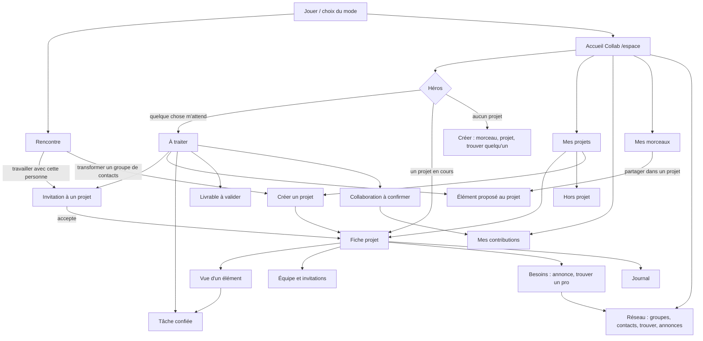
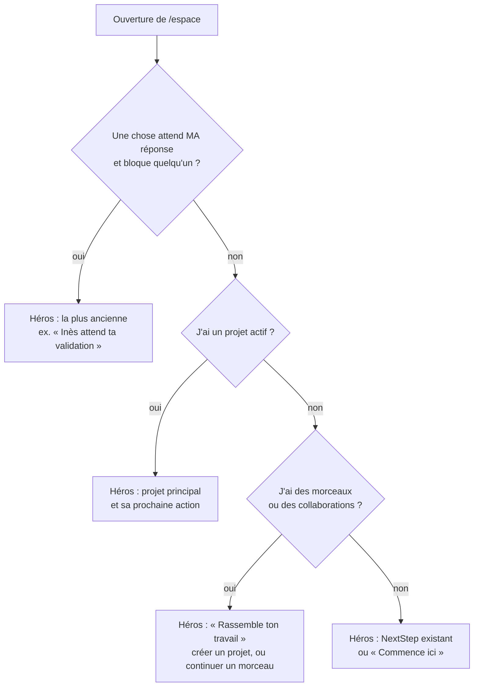

# Parcours UX de Collab centré sur les projets (G0-03, #71)

> **Statut : conception UX proposée** (18/11/2026). Ce document traduit
> l'architecture de [D72](../decisions/D72-architecture-projets-collab.md)
> (**Acceptée**, révision 2) et de la
> [conception 19](./19-architecture-cible-collab.md) en écrans, parcours
> et interactions. **Aucune ligne de code, aucune route, aucun schéma ni
> aucune migration ne sont modifiés.** Les arbitrages UX encore ouverts
> sont listés au §15 et consignés avec leur défaut dans
> [a-trancher.md](../plan/a-trancher.md#domaine-collab--parcours-ux-g0-03-71).
>
> **Base** : `main` à `5001738` (acceptation de D72), 18/11/2026.
>
> **Étiquettes** utilisées partout :
>
> - **[Existant]** : livré sur `main`, vérifié dans le code ;
> - **[Cible D72]** : validé par D72, **pas encore implémenté** ;
> - **[Proposition UX]** : ce que ce document propose, à valider.
>
> Et pour chaque pièce d'interface : **Réutilisable** (tel quel),
> **À adapter**, **À créer**, **Différé** (après lancement ou pilote).

---

## 1. Résumé exécutif

**Le problème.** Le mode Carrière (bientôt « Collab », #74) offre
aujourd'hui quinze destinations utiles (objectifs, carte, campagnes,
morceaux, groupes, équipe, structures, accompagnement, agenda, fiche…).
Elles se présentent comme une collection d'outils. Personne n'y voit
« mon EP » ou « notre tournée », parce que l'objet n'existe pas encore
(écart E1 de l'audit G0-01).

**La réponse proposée** [Proposition UX], en cinq points :

1. **L'accueil Collab répond à trois questions**, dans cet ordre :
   _qu'est-ce qui m'attend ?_, _sur quoi je travaille ?_, _que puis-je
   faire ensuite ?_ Un héros unique porte la réponse la plus utile, une
   tuile « À traiter » rassemble ce qui attend ma réponse, puis viennent
   mes projets.
2. **Deux espaces distincts, jamais mélangés** : **Mes projets** (les
   initiatives que j'organise ou auxquelles je participe, tournées vers
   l'avenir) et **Mes contributions** (ce que j'ai fait, prouvé, tourné
   vers le passé). Une réalisation apparaît dans les contributions, un
   projet dans les projets ; rien n'est compté deux fois.
3. **Une seule fiche projet, des compositions par famille** : un socle
   commun (identité, prochaine action, éléments, équipe, besoins,
   journal) dont l'**ordre** change selon que le projet est _enregistré_
   (single, EP, album, production), _scénique_ (concert, tournée,
   festival) ou _autre_ (campagne). Neuf types, trois compositions, un
   seul composant.
4. **Le droit se lit avant d'agir** : chaque bouton affiché correspond à
   une capacité calculée par le serveur (`projectAccess`) ; le partage
   d'une réalisation se choisit en un contrôle à trois positions
   (« Rien », « Résumé », « Travail ») avec, sous chaque position, ce que
   verront les participant·es.
5. **Le projet reste facultatif partout** : aucun écran existant
   n'exige un projet. Sans projet, l'accueil propose de créer un
   morceau, de trouver quelqu'un ou de créer un projet, au même rang.

**La navigation la plus simple** [Proposition UX] : l'accueil Collab
garde **quatre pivots** (`avancer`, `ma musique`, `réseau`, `repères`).
Trois doublons actuels se résorbent : « Campagnes en cours » devient la
tuile « Hors projet » de « Mes projets » ; « Mon équipe », « Mes
groupes » et « Mes structures » deviennent une seule entrée ; la fiche
de carrière et les crédits de `/morceaux` alimentent « Mes
contributions ». Deux nouvelles adresses seulement : `/projets` et
`/espace/contributions`.

**L'ordre d'implémentation** (§14) suit les lots de D72 : d'abord ce qui
ne dépend d'aucun nouveau modèle (réorganiser les pivots, « Mes
contributions » sur les données existantes), puis les écrans portés par
P2 et P3 (projet, partage), P4 (équipe, coordination), P5 (morceau
d'autrui), P13 (tâches et livrables).

**Ce qui bloque** : six arbitrages UX (§15). Aucun ne bloque la
conception ; UX-1 est **accepté** (18/11/2026), UX-5 reste à arbitrer avant U1.
#71 reste ouverte : son critère de clôture exige du code.

---

## 2. Principes UX structurants

Chaque principe est vérifiable sur une maquette ou un écran.

| #   | Principe                                                | Ce qu'il exige concrètement                                                                                                                                              | Source                      |
| --- | ------------------------------------------------------- | ------------------------------------------------------------------------------------------------------------------------------------------------------------------------ | --------------------------- |
| P1  | **Le projet est une aide, jamais un passage**           | Aucun formulaire, aucune action ne demande un projet. Créer un morceau, proposer une collaboration, candidater, rejoindre une jam : identiques avec ou sans projet       | I4                          |
| P2  | **Une action principale par écran**                     | Un seul héros, un seul `lm-btn` plein par tuile. Le reste est un menu de tuiles ou un lien                                                                               | D50, D55 §4.6               |
| P3  | **Je gère ≠ je participe ≠ j'ai contribué**             | Une pastille dit toujours mon rôle (« Je gère », « Je coordonne », « Je participe ») ; les contributions vivent dans leur propre espace                                  | I2, I7, §2.7 de la conc. 19 |
| P4  | **L'interface ne promet que ce que le serveur accorde** | Un bouton n'apparaît que si la capacité existe ; sinon, au besoin, une phrase dit **qui** peut le faire et propose le geste qui m'est permis (« Proposer à la gestion ») | I11, I12                    |
| P5  | **Ce qui est caché n'existe pas pour le lecteur**       | Ni « 2 éléments masqués », ni compteur gonflé, ni titre dans une notification non autorisée. Les comptes et l'avancement sont calculés sur ce que je vois                | I6, §9.3                    |
| P6  | **Partager est un geste explicite et réversible**       | Niveau visible sur chaque élément, modifiable en un geste, avec ses effets décrits avant de confirmer                                                                    | §9.3                        |
| P7  | **Le projet ne prouve rien, ne rapporte rien**          | Aucune célébration, aucun gain affiché sur un geste de projet (créer, ranger, inviter, terminer). L'avancement est un état, pas un score ; aucun pourcentage inventé     | I3, D54                     |
| P8  | **Le type suggère, il n'impose pas**                    | Le type change l'ordre des tuiles et les suggestions ; jamais les droits, jamais des étapes obligatoires                                                                 | #72, Q-G0-9                 |
| P9  | **Collab parle de travail, Rencontre de rencontres**    | Aucune jam, disponibilité, appréciation ou Super Jam dans Collab ; les personnes rencontrées en jam y apparaissent comme des contacts, sans l'événement                  | #71 §6, #74                 |
| P10 | **Mobile d'abord, 360–390 px**                          | Chaque écran conçu en une colonne, puis élargi en mosaïque ; aucune information disponible seulement sur grand écran                                                     | D55 §4.4                    |
| P11 | **Stable plutôt que malin**                             | Les tuiles de projets ne se réordonnent pas à chaque visite ; le héros change, la mosaïque reste                                                                         | #71 §5                      |
| P12 | **Les pros au bon moment, sans sollicitation**          | Une suggestion de professionnel n'apparaît que sur un besoin exprimé, mène à une recherche, et n'envoie rien sans geste explicite. L'XP n'entre jamais dans le tri       | CLAUDE.md, #71 S6           |

---

## 3. Audit des écrans et composants existants

### 3.1 Routes de l'espace Collab (mode `CAREER`) aujourd'hui

[Existant] L'accueil `/espace` est un `MetroHome` à quatre pivots,
chaque pivot un `MetroMenu` (MET-02, D50), précédés du volet
« priorités » (DASH-03) :

| Pivot actuel | Entrées (route)                                                                                                                                             |
| ------------ | ----------------------------------------------------------------------------------------------------------------------------------------------------------- |
| priorités    | `PriorityActions` : collaborations à valider (`/espace/a-confirmer`), candidatures (`/annonces`), demandes (`/messages`), prochaine date (`/espace/agenda`) |
| avancer      | héros `NextStep` (objectif selon l'ambition), Mes objectifs, Mon ambition, Coup de pouce                                                                    |
| parcours     | Carte de carrière, **Campagnes en cours** (`/espace/campagnes`, un morceau = une « campagne »), Agenda, Ma fiche de carrière                                |
| réseau       | **Mes structures** (`/structure`), **Mon équipe** (`/espace/equipe`), Accompagnement, Parrainer                                                             |
| repères      | Points, succès et confiance, Journal de bord, Les démarches                                                                                                 |

Plus `RoleSpace` pour les métiers autres que musicien·ne (menu de
`roleMenu`, `src/lib/linkmusician/navigation.ts`).

### 3.2 Inventaire route → objet → action → droit

| Route                                                  | Objet                                                 | Ce qu'on y fait                                                     | Qui peut agir (serveur)                                    | Rôle dans la cible                                                                     |
| ------------------------------------------------------ | ----------------------------------------------------- | ------------------------------------------------------------------- | ---------------------------------------------------------- | -------------------------------------------------------------------------------------- |
| `/espace/campagnes`                                    | `Work` (projection `campaigns`)                       | Voir ses morceaux par état, les places libres                       | Lecture                                                    | **À adapter** : devient « Hors projet » (§4.3)                                         |
| `/morceaux`, `/morceaux/nouveau`                       | `Work`, `WorkContributor`                             | Mes morceaux, ceux de mes groupes, ceux où j'ai un crédit ; créer   | Porteur ou OWNER/ADMIN (`manageableOwnerWhere`)            | **Réutilisable** (gestion) ; les crédits sur autrui migrent vers « Mes contributions » |
| `/morceaux/[id]`                                       | `Work`                                                | Maquette, crédits, rôles à pourvoir, « composé », la suite          | Gestion (`loadManagedWork`) ; lecture `isTeam` ou publique | **Réutilisable** ; reçoit « Partager dans un projet » (P5)                             |
| `/morceaux/[id]/etapes`                                | `WorkStep`, `WorkStepAct`                             | « Qui prend en charge ? », statut d'une étape                       | Gestion du morceau seulement (`applyWorkStep`)             | **À adapter** (P13) : l'assigné·e fait avancer sa tâche                                |
| `/groupes`, `/groupes/[handle]`                        | `Organization(BAND)`, `Membership`                    | Mes groupes, invitations, demandes, membres, étapes du groupe       | OWNER/ADMIN pour la gestion                                | **Réutilisable** ; reçoit la tuile « Projets du groupe »                               |
| `/structure`                                           | Organisations (studio, salle, agence…)                | Mes participations et invitations                                   | Selon `structureAccess`                                    | **À adapter** : fusion d'entrée avec groupes (§4.2)                                    |
| `/espace/equipe`                                       | Groupes + partenaires réguliers                       | Mes groupes et les personnes avec qui j'ai le plus collaboré        | Lecture                                                    | **À adapter** : partenaires → réseau ; groupes → « groupes et structures »             |
| `/espace/a-confirmer`                                  | Collaborations, crédits, invitations, accompagnements | Ce qui attend ma réponse                                            | Chaque item selon son service                              | **À adapter** : devient « À traiter », étendu aux projets (§6.3)                       |
| `/espace/agenda`                                       | Jams **et** collaborations                            | Dates à venir                                                       | Lecture                                                    | **À adapter** : sans jams côté Collab (#71 §6, #76)                                    |
| `/espace/fiche`                                        | Projection privée                                     | Rencontres, collaborations, épreuves                                | Lecture                                                    | **Réutilisable** (document à partager) ; source de « Mes contributions »               |
| `/espace/carte`                                        | Carte de carrière                                     | Actes et épreuves                                                   | Lecture                                                    | **À adapter** dans #72 (épreuves parallèles, P9)                                       |
| `/annonces`, `/annonces/nouvelle`, `/plateaux/nouveau` | `Opportunity`, `Application`                          | Publier un besoin, candidater, traiter les candidatures             | Émetteur                                                   | **Réutilisable** ; une annonce se range dans un projet (P2)                            |
| `/decouvrir`                                           | Recherche d'acteurs                                   | Trouver musicien·nes et pros                                        | Lecture                                                    | **Réutilisable** : cible des suggestions d'un besoin                                   |
| `/messages`, `/messages/contacts`                      | Conversations, `ContactGroup`                         | Échanger, proposer une collaboration, carnet et groupes de contacts | Participant·es                                             | **Réutilisable** ; « Transformer en projet » (P4)                                      |
| `/accompagnement`                                      | `Representation`                                      | Mandats manager / booker                                            | Artiste majeur·e, agent                                    | **Réutilisable** ; point d'entrée du manager (§11, E)                                  |

### 3.3 Composants Metro disponibles

[Existant] `src/lib/components/linkmusician/metro/` : `Tile`,
`TileFrame`, `Panorama`, `Pivot`, `MetroHome`, `MetroMenu`,
`MetroPageHeader`, `MetroField`, `MetroChoice`, `MetroSheet`,
`MetroEmpty`, `MetroList`, `ActionTile`, `EventTile`, `ProfileTile`,
`PriorityActions`, `Aurora`, `tones.ts`. Hors Metro mais utiles :
`NextStep`, `RoleSpace`, `works/WorkJourney`, `works/RolePicker`,
`works/WorksCard`, `TrackPicker`, `Suggestions`.

### 3.4 Écarts constatés avec la cible

1. **Aucun objet projet** : la « campagne » est un morceau (E1).
2. **Trois entrées pour « avec qui je travaille »** : Mon équipe, Mes
   structures, `/groupes` (accessible depuis l'équipe).
3. **Deux lectures de « ce que j'ai fait »** : `/espace/fiche` et les
   crédits de `/morceaux`, sans vue par rôle ni par preuve.
4. **Le héros parle de progression, pas de travail** : `NextStep` met
   en avant un objectif d'XP ou d'étape, pas le projet en cours.
5. **L'agenda Collab contient des jams** (contraire à #71 §6).
6. **`/espace/a-confirmer`** est déjà le bon centre d'attention, mais ne
   s'annonce que comme « collaborations à valider ».

---

## 4. Architecture de navigation cible

### 4.1 Les rubriques étudiées et leur sort

| Hypothèse de la mission        | Verdict [Proposition UX]                                                                                                 | Où elle vit                                   |
| ------------------------------ | ------------------------------------------------------------------------------------------------------------------------ | --------------------------------------------- |
| Accueil Collab                 | **Gardé** : `/espace`, réorganisé                                                                                        | `/espace`                                     |
| Mes projets                    | **Créé** : l'entrée principale du pivot `avancer`                                                                        | `/projets` [Cible D72, P3]                    |
| Mes contributions              | **Créé** : projection de l'existant, sans table                                                                          | `/espace/contributions`                       |
| Mes groupes et structures      | **Fusion** de « Mon équipe » (groupes), « Mes structures » et `/groupes`                                                 | entrée unique vers `/groupes` et `/structure` |
| Ma musique et mes réalisations | **Scindé** : « Mes morceaux » (ce que je gère) et « Mes contributions » (ce que j'ai fait) ; « réalisations » est ambigu | `/morceaux`, `/espace/contributions`          |
| Mes opportunités               | **Pas de rubrique** : les annonces existent (`/annonces`) ; ce qui attend une réponse passe par « À traiter »            | `/annonces`, tuile du pivot `réseau`          |
| Mon réseau professionnel       | **Gardé comme pivot** `réseau` : contacts, partenaires réguliers, accompagnement, trouver quelqu'un                      | pivot `réseau`                                |

Le doublon le plus dangereux est **projet / groupe** : un groupe n'est
pas un projet (conception 19 §2.2). L'interface le dit par la forme :
un groupe est une **équipe** (rose, pivot `réseau`), un projet est un
**travail** (bleu, pivot `avancer`). La fiche d'un groupe montre les
projets qu'il porte ; la fiche d'un projet montre son porteur.

### 4.2 L'arbre cible

```text
COLLAB (/espace, mode CAREER renommé par #74)
├── pivot « avancer »
│   ├── Héros : la prochaine action la plus utile (§5.2)
│   ├── À traiter                → /espace/a-confirmer (étendu)
│   ├── Mes projets              → /projets             [Cible D72, P3]
│   │   ├── un projet            → /projets/[id]        (≤ 3 tuiles ici)
│   │   ├── Hors projet          → /espace/campagnes    (projection B6)
│   │   └── Créer un projet      → /projets/nouveau
│   └── Agenda Collab            → /espace/agenda (sans jams)
├── pivot « ma musique »
│   ├── Mes morceaux             → /morceaux (ce que je gère)
│   ├── Mes contributions        → /espace/contributions
│   ├── Ma fiche de carrière     → /espace/fiche
│   └── Ma carte de carrière     → /espace/carte (#72)
├── pivot « réseau »
│   ├── Mes groupes et structures→ /groupes, /structure
│   ├── Mes contacts pro         → /messages/contacts (+ partenaires réguliers)
│   ├── Trouver quelqu'un        → /decouvrir
│   ├── Annonces et candidatures → /annonces
│   ├── Accompagnement           → /accompagnement (si concerné·e)
│   └── Parrainer                → /espace/parrainage (si palier)
└── pivot « repères »
    ├── Mes objectifs, Mon ambition, Coup de pouce
    ├── Points, succès et confiance, Journal de bord
    └── Les démarches
```

Le pivot actuel « priorités » (`PriorityActions`) ne disparaît pas : ses
quatre faits alimentent le héros et la tuile « À traiter ». Le héros
`NextStep` (objectif de progression) passe en tête du pivot `repères`,
et redevient le héros d'`avancer` quand il n'y a rien d'autre à faire
(§5.2, étape 4). Ce déplacement est l'arbitrage **UX-1** (§15).

**Métiers non musiciens** : « À traiter », « Mes projets » et « Mes
contributions » sont **communs à tous les métiers**, comme
`/espace/a-confirmer` aujourd'hui. `RoleSpace` garde ses entrées propres
(fiche métier, studios, plateaux) ; changer de rôle ne change jamais un
droit (DASH-01), ni la liste de mes projets.

### 4.3 Résorption des doublons

| Doublon actuel                                     | Proposition                                                                                                                                         | Compatibilité                                |
| -------------------------------------------------- | --------------------------------------------------------------------------------------------------------------------------------------------------- | -------------------------------------------- |
| « Campagnes en cours » et le futur « Mes projets » | `/espace/campagnes` devient la vue « Hors projet » : les morceaux qu'aucun projet ne range. L'entrée disparaît de l'accueil, la route reste         | URL conservée (conception 19 §11)            |
| « Mon équipe », « Mes structures », `/groupes`     | Une entrée « Mes groupes et structures » ouvre un menu à deux sections ; les partenaires réguliers passent dans « Mes contacts pro »                | `/espace/equipe` garde sa route, sans entrée |
| Crédits de `/morceaux` et `/espace/fiche`          | `/morceaux` ne liste plus que ce que je gère ou ce que mon groupe gère ; un lien « Mes crédits sur d'autres morceaux » mène à « Mes contributions » | Aucune donnée retirée, seulement rangée      |

### 4.4 Liens entre Collab et Rencontre

[Proposition UX], dans le respect de #74 et #76 (Rencontre = Jams,
Agenda, Communauté) :

| De → vers          | Geste                                                                   | Ce qui passe                                                                     |
| ------------------ | ----------------------------------------------------------------------- | -------------------------------------------------------------------------------- |
| Rencontre → Collab | Après une jam (#64) : « Travailler avec cette personne » sur un contact | La personne, jamais la jam ; ouvre un message ou « Inviter dans un projet » (P4) |
| Rencontre → Collab | Un groupe de contacts du carnet : « Transformer en projet »             | Les membres sont **invités**, pas ajoutés (P4)                                   |
| Rencontre → Collab | Bascule de mode dans l'en-tête (existant)                               | Rien ; chaque mode garde son accueil                                             |
| Collab → Rencontre | État vide de Collab : « Rencontrer des musicien·nes près de toi »       | Un lien, sans prérequis                                                          |
| Collab → Rencontre | **Aucun autre** : aucune jam comme étape d'un projet (#71 §6)           | —                                                                                |

### 4.5 Adresses proposées

Les adresses fixées par les lots, à titre de proposition : `/projets`,
`/projets/nouveau`, `/projets/[id]`, `/projets/[id]/equipe`,
`/projets/[id]/elements/[itemId]` (vue d'un élément **dans** le projet,
§9.3 de la conception 19), `/projets/[id]/journal`,
`/espace/contributions`. `projets` s'ajoute aux racines de
`contextDestination`. Aucune adresse existante ne change.

---

## 5. Diagrammes des parcours

### 5.1 Vue d'ensemble



### 5.2 Choix du héros de l'accueil



« Bloque quelqu'un » couvre, par ordre : un livrable déposé à valider,
une tâche confiée à accepter, un élément proposé au projet (pour sa
gestion ou sa coordination), une invitation à un projet, une
collaboration à confirmer. Les candidatures et demandes de contact
restent dans « À traiter » sans prendre le héros (elles ont déjà leur
écran). Les règles sont pures et testables (`priorityActions` étendu).

---

## 6. L'accueil Collab

### 6.1 Composition du pivot « avancer »

[Proposition UX] Trois tons vifs au plus : **violet** (héros, mode
Collab), **bleu** (projets, le travail), **ambre** (À traiter, ta
prochaine étape).

Mobile 390 px (mosaïque à 4 colonnes, D55 §4.4) :

```text
┌──────────────────────────────────────┐
│ collab                        ✉ 🔔 ? │  en-tête, MetroActions
│ avancer · ma musique · réseau · rep… │  pivots (rail)
├──────────────────────────────────────┤
│ ▌TON PROJET EN COURS          [big]  │  héros violet, framed, fx
│ ▌EP Lumière · Groupe Lumière         │
│ ▌2 titres mixés sur 4                │
│ ▌Prochaine action :                  │
│ ▌Trouver qui masterise   [Continuer] │  un seul geste
├──────────────────┬───────────────────┤
│ À TRAITER    3 ● │ MES PROJETS     4 │  ambre (sm) | bleu (sm)
├──────────────────┴───────────────────┤
│ Tournée de printemps          [band] │  bleu : un projet, 1 ligne
│ Je coordonne · 3 dates sur 6         │
├──────────────────────────────────────┤
│ Single Été · Je participe     [band] │
├──────────────────┬───────────────────┤
│ + Créer un projet│ Agenda   jeu. 20h │  paper | cyan → paper si 3 tons
└──────────────────┴───────────────────┘
```

Desktop (≥ 1 024 px) : la même mosaïque, plus large ; le héros `big`
occupe la moitié gauche, « À traiter » et les projets la droite. Aucune
tuile supplémentaire n'apparaît sur grand écran (P10).

Règles :

- **Au plus trois projets** dans l'accueil (le principal dans le héros,
  deux autres en `band`), puis « Mes projets » avec le total. Ordre
  stable : projets actifs, par date de **ma** dernière action, figé
  pendant la session (P11). L'épinglage est l'arbitrage **UX-3**.
- Chaque tuile de projet dit : nom, **mon rôle** (pastille), une ligne
  d'état calculée sur ce que je vois, et une pastille ambre si quelque
  chose m'y attend. Un seul geste : ouvrir la fiche.
- « À traiter » montre un **nombre** et rien d'autre (P5 : pas de titre
  dans l'accueil).
- L'agenda ne prend un ton vif que s'il reste une place sous la règle
  des trois tons ; sinon il est `paper`.

### 6.2 Les six états de l'accueil

| État                                        | Héros                                                                                                                                             | Tuiles du pivot « avancer »                                                                                     |
| ------------------------------------------- | ------------------------------------------------------------------------------------------------------------------------------------------------- | --------------------------------------------------------------------------------------------------------------- |
| **Nouveau compte, rien**                    | « Commence ici » : trois choix au même rang, _Créer un morceau_, _Trouver avec qui travailler_, _Créer un projet_ (ActionTile, pas de formulaire) | « Ce que tu peux faire dans Collab » (MetroEmpty explicatif) ; lien « Rencontrer des musicien·nes » (Rencontre) |
| **Musicien·ne avec des morceaux seulement** | « Rassemble ton travail » : _Continuer « Titre »_ (le morceau le plus récent) ; lien secondaire _Faire un projet de ces morceaux_                 | « Hors projet · 5 morceaux » (bleu) ; Créer un projet ; À traiter si non vide                                   |
| **Membre de plusieurs groupes**             | Le projet principal, tous porteurs confondus                                                                                                      | Projets groupés par porteur dans `/projets` ; dans l'accueil, la tuile porte le nom du porteur                  |
| **Professionnel·le sur plusieurs projets**  | Une tâche ou une validation qui l'attend, sinon le projet principal                                                                               | « Je participe à 4 projets » ; Mes contributions remonte dans ce pivot pour un métier non musicien (UX-4)       |
| **Responsable de plusieurs initiatives**    | L'élément qui attend sa décision (offre, livrable), sinon le projet principal                                                                     | Trois projets au plus, « Mes projets · 6 »                                                                      |
| **Rien d'urgent**                           | Le projet principal et sa prochaine action ; sans projet, `NextStep`                                                                              | « À traiter » affiche « Rien en attente » en `paper`, sans pastille                                             |

Aucun état n'est vide : le pire cas (compte neuf) montre trois portes
d'entrée réelles.

### 6.3 « À traiter » (`/espace/a-confirmer` étendu)

[Existant] L'écran rassemble collaborations à confirmer, crédits,
invitations de groupe, propositions d'accompagnement.
[Proposition UX] Il devient le **centre unique de ce qui attend ma
réponse**, avec un titre neutre (« À traiter ») et des sections par
nature, chacune un `MetroList` :

1. **Validations demandées** (P13) : « Inès a déposé la v2 de
   l'enregistrement de Titre 2 » → vue de l'élément.
2. **Tâches proposées** (P13) : « Sam te confie le mixage de Titre 3 » →
   Accepter / Refuser.
3. **Éléments proposés à un projet** (P5) : « Léa propose son morceau
   dans EP Lumière, en Travail » → Accepter / Refuser.
4. **Invitations à un projet** (P4) → écran d'invitation (§8.2).
5. **Collaborations et crédits** (existant).
6. **Groupes et accompagnements** (existant).

Une ligne n'affiche que ce que je suis autorisé·e à lire **au moment de
l'affichage** (droits réévalués, P5). Une section vide disparaît.

### 6.4 Ce que U0 a livré, et les écarts [Livré le 18/11/2026]

UX-1 tranché : [D74](../decisions/D74-heros-accueil-collab.md).

- **Pivots** de `/espace` (musicien·ne) : `avancer` (héros, « À faire
  maintenant », tuiles « À traiter », candidatures, demandes de contact,
  agenda, puis « Travaux en cours » `/espace/campagnes`), `ma musique`
  (Mes morceaux, Ma carte, Ma fiche), `réseau` (Mes groupes et
  structures → `/structure`, Mes contacts, Trouver quelqu'un, Annonces et
  candidatures, Accompagnement si concerné·e, Parrainer si palier),
  `repères` (Ta prochaine étape quand elle n'est pas le héros, Mes
  objectifs, Mon ambition, Coup de pouce, Points, succès et confiance,
  Journal de bord, Ce que Melokiva me propose, Les démarches). Le pivot
  séparé « priorités » disparaît : son contenu ouvre `avancer`.
- **Doublons résorbés** : « Mon équipe » et « Mes structures » deviennent
  « Mes groupes et structures » (`/structure`, qui liste déjà les groupes) ;
  `/espace/equipe` garde sa route, sans entrée. « Campagnes en cours »
  devient « Travaux en cours » (pas encore « Hors projet », faute de
  projets). Aucune route supprimée, aucun lien vers `/projets`.
- **Héros** (`pickHero`) : première action du moteur N3 (hors
  candidatures et contacts), sinon « Commence ici » pour un compte neuf,
  sinon `NextStep`. Le projet principal (étape 2 de §5.2) viendra avec U2.
  Les métiers (`RoleSpace`) reçoivent le même héros dans leur pivot
  « priorités », avec leurs entrées propres inchangées.
- **« À traiter »** (`/espace/a-confirmer`, adresse conservée) : sections
  Collaborations, Crédits de morceaux, Invitations de groupe, Autres
  demandes (accompagnement, candidatures, contacts) ; une section vide
  disparaît. La tuile de l'accueil compte collaborations, crédits,
  invitations et accompagnements (les candidatures et contacts ont leur
  tuile). Une seule lecture (`inboxFor`), partagée avec le moteur N3.
- **Agenda Collab** sans jams (#76) : collaborations prévues seulement, un
  lien « voir les jams à venir » vers Rencontre (`/jam/agenda`).
- **Blocages** (correction de sécurité, constat N3) : la carte (déclencheurs
  « collaboration à confirmer » et « rôle en attente »), « À traiter »
  (collaborations, crédits, propositions d'accompagnement), l'agenda Collab
  et la pastille des crédits de `/morceaux` ignorent désormais toute
  personne qui m'a bloqué·e ou que j'ai bloquée (`notBlockedWith`). Les
  faits restent en base : lever le blocage les rend.
- **Écarts** : le nom « Collab » n'est posé que sur « À traiter » et
  l'agenda ; l'en-tête garde « Mode carrière » jusqu'aux textes de #74.
  Mosaïque `sm`/`band` de §6.1 non reprise : les tuiles restent en menu
  (projets absents). « Mes contributions » (U1) n'existe pas encore : aucune
  entrée. Corrigé par #85 : `/accompagnement` écarte aussi, dans la
  requête de `representationsForMe`, les propositions d'une personne
  bloquée (dans les deux sens) ; page, tuile et « À traiter » lisent la
  même source. Un accompagnement confirmé reste lisible pour y mettre fin
  (Q75).

---

## 7. Créer et consulter un projet

### 7.1 Création en deux gestes

[Cible D72] Porteurs au lancement : moi, ou une organisation que je
gère parmi `BAND`, `PROMOTER`, `STUDIO`, `VENUE` (Q-G0-13). Types :
single, EP, album, tournée, concert, festival, production, campagne
(conception 19 §2.3).

[Proposition UX] `/projets/nouveau`, un écran de détail (une colonne,
`max-w-3xl`), pas de tunnel :

```text
┌ MetroPageHeader ─────────────────────┐
│ ← Mes projets                        │
│ NOUVEAU PROJET                       │
│ Un projet                            │
│ Rassemble des morceaux, des dates et │
│ des personnes autour d'un objectif.  │
│ Rien de ce que tu ranges ne change   │
│ de mains.                            │
├──────────────────────────────────────┤
│ Nom du projet *                      │
│ [ EP Lumière                       ] │
│ Les personnes que tu invites verront │
│ ce nom.                              │
│                                      │
│ C'est quoi ? *          (MetroChoice)│
│ [Single][EP][Album][Production]      │
│ [Concert][Tournée][Festival]         │
│ [Campagne][Autre ?]  ← UX-2          │
│                                      │
│ Porté par            (si j'en gère)  │
│ (•) Moi   ( ) Lumière   ( ) Le Bikini│
│ Seules les structures que tu gères.  │
│                                      │
│ ▸ Ajouter des dates et une phrase    │  replié (facultatif)
│                                      │
│ [ Créer le projet ]                  │
└──────────────────────────────────────┘
```

- **Minimal obligatoire** : nom, type. Le porteur vaut « Moi » par
  défaut ; le choix n'apparaît que si je gère au moins une structure
  autorisée.
- **Facultatif, replié** : date de début, échéance, une phrase
  d'objectif. Rien d'autre à la création (P2).
- **Jamais demandé** : membres, morceaux, budget, étapes.
- Créer ne déclenche **aucune célébration** ni gain (P7). Un toast
  neutre : « Projet créé. »

**Après la création** : la fiche s'ouvre avec un héros de premier pas,
choisi selon ce que j'ai déjà :

| J'ai déjà…                         | Première action proposée (héros)                                        | Autres choix (menu)                   |
| ---------------------------------- | ----------------------------------------------------------------------- | ------------------------------------- |
| des morceaux ou des collaborations | **Ranger ce que tu as déjà** (liste de **mes** éléments, §9.1)          | Inviter quelqu'un ; Publier un besoin |
| rien, projet enregistré            | **Créer le premier morceau** (ouvre `/morceaux/nouveau`, puis le range) | Inviter ; Publier un besoin           |
| rien, projet scénique              | **Publier un besoin** (annonce rangée dans le projet) ou **Inviter**    | Ranger un concert déjà confirmé       |

**Complétude progressive** [Proposition UX] : une tuile `paper` « Pour
démarrer » liste trois gestes facultatifs (ranger, inviter, ajouter des
dates), cochés quand ils sont faits, et disparaît quand ils le sont tous
ou quand on la ferme. Ce n'est ni une quête ni une étape : aucun point,
aucun pourcentage.

**Depuis d'autres points d'entrée** :

- fiche d'un groupe que je gère : « Projets du groupe » → « Nouveau
  projet » avec le groupe présélectionné ;
- `/espace/campagnes` (Hors projet) : sélectionner des morceaux →
  « Faire un projet » ;
- carnet de contacts : « Transformer en projet » (P4).

### 7.2 La fiche projet : un socle, trois compositions

[Proposition UX] Toutes les fiches partagent les mêmes blocs, dans le
même composant :

| Bloc                         | Contenu                                                                                              | Tuile                         | Lot    |
| ---------------------------- | ---------------------------------------------------------------------------------------------------- | ----------------------------- | ------ |
| **En-tête**                  | Nom, type, porteur (lien), état (« En cours », « Atteint », « Laissé de côté »), dates, **mon rôle** | `MetroPageHeader` + pastilles | P2     |
| **Prochaine action** (héros) | Une seule, calculée pour **mon rôle** (§7.3)                                                         | `ActionTile` violet           | P2, P9 |
| **Éléments**                 | Morceaux, concerts, annonces rangés, avec leur état et, pour la gestion, leur niveau de partage      | `Tile` bleu `wide`            | P2     |
| **Équipe**                   | Participant·es, rôle libre, pastille « coordonne » ; invitations en cours (gestion et coordination)  | `Tile` rose `md`              | P4     |
| **Besoins**                  | Annonces du projet et propositions en attente ; « Trouver un pro »                                   | `Tile` rose ou `paper` `md`   | P2, P4 |
| **Tâches**                   | Mes tâches dans ce projet ; pour la coordination, les tâches confiées                                | `Tile` bleu `md`              | P13    |
| **Journal**                  | Les derniers actes visibles (rangé, invité, partagé, terminé)                                        | `Tile` ink `band`             | P2     |
| **Dates**                    | Prochaines dates du projet (concerts rangés, échéance)                                               | `Tile` cyan `md`              | P2     |

**Composition par famille** (seul l'**ordre** et la taille changent) :

| Famille                                        | Ordre des blocs après le héros                                     | Ligne d'état calculée                     |
| ---------------------------------------------- | ------------------------------------------------------------------ | ----------------------------------------- |
| **Enregistré** : single, EP, album, production | Éléments (morceaux) · Tâches · Équipe · Besoins · Journal          | « 2 titres mixés sur 4 »                  |
| **Scène** : concert, tournée, festival         | Dates · Éléments (concerts, plateaux) · Besoins · Équipe · Journal | « 3 dates jouées sur 6 » ; prochaine date |
| **Autre** : campagne (et « Autre », UX-2)      | Éléments · Équipe · Besoins · Journal                              | « 4 éléments rangés »                     |

Mobile 390 px, fiche « EP » vue par la gestion :

```text
┌──────────────────────────────────────┐
│ ← Mes projets                        │
│ PROJET · EP                          │
│ EP Lumière                           │
│ [Groupe Lumière] [En cours] [Je gère]│
│ Échéance : mars 2027                 │
├──────────────────────────────────────┤
│ ▌PROCHAINE ACTION             [wide] │  violet
│ ▌Titre 4 n'a personne pour le mix.   │
│ ▌              [Confier le mixage]   │
├──────────────────────────────────────┤
│ MORCEAUX                 4    [wide] │  bleu
│ Titre 1 · masterisé      ◉ Résumé    │
│ Titre 2 · mixé           ✎ Travail   │
│ Titre 3 · enregistré     ✎ Travail   │
│ Titre 4 (Léa) · maquette ✎ Travail   │
│ [Ranger un élément]                  │
├──────────────────┬───────────────────┤
│ TÂCHES        2 ●│ ÉQUIPE          3 │  bleu | rose
│ 1 à valider      │ Sam coordonne     │
├──────────────────┼───────────────────┤
│ BESOINS       1  │ JOURNAL           │  paper | ink
│ violoncelliste   │ hier : v2 déposée │
└──────────────────┴───────────────────┘
```

Chaque bloc est une tuile d'**un seul geste** qui ouvre son écran
(D50) : la liste des morceaux d'un EP de quatre titres tient dans la
tuile, celle d'un album de quinze titres renvoie à un écran
« Éléments ». Les sous-écrans (`/equipe`, `/journal`, vue d'élément)
reprennent `MetroPageHeader` avec le retour vers la fiche.

La même fiche vue par **une participante simple** (ingé son de la
tournée) : pas de pastille de partage, pas de « Ranger », pas
d'« Inviter » ; seulement les éléments en Résumé ou Travail, ses tâches,
l'équipe et le journal filtré. Rien n'indique qu'il existe d'autres
éléments (P5).

**Projet terminé ou laissé de côté** : bandeau `paper` « Ce projet est
terminé · Rouvrir » (gestion seulement), tout le reste en lecture ; les
tuiles d'action disparaissent ; les capacités sont gelées (§9.1 de la
conception 19).

**Groupe porteur dissous** : bandeau « Le groupe Lumière est dissous :
ce projet est en lecture seule. » Aucun bouton.

### 7.3 La prochaine action, par rôle

[Proposition UX] Calculée par une règle pure, à partir des éléments
**visibles** du lecteur et de son rôle. Exemples :

| Rôle          | Ordre des propositions                                                                                                                    |
| ------------- | ----------------------------------------------------------------------------------------------------------------------------------------- |
| Gestion       | Élément proposé à accepter → livrable à valider (si gestion de l'élément) → étape sans responsable → besoin sans annonce → ranger/inviter |
| Coordination  | Proposition d'intervenant à valider → étape sans responsable sur un élément Travail → tâche refusée à réattribuer → dates à poser         |
| Participant·e | Ma tâche proposée à accepter → ma tâche en cours (déposer) → rien : « Tu es à jour sur ce projet »                                        |

Chaque proposition est un lien vers l'écran qui la réalise ; jamais une
action en un geste qui modifie une réalisation depuis la fiche (le
héros de la fiche ne valide pas un livrable : il ouvre la vue de
l'élément). Le détail du graphe d'étapes appartient à #72 (P9).

---

## 8. Participants, coordinateurs et permissions

### 8.1 Ce que voit chaque profil

[Cible D72] Matrice §6.2 de la conception 19. Traduction à l'écran
[Proposition UX] :

| Élément d'interface sur la fiche    | Gestion |          Coord.           | Participant·e | Assigné·e (sa tâche) | Gestion d'un élément (son élément) |
| ----------------------------------- | :-----: | :-----------------------: | :-----------: | :------------------: | :--------------------------------: |
| Renommer, changer l'état, supprimer |    ✔    |             —             |       —       |          —           |                 —                  |
| Modifier dates et description       |    ✔    |             ✔             |       —       |          —           |                 —                  |
| Ranger **mes** éléments             |    ✔    |             ✔             |       —       |          —           |                 —                  |
| Pastille et réglage du partage      |    ¹    |             —             |       —       |          —           |                 ✔                  |
| Inviter (participant·e simple)      |    ✔    |             ✔             |       —       |          —           |                 —                  |
| Proposer une capacité « coordonne » |    ✔    |             —             |       —       |          —           |                 —                  |
| Confier une étape (élément Travail) |    ✔    |             ✔             |       —       |          —           |                 ✔                  |
| Déposer un livrable                 |    —    |             —             |       —       |          ✔           |                 —                  |
| Valider un livrable                 |    ¹    |             —             |       —       |          —           |       ✔ (pas le sien propre)       |
| Proposer un besoin                  |    ✔    |             ✔             |       —       |          —           |                 —                  |
| Publier l'annonce au nom du porteur |    ✔    | « Proposer à la gestion » |       —       |          —           |                 —                  |
| Quitter le projet                   |    —    |             ✔             |       ✔       |          ✔           |                 ✔                  |

¹ Quand la gestion du projet gère aussi l'élément (le groupe et son
morceau), elle agit à ce second titre, et l'écran le dit (« en tant que
gestion du morceau »).

Règle d'affichage (P4) : **un geste absent est invisible**, sauf deux
cas où une phrase aide à comprendre : un·e coordinateur·rice qui
voudrait publier voit « Proposer à la gestion » ; un·e participant·e
voit, dans l'équipe, « Pour inviter quelqu'un, demande à Lumière ou à
Sam ». Jamais de bouton grisé sans explication.

### 8.2 Les interactions

**Inviter** (gestion, coordination ; P4). Depuis l'équipe : « Inviter »
ouvre un `MetroSheet` :

```text
┌ Inviter dans EP Lumière ─────────────┐
│ Qui ?  [ Rechercher dans mes contacts]│  D37 : personne connue
│ Son rôle (libre)  [ Ingé son       ] │  libellé, aucun droit
│ Ce qu'il ou elle pourra faire :      │  (gestion seulement)
│ (•) Participer : voir le projet et   │
│     ce qui est partagé, ses tâches   │
│ ( ) Coordonner : organiser les dates │
│     et les tâches, inviter. Pas de   │
│     droit sur le groupe ni sur les   │
│     morceaux eux-mêmes.              │
│ Il ou elle verra le nom du projet,   │
│ son porteur, toi, et ce rôle. Rien   │
│ d'autre avant d'accepter.            │
│               [Annuler] [Inviter]    │
└──────────────────────────────────────┘
```

Pour un·e mineur·e, l'option « Coordonner » n'apparaît pas, et
l'invitation n'est possible que dans un projet de son groupe (Q-G0-12).
Un compte bloqué, masqué ou inconnu n'apparaît pas dans la recherche.

**Accepter ou refuser** (la personne invitée). Écran d'invitation
(depuis « À traiter » ou la notification) : nom et type du projet,
porteur, qui invite, capacités en clair, phrase « La liste des
participant·es te sera visible, et ton nom leur sera visible ».
Deux boutons : « Rejoindre » (`lm-btn`), « Refuser » (ghost). Aucun motif
demandé. Après acceptation : la fiche s'ouvre avec le héros
« Bienvenue dans EP Lumière : voici ce qui est partagé avec toi ».
Après refus : retour à « À traiter », toast « Invitation refusée ».

**Confier un travail** (gestion, coordination, gestion de l'élément ;
P13). Depuis la vue d'un élément partagé en **Travail** : « Confier une
étape » → choisir l'étape (enregistrement, mixage, mastering… les
`WorkStep` existantes) → choisir une personne **participante** → envoyer.
L'étape affiche « Proposée à Inès · en attente ». Inès accepte ou
refuse depuis « À traiter ». Sur un élément en Résumé, le bouton
n'existe pas ; la gestion voit plutôt « Pour confier des étapes,
ouvre ce morceau au travail ».

**Ajouter un besoin** (gestion, coordination). Bloc « Besoins » →
« Ajouter un besoin » : métier recherché (`TrackPicker`), phrase. Pour la
gestion : « Publier l'annonce » ouvre `/annonces/nouvelle` prérempli,
puis la range. Pour la coordination : « Proposer à la gestion » crée une
proposition visible dans « À traiter » de la gestion. Chaque besoin
porte un lien « Trouver un pro » vers `/decouvrir` prérempli (métier,
commune du porteur), sans envoi automatique (P12).

**Soumettre un livrable** (assigné·e ; P13). Dans « Mes tâches » : la
tâche acceptée → « Déposer » (fichier ou lien) → « v1 déposée · en
attente de validation par Lumière ». Une nouvelle version remplace la
précédente **dans l'attente** : « v2 déposée ; la v1 n'est plus à
valider ». L'assigné·e ne voit jamais de bouton « Valider » sur son
propre dépôt.

**Demander une validation** : implicite au dépôt (pas de second geste).
La gestion de l'élément reçoit une ligne « Validations demandées ». Elle
valide (`lm-btn`) ; la tâche passe « Validée ». Un écran de validation
dit clairement : « Valider n'ajoute ni crédit ni point. Le crédit naît
de la collaboration confirmée avec Inès. » avec le lien « Proposer la
collaboration ». La demande de modifications est l'arbitrage **UX-6**.

**Retirer une participation** (gestion) ou **quitter** (la personne).
`MetroSheet` de confirmation, qui énonce les effets avant le geste :
« Sam ne verra plus ce projet. Ses propositions en attente sont
annulées ; les 2 tâches qui lui sont confiées redeviennent libres ; ses
livrables déjà déposés restent à valider. » Bouton `danger`.

### 8.3 États de chargement, refus, révocation

| Situation                                                       | Ce que l'écran fait                                                                                                                                                                      |
| --------------------------------------------------------------- | ---------------------------------------------------------------------------------------------------------------------------------------------------------------------------------------- |
| Chargement d'un écran                                           | Rendu serveur (SvelteKit) : pas de squelette sur les fiches ; sur les envois, le bouton passe en « Envoi… » `aria-busy`, désactivé pour éviter le double envoi                           |
| Projet inexistant **ou** inaccessible                           | La même page 404 : « Ce projet n'existe pas ou ne t'est pas ouvert. » + lien « Mes projets ». Jamais de 403 qui confirme l'existence                                                     |
| Élément d'un autre projet ou non partagé (URL forgée)           | 404 identique, au niveau de la vue d'élément                                                                                                                                             |
| Action refusée parce qu'un droit a été retiré entre-temps (I12) | La page se recharge ; toast « Tes droits sur ce projet ont changé. » ; l'écran affiche ce qui reste permis. Aucune donnée saisie perdue si elle reste utile (brouillon gardé localement) |
| Partage abaissé pendant un dépôt                                | « Ce morceau n'est plus ouvert au travail dans ce projet. Ton fichier n'a pas été envoyé. »                                                                                              |
| Participation retirée pendant la lecture                        | Au prochain chargement : 404 du projet ; dans « Mes projets », le projet disparaît sans notification détaillée                                                                           |
| Invitation devenue caduque (retirée, projet clos)               | « Cette invitation n'est plus valable. » ; la ligne disparaît d'« À traiter »                                                                                                            |
| Quota atteint (projets actifs, invitations)                     | Message qui dit la limite et le moyen d'avancer (« Termine ou laisse de côté un projet pour en ouvrir un nouveau »)                                                                      |
| Mineur·e                                                        | Les options interdites n'apparaissent pas ; une phrase explique pourquoi quand la personne cherche le geste (« Réservé aux adultes »)                                                    |

---

## 9. Partage des réalisations

### 9.1 Ranger un élément et choisir son partage

[Cible D72] Trois niveaux (`NONE`, `SUMMARY`, `WORK`), décidés par la
gestion **de l'élément**, défaut « public → Résumé, privé → Rien »,
titre de travail possible.

[Proposition UX] Vocabulaire à l'écran : **Rien**, **Résumé**,
**Travail**, toujours accompagnés d'une icône (œil barré, œil, outil) et
d'une phrase. Le contrôle est un `MetroChoice` à trois positions dans un
`MetroSheet` :

```text
┌ Ranger dans EP Lumière ──────────────┐
│ Mes éléments                         │  seulement les miens (I5)
│ [✓] Titre 3 · idée                   │
│ [ ] Concert du 12/12 au Bikini       │
│                                      │
│ Ce que voient les participant·es :   │
│ [ ⊘ Rien ] [ ◉ Résumé ] [ ✎ Travail ]│  MetroChoice, aria-pressed
│ ◉ Résumé : son titre et son état.    │
│   Ni la maquette, ni les notes, ni   │
│   les crédits.                       │
│ Titre affiché  [ Titre 3          ]  │  titre de travail (facultatif)
│                                      │
│              [Annuler] [Ranger]      │
└──────────────────────────────────────┘
```

Phrases sous chaque position :

- **Rien** : « Rangé ici pour toi. Les autres participant·es ne le
  voient pas et ne savent pas qu'il existe. »
- **Résumé** : « Son titre (ou le titre affiché) et son état. Ni la
  maquette, ni les notes, ni les crédits. »
- **Travail** : « Le résumé, plus les étapes de ce projet : les
  coordinateur·rices peuvent les confier, les personnes chargées y
  déposer leurs fichiers. Le morceau reste à toi : titre, crédits et
  maquette ne changent pas. »

Le défaut est présélectionné selon la visibilité de l'élément ; **Travail
n'est jamais présélectionné**. Une idée privée rangée en Résumé
déclenche une phrase de plus : « Son titre sera visible des 3
participant·es. Tu peux afficher un titre de travail à la place. »

Dans la liste des éléments, la **gestion de l'élément** voit la pastille
et peut la changer en un geste (« Changer le partage »). Abaisser de
Travail à Résumé ou Rien affiche l'effet avant de confirmer : « Les 2
étapes confiées dans ce projet redeviennent libres. Les fichiers déposés
restent à toi. »

### 9.2 Le morceau personnel dans le projet du groupe (Léa)

[Cible D72, P5] Le côté du **morceau** initie ; le projet ne peut ni
chercher ni demander un morceau qu'il ne voit pas.

1. Léa ouvre **son** morceau `/morceaux/[id]` → tuile « Dans mes
   projets » → « Partager dans un projet ». La liste ne propose que les
   projets **où elle participe** (EP Lumière).
2. Elle choisit le niveau (Résumé ou Travail) et peut saisir un titre
   affiché. Confirmation : « Le morceau reste à toi, avec tes crédits.
   Tu peux retirer le partage quand tu veux. Rien n'est cédé. »
3. L'état devient « Proposé à EP Lumière · en attente ». Côté projet,
   la gestion ou la coordination voit la ligne dans « À traiter » :
   « Léa propose Titre 4 en Travail » → Accepter / Refuser.
4. Accepté : le morceau apparaît dans la fiche avec la mention « de
   Léa ». Sur la fiche du morceau, Léa voit « Partagé dans EP Lumière ·
   Travail · Retirer ».
5. Retrait (par Léa ou par le projet) : effets annoncés, comme au §9.1.

Le **transfert** de gestion (P5b) n'apparaît **nulle part** au
lancement : aucun bouton « Donner au groupe », pour ne pas suggérer une
opération qui n'existe pas encore.

### 9.3 Fuites indirectes : règles d'interface

| Voie                          | Règle d'interface [Proposition UX]                                                                                                                              |
| ----------------------------- | --------------------------------------------------------------------------------------------------------------------------------------------------------------- |
| Compteurs, lignes d'état      | Toujours calculés sur les éléments visibles du lecteur ; jamais « +2 », jamais « éléments masqués »                                                             |
| Tuile de projet de l'accueil  | La ligne d'état du lecteur, pas celle de la gestion                                                                                                             |
| Journal                       | Les actes sur un élément invisible sont omis ; pas de trou visible (« 1 action masquée »)                                                                       |
| Notifications, courriels      | Le nom du projet et l'auteur, jamais le titre d'un élément sauf s'il est partagé avec la personne ; droits réévalués à l'envoi (« Du nouveau dans EP Lumière ») |
| Recherche au moment de ranger | Seulement mes éléments                                                                                                                                          |
| Invitations                   | Nom, type, porteur, inviteur, capacités ; ni éléments ni équipe                                                                                                 |
| Fiche du morceau              | La mention « Partagé dans … » n'est visible que de la gestion du morceau                                                                                        |
| Profil public                 | Aucun projet n'apparaît (projets privés au lancement)                                                                                                           |

**Aperçu « comme un·e participant·e »** pour la gestion : utile pour
vérifier ce qui est montré, mais c'est un écran de plus et une voie de
lecture de plus à tester. **Différé** (UX-7, §15).

---

## 10. Mes contributions et réseau professionnel

### 10.1 La distinction

| Espace                | Question                                                           | Temps           | Unité affichée                | Source                                                                    |
| --------------------- | ------------------------------------------------------------------ | --------------- | ----------------------------- | ------------------------------------------------------------------------- |
| **Mes projets**       | Qu'est-ce que j'organise ou suis en train de faire avec d'autres ? | Futur, en cours | Un **projet**                 | `Project` porté, `ProjectParticipant` [Cible D72]                         |
| **Mes contributions** | Qu'est-ce que j'ai fait, et qui le confirme ?                      | Passé           | Une **réalisation**, une fois | `WorkContributor` confirmé, `CollaborationParticipant` terminé [Existant] |
| **Mes morceaux**      | Qu'est-ce que je gère ?                                            | Tout            | Un **morceau**                | `Work` géré [Existant]                                                    |

[Proposition UX] **La participation à un projet n'est pas une
contribution** : elle est déclarative et vit déjà dans « Mes projets ».
La compter aussi dans « Mes contributions » serait un doublon (UX-5,
écart avec la lecture large du §2.7 de la conception 19, qui la cite
comme troisième source).

### 10.2 L'écran « Mes contributions »

[Proposition UX] `/espace/contributions`, une colonne, filtres en
`MetroChoice` :

```text
┌──────────────────────────────────────┐
│ ← Collab                             │
│ MA MUSIQUE                           │
│ Mes contributions                    │
│ Ce que tu as fait, confirmé par les  │
│ autres.                              │
│ [Tout][Son][Production][Scène][Jeu]  │  filtres par rôle
├──────────────────────────────────────┤
│ 2026                                 │
│ Titre 2 · Lumière                    │  MetroList
│ Mixage · nov.  [✓ Confirmé]          │  lime : collaboration terminée
│ Titre 3 · Lumière                    │
│ Mixage · nov.  [✓ Confirmé]          │
│ Concert au Bikini                    │
│ Ingé son retour · oct. [✓ Confirmé]  │
│ Le Soir · Léa                        │
│ Basse · sept.  [Crédité·e]           │  crédit consenti, sans collab
├──────────────────────────────────────┤
│ Partager ma fiche de carrière →      │
└──────────────────────────────────────┘
```

Règles :

- **Une ligne par réalisation**, avec sa meilleure preuve :
  « Confirmé » (collaboration terminée) l'emporte sur « Crédité·e »
  (crédit consenti). Une séance sur deux morceaux (P7) donne deux lignes
  (deux réalisations), mais compte **une** prestation dans les
  statistiques de métier (`CraftSummary`), comme la conception 19 le
  demande.
- Le titre suit les règles de lecture du morceau (archivé : « Morceau
  non publié » si masqué, §9.5 ; groupe dissous : mention).
- Aucun point, aucun niveau sur cet écran : la progression vit dans
  `repères` (P7, D54).
- Pas de filtre par projet (le projet ne prouve rien) ; un lien
  discret « dans EP Lumière » peut apparaître si **je** vois ce projet.

Pour un·e **professionnel·le** sans projet porté, cet écran est la
mémoire de son activité, et la source de sa fiche de carrière
(`/espace/fiche`) qu'il ou elle partage.

### 10.3 Le réseau professionnel

[Proposition UX] Le pivot `réseau` de Collab regroupe :

- **Mes groupes et structures** : un menu à deux sections (groupes,
  autres structures), avec pour chaque groupe ses projets en cours ;
- **Mes contacts pro** : le carnet (`/messages/contacts`), ses groupes
  de contacts, et les **partenaires réguliers** (aujourd'hui dans
  « Mon équipe ») ; les contacts nés d'une jam y figurent comme
  personnes, sans la jam (P9) ;
- **Trouver quelqu'un** : `/decouvrir`, que les besoins d'un projet
  ouvrent préremplie ;
- **Annonces et candidatures** ; **Accompagnement** ; **Parrainer**.

**Suggestions de professionnels adaptées au projet** : seulement sur un
besoin exprimé (§8.2), triées par les règles existantes de la recherche
(commune, métier, ouverture aux sollicitations), **jamais par l'XP**,
et sans contact automatique (P12).

---

## 11. Six scénarios

Pour chacun : **[Existant]** = ce qui marche aujourd'hui ;
**[Cible]** = ce que D72 et ce document rendent possible.

### A. Musicien solo : morceaux, projet EP, recherche d'un ingé son

- **Point d'entrée** : accueil Collab, état « morceaux seulement »
  (héros « Rassemble ton travail »).
- **Écrans** : Accueil → `/projets/nouveau` → fiche EP → sheet
  « Ranger » → bloc Besoins → `/annonces/nouvelle` (prérempli) ou
  `/decouvrir` → messages → `/espace/a-confirmer`.
- **Actions** : créer « EP Été » (type EP, porteur Moi) ; ranger trois
  morceaux (Rien par défaut pour les idées) ; ajouter le besoin
  « ingé son mixage » ; publier l'annonce (rangée dans l'EP) ou ouvrir
  un profil ; proposer une collaboration `MIXING` sur un morceau.
- **États intermédiaires** : annonce ouverte, candidatures « 2 à
  lire » dans « À traiter » ; collaboration proposée ; confirmée des deux
  côtés → crédit de l'ingé son.
- **Résultat** : un EP qui rassemble ses titres et son besoin ; l'ingé
  son crédité sur le morceau mixé.
- **[Existant]** : morceaux, annonces `SESSION_WORK`, recherche,
  collaboration et crédit. **[Cible]** : le projet, le rangement, le
  besoin rangé (P2) ; la collaboration sur plusieurs morceaux le même
  jour (P7).
- **Frictions** : (1) avant P7, mixer deux titres le même jour demande
  deux conversations ; (2) l'ingé son n'a pas besoin d'être invité au
  projet pour travailler, et le musicien peut croire qu'il le doit.
- **Améliorations** : la fiche dit « Pas besoin d'inviter pour
  collaborer : une collaboration se propose dans la conversation » ;
  l'invitation est présentée comme utile pour **organiser** (tâches,
  fichiers), pas pour travailler.

### B. Groupe de cinq : un EP et une tournée en parallèle

- **Point d'entrée** : fiche du groupe → « Projets du groupe » →
  « Nouveau projet » (groupe présélectionné), deux fois.
- **Écrans** : `/groupes/[handle]` → `/projets/nouveau` ×2 → fiches →
  équipe de la tournée.
- **Actions** : l'ADMIN crée « EP Lumière » et « Tournée de
  printemps » ; range quatre morceaux dans l'EP, les concerts dans la
  tournée ; invite le booker et l'ingé son retour **dans la tournée
  seulement**.
- **États** : les membres `MEMBER` du groupe ne sont pas participant·es
  d'office (Q-G0-12 et I2) : la gestion les invite, ou **[Proposition
  UX]** un raccourci « Inviter les membres du groupe » coche tout le
  monde en une fois (une invitation par personne, chacune acceptée).
- **Résultat** : deux tuiles dans l'accueil de chaque membre invité·e,
  chacune avec son état ; le booker ne voit pas l'EP.
- **Frictions** : (1) un membre non invité voit le groupe mais pas ses
  projets, ce qui peut surprendre ; (2) cinq invitations à accepter.
- **Améliorations** : sur la fiche du groupe, la tuile « Projets du
  groupe » liste pour un membre non participant le **nombre** de
  projets visibles par lui (0) et « Demande à la gestion de t'inviter »,
  sans nommer les projets (UX-8 : membres invités d'office ou non).

### C. Producteur invité à coordonner l'EP d'un groupe

- **Point d'entrée** : notification → « À traiter » → invitation
  (« Lumière t'invite à coordonner EP Lumière »).
- **Écrans** : invitation → fiche EP (vue coordination) → vue d'un
  élément → sheet « Confier une étape » → bloc Besoins.
- **Actions** : accepter ; voir les trois titres partagés en Travail et
  celui de Léa ; confier l'enregistrement des quatre titres à Inès
  (invitée par lui comme participante simple) ; proposer « cherche
  violoncelliste » ; modifier l'échéance.
- **États** : tâches « Proposée à Inès » → « Acceptée » ; proposition
  de besoin « en attente de Lumière » ; Lumière publie l'annonce.
- **Résultat** : l'EP s'organise sans que Sam soit ADMIN du groupe.
- **[Cible]** : tout le scénario dépend de P4 (capacités) et P13
  (tâches) ; P5 pour le titre de Léa.
- **Frictions** : (1) Sam ne peut pas publier l'annonce lui-même ; (2)
  il ne voit pas les titres que le groupe a rangés en Résumé comme
  travaillables.
- **Améliorations** : le bouton s'appelle « Proposer à Lumière » et
  la ligne dit « Lumière publie au nom du groupe » ; sur un élément en
  Résumé, Sam voit « Ouvert en résumé seulement » sans bouton (pas
  d'invitation à demander plus, pour ne pas mettre la gestion sous
  pression ; la conversation reste possible).

### D. Ingé son sur deux morceaux d'un même projet, demande de validation

- **Point d'entrée** : accueil Collab, héros « Ta tâche : enregistrer
  Titre 2 ».
- **Écrans** : « À traiter » → vue de l'élément (Titre 2, puis Titre 3)
  → dépôt → « Mes contributions ».
- **Actions** : accepter les deux tâches ; déposer la prise v1 de
  Titre 2 ; la gestion demande une reprise (hors outil, ou UX-6) ;
  déposer v2 ; validée ; la gestion propose la collaboration
  `RECORDING` sur les deux titres (P7) ; Inès confirme.
- **États** : « v1 déposée · en attente » → « v2 déposée ; la v1 n'est
  plus à valider » → « Validée » → collaboration « à confirmer » →
  « Confirmé ».
- **Résultat** : deux lignes « Enregistrement · Confirmé » dans ses
  contributions ; une prestation dans son métier.
- **Frictions** : la validation et la confirmation sont deux gestes
  distincts, et l'ingé son peut croire que la validation suffit à être
  crédité.
- **Améliorations** : après validation, la tâche affiche « Validée.
  Pour être crédité·e, la collaboration doit être confirmée par vous
  deux » avec l'état de la collaboration ; c'est l'endroit où l'on
  explique la règle de la preuve, au moment où elle compte.

### E. Manager de plusieurs artistes

- **Point d'entrée** : `RoleSpace` Manager → « Mes accompagnements »
  (`/accompagnement`), puis « Mes projets ».
- **Écrans** : `/accompagnement` → `/projets` (groupés par porteur) →
  fiches.
- **Actions** : retrouver Léa et Lumière ; ouvrir leurs projets **là où
  il est participant** ; lire les besoins ; proposer un besoin s'il
  coordonne.
- **[Existant]** : mandats (D65), candidatures pour autrui (D71).
  **[Cible]** : participation aux projets (P4). **Différé** : mandat
  limité à un projet (P12).
- **États** : un artiste accompagné dont il n'est dans aucun projet
  apparaît dans `/accompagnement` sans projet.
- **Résultat** : en deux écrans, la liste de ses artistes et de leurs
  projets ouverts.
- **Frictions** : (1) le mandat ne donne **aucun** accès aux projets
  (volontaire, I2) : il faut une invitation par projet ; (2) dans « Mes
  projets », ses propres projets et ceux de ses artistes se mélangent.
- **Améliorations** : `/projets` se groupe **par porteur** (« À moi »,
  « Lumière », « Léa ») ; à la confirmation d'un mandat, l'artiste voit
  une suggestion « Inviter ton manager dans tes projets » (un geste par
  projet, consenti, sans droit implicite).

### F. Nouveau musicien après une jam

- **Point d'entrée** : Rencontre, après-jam (#64) : « Garder le
  contact » avec deux personnes ; puis bascule vers Collab.
- **Écrans** : accueil Collab (état « rien ») → au choix
  `/morceaux/nouveau`, `/decouvrir` ou `/projets/nouveau`.
- **Actions** : créer un premier morceau (idée), sans projet ; ou
  créer un groupe de contacts avec les deux personnes, puis
  « Transformer en projet » (P4) ; ou répondre à une annonce de groupe.
- **États** : morceau en idée → l'accueil passe à l'état « morceaux
  seulement » ; ou projet avec deux invitations en attente.
- **Résultat** : un premier pas réel, sans tunnel ni groupe fictif.
- **Frictions** : trois portes au même rang peuvent faire hésiter ;
  « Collab » peut sembler réservé aux pros.
- **Améliorations** : la phrase d'accueil vide dit « Collab, c'est pour
  créer de la musique avec d'autres, que tu débutes ou non » ; la porte
  la plus simple (« Noter une idée de morceau ») est la première ; la
  bascule depuis Rencontre ne propose Collab qu'après un premier contact
  gardé, pas à la première visite.

---

## 12. États vides, erreurs, mobile et accessibilité

### 12.1 États vides

| Écran                                             | Phrase et action (`MetroEmpty`)                                                                                                                         |
| ------------------------------------------------- | ------------------------------------------------------------------------------------------------------------------------------------------------------- |
| Mes projets, aucun                                | « Un projet rassemble des morceaux, des dates et des personnes autour d'un objectif. C'est facultatif. » [Créer un projet] · lien « Voir mes morceaux » |
| Mes projets, hors projet vide                     | La tuile « Hors projet » disparaît                                                                                                                      |
| Fiche, aucun élément                              | « Rien n'est encore rangé ici. » [Ranger ce que j'ai] ou [Créer le premier morceau] selon §7.1                                                          |
| Fiche vue par un·e participant·e, rien de partagé | « Rien n'est encore partagé avec toi dans ce projet. » Aucune action (P5 : pas « 3 éléments privés »)                                                   |
| Équipe, seule la gestion                          | « Tu travailles seul·e sur ce projet pour l'instant. » [Inviter quelqu'un]                                                                              |
| Mes contributions, rien                           | « Tes contributions apparaîtront quand une collaboration sera confirmée ou un crédit accepté. » [Trouver avec qui travailler]                           |
| À traiter, rien                                   | « Rien n'attend ta réponse. » Pas d'action                                                                                                              |

### 12.2 Erreurs

Voir §8.3. Toutes les erreurs de formulaire suivent `MetroField`
(`role="alert"`, `aria-describedby`) ; une erreur serveur inattendue
garde la saisie et propose « Réessayer ».

### 12.3 Mobile, tablette, desktop

| Largeur              | Accueil                                          | Fiche projet                                                                     | Écrans de détail               |
| -------------------- | ------------------------------------------------ | -------------------------------------------------------------------------------- | ------------------------------ |
| 360–390 px           | Mosaïque 4 colonnes, héros `big`, projets `band` | Une colonne de tuiles, ordre de la famille ; sous-écrans pour les listes longues | Une colonne, `lm-sheet` en bas |
| Tablette (~768 px)   | Mosaïque, `md` côte à côte                       | Mosaïque deux colonnes : héros et éléments pleine largeur                        | `max-w-3xl` centré             |
| Desktop (≥ 1 024 px) | Rail des pivots visible en entier                | Mosaïque : éléments `wide` à gauche, équipe et tâches à droite                   | `max-w-5xl`, `lm-sheet` centré |

### 12.4 Accessibilité et performance

- Un `h1` par écran (le nom du projet sur la fiche) ; titres de tuiles
  en `h2`, dans l'ordre visuel de la famille.
- Le niveau de partage n'est **jamais** porté par la couleur seule :
  icône **et** mot (« Résumé »).
- `MetroChoice` : `aria-pressed`, groupe nommé (« Ce que voient les
  participant·es ») ; `MetroSheet` : focus piégé, Échap ferme, retour du
  focus sur le bouton d'origine.
- Mises à jour d'état (tâche acceptée, partage changé) annoncées par une
  région `aria-live="polite"` en plus du toast.
- Cibles de 44 px, contraste ≥ 4,5:1 dans les deux thèmes, focus de
  3 px.
- Mouvement : `fx` sur le héros de l'accueil seulement (deux au plus par
  écran) ; tout se coupe sous `prefers-reduced-motion`. Pas d'Aurora sur
  la fiche projet (D55 §4.7 : accueils seulement).
- Performance : la fiche est une projection serveur unique
  (`projectView`) ; pas de requête par tuile ; listes longues dans leur
  écran, pas dans la fiche.
- E2E : chaque écran passe `expectNoA11yViolations` à 390 px.

---

## 13. Correspondance composants existants ↔ besoins

| Besoin                                       | Pièce                                                                                   | Classement                                                               |
| -------------------------------------------- | --------------------------------------------------------------------------------------- | ------------------------------------------------------------------------ |
| Accueil à pivots                             | `MetroHome`, `Panorama`, `Pivot`, `MetroMenu`                                           | Réutilisable                                                             |
| Héros de l'accueil                           | `NextStep` (objectif) + nouvelle règle de choix (§5.2) dans `priorityActions`           | À adapter                                                                |
| Compteur « À traiter »                       | `PriorityActions` (faits) ; entrée de `MetroMenu` avec `summary`                        | À adapter                                                                |
| Centre « À traiter »                         | `/espace/a-confirmer`, `MetroList`                                                      | À adapter                                                                |
| Tuile d'un projet                            | `Tile` (`href`, ton bleu, `size="band"`), contenu : nom, pastille de rôle, ligne d'état | À créer : `ProjectTile` (composition de `Tile`, sans CSS propre)         |
| En-tête de fiche                             | `MetroPageHeader` + `lm-pill`                                                           | Réutilisable                                                             |
| Prochaine action de la fiche                 | `ActionTile`                                                                            | Réutilisable                                                             |
| Liste d'éléments, d'équipe, de contributions | `MetroList`                                                                             | Réutilisable                                                             |
| Création de projet                           | `MetroField`, `MetroChoice`, superforms                                                 | Réutilisable                                                             |
| Choix du porteur                             | `MetroChoice` (radio) alimenté par `manageableOwnerWhere`                               | Réutilisable                                                             |
| Contrôle de partage                          | `MetroChoice` + phrase d'effet                                                          | À créer : `ShareLevelChoice`                                             |
| Pastille de partage, de rôle                 | `lm-pill` + icône (`data-tone`)                                                         | À créer : `ShareLevelPill`, `ProjectRolePill` (fines)                    |
| Inviter, confier, confirmer un retrait       | `MetroSheet`                                                                            | Réutilisable                                                             |
| Personne invitée, participant·e              | `ProfileTile` (résultat), ligne de `MetroList` (équipe)                                 | Réutilisable                                                             |
| Concert d'une tournée                        | `EventTile`                                                                             | Réutilisable                                                             |
| État d'avancement d'un morceau               | `WorkJourney` (récap de campagne)                                                       | À adapter (vue d'élément en Résumé : sans les intervenants non partagés) |
| Étapes d'un morceau, prise en charge         | `/morceaux/[id]/etapes`                                                                 | À adapter (P13 : l'assigné·e agit)                                       |
| Livrable versionné                           | `MediaUpload` pour le dépôt                                                             | À créer (P13, #36)                                                       |
| Métier recherché d'un besoin                 | `TrackPicker`, `RolePicker`                                                             | Réutilisable                                                             |
| Suggestions de pros                          | `/decouvrir` prérempli ; `Suggestions`                                                  | Réutilisable                                                             |
| États vides                                  | `MetroEmpty`                                                                            | Réutilisable                                                             |
| Journal du projet                            | `MetroList` en tuile `ink`                                                              | Réutilisable (données nouvelles, P2)                                     |
| Aperçu « comme un·e participant·e »          | —                                                                                       | Différé (UX-7)                                                           |
| Page publique de projet                      | —                                                                                       | Différé (pas au lancement, conc. 19 §6.6)                                |
| Transfert de gestion                         | —                                                                                       | Différé (P5b)                                                            |
| Tâche libre de projet                        | —                                                                                       | Différé (§9.1 de la conc. 19)                                            |
| Structure participante                       | —                                                                                       | Différé (§6.4 de la conc. 19)                                            |

Aucun nouveau ton, aucune nouvelle taille, aucun nouveau CSS : les
pièces « à créer » sont des compositions de `Tile`, `MetroChoice` et
`lm-pill` (règle D55 §8, « l'ajouter au système, pas à la page »).

---

## 14. Découpage des travaux d'implémentation

### 14.1 Lots UX, rattachés aux lots de D72

Chaque lot UX livre ses écrans **avec** le lot métier qui le porte, pas
avant (P4 : jamais d'écran pour un droit que le serveur n'a pas).

| Lot UX | Contenu                                                                                                                                               | Lot D72       | Issues             | Prérequis                    |
| ------ | ----------------------------------------------------------------------------------------------------------------------------------------------------- | ------------- | ------------------ | ---------------------------- |
| **U0** | Réorganiser les pivots de `/espace` (§4.2) ; fusion « groupes et structures » ; « À traiter » renommé ; agenda Collab sans jams                       | aucun         | #71, #74, #76, #70 | UX-1 tranché ; textes de #74 |
| **U1** | « Mes contributions » sur les données existantes (crédits, collaborations terminées)                                                                  | aucun         | #71, #41–#45       | UX-5                         |
| **U2** | `/projets`, `/projets/nouveau`, fiche (socle, trois familles), ranger ses éléments, `ShareLevelChoice`, journal, « Hors projet », tuiles de l'accueil | P2, P3        | #71, #70           | D72 (fait), UX-2, UX-3       |
| **U3** | Équipe : inviter, accepter, refuser, quitter, retirer ; coordination ; besoins et propositions ; « À traiter » étendu ; « Transformer en projet »     | P4            | #71, #36           | U2                           |
| **U4** | Partager mon morceau dans un projet (côté morceau et côté projet)                                                                                     | P5            | #71, #40           | U3                           |
| **U5** | Tâches confiées, dépôt, validation, lien vers la collaboration                                                                                        | P13           | #36                | U3, UX-6                     |
| **U6** | Solo sur scène : interprète personne dans les concerts, plateaux par format                                                                           | P8, P8b       | #36, #72, #77      | P8                           |
| **U7** | Prochaine action et avancement non linéaires, carte à épreuves parallèles                                                                             | P9            | #72                | U2, P8                       |
| —      | Aperçu participant, page publique, transfert, tâches libres, structures participantes, mandat de projet                                               | P5b, P11, P12 | #40, #77, #44, #45 | Après pilote                 |

### 14.2 Ordre recommandé

1. **U0 et U1** d'abord : aucune dépendance au nouveau modèle, ils
   clarifient l'existant et préparent l'accueil. U1 donne aux
   professionnel·les (#42 à #45) leur écran de référence tôt.
2. **P1 et P6** (conception 19 §10) se déroulent en parallèle côté
   métier ; ils n'ont pas d'écran nouveau, seulement des mentions
   (« Morceau non publié », « groupe dissous ») à prévoir dans U1.
3. **U2 avec P2 + P3**, puis **U3 avec P4** : le cœur de #71.
4. **U6 avec P8**, puis **U4 avec P5**, puis **U5 avec P13** : l'ordre
   de la conception 19 §10.
5. **U7 avec P9** quand #72 est spécifié.

### 14.3 Correspondance avec les issues

| Issue   | Ce que ce document lui apporte                                                                      |
| ------- | --------------------------------------------------------------------------------------------------- |
| #71     | Le parcours entier ; reste ouverte jusqu'au code de U0 à U3                                         |
| #72     | La règle de prochaine action par rôle (§7.3) et la ligne d'état par famille, à formaliser en graphe |
| #36     | Les écrans de tâches, livrables et validation (§8.2, scénarios C et D) ; UX-6                       |
| #40     | Le partage du morceau d'autrui (§9.2), les mentions d'archivage dans les contributions              |
| #41–#45 | « Mes contributions » comme écran commun des métiers ; `RoleSpace` conservé (§4.2) ; scénario E     |
| #74     | Le nom « Collab », les liens avec Rencontre (§4.4)                                                  |
| #76     | L'agenda Collab sans jams (U0)                                                                      |
| #70     | Trois compositions à ajouter au catalogue : `ProjectTile`, `ShareLevelChoice`, pastilles (§13)      |

**Aucune issue nouvelle** : chaque lot U entre dans une issue existante.

---

## 15. Arbitrages UX demandés au fondateur

Consignés avec leur défaut dans
[a-trancher.md](../plan/a-trancher.md#domaine-collab--parcours-ux-g0-03-71).
Le défaut s'applique si rien n'est tranché au démarrage du lot.

| #    | Question                                                                                                                     | Défaut proposé                                                                                                                                        | Bloque |
| ---- | ---------------------------------------------------------------------------------------------------------------------------- | ----------------------------------------------------------------------------------------------------------------------------------------------------- | ------ |
| UX-1 | Le héros de l'accueil Collab parle-t-il du **travail** (ce qui m'attend, mon projet) avant la **progression** (`NextStep`) ? | ✅ **Tranché : oui** ([D74](../decisions/D74-heros-accueil-collab.md)) ; `NextStep` en tête de `repères`, et héros quand il n'y a rien d'autre (§5.2) | U0     |
| UX-2 | Le type « **Autre** » (et « Événement » pour un festival) s'ajoute-t-il aux huit types de D72 ?                              | **Oui pour « Autre »** (composition « Autre ») ; **non** pour « Événement », « Festival » suffit jusqu'à G3                                           | U2     |
| UX-3 | Le projet principal de l'accueil : choisi par la personne (**épingler**) ou déduit de sa dernière action ?                   | **Déduit** au lancement ; épinglage après le pilote s'il manque                                                                                       | U2     |
| UX-4 | Pour un métier non musicien, « Mes contributions » remonte-t-il dans le pivot `avancer` ?                                    | **Oui** pour les métiers dont `RoleSpace` est actif ; non pour le musicien                                                                            | U1     |
| UX-5 | La **participation** à un projet compte-t-elle comme une contribution ?                                                      | **Non** : elle vit dans « Mes projets » ; les contributions ne listent que crédits et collaborations confirmés                                        | U1     |
| UX-6 | La gestion d'un élément peut-elle **demander une nouvelle version** d'un livrable (et pas seulement valider) ?               | **Oui**, avec un message court ; la demande ne change aucun droit. À fixer dans #36                                                                   | U5     |
| UX-7 | Un **aperçu « comme un·e participant·e »** pour la gestion ?                                                                 | **Non au lancement** : la phrase de chaque niveau de partage suffit ; à revoir au pilote                                                              | —      |
| UX-8 | Les membres d'un groupe porteur sont-ils **invités d'office** aux projets du groupe ?                                        | **Non** : un raccourci « Inviter les membres du groupe » (une invitation chacun, acceptée) ; I2 préservé                                              | U3     |

**UX-1 — Accepté par le fondateur le 18/11/2026 : Oui, le travail avant la progression.** UX-5 reste à arbitrer avant U1.
Aucun ne remet en cause D72 : ce sont des choix de présentation.

---

## 16. Ce que ce document ne fait pas

- Il ne crée ni route, ni composant, ni schéma ; les adresses et noms
  de composants sont des propositions que chaque lot fixe.
- Il ne change aucune règle d'XP, de preuve ou de droit : tout ce qui
  touche un droit renvoie à D72 et à la conception 19.
- Il ne présente aucune fonction comme disponible : chaque écran
  nouveau est marqué [Cible D72] ou [Proposition UX].
- Il ne révise pas D50 : l'accueil reste un menu de tuiles, avec un
  héros d'un seul geste ; la fiche projet est un menu de tuiles vers
  ses écrans.
