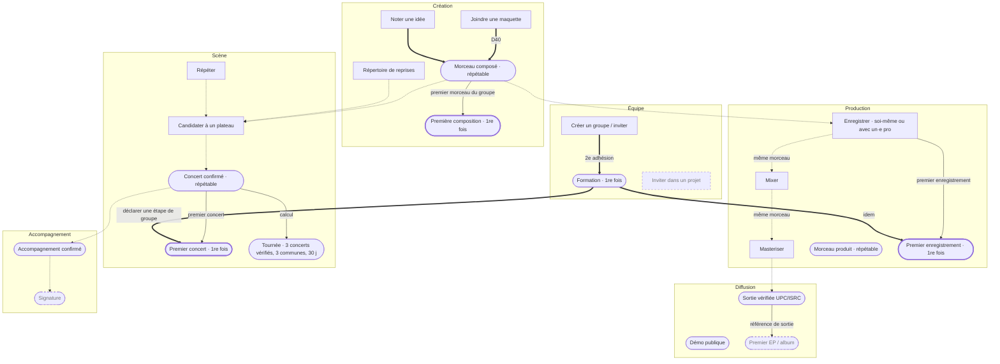
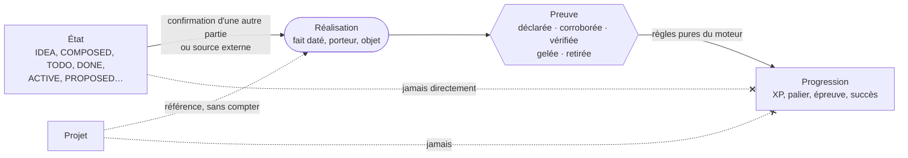
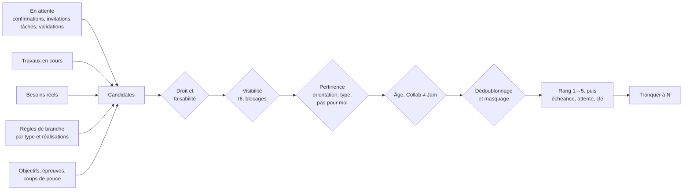
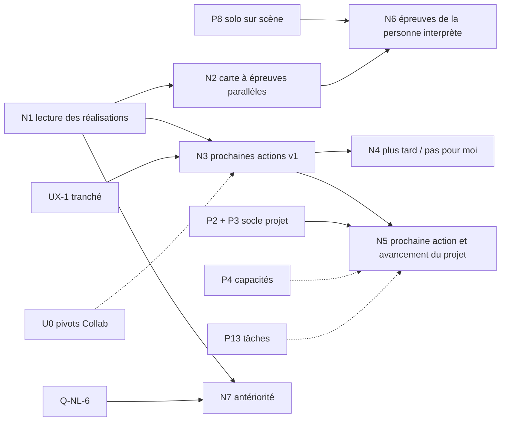

# Progression non linéaire : réalisations, preuves et prochaines actions (G0-04, #72)

> **Nature du document** : conception métier et UX, **sans code** (les lots N1 et N2, livrés, sont notés en §15). Les arbitrages Q-NL-1 à Q-NL-8 ont été **acceptés le 18/11/2026** par le fondateur et consignés dans [D73](../decisions/D73-progression-non-lineaire.md). Aucun
> schéma Prisma, aucune route, aucun service, aucun barème n'est modifié.
> Base vérifiée : `main` à `f3e10fb` (18/11/2026).
>
> Lot : G0-04, issue [#72](https://github.com/Pierre-FABIEN/linkmusician/issues/72).
> Entrées : [audit G0-01](./audit-structurel-collab.md) (#84),
> [D72](../decisions/D72-architecture-projets-collab.md) et
> [conception 19](./19-architecture-cible-collab.md) (#83, **acceptées**),
> [conception 20](./20-parcours-ux-collab.md) (#71), la spécification
> archivée de #72 ([archive §#72](../plan/archive-issues-avant-refonte-2026-11-18.md)),
> conceptions [02](./02-progression.md), [07](./07-modes-de-jeu.md) et
> [08](./08-carrieres-par-role.md).

Chaque affirmation porte l'un de ces marqueurs :

| Marqueur       | Sens                                                                                |
| -------------- | ----------------------------------------------------------------------------------- |
| **[Existant]** | Vérifié dans le code ou les tests de `main`, avec sa référence                      |
| **[D72]**      | Décision déjà acceptée (D72 rév. 2, conception 19) ou autre décision **Acceptée**   |
| **[Proposé]**  | Proposition de ce document, à valider (questions au §16)                            |
| **[Différé]**  | Fonction reconnue nécessaire, mais hors des premiers lots, ou dépendante d'un autre |

---

## Sommaire

1. [Résumé exécutif](#1-résumé-exécutif)
2. [Analyse du fonctionnement actuel](#2-analyse-du-fonctionnement-actuel)
3. [Invariants à préserver](#3-invariants-à-préserver)
4. [Modèle conceptuel de progression](#4-modèle-conceptuel-de-progression)
5. [Diagramme des branches et dépendances](#5-diagramme-des-branches-et-dépendances)
6. [État, réalisation, preuve, progression](#6-état-réalisation-preuve-progression)
7. [Progression individuelle, collective et professionnelle](#7-progression-individuelle-collective-et-professionnelle)
8. [Règles des suggestions contextuelles](#8-règles-des-suggestions-contextuelles)
9. [Priorité des prochaines actions](#9-priorité-des-prochaines-actions)
10. [Proposition UX de la carte de carrière](#10-proposition-ux-de-la-carte-de-carrière)
11. [Les huit scénarios et les cas limites](#11-les-huit-scénarios-et-les-cas-limites)
12. [Sécurité, confidentialité, anti-abus](#12-sécurité-confidentialité-anti-abus)
13. [Performance et optimisations](#13-performance-et-optimisations)
14. [Correspondance avec les services existants](#14-correspondance-avec-les-services-existants)
15. [Découpage en lots](#15-découpage-en-lots)
16. [Questions à arbitrer](#16-questions-à-arbitrer)

---

## 1. Résumé exécutif

**La question** : comment Melokiva accompagne-t-il chaque acteur dans son
évolution musicale, propose-t-il les bonnes collaborations au bon moment et
reconnaît-il les réalisations réelles, sans imposer de progression
chronologique ou artificielle ?

**La réponse courte**, en six règles :

1. **Quatre notions séparées.** L'**état** dit où en est un objet (morceau,
   tâche, projet). La **réalisation** dit ce qui a été accompli. La
   **preuve** dit qui le confirme, et avec quelle fiabilité. La
   **progression** traduit des réalisations prouvées en XP, paliers,
   épreuves et succès. On ne passe d'un état à une réalisation que par la
   **confirmation d'une autre partie** ou une **source externe**. Changer un
   état ne rapporte rien.
2. **Un graphe, pas un tunnel.** Six branches (Équipe, Création,
   Production, Scène, Diffusion, Accompagnement) avancent en parallèle.
   Les seuls **prérequis réels** sont des droits, des consentements,
   l'existence de l'objet visé et les règles de preuve. **Aucun ordre
   musical** n'est exigé : l'absence d'un fait sur Melokiva ne prouve pas
   qu'il n'a pas eu lieu.
3. **Premières fois et répétables.** Les étapes (`Milestone`) restent des
   premières fois uniques. Les réalisations suivantes (concerts, sessions,
   morceaux, tournées) se répètent : elles comptent par leurs propres faits,
   avec les rendements décroissants existants.
4. **Le projet ne compte rien [D72 I3].** Son avancement est une
   **lecture**, calculée sur les réalisations liées et visibles du lecteur.
   Un projet n'a ni XP, ni palier, ni étape. Une réalisation rangée dans
   trois projets ne compte qu'une fois partout.
5. **Un moteur de suggestions déterministe**, sans IA ni XP. Il part
   d'actions réellement disponibles, les filtre par droits et visibilité,
   et les classe en **cinq rangs** : ce qui bloque quelqu'un, ce qui
   attend ma réponse, mon travail en cours, un besoin que je peux combler,
   puis une suggestion facultative. Un professionnel n'est nommé que s'il
   est déjà dans mon réseau réel ; sinon, la suggestion mène à une
   recherche.
6. **La carte de carrière perd son « acte en cours ».** Elle devient une
   mosaïque de branches avec des **épreuves à portée**, en parallèle. Les
   épreuves franchies restent, les épreuves futures disent « bientôt »,
   et une branche peut être déclarée « pas pour moi » sans perte.

**Ce que la conception ne change pas** : le barème XP, le registre en ajout
seul, les règles de preuve, les étapes de groupe et leur contestation, les
paliers. Les seules évolutions de règle proposées concernent la **carte de
carrière** (D53) et sont soumises à arbitrage (§16).

**Premiers lots** (§15) : **N1** lecture unifiée des réalisations
(projection, sans migration), **N2** carte à épreuves parallèles,
**N3** moteur de prochaines actions v1 sur les sources existantes. Les
trois peuvent démarrer avant le socle projet (P2). Les lots liés au
projet (N5), au solo (N6) et à l'antériorité (N7) suivent leurs
dépendances.

**#72 reste ouverte** : son critère de clôture exige du code et des tests.

---

## 2. Analyse du fonctionnement actuel

Pour chaque mécanisme : ce qui existe, ce qui fonctionne, les dépendances
implicites, la limite linéaire éventuelle, ce qu'on garde et ce qu'il faut
adapter.

### 2.1 Étapes de carrière : la carte des huit actes

- **Existe** [Existant] : `src/lib/career/map.ts` (règle pure) et
  `src/lib/server/career/map.ts` (lecture des faits). Huit actes ; I à V
  jouables, VI à VIII « dans le brouillard ». Chaque acte finit par une
  **épreuve** calculée sur des faits, jamais sur l'XP (test
  `map.test.ts` : « jamais l'XP »). Une épreuve est fêtée une fois
  (`Person.actsCelebrated`). Décision D53.
- **Fonctionne** : les épreuves sont indépendantes les unes des autres
  (`passed` est calculé acte par acte) ; on peut franchir l'acte V avant
  l'acte II (test « pas d'ordre imposé »).
- **Dépendances implicites** :
  - acte I : appréciations reçues **en jam** ou collaboration confirmée
    (`jamAppreciations`, donnée de Rencontre lue dans Collab) ; son
    bouton mène à `/jam/agenda` ([map.ts:88](../../src/lib/career/map.ts#L88)) ;
  - acte II : un morceau composé **à plusieurs** et corroboré
    ([map.ts:103](../../src/lib/career/map.ts#L103)) ;
  - actes III et V : une étape **d'un groupe** dont on était membre à la
    date (`creditedBands`, [server/career/map.ts:36-48](../../src/lib/server/career/map.ts#L36-L48)).
- **Limites linéaires** :
  - `current` est **le premier acte jouable non franchi**
    ([map.ts:191](../../src/lib/career/map.ts#L191)). Un groupe de scène
    qui a franchi l'acte V voit toujours « Acte en cours : La création ».
    L'accueil `/espace` n'affiche **que** cet acte
    (`act: map.current`, `src/routes/(app)/espace/+page.server.ts`) ;
  - la numérotation romaine I → VIII suggère un ordre que la règle
    n'impose pas ;
  - l'artiste solo ne peut franchir ni l'acte III ni l'acte V (groupe
    exigé), et le message `soloOnly` l'invite à composer à plusieurs
    ([map.ts:210](../../src/lib/career/map.ts#L210)).
- **À conserver** : épreuves calculées sur des faits prouvés par autrui,
  célébration unique, aucune XP, déblocages affichés sans verrou.
- **À adapter** : remplacer le pointeur unique par une liste d'épreuves à
  portée (§10) ; accepter la personne interprète pour III et V après P8
  (Q-NL-2) ; sortir le lien Jam de Collab (Q-NL-3).
- **Tests** : `src/lib/career/map.test.ts` (12 cas),
  `src/lib/server/career/map.integration.test.ts`,
  `e2e/linkmusician/carriere.spec.ts`.

### 2.2 Les étapes `Milestone` (premières fois de groupe)

- **Existe** [Existant] : dix étapes (`src/lib/milestones/rules.ts`,
  `prisma/seed-data/milestones.js`), **une par groupe et par étape**
  (`@@unique([bandId, definitionId])`, `prisma/schema.prisma:3242`).
  Modes : `formation` (2ᵉ adhésion), `work` (premier morceau composé),
  `declare` (répétition, enregistrement, démo publique, concert), `later`
  (tournée, EP, album, signature). Déclaration jusqu'en 1950
  (`MIN_MILESTONE_DATE`), jamais dans le futur.
- **Fonctionne** : aucun ordre imposé entre étapes ; la preuve ne recule
  jamais (`isUpgrade`) ; la tournée est calculée sur trois concerts
  vérifiés dans trois communes en trente jours (`src/lib/milestones/tour.ts:21`).
- **Dépendances implicites** :
  - seul un groupe **formé** déclare (`declareBlocker`,
    [rules.ts:183](../../src/lib/milestones/rules.ts#L183)) ;
  - une étape antérieure à la formation sur Melokiva est créditée aux
    membres **de la formation** (`creditDate`,
    [rules.ts:167](../../src/lib/milestones/rules.ts#L167)) : l'historique
    d'avant est inconnu ;
  - `Milestone.bandId` référence déjà un `Actor` [D72, conception 19 §2.10] :
    une personne pourra porter ses étapes de scène sans changer la table.
- **Limites linéaires** : aucune dans la règle. Le **palier de groupe**
  (`bandTier`, `src/lib/server/progression/core/tiers.ts:89`) prend la
  **dernière étape dans l'ordre du référentiel** : un groupe qui a joué
  sans enregistrer est « Live », un groupe qui a enregistré sans jouer est
  « Enregistre ». Ce rang ordonne implicitement scène au-dessus de studio.
  Ce n'est pas un blocage, mais c'est une hiérarchie (Q-NL-7).
- **À conserver** : unicité, premières fois, preuve sans recul, contestation
  (D49), date de l'étape distincte de la déclaration.
- **À adapter** : porteur personne pour la scène (P8, D72) ; affichage des
  premières fois comme un **ensemble**, pas comme une échelle (§10).
- **Tests** : `src/lib/milestones/*.test.ts` (règles, preuves,
  contestations, tournée, vérification, référentiel),
  `src/lib/server/milestones/*.integration.test.ts` (service, preuves,
  contestations, enregistrement, paliers), `e2e/linkmusician/etapes.spec.ts`.

### 2.3 Niveaux et paliers

- **Existe** [Existant] :
  - niveau de compte et XP par piste, projetés dans `ActorProgress`
    (reconstructible depuis `XpTransaction`) ;
  - paliers musicien (`MUSICIAN_TIERS`, `tiers.ts`) : des **conditions**
    non imbriquées (« un·e musicien·ne de scène peut ne pas être
    collaborateur·rice ») ;
  - paliers des métiers du son et de la scène (`CRAFT_TIERS`,
    `venueSummary`, `promoterSummary`, `agentSummary`).
- **Fonctionne** : le palier affiché est le plus haut atteint, sans
  imposer les précédents ; l'XP ne donne aucun droit.
- **Limite** : aucune pour les paliers musicien et métier. Le palier de
  groupe est discuté au §2.2.
- **À conserver** : tout. Aucune modification proposée.

### 2.4 Les événements qui donnent des points

- **Existe** [Existant] : union discriminée Zod
  (`src/lib/server/progression/core/events.ts`), une règle par type
  (`core/rules/*.ts`), barème versionné (`core/bareme.ts`), registre en
  ajout seul avec idempotence
  `@@unique([sourceEventId, ruleId, actorId, track])`
  (`prisma/schema.prisma:1937`), annulation par transaction négative liée
  (`reversesId`).
- **Sources d'XP** : profil complété, démo validée, conversation
  réciproque née d'une annonce, adhésion acceptée, **collaboration
  confirmée des deux côtés**, morceau composé à plusieurs (D35), étape de
  groupe attestée (différence de barème par niveau de preuve, part de
  25 % aux membres présents, `memberShare`), prestations du son confirmées
  par l'artiste, crédit sur sortie vérifiée, concert tenu (organisation,
  booker), jam tenue (organisation), accompagnement confirmé, tournée
  bookée, appréciation reçue.
- **Sans XP, avec succès** (D54) : morceau composé seul·e (_Fait maison_),
  rôle du son crédité (_Premier mixage_…), présentation réussie
  (_Passeur_), fondateur·rice.
- **Fonctionne** : aucune source n'est unilatérale ; la valeur dépend de
  la preuve ; rendements décroissants par contrepartie (1 ; 0,5 ; 0,25 ;
  puis 0 sur 365 jours, `bareme.ts:72`) et poids de confiance.
- **Limite linéaire** : aucune. Le moteur ne connaît ni ordre ni acte.
- **À conserver** : intégralement. Ce document **n'ajoute aucune source
  d'XP** et n'en modifie aucune.

### 2.5 Preuves déclarées, corroborées, vérifiées

- **Existe** [Existant] :
  - étapes : `DECLARED` → `CORROBORATED` (un membre présent pour la
    répétition, une personne hors groupe de confiance TL1+ pour
    l'enregistrement et le concert, un lien relu pour la démo) →
    `VERIFIED` (hôte vérifié pour le concert, ingé son ou studio pour
    l'enregistrement, référence UPC/ISRC pour une sortie)
    (`src/lib/milestones/proofs.ts`, `server/milestones/proofs.ts`,
    `release-verification.ts`) ;
  - morceaux : `DECLARED` (composé seul·e) ou `CORROBORATED` (≥ 2 crédits
    confirmés et maquette) (D35, D40) ;
  - production : un fait de collaboration (`Work.recordedAt`…) prime ;
    une étape terminée soi-même vaut `DECLARED`, lue sur l'étape et
    jamais écrite dans `Work` (D70, `src/lib/works/production.ts`) ;
  - contestation : signalement TL1+ qui gèle (`frozenAt`), retenue qui
    reprend l'XP et retire l'étape (D49, `disputes.ts`).
- **Fonctionne** : trois niveaux cohérents entre étapes et morceaux ; les
  lectures de la carte excluent les étapes gelées (`frozenAt: null`).
- **Limite** : la preuve d'un **concert d'une personne** n'existe pas
  (P8) ; une collaboration passée ne se déclare que **60 jours** en
  arrière (`PAST_DAYS`, `src/lib/collaborations/rules.ts:131`) : un
  musicien confirmé ne peut pas faire attester son passé par ce canal
  (scénario H).
- **À conserver** : tout le modèle de preuve.

### 2.6 Les différentes réalisations musicales

[Existant] Elles sont dispersées sur six objets, sans lecture commune :

| Réalisation                         | Objet et champ                                              | Porteur                   | Répétable         | Preuve                          |
| ----------------------------------- | ----------------------------------------------------------- | ------------------------- | ----------------- | ------------------------------- |
| Morceau composé                     | `Work.state = COMPOSED`, `Work.proof`                       | Personne ou groupe        | Oui               | Déclarée / corroborée (D35)     |
| Crédit sur un morceau               | `WorkContributor.confirmedAt`, `WorkRole`                   | Personne                  | Oui               | Consenti (D40)                  |
| Étape de production d'un morceau    | `Work.recordedAt/mixedAt/masteredAt/producedAt`, `WorkStep` | Le morceau                | Une par type (E8) | Collaboration ou déclarée (D70) |
| Collaboration terminée              | `Collaboration.status = COMPLETED`                          | Les participant·es        | Oui               | Confirmée des deux côtés        |
| Première fois d'un groupe           | `Milestone`                                                 | Groupe (`Actor`)          | Non               | Trois niveaux, contestable      |
| Concert tenu, jam tenue, tournée    | Événements `gig.held`, `jam.held`, `tour.booked`            | Organisation, booker      | Oui               | Confirmé par qui jouait         |
| Accompagnement                      | `Representation`, `management.confirmed`                    | Manager, booker           | Oui               | Confirmé par l'artiste          |
| Sortie vérifiée (référence externe) | `Milestone.releaseReference`, `release.credit_verified`     | Groupe ; crédit personnel | Oui (par sortie)  | Vérifiée (API)                  |

**Constat** : chaque lecture (carte, fiche de carrière, paliers, coups de
pouce, « Mes contributions » futur) refait sa propre requête. C'est la
cause du lot **N1** (§15).

### 2.7 Les suggestions de prochaines actions

[Existant] Quatre mécanismes indépendants, sans priorité commune :

| Mécanisme             | Code                                                                       | Ce qu'il propose                                                            | Limites constatées                                                                                                                                                     |
| --------------------- | -------------------------------------------------------------------------- | --------------------------------------------------------------------------- | ---------------------------------------------------------------------------------------------------------------------------------------------------------------------- |
| Objectifs (quêtes)    | `progression/core/quests.ts:143` `nextObjectives`                          | Profil, première démo, contact, groupe, collaboration, morceau, paliers     | Ordonnés par l'ambition ; « rejoindre un groupe » proposé à tous ; aucune notion de projet                                                                             |
| Objectifs des métiers | `core/craftQuests.ts`                                                      | Prestations selon les spécialités cochées                                   | Bon filtrage par spécialité ; à reprendre tel quel                                                                                                                     |
| Coups de pouce        | `src/lib/career/nudges.ts:93`, `server/career/nudges.ts`                   | Place libre, morceau à enregistrer, à mixer, jams de la semaine             | Seulement après 21 jours sans progrès ; suppose **composé → enregistrer → mixer** ; propose des **jams** dans Collab (`JAMS_SOON`, contraire à P9 de la conception 20) |
| Actions prioritaires  | `src/lib/linkmusician/priorityActions.ts:29`, `server/space/priorities.ts` | Collaborations à valider, candidatures, demandes de contact, prochaine date | Bonne base des rangs 1–2 ; l'agenda mêle jams et collaborations ; ordre fixe par métier                                                                                |

**Ce qui fonctionne** : tous sont des règles pures, testées, sans XP dans
le tri ; les coups de pouce ne nomment que des personnes du **réseau
musical réel** (`MusicalTie`), visibles, proches, hors équipe du morceau ;
rien n'est notifié.

**Dépendance linéaire** : `nextProductionNeed`
([production.ts:81](../../src/lib/works/production.ts#L81)) propose
l'enregistrement de tout morceau composé, quel que soit le projet. Un
groupe de reprises orienté scène se verra proposer « enregistrer » sur
chaque morceau composé.

### 2.8 La carte de carrière actuelle à l'écran

[Existant] `/espace/carte` liste les huit actes dans l'ordre, avec un
statut (« Épreuve franchie », « Acte en cours », « Ouvert », « Dans le
brouillard »), l'ambition qui met des actes en avant, et le rappel
« composé seul·e ». L'accueil `/espace` montre l'acte en cours et le
nombre d'actes franchis.

### 2.9 Règles anti-abus

[Existant] Rendements décroissants par contrepartie ; poids de la
confiance de la contrepartie ; confiance TL0–TL3 qui fixe les quotas ;
détection de cercles fermés (`core/collusion.ts`) ; une collaboration par
conversation et par jour (`requireAvailableDay`,
`server/collaborations/service.ts:258`) ; une étape par groupe ; une
`WorkStep` par morceau et par type (`@@unique([workId, kind])`) ; un gain
par événement, règle, acteur et piste ; contestation qui gèle et reprend.
**À conserver** sans changement.

### 2.10 Progression individuelle et collective

[Existant] Pistes séparées : `MUSICIAN`, `BAND`, et une par métier
(`SOUND_ENGINEER`, `PRODUCER`, `PROMOTER`, `BOOKER`, `MANAGER`). Une étape
de groupe crédite le groupe sur `BAND` et **chaque membre présent à la
date** (25 %) sur `MUSICIAN` (`milestoneMember`). Une prestation du son
crédite l'ingé son sur sa piste métier ; l'artiste gagne la collaboration
sur `MUSICIAN`. **Aucun double comptage** : deux parties, deux rôles, deux
pistes, un seul événement source. Le projet n'existe pas encore (P2).

---

## 3. Invariants à préserver

Aucun n'est modifié par ce document.

**De `CLAUDE.md`** : le client n'envoie jamais de valeur de progression ;
`progression/core/` reste pur ; `XpTransaction` en ajout seul,
`ActorProgress` reconstructible ; l'XP n'entre ni dans la réputation, ni
dans la confiance, ni dans un tri ; aucune localisation précise ; toute
nouvelle donnée personnelle entre dans l'export et l'anonymisation RGPD.

**Des décisions acceptées** : une action unilatérale ne rapporte pas d'XP ;
la valeur dépend de la preuve ; la progression ne bloque jamais l'usage
de base ; XP pour l'activité, succès pour la direction (D54) ; épreuves
calculées sur des faits (D53) ; étapes « premières fois » contestables
(D41, D49) ; déclaré ≠ prouvé (D70) ; crédité ≠ membre, mandat ≠
propriété (D65, D71).

**De D72** : I1 le projet ne possède rien ; I2 la participation ne donne
aucun droit ; **I3 le projet ne prouve rien et son avancement est calculé
à la lecture** ; I4 le projet est facultatif ; I6 un lien ne révèle rien,
compteurs et suggestions compris ; I11 non-élévation ; I12 la révocation
l'emporte.

**Invariants NL1–NL5 acceptés** [D73] (décision dédiée du 18/11/2026 ; non implémentés) :

- **NL1 — Aucun ordre musical n'est un prérequis.** Un prérequis serveur
  porte sur un droit, un consentement, l'existence de l'objet visé, une
  règle de preuve, l'âge ou le calendrier (un fait se déclare une fois
  passé). Jamais sur l'existence d'une autre réalisation musicale.
- **NL2 — L'absence de fait n'est pas un défaut.** Ne pas avoir de
  maquette, de groupe ou de concert sur Melokiva n'est jamais présenté
  comme un manque, un retard ou une étape « à faire ».
- **NL3 — Une réalisation compte une fois.** Où qu'elle soit rangée,
  affichée ou agrégée, une réalisation est identifiée par son fait source
  et n'est comptée qu'une fois par lecteur.
- **NL4 — Une suggestion est exécutable.** Elle n'apparaît que si le
  lecteur a, au moment de l'affichage, le droit et la possibilité de
  faire le geste proposé (ou de demander à qui l'a).
- **NL5 — La priorité ne lit pas l'XP.** Aucun rang, aucun tri de
  suggestion ou de prochaine action ne dépend d'un gain potentiel.

---

## 4. Modèle conceptuel de progression

### 4.1 Les objets du graphe

Le graphe a deux sortes de nœuds :

- une **capacité** : ce qu'un acteur **peut faire** maintenant (inviter,
  noter une idée, enregistrer, candidater). Elle dépend de droits, pas de
  réalisations ;
- une **réalisation** : ce qui **a été fait** et reconnu, avec son porteur,
  son objet, sa date et sa preuve.

Et trois sortes de liens :

| Lien                   | Sens                                                                         | Effet                                  | Exemple                                                                   |
| ---------------------- | ---------------------------------------------------------------------------- | -------------------------------------- | ------------------------------------------------------------------------- |
| **Requis** (`hard`)    | Sans lui, le geste est impossible ou faux                                    | Le serveur refuse, avec une raison     | Maquette jointe pour « C'est composé » (D40) ; groupe formé pour déclarer |
| **Dérive** (`derives`) | La réalisation se **calcule** depuis d'autres faits ; personne ne la déclare | Lecture ou événement, jamais un geste  | « Première tournée » dérive de trois concerts vérifiés                    |
| **Suggère** (`soft`)   | Ordre habituel, utile pour proposer la suite                                 | Ordre des suggestions, jamais un refus | Morceau enregistré → mixage                                               |
| _(absence de lien)_    | **Indépendance** : les deux avancent sans se connaître                       | Aucun                                  | Concert et enregistrement                                                 |

### 4.2 Les six branches

Les branches de la spécification #72 sont conservées. Elles sont des
**familles d'affichage et de suggestion**, pas des objets en base.

| Branche            | Capacités (exemples)                                                                      | Réalisations répétables                            | Premières fois (`Milestone`)                           | État de livraison                                                                               |
| ------------------ | ----------------------------------------------------------------------------------------- | -------------------------------------------------- | ------------------------------------------------------ | ----------------------------------------------------------------------------------------------- |
| **Équipe**         | Créer un groupe, inviter, rejoindre, recruter par rôle, inviter dans un projet            | Adhésion acceptée, collaboration terminée          | Formation                                              | [Existant] groupes, rôles ; [D72] projet (P2, P4)                                               |
| **Création**       | Noter une idée, joindre une maquette, créditer, « C'est composé », répertoire de reprises | Morceau composé, crédit confirmé                   | Première composition                                   | [Existant] ; répertoire de reprises déclaré par le groupe (D64)                                 |
| **Production**     | Prendre en charge une étape, faire appel à un·e pro, enregistrer, mixer, masteriser       | Étape de production (fait ou déclarée), prestation | Premier enregistrement                                 | [Existant] prise en charge **RECORDING seule** (`OPEN_WORK_STEP_KINDS`) ; tâches confiées (P13) |
| **Scène**          | Répéter, candidater à un plateau, déclarer un concert, jouer                              | Concert confirmé, tournée                          | Première répétition, premier concert, première tournée | [Existant] pour un groupe ; personne interprète (P8) ; plateaux par format (P8b)                |
| **Diffusion**      | Publier une démo, faire vérifier une sortie                                               | Sortie vérifiée                                    | Première démo publique, premier EP, premier album      | [Existant] démo publique, vérification de sortie ; [Différé] distribution, EP/album (#40)       |
| **Accompagnement** | Proposer ou accepter un mandat, candidater pour autrui                                    | Accompagnement confirmé, tournée bookée            | Signature                                              | [Existant] mandats (D65, D71) ; [Différé] label (#47)                                           |

Une septième lecture, **Contributions**, est transversale : elle rassemble
ce que l'acteur a fait **chez les autres** (crédits, prestations,
collaborations). C'est l'écran « Mes contributions » de la conception 20
(U1), pas une branche de plus.

### 4.3 Typologie des étapes

| Type                      | Définition                                                             | Exemples                                                            | Traitement                                           |
| ------------------------- | ---------------------------------------------------------------------- | ------------------------------------------------------------------- | ---------------------------------------------------- |
| **Prérequis réel**        | Droit, consentement, objet existant, règle de preuve, âge, date passée | Gestion du morceau ; maquette pour composer ; hôte pour un concert  | Refus serveur avec raison et « qui peut le faire »   |
| **Dépendance suggérée**   | Ordre habituel dans un même objet                                      | Enregistré → mixage → mastering                                     | Ordre des suggestions sur **ce** morceau             |
| **Étape facultative**     | Utile, jamais exigée                                                   | Projet, maquette publique, répétition déclarée                      | Proposée au rang 5 au plus, masquable                |
| **Branche parallèle**     | Avance sans l'autre                                                    | Scène et Production                                                 | Tuiles distinctes, aucune ne conditionne l'autre     |
| **Réalisation répétable** | Se produit N fois, chaque fois avec sa preuve                          | Concert, session, morceau, tournée                                  | Comptée par fait ; rendements décroissants existants |
| **Première fois unique**  | La première occurrence, une fois par porteur                           | `Milestone`, épreuves de la carte, succès                           | Unicité en base ; célébrée une fois                  |
| **Future**                | Pas encore livrée sur Melokiva                                         | Premier EP, signature, distribution                                 | « Bientôt » : visible si utile, jamais en suggestion |
| **Non pertinente**        | Le profil ou le projet ne la vise pas                                  | Composition pour un groupe de reprises ; studio pour un projet live | Masquée sur demande, réversible, sans perte (§8.6)   |

### 4.4 Matrice des dépendances

Format repris de la spécification #72 §3, sur les capacités existantes ou
décidées. `Statut` : **D** disponible sur `main`, **P** partiel, **F**
futur (lot cité).

| id                 | Portée          | Requis (hard)                                                      | Suggéré (soft)                      | Indépendant de                     | Peut se sauter | Réalisation produite                          | Preuve                                    | Statut                              |
| ------------------ | --------------- | ------------------------------------------------------------------ | ----------------------------------- | ---------------------------------- | -------------- | --------------------------------------------- | ----------------------------------------- | ----------------------------------- |
| `team.invite`      | groupe          | Gestion du groupe ; cible admissible (âge, blocage)                | Une place libre                     | Morceau, concert                   | Oui            | Adhésion (à l'acceptation)                    | Acceptation de la personne                | D                                   |
| `work.create`      | personne/groupe | Droit sur le porteur                                               | —                                   | Groupe, projet, studio             | —              | Aucune (état `IDEA`)                          | —                                         | D                                   |
| `work.compose`     | morceau         | Gestion ; maquette jointe (D40)                                    | Rôles crédités                      | Enregistrement, scène              | Oui            | Morceau composé                               | Déclaré ; corroboré à 2 crédits confirmés | D                                   |
| `work.record.self` | morceau         | Gestion ; type ouvert (`RECORDING`)                                | Morceau identifiable                | Ingé son, scène, projet            | Oui            | Étape déclarée (D70)                          | Déclarée, jamais plus                     | D (enregistrement seul)             |
| `work.record.pro`  | morceau         | Contact autorisé ; collaboration acceptée des deux côtés           | Morceau composé                     | Concert, groupe                    | Oui            | Collaboration terminée, `recordedAt`          | Confirmée par l'autre partie              | D (1 morceau, E3/E4 → P7)           |
| `work.mix`         | morceau         | Gestion ou collaboration acceptée                                  | Un enregistrement (fait ou déclaré) | Concert                            | Oui            | `mixedAt` ou étape déclarée                   | Idem                                      | P (prise en charge soi-même F, #36) |
| `band.declare`     | groupe          | Gestion ; groupe formé ; date passée ; pas déjà là                 | —                                   | Ordre des autres étapes            | Oui            | Étape `DECLARED`                              | Puis corroboration                        | D                                   |
| `gig.play`         | groupe          | Hôte désigné ; concert passé ; confirmation des deux côtés         | Répertoire, répétition              | Enregistrement, sortie, producteur | Oui            | Collaboration `GIG`, `gig.held`               | Confirmée ; vérifiée si hôte vérifié      | D groupe ; F personne (P8)          |
| `gig.apply`        | groupe          | Plateau ouvert ; droit de candidater (D71) ; format accepté        | Un concert déjà joué                | Enregistrement                     | Oui            | Aucune (candidature)                          | —                                         | D groupe ; F solo (P8b)             |
| `release.verify`   | groupe          | Référence UPC/ISRC valide ; gestion                                | Un master                           | Concert                            | Oui            | Sortie vérifiée                               | Vérifiée (API)                            | P                                   |
| `project.*`        | projet          | Gestion du porteur ou capacité (D72 §9.1)                          | —                                   | **Toute réalisation** (I4)         | Oui            | **Aucune** (I3)                               | —                                         | F (P2–P4)                           |
| `task.deliver`     | tâche           | Être la personne à qui la tâche est confiée ; partage `WORK` (D72) | —                                   | XP, crédit                         | —              | **Aucune** : la preuve reste la collaboration | —                                         | F (P13)                             |
| `mandate.accept`   | personne        | Proposition reçue ; majorité                                       | —                                   | Concerts, sorties                  | Oui            | Accompagnement confirmé                       | Confirmé par l'artiste                    | D                                   |

**Règle anti-faux blocage** [Proposé, NL1] : une ligne qui ajouterait en
`hard` une réalisation musicale (« enregistré avant concert », « groupe
complet avant composition », « album avant manager ») est refusée en
revue, sauf décision documentée.

---

## 5. Diagramme des branches et dépendances

Lecture : `==>` requis, `-->` dérive (calculé), `-.->` suggère (jamais
bloquant). **L'absence de flèche signifie l'indépendance.** Les nœuds
arrondis sont des réalisations, les rectangles des capacités ; les
pointillés marquent le futur.



Deux remarques sur ce graphe :

- les liens `==>` de la formation vers les étapes de scène et
  d'enregistrement sont les **seuls prérequis entre réalisations**. Ils
  viennent de la règle « une étape se déclare pour un groupe formé »
  (D37, D40), pas d'un ordre musical. Ils tombent pour la **personne
  interprète** avec P8 [D72] ;
- les liens `-.->` de la Production restent **dans le même morceau** :
  on ne propose pas de mixer le morceau B parce que le morceau A est
  enregistré.

Le second diagramme situe les quatre notions (§6) :



---

## 6. État, réalisation, preuve, progression

### 6.1 Définitions

| Notion          | Question                                  | Qui l'écrit                                                      | Stockée ?                               | Réversible ?                                     |
| --------------- | ----------------------------------------- | ---------------------------------------------------------------- | --------------------------------------- | ------------------------------------------------ |
| **État**        | Où en est cet objet ?                     | Sa gestion (ou la personne à qui une tâche est confiée)          | Oui, sur l'objet                        | Oui (rouvrir, reporter, abandonner)              |
| **Réalisation** | Qu'est-ce qui a été accompli ?            | Le serveur, à la confirmation d'une autre partie ou d'une source | Oui, sur l'objet du fait                | Non, sauf contestation retenue ou retrait (D49)  |
| **Preuve**      | Qui le confirme, avec quelle fiabilité ?  | Une autre personne, une organisation vérifiée, une API           | Oui (`proof`, attestations, références) | Monte seulement ; tombe par contestation retenue |
| **Progression** | Qu'est-ce que cela change pour l'acteur ? | Le moteur (`progression/core`), jamais le client                 | XP au registre ; le reste **calculé**   | Correction par transaction négative liée         |

### 6.2 Ce qui n'est pas une réalisation

[D72 I3, D70, principe 8 de #72] Ne produisent **ni réalisation, ni preuve,
ni progression** :

- créer, renommer, terminer ou abandonner un **projet** ;
- ranger un élément dans un projet, en changer le partage ;
- inviter quelqu'un, accepter une invitation **de projet**, recevoir ou
  perdre une capacité ;
- créer une tâche, la confier, la passer « en cours » ou « terminée » ;
- déposer ou valider un **livrable** ;
- noter une idée de morceau, publier une annonce, candidater, recevoir une
  candidature ;
- déclarer une ambition ou une orientation ;
- prendre en charge une étape de production et la terminer soi-même : elle
  vaut `DECLARED` (D70), affichée comme telle, sans XP.

Sont des réalisations (existantes) : morceau composé (avec sa preuve),
crédit confirmé, collaboration terminée et confirmée, étape de groupe,
concert, jam ou tournée tenus et confirmés, accompagnement confirmé,
sortie vérifiée. **Une tâche validée ne devient pas une réalisation** : la
preuve d'une prestation reste la collaboration terminée (conception 19
§2.12).

### 6.3 La lecture unifiée des réalisations [Proposé ; livré par N1]

Un type de lecture, **sans table**, rassemble les réalisations d'un acteur :

```text
Realisation = {
  key        // identifiant stable du fait source : "work:<id>:composed",
             // "collab:<id>", "milestone:<id>", "event:<id>"…
  branch     // EQUIPE | CREATION | PRODUCTION | SCENE | DIFFUSION | ACCOMPAGNEMENT
  kind       // WORK_COMPOSED, CREDIT, PRODUCTION_STAGE, COLLABORATION,
             // MILESTONE, GIG, TOUR, RELEASE, MANAGEMENT
  bearerId   // l'acteur qui porte le fait (personne, groupe, organisation)
  objectRef  // morceau, collaboration, étape… (jamais un projet)
  role       // comment le lecteur y a pris part : porteur, membre à la date,
             // crédité·e, prestataire, hôte
  occurredAt
  proof      // DECLARED | CORROBORATED | VERIFIED
  status     // ACTIVE | FROZEN (contestée) | RETIRED
  firstTime  // vrai pour une Milestone
}
```

- **Une source par fait** : la clé désigne l'objet qui porte la preuve.
  Une collaboration de mixage sur un morceau donne **une** réalisation
  `COLLABORATION` (et alimente `Work.mixedAt`, qui n'est pas une seconde
  réalisation mais l'état de production du morceau).
- **Le rôle** distingue « mon groupe l'a fait » (membre à la date) de « je
  l'ai fait » (porteur, crédité·e, prestataire).
- **Les filtres de lecture** : seules les réalisations que le lecteur peut
  voir (`isTeam`, visibilité publique, blocages, mineur·es) ; une
  réalisation `FROZEN` ou `RETIRED` ne franchit aucune épreuve et ne
  s'affiche pas comme prouvée.
- **Le module pur** (`src/lib/career/realisations.ts`, proposé) contient
  les types, la déduplication par clé et le classement par branche ; le
  serveur (`src/lib/server/career/realisations.ts`, proposé) lit les
  tables existantes. C'est le lot **N1**.

**Livré par N1 (18/11/2026)** [Existant] : `src/lib/career/realisations.ts`
(pur) et `src/lib/server/career/realisations.ts` (`readRealisations`,
`realisationsOf(actorId, reader)`) ; la carte et la fiche en déduisent leurs
faits, avec des résultats identiques (détail : `docs/carriere/README.md`).
Écarts techniques avec l'esquisse ci-dessus, sans effet sur une règle :

- `roles[]` au lieu de `role` : une même entrée porte tous les rôles du
  lecteur sur le fait (créditée **et** membre du groupe porteur), ce qui
  garantit NL3 sans choisir un rôle « principal » ;
- champ `visibility` (`PUBLIC` / `PRIVATE`) : une idée de morceau et une
  collaboration ne sortent que pour l'acteur lui-même ;
- clé d'étape `milestone:<bandId>:<definitionId>` (unique en base, stable
  après un retrait), et non l'identifiant de ligne ;
- types livrés : `WORK_COMPOSED`, `CREDIT`, `PRODUCTION_STAGE`,
  `COLLABORATION`, `MILESTONE` (étapes de scène lues par la carte :
  enregistrement, concert, tournée). `GIG`, `TOUR` comme réalisations
  répétables, `RELEASE` et `MANAGEMENT` viendront avec les lots qui les
  lisent (N3, N7) ;
- les appréciations de jam et le compte des collaborations de la carte
  restent lus dans le résumé musicien, qui fait foi pour le palier ;
- `PRODUCTION_STAGE` est la vue, par le lecteur, de la production d'un
  morceau où il a part (acte IV) ; pour le ou la producteur·rice, le fait
  est sa `COLLABORATION` (DC2 : deux parties, deux contributions).

---

## 7. Progression individuelle, collective et professionnelle

### 7.1 Les quatre perspectives

| Perspective          | Ce qu'elle montre                                                                                      | XP                          | Palier / rang                            | Premières fois                                           | Source de vérité                             |
| -------------------- | ------------------------------------------------------------------------------------------------------ | --------------------------- | ---------------------------------------- | -------------------------------------------------------- | -------------------------------------------- |
| **Musicien·ne**      | Ses morceaux, crédits, collaborations, concerts joués, épreuves, succès                                | Piste `MUSICIAN` [Existant] | `MUSICIAN_TIERS` [Existant]              | Épreuves de la carte ; étapes de scène personnelles (P8) | Registre XP ; réalisations où elle a un rôle |
| **Groupe**           | Ses morceaux, étapes, concerts, membres et anciens membres, projets portés                             | Piste `BAND` [Existant]     | `bandTier` [Existant]                    | `Milestone` [Existant]                                   | Registre XP du groupe ; étapes               |
| **Projet**           | Ses éléments visibles, leur état, leurs réalisations, ce qui reste, qui fait quoi                      | **Aucune** [D72 I3]         | **Aucun**                                | **Aucune**                                               | Calcul à la lecture (§7.3)                   |
| **Professionnel·le** | Prestations confirmées, crédits du son, concerts tenus ou bookés, artistes accompagnés, par spécialité | Pistes métier [Existant]    | `CRAFT_TIERS`, résumés métier [Existant] | Succès par rôle (D54)                                    | Registre XP ; « Mes contributions » (U1)     |

### 7.2 Règles sans double comptage [Proposé, sauf mention]

- **DC1 — Un fait, un événement, un gain par règle et par piste.**
  [Existant] Garanti par `@@unique([sourceEventId, ruleId, actorId, track])`.
  Aucun geste de projet n'émet d'événement [D72 I3] : multiplier les
  projets ne multiplie rien.
- **DC2 — Deux parties, deux rôles, deux pistes.** [Existant] L'artiste
  gagne la collaboration (`MUSICIAN`), l'ingé son la prestation
  (`SOUND_ENGINEER`). Ce n'est pas un double comptage : ce sont deux
  contributions distinctes au même fait.
- **DC3 — Groupe et membres.** [Existant] Le groupe reçoit l'étape (`BAND`),
  chaque membre **présent à la date** une part (25 %). Un membre de deux
  groupes reçoit deux parts pour deux étapes distinctes : deux faits.
- **DC4 — Personne et groupe le même soir** (P8). Le porteur d'un concert
  est **l'interprète désigné** de la collaboration : le groupe **ou** la
  personne, jamais les deux. Une personne qui joue avec son groupe ne
  franchit pas son « Premier concert » personnel ; une personne qui joue
  en son nom ne franchit pas celui de son groupe. Les épreuves III et V
  d'une personne comptent les deux sources (son groupe à la date, ou
  elle-même), **dédupliquées par clé** : une même soirée ne compte qu'une
  fois (acceptation P8 de la conception 19).
- **DC5 — Projet : compter des clés distinctes.** L'avancement d'un projet
  compte les réalisations **distinctes** de ses éléments visibles. Un
  morceau rangé dans l'EP et dans la tournée apparaît dans les deux
  projets, mais une seule fois dans « Mes contributions », dans la carte et
  dans toute vue « tous projets ».
- **DC6 — L'épreuve lit des faits, pas des points.** [Existant, D53] Un
  même fait peut franchir deux épreuves différentes (une collaboration de
  production franchit l'acte I et l'acte IV). C'est voulu : les épreuves
  décrivent des expériences, pas des gains.
- **DC7 — Pas de réattribution.** L'avancement d'un projet ne crée, ne
  déplace et ne recalcule aucune XP déjà gagnée.

### 7.3 L'avancement d'un projet [D72 I3 ; détail proposé]

L'avancement est **une ligne d'état par famille** (conception 20 §7.2),
calculée sur les éléments que le lecteur voit, jamais un pourcentage :

| Famille de projet (D72)            | Ligne d'état calculée (exemples)                          | Source                                              |
| ---------------------------------- | --------------------------------------------------------- | --------------------------------------------------- |
| Enregistrement (EP, album, single) | « 2 titres mixés sur 4 » · « 1 en attente de validation » | `productionStages` des morceaux liés ; tâches (P13) |
| Scène (tournée, concert)           | « 3 dates jouées · 2 à venir · 1 plateau ouvert »         | Collaborations `GIG` liées ; annonces liées         |
| Production, campagne, autre        | « 5 éléments · 2 tâches en cours »                        | Éléments liés ; tâches                              |

Règles :

- **dénominateur** : le nombre d'éléments **liés et visibles**, jamais une
  cible inventée (« 4 titres pour un EP ») ;
- **déclaré et prouvé distingués** : « 2 mixés (dont 1 déclaré) » ;
- **ce qui reste** : seulement des besoins réels (étape sans responsable,
  rôle sans personne, tâche refusée, plateau à pourvoir), jamais une
  étape facultative ;
- un projet `DONE` ou `ABANDONED` garde sa dernière lecture, sans
  célébration ni gain (P7 de la conception 20).

### 7.4 Les deuxièmes fois

[D72, conception 19 §2.10] Un deuxième EP ou une deuxième tournée ne sont
pas de nouvelles étapes : ce sont des **projets terminés** et des
**réalisations répétables**. [Proposé] La carte et la page du groupe
peuvent afficher un **compteur factuel** (« 3 tournées », « 14 concerts
confirmés »), calculé sur les faits, sans XP ni célébration
supplémentaire. Les rendements décroissants existants s'appliquent aux
gains éventuels de chaque fait.

---

## 8. Règles des suggestions contextuelles

### 8.1 Le contrat du moteur [Proposé ; livré par N3, voir §9.5]

Un moteur **déterministe**, en deux couches, comme les coups de pouce
existants :

- **règle pure** (`src/lib/career/next/`, proposé ; partagée serveur et
  navigateur, sans Prisma) : reçoit des faits déjà filtrés, renvoie une
  liste ordonnée ;
- **projection serveur** (`src/lib/server/career/next.ts`, proposé) :
  lit les faits **visibles du lecteur**, réutilise les prédicats de droits
  existants, puis appelle la règle pure. Aucune permission n'est décidée
  dans le navigateur.

**Entrées** (toutes calculées côté serveur) :

| Entrée          | Contenu                                                                              | Source existante ou prévue                                 |
| --------------- | ------------------------------------------------------------------------------------ | ---------------------------------------------------------- |
| `scope`         | Accueil, projet, morceau, groupe                                                     | Route                                                      |
| `reader`        | Métier actif, majorité, rôles sur l'objet (gère, coordonne, participe, crédité·e)    | `TRACKS`, `canReceiveRequest`, `isTeam`, D72 `projectView` |
| `pending`       | Ce qui attend le lecteur : confirmations, invitations, tâches proposées, validations | `pendingForMe`, `spacePriorities`, P4, P13                 |
| `work`          | Ses travaux en cours : morceaux `IDEA`, étapes prises en charge, tâches en cours     | `teamWhere`, `stepFactsOf`, P13                            |
| `needs`         | Besoins réels : rôle sans personne, étape sans responsable, plateau à pourvoir       | `WorkRole` libres, `nextProductionNeed`, annonces          |
| `realisations`  | Réalisations du lecteur et de l'objet (§6.3)                                         | N1                                                         |
| `orientation`   | Ambition personnelle ; type du projet ; branches « pas pour moi »                    | `Person.ambition` ; `Project.type` (P2) ; N4               |
| `network`       | Personnes du réseau réel, visibles, proches, avec leurs spécialités                  | `MusicalTie`, `findActorsNear` (coups de pouce)            |
| `opportunities` | Annonces ouvertes compatibles, visibles                                              | `Opportunity`, matching #27                                |
| `dismissed`     | Suggestions différées ou masquées                                                    | N4 (aucune persistance avant)                              |

**Sortie** : au plus `N` candidates (3 sur l'accueil, 5 dans une fiche),
chacune :

```text
Suggestion = {
  key        // stable : "<règle>:<objet>", ex. "prod.mix:work_abc"
  rank       // 1 à 5 (§9)
  branch
  scope      // où elle s'affiche
  title      // une phrase, sans reproche
  why        // pourquoi maintenant, en une phrase ("Titre 2 est enregistré.")
  href, cta  // l'écran qui réalise le geste ; jamais une écriture directe
  dismissal  // NONE (rangs 1–2) | LATER | NOT_FOR_ME
  subject    // référence de l'objet, déjà autorisée pour le lecteur
}
```

### 8.2 Le pipeline



### 8.3 Les filtres, dans l'ordre

1. **Droit et faisabilité (NL4).** Le lecteur peut faire le geste
   maintenant : prédicat serveur existant (gestion du morceau, du groupe,
   capacité de projet relue, droit de candidater D71) et état compatible
   (pas « C'est composé » sur un morceau composé, pas « mixer » sans
   type de prise en charge ouvert). Sinon : soit rien, soit la variante
   « Proposer à la gestion » quand la capacité existe (conception 20 P4).
2. **Visibilité (I6).** Le sujet est lisible par le lecteur au moment du
   calcul ; titre, compte et raison ne mentionnent que ce qu'il voit.
   Aucune suggestion sur un élément lié sans partage.
3. **Pertinence.** Le type de projet, le répertoire du groupe (D64),
   l'ambition et les branches « pas pour moi » écartent ou rétrogradent
   (§8.5). L'absence d'un fait ne crée pas de suggestion à elle seule
   (NL2) : il faut un **déclencheur** (§8.4).
4. **Âge et séparation des modes.** Un·e mineur·e ne reçoit aucune
   suggestion de contacter une personne inconnue, de candidater seul·e à
   un plateau (Q-G0-12) ni de coordonner. **Aucune jam, disponibilité ou
   Super Jam dans Collab** (conception 20 P9) : le coup de pouce
   `JAMS_SOON` reste dans Rencontre.
5. **Dédoublonnage.** Une seule suggestion par couple (règle, objet) ;
   une seule par objet et par écran (la plus avancée : « mixer » plutôt
   que « enregistrer » si l'enregistrement est déjà pris en charge) ; une
   action déjà présente dans « À traiter » n'est pas répétée comme
   suggestion ; une suggestion de projet n'est pas répétée à l'accueil
   si le héros montre déjà ce projet.
6. **Masquage.** Les clés différées ou masquées (§8.6) sont retirées.

### 8.4 Les déclencheurs par branche

Une suggestion de rang 3 à 5 naît d'un **déclencheur** : un fait récent,
un besoin exprimé, un type de projet ou une orientation. Jamais du seul
vide.

| Règle (clé)          | Déclencheur                                                                           | Proposition                                                                          | Rang | Ne pas proposer si…                                                                     |
| -------------------- | ------------------------------------------------------------------------------------- | ------------------------------------------------------------------------------------ | ---- | --------------------------------------------------------------------------------------- |
| `crea.demo`          | Morceau `IDEA` que je gère, modifié récemment, sans maquette                          | « Joins une maquette à Titre »                                                       | 3    | Le morceau est dans un projet de type Scène seulement et le répertoire est « reprises » |
| `crea.compose`       | Morceau `IDEA` avec maquette                                                          | « Titre est-il composé ? »                                                           | 3    | —                                                                                       |
| `crea.credit`        | Un crédit proposé sur mon morceau, **en attente** de la personne                      | « Lina n'a pas encore confirmé son rôle » (lien vers le morceau ; relance à la main) | 4    | Le crédit a été refusé ; la personne n'est plus visible                                 |
| `prod.record`        | Morceau composé dans un projet de type enregistrement, ou orientation « enregistrer » | « Prépare l'enregistrement de Titre »                                                | 4    | Projet Scène, branche Production « pas pour nous », étape déjà prise en charge          |
| `prod.mix`           | Morceau enregistré (fait ou déclaré), mixage ni fait ni pris en charge                | « Titre est enregistré : place au mixage »                                           | 4    | Même conditions ; mixage pris en charge                                                 |
| `prod.master`        | Morceau mixé, projet de type enregistrement                                           | « Trouver qui masterise »                                                            | 4    | Pas de projet enregistrement et pas d'orientation « enregistrer »                       |
| `prod.find_pro`      | Un besoin `prod.*` ci-dessus                                                          | Personnes du **réseau réel** ayant la spécialité, sinon recherche filtrée            | 4    | Lecteur mineur hors de son groupe ; aucune spécialité correspondante                    |
| `scene.slot`         | Plateau ouvert, compatible (zone, format), pour un groupe que je gère                 | « Un plateau à Toulouse le 12/12 »                                                   | 4    | Format non accepté ; mineur·e seul·e ; projet Enregistrement seulement                  |
| `scene.next_date`    | Projet Scène actif, aucune date à venir                                               | « Chercher une date »                                                                | 4    | Projet en pause ou terminé                                                              |
| `scene.rehearsal`    | Projet Scène avec date à venir et nouveau membre récent                               | « Prévoir une répétition »                                                           | 5    | —                                                                                       |
| `team.fill_role`     | Rôle libre sur un morceau ou besoin de projet sans annonce                            | « Publie une annonce » ou personne du réseau proche                                  | 4    | Annonce déjà ouverte pour ce rôle                                                       |
| `proof.attest`       | Étape `DECLARED` du groupe, attestant possible connu                                  | « Faire confirmer le premier concert »                                               | 5    | Étape gelée ; contestée ; aucune personne éligible                                      |
| `trial.within_reach` | Épreuve de la carte dont un fait déclencheur existe déjà (concert joué non vérifié…)  | « Ton concert peut être vérifié par le lieu »                                        | 5    | Branche « pas pour moi »                                                                |
| `objective.*`        | Objectifs existants (`nextObjectives`, `craftQuests`)                                 | Inchangés                                                                            | 5    | Doublon d'une suggestion plus concrète                                                  |

La ligne `crea.credit` est volontairement restreinte : on ne suggère
jamais de « créditer quelqu'un » à partir d'une supposition.

### 8.5 Le type de projet et l'orientation [Proposé]

- **Le type de projet** (D72 : EP, album, single, tournée, concert,
  festival, production, campagne, « Autre » selon UX-2) est l'orientation
  **collective** principale : il choisit les règles de branche applicables
  dans ce projet. Un projet « Tournée » ne suggère pas d'enregistrer ;
  un projet « EP » ne suggère pas de candidater à un plateau (il peut le
  montrer au rang 5 si l'orientation du groupe le permet, cf. ci-dessous).
- **L'ambition personnelle** (`Person.ambition`, existante) reste
  **personnelle** : elle ordonne les suggestions de l'accueil et de la
  carte, jamais celles d'un projet d'autrui.
- **Pas de nouvelle « orientation de groupe »** au lancement : le
  répertoire déclaré (D64 : reprises, compositions, les deux) et les types
  de ses projets suffisent. Un groupe de reprises ne reçoit pas de
  suggestion de composition. Revoir au pilote (Q-NL-5).
- **Une orientation ne retire jamais une capacité** : elle change
  l'ordre et le tri des suggestions, pas les droits ni l'accès aux écrans
  (conception 20 P8).

### 8.6 Différer et masquer [Proposé]

| Geste            | Effet                                                                          | Rangs concernés | Retour                                                           |
| ---------------- | ------------------------------------------------------------------------------ | --------------- | ---------------------------------------------------------------- |
| **Plus tard**    | La clé disparaît **30 jours**, ou jusqu'à un nouveau fait sur son objet        | 3 à 5           | Automatique                                                      |
| **Pas pour moi** | La **règle** (ou la branche) est masquée dans ce périmètre (moi, ce projet)    | 4 et 5          | Réglage « Ce que Melokiva me propose », réversible à tout moment |
| _(aucun)_        | Les rangs 1 et 2 sont de vraies demandes : on y **répond** (accepter, refuser) | 1 et 2          | —                                                                |

- « Pas pour nous » sur un projet est un geste de sa **gestion** ; un·e
  participant·e masque pour elle-même seulement.
- Masquer ne supprime aucune réalisation, aucune capacité, aucun écran.
- **Persistance** : nouvelle donnée personnelle (clé, périmètre,
  échéance), couverte par l'export et l'anonymisation RGPD. C'est un
  changement de schéma : lot **N4**, après arbitrage Q-NL-4. Avant N4,
  la règle de dédoublonnage et la limite de **une suggestion de rang 5 par
  écran** tiennent lieu de garde-fou.

### 8.7 Le cas de référence : quatre compositions et un EP

Groupe Lumière, quatre morceaux composés, projet « EP Lumière » actif,
porté par le groupe. Lecteur : Sam, gestion du groupe.

| Fait                                                                                     | Suggestion produite                                                                        | Rang | Pourquoi ce rang                                      |
| ---------------------------------------------------------------------------------------- | ------------------------------------------------------------------------------------------ | ---- | ----------------------------------------------------- |
| Inès (ingé son) a terminé la collaboration de prise de son de Titre 1, en attente de Sam | « Confirme la session de Titre 1 avec Inès »                                               | 1    | Inès attend, seul Sam peut confirmer                  |
| Titres 2 à 4 composés, enregistrement non pris en charge                                 | **Une** suggestion « Préparer l'enregistrement de 3 titres »                               | 4    | Besoin réel d'un projet EP ; groupée par projet       |
| Aucun ingé son dans le projet                                                            | « Inès a déjà travaillé avec vous » (réseau) ou « Chercher un·e ingé son à Toulouse »      | 4    | Justifié par le besoin ; nom seulement du réseau réel |
| Aucune répétition déclarée                                                               | Rien                                                                                       | —    | Pas de déclencheur : l'absence n'est pas un défaut    |
| Aucun producteur                                                                         | Rien par défaut ; rang 5 si l'orientation de Sam est « Enregistrer » ou « Devenir pro »    | 5    | Facultatif                                            |
| Aucune date de concert                                                                   | Rien dans le projet EP ; à l'accueil, rang 5 seulement si un plateau compatible est ouvert | 5    | Autre branche, autre projet                           |

Résultat dans la fiche : 1) confirmer la session (héros), 2) préparer
l'enregistrement, 3) trouver un·e ingé son. Les deux dernières sont
groupées si elles portent sur les mêmes titres.

### 8.8 Recommander un professionnel

[Proposé, conforme à la conception 20 P12 et aux coups de pouce existants]

- **Jamais sans besoin exprimé ou calculé** sur un objet du lecteur.
- **Nommer** une personne seulement si elle est dans le **réseau réel**
  du lecteur (`MusicalTie` : on a déjà joué ensemble), visible, non
  bloquée, avec la spécialité correspondante ; la phrase dit pourquoi
  (« vous avez joué ensemble »).
- **Sinon**, la suggestion mène à une **recherche filtrée** (métier,
  spécialité, zone arrondie), dont l'ordre reste celui de la recherche
  (jamais l'XP).
- **Rien n'est envoyé** sans geste explicite : la suggestion ouvre un
  profil ou une recherche, pas un message.
- Un·e mineur·e ne reçoit de nom qu'à l'intérieur de son groupe ou de son
  réseau existant.

---

## 9. Priorité des prochaines actions

### 9.1 Les cinq rangs [Livré par N3 pour les sources existantes ; cohérent avec UX-1 et la conception 20 §7.3]

| Rang  | Nature                                               | Critères (tous requis)                                                                                                                                         | Exemples                                                                                                                                                |
| ----- | ---------------------------------------------------- | -------------------------------------------------------------------------------------------------------------------------------------------------------------- | ------------------------------------------------------------------------------------------------------------------------------------------------------- |
| **1** | **Bloque réellement un autre acteur**                | Une autre personne a agi et attend ; **seul·e le lecteur** (ou sa gestion) peut débloquer ; sans réponse, la réalisation ou le travail de l'autre est suspendu | Collaboration terminée par l'autre, à confirmer ; livrable déposé, à valider (gestion de l'élément) ; tâche acceptée qui attend une décision du lecteur |
| **2** | **Invitation ou validation qui demande une réponse** | Une demande nominative au lecteur, en attente                                                                                                                  | Invitation au groupe ou au projet ; tâche proposée ; crédit à confirmer ; attestation demandée ; mandat proposé ; candidature reçue                     |
| **3** | **Travail personnel ou projet à poursuivre**         | Un objet que le lecteur gère ou une tâche qu'il ou elle a acceptée, en cours                                                                                   | Ma tâche en cours (déposer) ; morceau `IDEA` récent ; prochaine étape du projet principal                                                               |
| **4** | **Besoin du projet qu'on peut combler**              | Un besoin réel (§7.3) sur un objet du lecteur, et un geste disponible                                                                                          | Étape sans responsable ; rôle libre ; plateau compatible ; ingé son à trouver                                                                           |
| **5** | **Suggestion facultative de progression**            | Déclencheur de §8.4, rien d'autre                                                                                                                              | Faire confirmer une étape ; épreuve à portée ; objectif                                                                                                 |

**Ce qui ne compte jamais** (NL5) : XP potentielle, palier visé, épreuve
à fêter, nombre de suggestions déjà vues.

### 9.2 Tri à l'intérieur d'un rang

1. **Échéance réelle** la plus proche (date d'un concert, expiration
   d'une proposition, date d'une session) — seulement si l'échéance est
   un fait stocké ;
2. **attente** la plus longue (date de la demande) ;
3. **clé stable** (ordre lexical) pour départager.

Le tri est **déterministe** : à faits égaux, même ordre à chaque visite.
Le héros peut changer quand un fait change ; la mosaïque des projets
reste stable pendant la session (conception 20 P11).

### 9.3 Où s'affiche quoi

| Écran                  | Rangs 1–2               | Rang 3                            | Rangs 4–5                              |
| ---------------------- | ----------------------- | --------------------------------- | -------------------------------------- |
| Accueil Collab (héros) | Le premier, s'il existe | Sinon, le projet principal        | Sinon, une suggestion (rang 4 avant 5) |
| « À traiter »          | **Tous**, par section   | —                                 | —                                      |
| Fiche projet           | Ceux de ce projet       | Ma tâche, prochaine étape         | Au plus 2                              |
| Fiche morceau          | Ceux de ce morceau      | « La suite du morceau » existante | Au plus 1                              |
| Carte de carrière      | —                       | —                                 | Épreuves à portée (§10), au plus 3     |

### 9.4 États vides

| Situation                        | Ce qu'on montre                                                                              |
| -------------------------------- | -------------------------------------------------------------------------------------------- |
| Rien en attente, travaux à jour  | « Tu es à jour. » et **une** porte : le projet principal, ou les trois portes du compte neuf |
| Compte neuf                      | Trois choix au même rang (conception 20 §6.2) ; aucune suggestion de progression             |
| Tout masqué par « pas pour moi » | « Tu as choisi ce que Melokiva te propose. » + lien vers le réglage                          |
| Projet sans élément              | « Range un morceau ou une date » (gestion) ; « Rien à faire pour toi ici » (participant·e)   |
| Professionnel·le sans demande    | Ses contributions récentes et le lien vers son espace métier                                 |

Aucun état vide ne dit ce que la personne « n'a pas fait » (NL2), ni
depuis combien de temps.

### 9.5 Ce que N3 a livré, et les écarts [Livré le 18/11/2026]

[Détail du code : [docs/carriere](../carriere/README.md#prochaines-actions-n3-72)]

- **Emplacements** : règle pure `src/lib/career/next/` (`candidatesFrom`,
  `rankSuggestions`), projection `src/lib/server/career/next.ts`
  (`nextFactsFor`, `nextActionsFor`). Contrat de §8.1 tenu (`key`,
  `rank`, `branch`, `scope` = `HOME` ou `DETAIL`, `title`, `why`, `href`,
  `cta`, `dismissal`, `subject`), plus `deadline` et `waitingSince` pour
  le tri §9.2. Le navigateur ne reçoit que la clé, le rang, la branche, la
  phrase et le geste.
- **Règles livrées** : `collab.confirm` (rang 1 si une autre partie a déjà
  confirmé, sinon 2), `collab.respond`, `credit.confirm`,
  `band.invitation`, `representation.respond`, `applications.review`,
  `contact.respond` (rang 2) ; `work.step`, `crea.demo`, `crea.compose`
  (rang 3) ; `prod.mix`, `prod.record`, `team.fill_role` (rang 4) ;
  `trial.within_reach`, `objective` (rang 5).
- **Écarts avec §8.4, faute de `Project` (P2)** : `prod.record` ne lit pas
  de type de projet ; il est au rang 4 si l'ambition est « Enregistrer » ou
  « Devenir pro », sinon **rétrogradé au rang 5** (§8.5 : l'orientation
  change l'ordre, pas les droits). `prod.mix` reste au rang 4 (son
  déclencheur est un fait : le morceau est enregistré). `prod.find_pro`
  est fusionné dans `prod.record` / `prod.mix` (le geste nomme la personne
  du réseau ou ouvre la recherche filtrée), comme le prévoit §8.7.
- **Droits (NL4)** : les besoins (rangs 3 et 4) ne portent que sur des
  morceaux que le lecteur **gère** (prédicat `manageableOwnerWhere` des
  mutations) : un·e membre sans gestion garde les coups de pouce, qui
  restent inchangés. Une étape n'est proposée que si son type est ouvert
  (`OPEN_WORK_STEP_KINDS`), sinon `applyWorkStep` la refuserait.
- **Personnes nommées (§8.8)** : réseau réel, visibles, hors équipe, et
  **majeures** ; sinon recherche filtrée pour un·e adulte, et pour un·e
  mineur·e la fiche du morceau (prise en charge soi-même) ou rien.
- **Non livré, faute de source** : `crea.credit` (relance d'un crédit
  attendu chez une autre personne), `scene.slot`, `scene.next_date`,
  `scene.rehearsal`, `proof.attest` hors épreuve à portée, tâches et
  livrables (P13). Rien n'est inventé à leur place.
- **Limites d'affichage** : 3 sur l'accueil, 5 en vue détaillée (aucune
  vue détaillée n'existe encore), une seule de rang 5, une par règle aux
  rangs 3 à 5 (une même règle ne remplit pas l'écran). « Plus tard » et
  « Pas pour moi » sont typés (`dismissal`) mais **aucun bouton n'est
  affiché** et rien n'est enregistré avant N4.
- **Intégration UI** : bloc « À faire maintenant » en tête du pivot
  « priorités » de `/espace` (musicien·ne et espaces métier), au-dessus
  des quatre aperçus existants, qui restent. **Le héros `NextStep` n'est
  pas changé** : UX-1 n'est pas tranché (#71). Point d'intégration pour
  U0 : si UX-1 est accepté, le héros d'« avancer » prend
  `next[0]` quand il existe, et `NextStep` passe en tête de « repères » ;
  l'accueil musicien passe alors l'objectif au moteur (option `objective`,
  rang 5) puisqu'il ne sera plus montré par le héros.
- **Dédoublonnage N2** : la page de branche ne répète plus dans « En
  cours » une collaboration déjà proposée dans « Possible maintenant ».
- **Constat de sécurité (non corrigé, hors N3)** : les déclencheurs de la
  carte (`collaborationsToConfirm`) et la page `/espace/a-confirmer` lisent
  les collaborations sans le filtre de blocage des priorités. Le moteur ne
  reprend une épreuve visant une collaboration que si elle a passé ce
  filtre ; la carte et la page sont laissées telles quelles (N2 inchangée)
  et sont à aligner dans U0 (« À traiter »).

---

## 10. Proposition UX de la carte de carrière

### 10.1 Ce qui change [Q-NL-1 ; livré par N2, sauf « Pas pour moi » (N4)]

- **Plus d'« acte en cours »** : la carte montre **jusqu'à trois épreuves
  à portée**, choisies parmi les épreuves non franchies dont un fait
  déclencheur existe (un concert joué mais non vérifié rend l'épreuve
  Scène « à portée »), triées par l'ambition, puis par branche.
- **Plus de numéros romains** à l'écran : les huit épreuves gardent leur
  nom (« La rencontre », « Le studio »…), regroupées par branche. Le
  numéro reste interne (`actsCelebrated`, célébrations).
- **Des branches en mosaïque**, chacune une tuile Metro.
- **Quatre statuts d'épreuve** au lieu de quatre statuts d'acte :
  _Franchie_, _À portée_, _Ouverte_, _Bientôt_. Plus « dans le
  brouillard » : une fonction non livrée dit « Bientôt sur Melokiva ».
- **« Pas pour moi »** sur une branche : la tuile se replie en bas de la
  carte, sans perte ; elle sort des suggestions.

### 10.2 Mobile, 390 px [Livré par N2, voir §10.7]

```text
┌──────────────────────────────────────┐
│ ma carrière                    ✉ 🔔 ? │
│ branches · épreuves · contributions   │  pivots
├──────────────────────────────────────┤
│ ▌À PORTÉE                     [big]  │  héros violet
│ ▌Le concert du 08/11 peut être       │
│ ▌vérifié par Le Bikini               │
│ ▌                 [Demander au lieu] │  un seul geste
├──────────────────┬───────────────────┤
│ SCÈNE        ✓ 2 │ CRÉATION      ✓ 1 │  bleu | bleu
│ 14 concerts      │ 6 morceaux        │  ligne d'état factuelle
│ 1 tournée        │ dont 2 à plusieurs│
├──────────────────┼───────────────────┤
│ PRODUCTION       │ ÉQUIPE        ✓ 1 │
│ 2 enregistrés    │ 1 groupe          │
│ 1 en cours       │ 3 collaborations  │
├──────────────────┴───────────────────┤
│ DIFFUSION · Bientôt : sorties et EP  │  paper
├──────────────────────────────────────┤
│ Pas pour moi : Accompagnement   [▾]  │  repliée
└──────────────────────────────────────┘
```

- **Une tuile = une branche = une intention** : l'ouvrir mène à sa page
  (épreuves de la branche, premières fois, réalisations récentes, travaux
  en cours, ce qui est possible maintenant).
- **Ligne d'état** : des faits comptés (« 14 concerts »), jamais un
  pourcentage, jamais d'XP.
- **✓ n** : épreuves et premières fois obtenues dans la branche.
- Desktop : la même mosaïque élargie (conception 20 P10) ; aucune tuile en
  plus.

### 10.3 La page d'une branche [Livré par N2, sans moteur de suggestions]

Sections, dans l'ordre, chacune repliée si vide :

1. **Possible maintenant** : au plus deux gestes (suggestions de la
   branche, rangs 3 à 5) ;
2. **En cours** : étapes prises en charge, tâches, candidatures en
   attente ;
3. **Réalisé** : réalisations récentes avec leur preuve (« Corroboré par
   Jo », « Vérifié par Le Bikini », « Déclaré par toi ») ;
4. **Premières fois et épreuves** : un ensemble de pastilles, sans ordre
   de difficulté ;
5. **Pas possible pour l'instant** : une phrase par empêchement, avec
   **qui peut** ou **ce qui manque** : « Les plateaux solos dépendent de
   l'organisateur », « Réservé aux adultes », « Bientôt sur Melokiva ».
   Jamais « fais d'abord X ».

### 10.4 Contributions professionnelles

Pour un métier non musicien, le pivot « contributions » passe en
premier (UX-4) : prestations confirmées par spécialité, artistes
distincts, crédits sur sorties vérifiées. Les épreuves des métiers (paliers
`CRAFT_TIERS`) gardent leurs conditions actuelles ; elles s'affichent
comme ensemble, pas comme échelle.

### 10.5 Ce qu'on évite

- Un arbre de compétences : pas de nœuds à « acheter », pas de
  verrou visuel, pas de chemin dessiné entre les branches.
- Une récompense déconnectée : aucune tuile ne montre de points ; les
  célébrations restent celles des épreuves et succès existants.
- Une liste de devoirs : aucune case à cocher « à faire » pour une étape
  facultative.

### 10.6 Accessibilité et performance

Chaque tuile a un nom accessible qui lit la branche, la ligne d'état et
le nombre d'épreuves ; l'ordre de lecture suit l'ordre visuel ;
`prefers-reduced-motion` coupe les animations de célébration ; contraste
des pastilles conforme à D55 §4.9. La carte se calcule en une lecture
(N1), les pages de branche à la demande (§13).

### 10.7 Ce que N2 a livré, et les écarts avec l'esquisse

[Livré le 18/11/2026, [docs/carriere](../carriere/README.md)]

- **Branches des épreuves** : Équipe (La rencontre), Création (La
  création), Production (Le studio, La production), Scène (La scène),
  Diffusion (La sortie, bientôt), Accompagnement (Le développement et La
  carrière, bientôt). Le numéro interne 1 à 8 ne s'affiche plus nulle
  part (carte, accueil, célébration, fiche, carte souvenir).
- **Faits déclencheurs retenus** (aucune condition de franchissement
  nouvelle) : collaboration passée qui n'attend que ma confirmation
  (Rencontre ; Production pour une production côté artiste ; Scène pour un
  concert côté groupe chez un hôte vérifié) ; rôle en attente sur un
  morceau composé déclaré où je suis confirmé·e (Création) ; « Premier
  enregistrement » déclaré, non gelé, d'un de mes groupes (Studio) ;
  « Premier concert » corroboré non vérifié (Scène). Une session
  d'enregistrement avec un·e pro n'est **pas** retenue : sa vérification
  dépend de conditions (studio, membres, formation du groupe) qu'on ne
  peut pas promettre à l'affichage.
- **Tuiles** : grille 2 colonnes sur mobile, 4 sur grand écran, hauteur
  libre (pas de `lm-mosaic` à rangées fixes, qui couperait les textes à
  390 px). Ligne d'état tirée de `CareerFacts` seulement (rien d'affiché
  quand il n'y a rien, NL2) ; « ✓ n » compte les **épreuves** franchies de
  la branche (les premières fois sont sur la page de branche). Trois tons
  vifs : violet (héros), ambre (autres épreuves à portée), bleu (branches).
- **Page de branche** : « Possible maintenant » réutilise le geste des
  épreuves à portée, puis la porte d'entrée (`cta`) des épreuves ouvertes ;
  « En cours » lit les mêmes déclencheurs et les réalisations gelées ;
  aucune suggestion nouvelle (N3).
- **Non fait** : « Pas pour moi » par branche (N4 : aucun bouton factice
  n'est affiché) ; héros alimenté par le moteur N3 ; « 14 concerts » de
  l'esquisse (les concerts confirmés ne sont pas dans `CareerFacts` ; la
  tuile Scène montre les premiers concerts vérifiés et les tournées).

---

## 11. Les huit scénarios et les cas limites

Pour chaque scénario : faits, réalisations reconnues, étapes accessibles,
suggestions, suggestions à ne pas afficher, preuves, impact sur la
progression, limites actuelles.

### A — Artiste solo qui compose et enregistre sans groupe

Maya compose six morceaux seule, en enregistre trois chez elle, puis fait
mixer deux titres par Inès.

- **Faits** : six `Work` portés par Maya, `COMPOSED`, `DECLARED` ; trois
  étapes `RECORDING` prises en charge `SELF/HOME` et terminées ; deux
  collaborations `MIXING` terminées avec Inès.
- **Réalisations** : six morceaux composés (déclarés) ; trois
  enregistrements **déclarés** (D70) ; deux mixages **confirmés** ; succès
  _Fait maison_ et _Orchestre à soi seul·e_ (D54).
- **Accessibles** : toutes les capacités de Création et de Production ;
  un projet « EP » facultatif ; Scène par la personne interprète après
  P8.
- **Suggestions** : mixer le troisième titre enregistré (rang 4), avec
  Inès nommée (réseau réel) ; masteriser les deux titres mixés si un
  projet EP existe (rang 4) ; épreuve « Le studio » à portée après P8/N6
  (rang 5).
- **À ne pas afficher** : « monte un groupe », « compose à plusieurs pour
  franchir l'acte II » comme objectif mis en avant, toute jam dans
  Collab, « enregistrer » sur les titres déjà pris en charge.
- **Preuves** : les mixages sont prouvés par Inès ; les enregistrements
  maison restent déclarés, ce qui est affiché sans jugement.
- **Progression** : collaborations (`MUSICIAN`, ×rendement par Inès) ;
  Inès gagne ses prestations (`SOUND_ENGINEER`) ; aucune XP de
  composition seule (D35).
- **Limites actuelles** : actes II et III infranchissables seule
  (`worksTogether`, `creditedBands`) ; message `soloOnly` ; mixage pris
  en charge soi-même non ouvert (`OPEN_WORK_STEP_KINDS = ['RECORDING']`) ;
  une collaboration = un morceau (E3).

### B — Groupe qui privilégie la scène

Les Ronces, groupe de reprises (D64), jouent douze concerts avant tout
enregistrement.

- **Faits** : groupe formé ; répertoire « reprises » ; douze
  collaborations `GIG` terminées, dont huit avec des hôtes vérifiés ;
  aucune œuvre originale.
- **Réalisations** : _Formation_ (vérifiée), _Premier concert_
  (vérifié), _Première tournée_ si trois concerts vérifiés dans trois
  communes en trente jours ; douze concerts confirmés (répétables).
- **Accessibles** : toute la Scène ; Création et Production restent
  ouvertes, sans suggestion.
- **Suggestions** : plateaux compatibles (rang 4) ; faire confirmer la
  première répétition (rang 5) ; « 14 concerts » en ligne d'état.
- **À ne pas afficher** : « enregistrer une maquette », « composer »,
  « publier une démo » (répertoire reprises, NL2).
- **Preuves** : hôte vérifié pour les concerts ; personne extérieure TL1+
  pour la corroboration.
- **Progression** : étapes (`BAND`, part de 25 % aux membres présents) ;
  collaborations ; épreuve Scène franchie pour chaque membre présent ;
  organisateurs et bookers gagnent `gig.held`.
- **Limites actuelles** : l'accueil affiche « Acte en cours : La
  création » ; palier de groupe « Tournée » (correct, mais présenté comme
  rang) ; `nextProductionNeed` proposerait d'enregistrer tout morceau
  composé.

### C — Groupe qui privilégie le studio

Nébuleuse réalise un EP de cinq titres sans avoir joué sur scène.

- **Faits** : cinq morceaux composés à plusieurs (corroborés) ;
  enregistrements, mixages et masters par collaborations ; un projet
  « EP » (P2) ; une sortie avec référence UPC.
- **Réalisations** : _Première composition_, _Premier enregistrement_
  (vérifié par le studio), sortie vérifiée ; épreuves Création, Studio,
  Production.
- **Accessibles** : Diffusion (vérification de sortie) ; Scène ouverte.
- **Suggestions** : masteriser le dernier titre (rang 4) ; faire vérifier
  la sortie (rang 5) ; aucune date de concert dans le projet EP.
- **À ne pas afficher** : « candidater à un plateau » en héros ; « premier
  concert » comme objectif mis en avant (seulement si l'ambition de la
  personne est « scène » ou « pro », au rang 5, à l'accueil).
- **Preuves** : collaborations confirmées par l'ingé son ou le studio ;
  vérification externe de la sortie.
- **Progression** : collaborations, composition à plusieurs (150 par
  contributeur), étapes ; `release.credit_verified` pour les pros du son.
- **Limites actuelles** : _Premier EP_ en mode `later` ; œuvre,
  enregistrement et sortie confondus (E8, P10) ; une collaboration par
  conversation et par jour (E4).

### D — Plusieurs projets simultanés

Le groupe Lumière mène « EP Lumière » et « Tournée de printemps ».

- **Faits** : deux projets portés par le groupe (P2) ; quatre morceaux
  dans l'EP, dont deux aussi au répertoire de la tournée ; six dates
  liées à la tournée.
- **Réalisations** : celles des morceaux et des concerts, **une seule
  fois** chacune (DC5) ; aucun gain lié aux projets.
- **Accessibles** : chaque projet à son rythme ; un participant d'un
  projet n'a rien dans l'autre (I2).
- **Suggestions** : par projet (« 2 titres mixés sur 4 » ; « 3 dates sur
  6 ») ; à l'accueil, le héros prend le rang le plus urgent tous projets
  confondus, puis le projet principal (UX-3).
- **À ne pas afficher** : une suggestion de l'EP dans la fiche de la
  tournée ; un compteur global qui additionnerait deux fois les morceaux
  partagés.
- **Preuves** : inchangées.
- **Progression** : aucune différence avec ou sans projets.
- **Limites actuelles** : aucun objet projet (E1, P2) ; la « campagne »
  actuelle est un morceau.

### E — Ingénieur du son sur plusieurs projets

Inès enregistre trois titres de Lumière (dans l'EP) et mixe deux titres de
Maya (hors projet).

- **Faits** : collaborations `RECORDING` et `MIXING` ; crédits du son ;
  participation au projet EP (P4) avec tâches confiées (P13).
- **Réalisations** : cinq prestations confirmées (une par
  collaboration terminée) ; succès _Première prise de son_, _Premier
  mixage_.
- **Accessibles** : ses tâches ; ses dépôts de livrables ; « Mes
  contributions ».
- **Suggestions** : déposer la v2 du titre 3 (rang 3) ; confirmer un
  crédit (rang 2) ; rien sur la composition, rien sur la carrière de
  musicienne si son métier actif est ingé son.
- **À ne pas afficher** : le titre d'un morceau de l'EP non partagé avec
  elle ; « 2 éléments masqués » ; une relance automatique des artistes.
- **Preuves** : confirmation de l'artiste ; validation du livrable **ne
  prouve rien** (seule la collaboration terminée prouve).
- **Progression** : `services.RECORDING` et `MIXING` × rendement par
  artiste (Lumière et Maya sont deux contreparties distinctes) × confiance
  de l'artiste.
- **Limites actuelles** : un morceau par collaboration (E3, P7) ; une par
  jour et par conversation (E4) ; pas de tâches confiées (P13).

### F — Producteur coordinateur

Karim coordonne l'EP de Lumière (capacité `COORDINATE`, D72 §9.1).

- **Faits** : participant coordinateur ; il confie des `WorkStep` des
  éléments partagés « travail » ; il attend des dépôts et des validations.
- **Réalisations** : sa production n'est reconnue que par une
  collaboration `PRODUCTION` terminée et confirmée par le groupe ; **la
  coordination elle-même ne compte pas** (I3).
- **Accessibles** : confier, réattribuer une tâche refusée, poser des
  dates, proposer un besoin ; **pas** valider un livrable (gestion de
  l'élément), **pas** publier au nom du groupe.
- **Suggestions** : réattribuer la tâche refusée par Lina (rang 3 pour
  lui) ; étape sans responsable sur un élément « travail » (rang 4) ;
  proposer un besoin de mastering (rang 4).
- **À ne pas afficher** : « valider le livrable » (pas son droit) ;
  « 3 livrables en attente » s'il ne voit pas ces éléments.
- **Preuves** : collaboration de production confirmée.
- **Progression** : `services.PRODUCTION` sur sa piste ; acte IV pour les
  musicien·nes crédité·es.
- **Limites actuelles** : ni projet ni capacités (P2, P4) ; sans eux,
  Karim doit être ADMIN du groupe (audit G0-01).

### G — Manager de plusieurs artistes

Sophie accompagne trois artistes : un groupe de scène, une artiste studio
et un duo débutant.

- **Faits** : trois `Representation` confirmées ; un droit de candidater
  (D71) pour le groupe de scène.
- **Réalisations** : trois accompagnements confirmés ; dates bookées si
  elle est aussi booker.
- **Accessibles** : ce que chaque mandat ouvre, artiste par artiste ;
  aucune écriture sur leurs projets (#44 ; mandat de projet différé, P12).
- **Suggestions** : une proposition de mandat à trancher (rang 2) ; un
  plateau compatible pour le groupe dont elle a le droit de candidater
  (rang 4) ; rien pour l'artiste studio en Scène.
- **À ne pas afficher** : les suggestions de progression **personnelles**
  de ses artistes (elles sont à eux) ; un classement de ses artistes ; tout
  élément privé d'un projet d'artiste.
- **Preuves** : confirmation de l'artiste.
- **Progression** : `management.confirmed` (`MANAGER`) ; `tour.booked`
  pour le booker.
- **Limites actuelles** : mandats sans portée de projet (E12) ; espace
  manager à finaliser (#44).

### H — Musicien confirmé nouvellement inscrit

Jo joue depuis quinze ans, a sorti deux albums avec son ancien groupe et
deux cents concerts.

- **Faits connus de Melokiva** : aucun au départ.
- **Réalisations reconnaissables** :
  - un **groupe existant** qu'il crée sur Melokiva peut déclarer ses
    étapes passées jusqu'en 1950 [Existant], créditées à l'effectif de la
    formation sur la plateforme (`creditDate`) ; elles restent
    `DECLARED` jusqu'à corroboration ;
  - une **sortie avec référence UPC/ISRC** se vérifie par l'API
    MusicBrainz depuis la page d'un groupe [Existant,
    `server/milestones/release-verification.ts`] : c'est la meilleure
    preuve d'antériorité, mais elle passe aujourd'hui par un groupe ;
  - ses morceaux peuvent être créés et marqués composés, sans date de
    composition.
- **Accessibles** : tout, dès le premier jour (la progression ne bloque
  jamais l'usage).
- **Suggestions** : « Ajoute une sortie que tu as faite » (rang 5) ;
  pas de « premier contact », « premier groupe » ni « première démo » si
  Jo déclare son expérience (Q-NL-6).
- **À ne pas afficher** : les objectifs de débutant·e en héros ; une carte
  qui lui dit « Acte I en cours » ; une incitation à « recommencer ».
- **Preuves** : déclarée pour le passé, vérifiée pour les sorties
  référencées, corroborée par d'anciens partenaires inscrits.
- **Progression** : seulement ce que le barème prévoit pour chaque
  niveau de preuve (déclaré : faible ; vérifié : plein) ; **aucune XP pour
  une simple déclaration d'expérience**.
- **Limites actuelles** : collaborations limitées à **60 jours** en
  arrière (`PAST_DAYS`) ; aucune étape personnelle ; épreuve Scène exige
  un concert vérifié **sur Melokiva**.

### Cas limites

| Cas                                           | Règle                                                                                                                                                                                                         | Existant / proposé                                     |
| --------------------------------------------- | ------------------------------------------------------------------------------------------------------------------------------------------------------------------------------------------------------------- | ------------------------------------------------------ |
| **Départ d'un groupe**                        | Les étapes passées restent créditées (membre à la date) ; les suivantes non ; les suggestions sur les objets du groupe disparaissent à la lecture suivante ; ses étapes de production sont libérées (E10, P1) | [Existant] crédit à la date ; [D72] P1 pour E10        |
| **Dissolution**                               | Plus de déclaration (`declareBlocker`) ; réalisations conservées ; aucune suggestion sur le groupe ; projets du groupe en lecture (conception 19 §6.5) ; crédits publics conservés (P6)                       | [Existant] blocage ; [D72] P6                          |
| **Révocation d'une capacité ou d'un partage** | Suggestions recalculées à chaque lecture (jamais mises en cache avec les droits) ; geste refusé sous verrou `project:` (I12) ; le lien mène à un 404 uniforme                                                 | [D72] I12 ; [Proposé] pas de cache des suggestions     |
| **Fin d'un mandat**                           | Les suggestions de l'agent sur l'artiste disparaissent ; la candidature déléguée est refusée (D71)                                                                                                            | [Existant] D71                                         |
| **Contestation d'une étape**                  | Gelée : ne franchit aucune épreuve, pas de suggestion `proof.attest` ; retenue : XP reprise, épreuve recalculée, aucune célébration négative                                                                  | [Existant] `frozenAt`, D49                             |
| **Épreuve franchie puis perdue**              | Elle redevient « ouverte », sans message de perte ; `actsCelebrated` n'est pas vidé, donc pas de seconde célébration si elle est refranchie                                                                   | [Existant] célébration unique ; [Proposé] texte neutre |
| **Compte supprimé ou anonymisé**              | Ses réalisations chez autrui suivent P6 ; il disparaît des suggestions nommées                                                                                                                                | [D72] P6 ; [Existant] `publicActorWhere`               |
| **Mineur·e**                                  | Aucune suggestion de contact inconnu, de candidature solo ni de coordination ; noms seulement dans son groupe ou son réseau                                                                                   | [Existant] D5, D37, D46 ; [D72] Q-G0-12                |
| **Projet abandonné**                          | Ses suggestions disparaissent ; ses réalisations restent intactes (I1)                                                                                                                                        | [D72] I1                                               |
| **Même morceau dans deux projets**            | Une suggestion par morceau et par écran ; la fiche de chaque projet le montre selon **son** partage                                                                                                           | [Proposé] DC5, §8.3                                    |

---

## 12. Sécurité, confidentialité, anti-abus

| Risque                                                | Règle serveur                                                                                                                                  | Contrainte d'intégrité                                                            | Tests                                                                                                     |
| ----------------------------------------------------- | ---------------------------------------------------------------------------------------------------------------------------------------------- | --------------------------------------------------------------------------------- | --------------------------------------------------------------------------------------------------------- |
| Points créés en multipliant les projets               | Aucun service de projet n'émet d'événement de domaine (I3)                                                                                     | Aucun type d'événement `project.*` dans `domainEventSchema`                       | Unitaire : l'union d'événements ne contient pas `project.*` ; intégration : 10 projets, registre inchangé |
| Double comptage d'une réalisation partagée            | Lecture par clé de fait (§6.3) ; avancement par clés distinctes (DC5)                                                                          | `@@unique([sourceEventId, ruleId, actorId, track])` existante                     | Unitaire : déduplication ; intégration : un morceau dans 3 projets, compteurs à 1                         |
| Même contribution déclarée plusieurs fois             | Collaboration : unicité par paire et par jour, puis par morceau et par jour (P7) ; rendements décroissants ; crédits confirmés une fois        | `WorkStep @@unique([workId, kind])`, `Milestone @@unique([bandId, definitionId])` | Intégration : deux déclarations concurrentes, une seule réalisation (barrières existantes)                |
| Preuve contestée ou retirée utilisée                  | Lectures avec `frozenAt: null` ; réalisation `RETIRED` exclue ; reprise par transaction négative liée                                          | `reversesId @unique` existante                                                    | Intégration : épreuve perdue après contestation retenue ; pas de suggestion sur étape gelée               |
| Suggestion qui révèle un projet ou un morceau privé   | Candidates construites **après** le filtre de lecture ; titre et compte calculés sur le visible ; pas de compte de masqués                     | —                                                                                 | Intégration : lecteur sans partage, aucune clé ni titre ; snapshot du texte                               |
| Action après révocation d'un mandat ou d'une capacité | Droit relu à l'écriture sous verrou (I12, D71) ; suggestions jamais mises en cache avec les droits                                             | —                                                                                 | Intégration à barrière : révocation entre affichage et POST → refus sans effet partiel                    |
| Recommandations inadaptées aux mineur·es              | Filtre d'âge dans la projection serveur (§8.3, point 4)                                                                                        | —                                                                                 | Unitaire : profil mineur, aucune suggestion `prod.find_pro` hors réseau, `scene.slot` solo                |
| Professionnel·le nommé·e sans justification           | Nom seulement depuis `MusicalTie` visible ; sinon recherche                                                                                    | —                                                                                 | Unitaire : aucune personne hors réseau dans `subject`                                                     |
| Client qui forge un rang ou une clé                   | Le client n'envoie que « plus tard / pas pour moi » sur une clé ; le serveur vérifie que la clé fait partie des suggestions calculées pour lui | Clé bornée, périmètre relu                                                        | Intégration : POST de clé inventée → refus                                                                |
| Suggestion utilisée comme spam d'invitations          | Une suggestion ouvre un écran ; les quotas d'invitation existants s'appliquent                                                                 | —                                                                                 | E2E : aucun message envoyé sans geste                                                                     |
| Calculs coûteux sur les tableaux de bord              | Voir §13                                                                                                                                       | —                                                                                 | Test de nombre de requêtes par chargement (budget)                                                        |

**Aucun nouveau système de points n'est introduit.** Les compteurs
factuels (§7.4) et les lignes d'état ne sont pas des scores et n'entrent
dans aucun calcul.

---

## 13. Performance et optimisations

### 13.1 Constats [Existant]

- `/espace` lance déjà neuf projections en parallèle (tableau de bord,
  carte, coups de pouce, priorités, représentations…).
- `careerEvidence` fait **au moins huit requêtes** (plus celles de
  `getMusicianTier`), dont une recherche
  `domain_events` par `actorIds has` et filtre JSON sur `payload`
  (`server/career/map.ts:71`). La table `domain_events` n'a d'index que
  sur `processedAt` et `(type, occurredAt)` : la recherche par acteur
  n'est pas indexée. À **mesurer** avant d'agir (`EXPLAIN ANALYZE` sur la
  base de démo).
- Les coups de pouce ne se calculent que si la personne n'avance plus
  (`onlyIfStalled`), ce qui protège l'accueil.
- **Mesuré par N1** (18/11/2026, schéma `e2e`, scénario de
  `realisations.integration.test.ts`) : faits de la carte 8 → 6 requêtes
  SQL, fiche publique 17 → 14, fiche privée 20 → 17, carte souvenir
  13 → 10 ; latence médiane des faits de la carte inchangée au bruit près
  (57–59 ms avant, 52–61 ms après, base Neon distante). Prisma charge
  chaque relation par une requête (`relationJoins` non activé) : passer
  sous six demanderait du SQL brut ou une option du schéma, hors N1.

- **Mesuré par N3** (18/11/2026, schéma `e2e`, scénario de
  `next.integration.test.ts`) : l'accueil lisait 31 requêtes (compte
  neuf) et 32 (compte actif) pour la carte, les priorités et
  l'accompagnement ; avec les prochaines actions et la mémorisation par
  requête, **36 et 49** (sans mémorisation : 67 et 81). Latence médiane
  observée : 162 → 173 ms (neuf), 160 → 222 ms (actif), base Neon
  distante. Le layout ne relit plus les réalisations quand la page les lit.

### 13.2 Stratégie [Proposé ; points 1, 2 et 7 livrés par N3]

1. **Une lecture des réalisations par requête HTTP** (N1), mémorisée le
   temps de la requête et partagée par la carte, les suggestions et la
   fiche de carrière : on supprime les lectures en double.
2. **Requêtes bornées** : `take` sur les morceaux (déjà 20 dans les coups
   de pouce), sur les projets (3 à l'accueil), sur les candidates ; les
   comptes par `groupBy` ou `count`, jamais par chargement complet.
3. **Index** : si la mesure le confirme, un index GIN sur
   `domain_events.actorIds` (migration additive, à retirer de la liste de
   `db:nettoyer-migration` si créé en SQL brut). Aucune migration dans ce
   lot.
4. **Avancement de projet** : calculé pour les projets affichés
   seulement ; la liste « Mes projets » se contente de la ligne d'état du
   type, calculée en une requête par famille.
5. **Pas de cache des suggestions** entre requêtes : elles dépendent des
   droits (I12). On peut mettre en cache des **faits publics** (référentiel
   des étapes, plateaux ouverts d'une zone) quelques minutes.
6. **Chargement progressif** : héros et « À traiter » d'abord ; tuiles de
   branches et suggestions de rang 5 en promesse différée (streaming
   SvelteKit), avec état de chargement lisible.
7. **Budget** : un test d'intégration compte les requêtes d'un
   chargement de `/espace` et échoue au-delà d'un seuil fixé au lot N3.

---

## 14. Correspondance avec les services existants

| Besoin de la conception          | Service existant                                                                     | Sort                                                                                        | Lot     |
| -------------------------------- | ------------------------------------------------------------------------------------ | ------------------------------------------------------------------------------------------- | ------- |
| Lecture unifiée des réalisations | `server/career/map.ts` `careerEvidence`, `getMusicianTier`, `server/career/sheet.ts` | Extraire en `realisationsOf` ; la carte et la fiche la consomment                           | N1      |
| Épreuves parallèles              | `lib/career/map.ts` `careerMap`                                                      | ✅ `withinReach[]` au lieu de `current` ; `passed`, célébrations, déblocages gardés (N2)    | N2      |
| Ambition                         | `lib/career/ambition.ts`                                                             | Inchangée ; ordonne les épreuves à portée et le rang 5                                      | N2, N3  |
| Rangs 1–2                        | `linkmusician/priorityActions.ts`, `server/space/priorities.ts`, `pendingForMe`      | Source des rangs 1–2 ; « À traiter » (U0) les détaille                                      | N3      |
| Rang 3                           | `works` (`teamWhere`, morceaux `IDEA`), `stepFactsOf`                                | Source « travail en cours »                                                                 | N3      |
| Rang 4 production                | `works/production.ts` `nextProductionNeed`                                           | Garder la règle **par morceau** ; ajouter le filtre type de projet / répertoire             | N3, N5  |
| Rang 4 réseau                    | `career/nudges.ts` `pickNudges` (`OPEN_ROLE`, `TO_RECORD`, `TO_MIX`)                 | Devient une source du moteur ; plus seulement « si bloqué » ; `JAMS_SOON` reste à Rencontre | N3      |
| Rang 5                           | `core/quests.ts` `nextObjectives`, `core/craftQuests.ts`                             | Sources inchangées, dédoublonnées                                                           | N3      |
| Héros de l'accueil               | `NextStep`, `PriorityActions`                                                        | Suivent UX-1 : travail d'abord, `NextStep` ensuite                                          | N3 (U0) |
| Prochaine action d'un projet     | Conception 20 §7.3 (règle par rôle)                                                  | Implémentée dans le moteur, portée « projet »                                               | N5 (U7) |
| Preuves                          | `milestones/proofs.ts`, `disputes.ts`, `release-verification.ts`                     | Inchangés ; lus par N1                                                                      | —       |
| Moteur d'XP                      | `progression/core/*`, `ledger.ts`, `processor.ts`                                    | **Inchangé**                                                                                | —       |
| Étapes personnelles de scène     | `Milestone` (porteur `Actor`), `declareBlocker`, `checkGigParties`                   | P8 (D72)                                                                                    | N6      |
| Masquage                         | —                                                                                    | Nouveau (persistance), RGPD                                                                 | N4      |
| Antériorité                      | `milestoneDetailsSchema` (1950), `release-verification`                              | Réutilisés ; « expérience déclarée » selon Q-NL-6                                           | N7      |

---

## 15. Découpage en lots

Les lots sont indépendants, testables, et entrent dans des issues
existantes (**aucune issue nouvelle**). Ils précisent le **P9** de D72 et
le **U7** de la conception 20 sans les dupliquer : N2 + N3 + N5 forment
P9/U7 ; N1 est leur fondation ; N4, N6 et N7 sont des extensions.



### N1 — Lecture unifiée des réalisations · #72

- **Objectif** : `realisationsOf(actorId, reader)` et son module pur
  (§6.3) ; la carte et la fiche de carrière l'utilisent ; aucun
  comportement visible ne change.
- **Dépendances** : aucune.
- **Migration** : aucune.
- **Tests** : unitaires (déduplication par clé, rôles, gel, retrait) ;
  intégration (mêmes faits qu'avant pour la carte : non-régression des
  tests `map.integration.test.ts`) ; comptage des requêtes.
- **Acceptation** : la carte et la fiche donnent les mêmes résultats ;
  une requête de moins au moins par chargement.
- **État** : ✅ livré le 18/11/2026 (mesures §13.1). Non fait : la
  mémorisation par requête HTTP (§13.2, point 1) ; le layout et la page de
  `/espace` lisent encore chacun les réalisations quand une célébration est
  à vérifier. À reprendre avec N3, qui ajoute un troisième lecteur.

### N2 — Carte à épreuves parallèles · #72

- **Objectif** : §10 : `withinReach[]` au lieu de `current` ; mosaïque de
  branches ; statuts _Franchie / À portée / Ouverte / Bientôt_ ; plus de
  numéros romains à l'écran ; l'accueil montre les épreuves à portée ;
  lien Jam de l'acte I déplacé vers Rencontre (Q-NL-3).
- **Dépendances** : N1 ; Q-NL-1, Q-NL-3 (défauts applicables).
- **Migration** : aucune (`actsCelebrated` inchangé).
- **Tests** : unitaires (scénarios B et C : aucune épreuve « en cours »
  bloquée par une autre ; ambition qui réordonne sans changer d'état) ;
  E2E `carriere.spec.ts` adapté (390 px, axe).
- **Acceptation** : « aucun acte ne reste en cours parce qu'un autre
  n'est pas franchi » (P9 de la conception 19).
- **État** : ✅ livré le 18/11/2026 (§10.7). `careerMap` rend `state`
  (Franchie, À portée, Ouverte, Bientôt), `withinReach` (≤ 3) et
  `branches` ; plus de `current` ni de `roman`. Requêtes : carte 6 dans le
  scénario de référence (inchangé), faits + 2 pour un compte neuf ; fiche
  et carte souvenir inchangées. Conditions, preuves, XP, célébrations
  (`actsCelebrated`) inchangées ; seul le titre affiché de la célébration
  perd son numéro (« Épreuve franchie : La rencontre »).

### N3 — Prochaines actions v1 · #72, #71

- **Objectif** : moteur §8–§9 sur les **sources existantes** (priorités,
  travaux, `nextProductionNeed`, coups de pouce sans jam, objectifs) ;
  héros de l'accueil selon UX-1 ; limite de une suggestion de rang 5 par
  écran.
- **Dépendances** : N1 ; UX-1 ; s'intègre à U0 si U0 est livré avant.
- **Migration** : aucune.
- **Tests** : unitaires (rangs, tri stable, dédoublonnage, mineur·e, pas
  d'XP dans l'entrée — test de forme comme `map.test.ts`) ; intégration
  (visibilité, révocation à barrière, aucune jam dans Collab) ; E2E
  accueil (compte neuf, groupe de scène, ingé son).
- **Acceptation** : scénarios A, B, C, E et H (partie existante) rejoués
  sans suggestion interdite du §11.
- **État** : ✅ moteur livré le 18/11/2026 (§9.5) ; héros de l'accueil
  laissé à U0 tant qu'UX-1 n'est pas tranché. Les scénarios du §11 ne
  sont pas rejoués un à un : leurs règles interdites sont couvertes par les
  tests unitaires et d'intégration (aucune jam, aucune absence présentée
  comme un manque, aucun nom hors réseau). Budget de requêtes fixé :
  5 et 17 requêtes ajoutées à l'accueil (seuils 6 et 20).

### N4 — Différer et masquer · #72

- **Objectif** : §8.6, avec persistance.
- **Dépendances** : N3 ; Q-NL-4.
- **Migration** : additive (table des choix de suggestion), RGPD (export,
  anonymisation).
- **Tests** : intégration (clé forgée refusée, échéance, « pas pour
  nous » réservé à la gestion) ; export RGPD.

### N5 — Prochaine action et avancement du projet · #72, #71, #36

- **Objectif** : conception 20 §7.3 et §7.3 de ce document : ligne
  d'état par famille, prochaine action par rôle, besoins réels, filtre
  par type de projet.
- **Dépendances** : P2 + P3 (U2) ; P4 pour les rôles ; P13 pour les
  tâches et livrables (rangs 1–3 correspondants).
- **Migration** : aucune (lecture).
- **Tests** : intégration (DC5 : morceau dans deux projets ; participant
  sans partage ; coordinateur sans droit de valider) ; E2E scénarios D et
  F.

### N6 — Épreuves de la personne interprète · #72, #36

- **Objectif** : épreuves Studio et Scène franchissables par une personne
  (Q-NL-2) ; DC4.
- **Dépendances** : P8 ; N2.
- **Tests** : unitaires et intégration (personne et groupe le même soir,
  une seule fois ; solo qui franchit Scène sans groupe).

### N7 — Antériorité · #72, #40

- **Objectif** : parcours d'arrivée d'un musicien confirmé (scénario H) :
  ajouter une sortie référencée, déclarer les étapes passées d'un groupe,
  et, selon Q-NL-6, une expérience déclarée qui filtre les objectifs de
  débutant·e.
- **Dépendances** : N1 ; Q-NL-6 ; #40 pour les sorties.
- **Migration** : seulement si Q-NL-6 retient une donnée nouvelle (RGPD).

### Ordre recommandé et articulation

| Rang | Lot | Pourquoi                                                       | En parallèle de |
| ---- | --- | -------------------------------------------------------------- | --------------- |
| 1    | N1  | Fondation sans risque ; aucune décision requise                | U0, U1, P1, P6  |
| 2    | N2  | Corrige la linéarité visible la plus forte (« acte en cours ») | P2              |
| 3    | N3  | Donne au héros de l'accueil sa règle (UX-1)                    | U0, U2          |
| 4    | N5  | Dès que P2/P3 existent                                         | P4, P13         |
| 5    | N6  | Avec P8                                                        | P8b             |
| 6    | N4  | Quand le pilote montre la répétition de suggestions            | —               |
| 7    | N7  | Avant l'ouverture aux musicien·nes confirmé·es du pilote       | #40             |

**Liens avec les issues** : #72 (N1–N7, reste ouverte jusqu'au code) ;
#71 (N3 et N5 donnent leur règle au héros et à la fiche projet, U0 et
U7) ; #36 (rangs 1–3 des tâches et livrables, P13) ; #40 (antériorité par
sorties, E8, P10) ; #41–#45 (« contributions » et rangs des métiers,
aucune règle nouvelle par métier) ; #77 (plateaux et événements comme
déclencheurs `scene.*` quand G3 existera).

**Ce que les lots ne font pas** : aucun moteur générique de règles, aucun
statut générique, aucun ordonnanceur, aucune réservation multi-titres,
aucune nouvelle source d'XP.

---

## 16. Questions à arbitrer

### 16.1 Décisions produit rendues (D73 acceptée)

Chaque question a été **tranchée explicitement le 18/11/2026**. La colonne « Défaut proposé » ci-dessous décrit la valeur **retenue** dans [D73](../decisions/D73-progression-non-lineaire.md), et non une proposition en attente. Le code reste à livrer dans N1–N7.

| #      | Question                                                                                                                                                                                                         | Défaut proposé                                                                                              | Change une règle ?  | Lot |
| ------ | ---------------------------------------------------------------------------------------------------------------------------------------------------------------------------------------------------------------- | ----------------------------------------------------------------------------------------------------------- | ------------------- | --- |
| Q-NL-1 | Remplacer « l'acte en cours » par **jusqu'à trois épreuves à portée**, en mosaïque de branches, sans numéros romains à l'écran ?                                                                                 | **Oui** (Q-G0-9 l'annonçait) ; les huit épreuves et leurs conditions restent celles de D53                  | Présentation de D53 | N2  |
| Q-NL-2 | Après P8, une **personne** franchit-elle « Le studio » et « La scène » par ses propres faits (collaboration d'enregistrement confirmée sur un morceau où elle est créditée ; concert vérifié comme interprète) ? | **Oui**, dédupliqué avec son groupe (DC4)                                                                   | **Révision de D53** | N6  |
| Q-NL-3 | L'épreuve « La rencontre » garde-t-elle les appréciations de jam comme fait admissible, avec un lien vers Rencontre plutôt que `/jam/agenda` dans Collab ?                                                       | **Oui** : le fait reste valable, le lien change d'espace                                                    | Non                 | N2  |
| Q-NL-4 | Conserver les choix « plus tard » (30 jours) et « pas pour moi » (jusqu'à annulation) ?                                                                                                                          | **Oui**, nouvelle donnée personnelle couverte par le RGPD                                                   | Non                 | N4  |
| Q-NL-5 | Faut-il une **orientation de groupe** distincte de l'ambition personnelle et du type de projet ?                                                                                                                 | **Non au lancement** : type de projet + répertoire (D64) ; revoir au pilote                                 | Non                 | —   |
| Q-NL-6 | Un·e musicien·ne confirmé·e peut-il ou elle **déclarer son expérience** (« j'ai déjà joué en concert, enregistré, sorti ») pour ne plus recevoir d'objectifs de débutant·e ?                                     | **Oui**, sans XP, sans épreuve, sans badge ; seulement un filtre de suggestions ; donnée personnelle (RGPD) | Non                 | N7  |
| Q-NL-7 | Le palier de groupe (dernière étape dans l'ordre du référentiel) reste-t-il affiché comme un rang ?                                                                                                              | **Oui**, inchangé ; la carte du groupe montre aussi ses premières fois comme un ensemble                    | Non                 | —   |
| Q-NL-8 | Inscrire **NL1 à NL5** (§3) comme invariants, dans une décision dédiée ou en complément de D72 ?                                                                                                                 | **Oui**, décision dédiée à la prise du premier lot N                                                        | Ajout d'invariants  | N1  |

### 16.2 Choix techniques résolus dans les lots, sans validation produit

- Emplacement des modules purs (`src/lib/career/realisations.ts`,
  `src/lib/career/next/`) et des projections serveur.
- Format des clés stables de réalisation et de suggestion.
- Tri dans un rang (échéance, attente, clé), limites d'affichage (3 / 5 /
  1 suggestion de rang 5).
- Mémorisation par requête, `take`, promesses différées.
- Index GIN sur `domain_events.actorIds`, seulement après mesure.
- Texte des empêchements (« qui peut le faire »), dans le ton de la
  conception 07 §7.
- Budget de requêtes de `/espace` (test).

### 16.3 Hors de ce document

- Aucune modification du barème, des sources d'XP, des règles de preuve
  ou de contestation.
- Aucun nouvel objet de session ou de prestation groupée (spécification
  #72 §4) : la collaboration multi-morceaux (P7) et les tâches (P13)
  couvrent le besoin au lancement ; un objet de session reste à étudier
  si le pilote montre des séances à plusieurs prestataires.
- Aucune page publique de projet, aucun classement.
