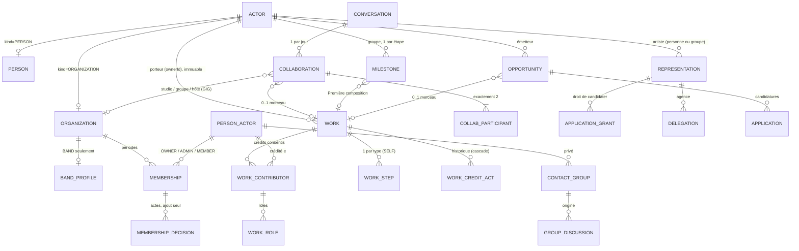

# Audit structurel du domaine Collab (G0-01, #84)

> **Nature : audit. Aucune ligne de code, aucun schéma, aucune migration
> modifiés.** Il prépare la décision d'architecture de G0-02
> ([#83](https://github.com/Pierre-FABIEN/linkmusician/issues/83)). Il ne la
> prend pas.
>
> **Base vérifiée** : `main` au commit `9e2449b` (18/11/2026), après avance
> rapide sur `origin/main` : la copie locale avait 17 commits de retard, dont
> DASH-07b, ONB-12c2, ONB-12c3, ONB-14 et DASH-20a à 20c, tous publiés.
> Sources lues : `prisma/schema.prisma` (section LINKMUSICIAN), les services
> `src/lib/server/{works,bands,collaborations,milestones,organizations,representation,opportunities,career}/`,
> les règles pures associées (`src/lib/{bands,milestones,collaborations,career,representation,structures}/`),
> les routes `(app)/morceaux`, `(app)/groupes`, `(app)/espace`, les noms des
> tests d'intégration et des E2E, les décisions D21, D35, D37, D41, D45, D46,
> D49, D64 et D66 à D71.
>
> **Limites** : les tests sont **lus, pas exécutés**. L'audit est statique :
> un comportement « vérifié » l'est par la lecture du code à ce commit, et
> par un test existant quand il est cité. Il complète les analyses du même
> jour ([audit-structurel-roadmap](../plan/audit-structurel-roadmap-2026-11-18.md),
> [audit-structurel-backlog](../plan/audit-structurel-backlog-2026-11-18.md)),
> qui ne lisaient que le schéma, et l'[audit des capacités](17-audit-capacites-services.md)
> (#55).

Chaque affirmation porte une étiquette :

- **[Fait]** : vérifié dans le code à `9e2449b`, avec sa référence ;
- **[Hyp.]** : hypothèse ou lecture probable, non démontrée ;
- **[Reco.]** : recommandation de cet audit ;
- **[Décision]** : choix produit à trancher dans #83, pas par cet audit.

---

## 1. Résumé exécutif

**Réponse courte à la question posée.** L'architecture représente
correctement **les groupes** (collectif durable, membres, gouvernance et
historique), **les morceaux** (porteur personne ou groupe, crédits consentis)
et **les actes confirmés à deux** (collaborations). Elle ne représente pas
**l'initiative** : un objectif situé (un EP, une tournée, un festival, une
sortie) qui regroupe plusieurs réalisations, plusieurs intervenants et ses
propres dates. Ce rôle est aujourd'hui tenu, en partie et implicitement, par
trois objets qui ne sont pas faits pour lui :

- le **morceau** (`Work`), appelé « campagne » dans l'interface (`/espace/campagnes`
  liste les morceaux, `career/service.ts:campaigns`). Une campagne vaut donc
  un seul titre ;
- les **étapes de groupe** (`Milestone`), des « premières fois » uniques par
  groupe (`@@unique([bandId, definitionId])`). Elles ne peuvent pas
  représenter un deuxième EP ni deux initiatives en parallèle ;
- le **groupe de contacts** (`ContactGroup`, commenté « un projet potentiel »
  dans le schéma) et la **discussion de groupe** (`GroupDiscussion`), seul
  espace à plusieurs. Ils ne sont reliés ni à un morceau, ni à un groupe, ni à
  un concert.

**Ce qui fonctionne et ne doit pas être refait** [Fait] : la gouvernance des
groupes (un OWNER toujours présent, transmission, dissolution, périodes
d'adhésion, actes en ajout seul), la distinction crédit ≠ adhésion (un
crédité n'est pas membre), les mandats d'accompagnement et le droit de
candidater (D65 à D71), les verrous `work:` puis `band:` (ARCH-MET-02), et les
niveaux de preuve des étapes.

**Contraintes artificielles vérifiées.** Plusieurs ne demandent pas de
nouvelle entité :

1. Un morceau ne change jamais de porteur : aucune écriture de `Work.ownerId`
   après la création. Un morceau composé seul·e avant le groupe ne peut pas
   devenir un morceau du groupe (scénario G).
2. Une collaboration porte **au plus un morceau**, réunit **exactement deux
   personnes** (elle naît d'une conversation à deux, `Conversation.pairKey`),
   et une seule est permise **par conversation et par jour**
   (`collaborations/service.ts:proposeCollaboration`, `requireAvailableDay`).
   Une ingé son qui mixe deux titres du même groupe le même jour ne peut en
   déclarer qu'un par la voie prouvée (scénario C).
3. Un concert (`GIG`) et un plateau (`GIG_SLOT`) exigent un **groupe**
   (D64). Les étapes de groupe exigent un groupe **formé**, c'est-à-dire avec
   au moins deux membres (`formsBand`). Un·e artiste solo doit donc créer un
   groupe de formation « Solo », qui ne sera jamais formé : ses concerts
   n'alimentent ni l'étape « Premier concert », ni l'acte V de sa carte
   (scénarios B et H).
4. Les dates de production d'un morceau (`recordedAt`, `mixedAt`…) et les
   `WorkStep` sont **uniques par morceau et par type**. Un nouvel
   enregistrement ou une nouvelle version n'a pas de place.
5. Supprimer un morceau (gestion) ou un compte (porteur personnel) **efface
   physiquement** le morceau, avec les crédits confirmés et l'historique des
   crédits des autres personnes. C'est testé et voulu
   (`works/history.integration.test.ts`, `service.integration.test.ts`
   « RGPD : morceaux portés supprimés »), mais contraire à l'idée que les
   réalisations survivent à leur porteur.
6. Un groupe dissous rend ses morceaux introuvables, y compris dans les
   crédits publics de ses contributeur·rices externes
   (`publicWorksOf`, `loadWork`).

**Recommandation** [Reco.] : **option B d'abord** (étendre les relations
existantes pour lever les contraintes 1 à 6, sans nouvelle entité majeure).
Ensuite, une entrée « Mes projets » en **projection** (vue calculée) pour
#71. L'**option C** (un objet `Project` persistant) ne se justifie que si
#83 retient les scénarios A, D et E comme indispensables au lancement. Dans
ce cas, il faut un agrégat léger qui _référence_ groupes, morceaux et
concerts sans jamais les posséder (§8). Les deux voies sont compatibles :
B est un prérequis de C, pas une alternative.

---

## 2. Cartographie des entités existantes

Chemins relatifs à `src/lib/server/` sauf mention contraire. « Seul point
d'écriture » reprend le commentaire du schéma, vérifié par recherche des
`create`/`update` dans `src/lib/server`.

### 2.1 Acteurs : `Actor`, `Person`, `Organization`

| Aspect         | Constat                                                                                                                                                                                                                                                                                          |
| -------------- | ------------------------------------------------------------------------------------------------------------------------------------------------------------------------------------------------------------------------------------------------------------------------------------------------ |
| Responsabilité | [Fait] `Actor` est le supertype commun (`ActorKind` : PERSON, ORGANIZATION). Progression, médias, localisation, crédits et collaborations pointent sur lui.                                                                                                                                      |
| Cardinalités   | [Fait] `Person` 1–1 `User` et 1–1 `Actor`. `Organization` 1–1 `Actor`, `kind` ∈ BAND, STUDIO, VENUE, PROMOTER, SCHOOL, AGENCY. **Pas de LABEL ni d'éditeur** en organisation : `LABEL_PRO` et `PUBLISHER` n'existent que comme métiers (`TrackKind`).                                            |
| Cycle de vie   | [Fait] Un acteur n'est jamais supprimé : `deletedAt` (anonymisation RGPD, `prisma/actors/person.ts`). Une organisation est `dissolvedAt` ; `verifiedAt` est accordé par la modération.                                                                                                           |
| Permissions    | [Fait] `organizations/access.ts:structureAccess` relit l'adhésion ACTIVE en base, y compris en transaction ; `structurePermissions` (`#lib/structures/rules`) : `manage` et les permissions spécialisées pour OWNER et ADMIN seulement. Le métier déclaré ne donne aucun droit (D66, audit #55). |
| Tests          | `organizations/access.integration.test.ts`, `organizations/history.integration.test.ts`, E2E `structures.spec.ts`.                                                                                                                                                                               |

### 2.2 Groupe : `Organization(BAND)`, `Membership`, `MembershipDecision`, `BandProfile`

| Aspect         | Constat                                                                                                                                                                                                                                                                                                                                                             |
| -------------- | ------------------------------------------------------------------------------------------------------------------------------------------------------------------------------------------------------------------------------------------------------------------------------------------------------------------------------------------------------------------- |
| Responsabilité | [Fait] Collectif durable : identité publique, effectif présent et passé (D38), gouvernance, XP de groupe. `BandProfile` : formation (SOLO, DUO, TRIO, BAND) et répertoire déclarés (D64).                                                                                                                                                                           |
| Service        | [Fait] `bands/service.ts`, seul point d'écriture : `createBand`, `inviteToBand`, `requestToJoin`, `answerInvite`, `answerRequest`, `withdrawPending`, `leaveBand`, `removeMember`, `setRole`, `transferOwnership`, `joinFromRecruitment`, `updateBandProfile`.                                                                                                      |
| Cardinalités   | [Fait] Personne N–N groupe par `Membership`, une ligne **par période**. Au plus une ligne ouverte (INVITED, REQUESTED, ACTIVE) par personne et par groupe : index partiel SQL `memberships_open_key`, plus le service sous verrou. Rôles OWNER, ADMIN, MEMBER ; un OWNER exactement tant que le groupe vit.                                                         |
| Cycle de vie   | [Fait] Créé non formé ; **formé** à la 2ᵉ adhésion active (`#lib/bands/rules:formsBand`, D37) ; dissous quand le dernier membre part (`leaveCheck`, `dissolve`). L'OWNER ne part qu'après transmission (`owner_must_transfer`). À la suppression du compte de l'OWNER, le successeur est désigné (`successorOf`) ou le groupe est dissous (`bandAnonymizationOps`). |
| Historique     | [Fait] `MembershipDecision` en ajout seul (16 actes, DASH-05g/h) ; périodes `startedAt`/`endedAt`. Les étapes sont attribuées aux membres présents à leur date.                                                                                                                                                                                                     |
| Permissions    | [Fait] Inviter : gestion (OWNER/ADMIN). Retirer : OWNER tout le monde, ADMIN les membres (`canRemove`). Changer un rôle et transmettre : OWNER seul. Tout sous `lockBand` (`pg_advisory_xact_lock`).                                                                                                                                                                |
| Tests          | `bands/service.integration.test.ts` (« un groupe a toujours un OWNER », « suppression du compte responsable : le groupe passe au membre suivant », « le dernier membre dissout le groupe », « départ puis retour : deux périodes »), `bands/history.integration.test.ts` (dissolution, rollback), E2E `groupes.spec.ts`, `recrutement.spec.ts`.                     |
| Limites        | [Fait] Un groupe n'a **aucun objet enfant de type initiative** : ses morceaux (`Work.ownerId`), ses concerts (`Collaboration.bandId`), ses étapes (`Milestone.bandId`) et ses candidatures (`Application.applicantActorId`) sont des listes à plat, sans regroupement.                                                                                              |

### 2.3 Morceau : `Work`, `WorkContributor`, `WorkRole`, `WorkCreditAct`, `WorkRoleAct`

| Aspect         | Constat                                                                                                                                                                                                                                                                                                                                                                                                 |
| -------------- | ------------------------------------------------------------------------------------------------------------------------------------------------------------------------------------------------------------------------------------------------------------------------------------------------------------------------------------------------------------------------------------------------------- |
| Responsabilité | [Fait] Un objet unique pour **composition, maquette et avancement de production** : état IDEA → COMPOSED, preuve DECLARED/CORROBORATED (D35, D40), dates `recordedAt`, `mixedAt`, `masteredAt`, `producedAt` (première collaboration terminée de chaque type). **Pas de distinction œuvre / enregistrement (master) / sortie.**                                                                         |
| Service        | [Fait] `works/service.ts`, seul point d'écriture : `createWork`, `updateWork`, `deleteWork`, `addOpenRole`, `removeOpenRole`, `creditPerson`, `addOwnSoundRole`, `confirmCredit`, `leaveCredit`, `withdrawCredit`, `setDemo`, `markComposed`, `creditFromCollaboration` (appelé dans la transaction d'une collaboration).                                                                               |
| Cardinalités   | [Fait] `Work` N–1 porteur (`ownerId`, un `Actor` personne ou groupe). `WorkContributor` N–N personnes (`@@unique([workId, personId])`), chaque crédit 1–N `WorkRole`. Un rôle sans contributeur est « à pourvoir ». `Work` 0–N `Collaboration`, 0–N `Opportunity`, 0–N `Milestone` (seule « Première composition » le renseigne).                                                                       |
| Création       | [Fait] `createWork` : à soi, ou au nom d'un groupe dont on est OWNER/ADMIN (`works/access.ts:manageableOwnerWhere`, relu sous verrou). La personne qui crée est créditée et confirmée d'emblée, avec l'acte `CREATOR_CREDITED`.                                                                                                                                                                         |
| Modification   | [Fait] Toute mutation passe par `loadManagedWork` : verrou `work:`, puis `band:` pour un morceau de groupe, relecture de l'existence et de la gestion (ARCH-MET-02b). **Aucune fonction ne modifie `ownerId`.**                                                                                                                                                                                         |
| Consentement   | [Fait] Un crédit n'est public qu'une fois confirmé par la personne (`confirmedAt`) ; les rôles du son n'entrent ni dans la corroboration ni dans la part de composition (`confirmedAuthors`, `hasCreativeRole`). L'historique des actes de crédit est en ajout seul (`WorkCreditAct`, D69 pour `WorkRoleAct`).                                                                                          |
| Lecture        | [Fait] Équipe (`isTeam`) : porteur, membre actif du groupe porteur (MEMBER compris), personne créditée **même non confirmée** (elle doit voir pour répondre). Gestion (`canManage`) : porteur personnel, ou OWNER/ADMIN du groupe porteur vivant.                                                                                                                                                       |
| Suppression    | [Fait] `deleteWork` : suppression physique par la gestion, sans garde sur les crédits confirmés d'autrui. Cascade sur `WorkContributor`, `WorkRole`, `WorkCreditAct`, `WorkRoleAct`, `WorkStep` ; `SetNull` sur `Collaboration.workId`, `Milestone.workId` et `Opportunity.workId`. Le test `works/history.integration.test.ts` vérifie que l'historique de crédit d'une mineure créditée devient vide. |
| RGPD           | [Fait] À l'anonymisation, `prisma.work.deleteMany({ where: { ownerId } })` supprime les morceaux portés par la personne. Les crédits confirmés des autres sur ces morceaux disparaissent avec eux. Sur les morceaux d'autrui, le crédit confirmé de la personne reste, affiché « Compte supprimé » (test `works/service.integration.test.ts`).                                                          |
| Tests          | `works/service`, `access`, `locking`, `history`, `own-roles`, `production`, `steps` (`*.integration.test.ts`) ; E2E `morceaux.spec.ts`, `campagne.spec.ts`, `collaborations-morceau.spec.ts`, `production-autonome.spec.ts`, `inge-son.spec.ts`, `producteur.spec.ts`.                                                                                                                                  |

### 2.4 Étapes de production : `WorkStep`, `WorkStepAct`

| Aspect         | Constat                                                                                                                                                                                                                                                                                                     |
| -------------- | ----------------------------------------------------------------------------------------------------------------------------------------------------------------------------------------------------------------------------------------------------------------------------------------------------------- |
| Responsabilité | [Fait] « Qui prend en charge ? » une étape d'un morceau (D68) : statut TODO → IN_PROGRESS → DONE, responsable, `revision` contre les écritures périmées. **Déclaratif** : n'écrit ni `recordedAt`, ni crédit, ni XP (D70).                                                                                  |
| Limites        | [Fait] `WorkStepMode` ne contient que `SELF`, `WorkStepPlace` que `HOME`, `OPEN_WORK_STEP_KINDS` que l'enregistrement. `@@unique([workId, kind])` : une étape par type et par morceau. Pas d'étape partagée entre morceaux (une session pour un EP entier) ni d'étape hors morceau (répétition de tournée). |
| Permissions    | [Fait] Écriture : gestion du morceau seulement (`applyWorkStep` → `loadManagedWork`). Un membre MEMBER ne prend pas en charge une étape. Un responsable qui quitte le groupe reste `assigneeId` : aucun service de départ ne libère ses étapes [Fait par absence dans `leaveBand`/`removeMember`].          |
| Tests          | `works/steps.integration.test.ts`, E2E `etapes-autonomes.spec.ts`, `production-autonome.spec.ts`.                                                                                                                                                                                                           |

### 2.5 Collaboration : `Collaboration`, `CollaborationParticipant`

| Aspect         | Constat                                                                                                                                                                                                                                                                                                                                                                                                    |
| -------------- | ---------------------------------------------------------------------------------------------------------------------------------------------------------------------------------------------------------------------------------------------------------------------------------------------------------------------------------------------------------------------------------------------------------- |
| Responsabilité | [Fait] **Acte daté, confirmé par chaque participant**, qui rapporte (`collaboration.completed`) et sert de preuve : il fait avancer un morceau, crédite un rôle du son, vérifie « Premier enregistrement » ou « Premier concert », compte une session de studio.                                                                                                                                           |
| Cardinalités   | [Fait] Née d'une conversation **à deux** acceptée (`Conversation.pairKey` unique), elle crée exactement deux participants. 0–1 `Work` (géré par l'un des deux), 0–1 studio (géré par l'un des deux), et pour `GIG` exactement 1 groupe (l'un y joue) et 1 hôte VENUE/PROMOTER (l'autre le gère). Une seule collaboration PROPOSED/ACCEPTED/COMPLETED par conversation et par jour (`requireAvailableDay`). |
| Cycle de vie   | [Fait] PROPOSED → ACCEPTED → COMPLETED (toutes confirmations) ou CANCELLED ; refus et annulation personnels distincts (`declinedAt`, `cancelledAt`, DASH-05k).                                                                                                                                                                                                                                             |
| Permissions    | [Fait] `proposeCollaboration` : participant de la conversation, pas de blocage, métier du son requis pour la prestation (`checkProvider`). Pour un concert, **n'importe quel membre actif** du groupe suffit côté groupe (`gigPartiesOfPair` ne filtre pas le rôle), alors que la déclaration manuelle d'une étape exige la gestion (`managedBand`).                                                       |
| Tests          | `collaborations/proposal`, `work`, `gigs`, `history`, `endorse`, `anonymisation` (`*.integration.test.ts`) ; E2E `concerts.spec.ts`, `collaborations-morceau.spec.ts`, `studio-sessions.spec.ts`, `recette-transverse.spec.ts` (DASH-20c : ingé son et morceau de groupe, deux confirmations simultanées).                                                                                                 |

### 2.6 Accompagnement : `Representation`, `RepresentationDelegation`, `ApplicationGrant`

| Aspect         | Constat                                                                                                                                                                                                                                                                                                                                        |
| -------------- | ---------------------------------------------------------------------------------------------------------------------------------------------------------------------------------------------------------------------------------------------------------------------------------------------------------------------------------------------- |
| Responsabilité | [Fait] Mandat d'un·e manager ou booker pour un artiste (personne ou groupe), avec un périmètre immuable : dates, départements, activités (D65). Affectation nominative dans une agence (D67). Droit distinct de candidater pour l'artiste (D71).                                                                                               |
| Permissions    | [Fait] L'agent propose ; l'artiste, ou la gestion **majeure** du groupe, confirme (`representation/service.ts:adultAnswerersOf`, Q48). `grantableKinds` : un groupe → `GIG_SLOT` seulement ; une personne → `JAM`, `SESSION_WORK`. Un booker d'une personne n'a donc **aucun** type candidatable (`#lib/representation/applicationGrants.ts`). |
| Limites        | [Fait] Un mandat porte sur **un artiste entier**, jamais sur une initiative : pas de « manager de cette tournée ». Aucun droit sur les morceaux ni sur les étapes.                                                                                                                                                                             |
| Tests          | `representation/*.integration.test.ts` (5 fichiers), `opportunities/delegated.integration.test.ts`, E2E `booker.spec.ts`, `delegations.spec.ts`, `droit-de-candidater.spec.ts`, `candidature-deleguee.spec.ts`.                                                                                                                                |

### 2.7 Événements et opportunités : `Opportunity`, `Application`, `JamSeries`, `Venue`

| Aspect         | Constat                                                                                                                                                                                                                                                                                                    |
| -------------- | ---------------------------------------------------------------------------------------------------------------------------------------------------------------------------------------------------------------------------------------------------------------------------------------------------------- |
| Responsabilité | [Fait] `Opportunity` sert à la fois d'**annonce** (`RECRUIT_MEMBER`, `SESSION_WORK`), de **jam** (`JAM`, avec présences, série, lead) et de **plateau** (`GIG_SLOT`, une date d'organisateur). Il n'existe **ni événement générique, ni festival**, ni regroupement de plusieurs dates ou plateaux.        |
| Cardinalités   | [Fait] Émetteur 1 acteur (personne ou groupe, `postedById` pour la personne), 0–1 `Work`, 0–1 `Venue`, 0–1 `JamSeries`. Candidature unique par annonce et par candidat (`@@unique([opportunityId, applicantActorId])`).                                                                                    |
| Permissions    | [Fait] Plateau : publié par une personne organisatrice (`gigSlots.ts:isPromoter`) ; une **personne** ne candidate pas (`applications.ts:applyTo` : « Un plateau se candidate au nom d'un groupe que tu gères ») ; la gestion d'un groupe ou un booker délégué candidate (`applyAsBand`, `applyDelegated`). |
| Concert tenu   | [Fait] Un concert n'est pas une `Opportunity` mais une `Collaboration(GIG)` entre deux personnes. Le plateau accepté et le concert confirmé ne sont **pas reliés** par une clé (`Collaboration.opportunityId` existe, mais un plateau réunit N groupes, alors qu'une collaboration n'en porte qu'un).      |

### 2.8 Jalons et progression : `Milestone`, `MilestoneAttestation`, `MilestoneEvidence`, carte de carrière

| Aspect            | Constat                                                                                                                                                                                                                                                                                                                                                              |
| ----------------- | -------------------------------------------------------------------------------------------------------------------------------------------------------------------------------------------------------------------------------------------------------------------------------------------------------------------------------------------------------------------- |
| Responsabilité    | [Fait] Dix « premières fois » **d'un groupe** (`prisma/seed-data/milestones.js`), une seule par groupe et par étape (`@@unique([bandId, definitionId])`), avec un niveau de preuve DECLARED → CORROBORATED → VERIFIED et une contestation (`frozenAt`, D49).                                                                                                         |
| Conditions        | [Fait] Déclaration par la gestion d'un groupe **formé** (`#lib/milestones/rules:declareBlocker`). Les vérifications automatiques (enregistrement, concert) exigent aussi `formedAt` (`verifyRecordingFromCollaboration`, `verifyGigFromCollaboration`). Une date antérieure à la formation est ramenée à celle-ci (`creditDate`).                                    |
| Linéarité         | [Fait] Aucun ordre imposé à la déclaration : un concert peut précéder un enregistrement. Le rang (`progression/core/tiers.ts:bandTier`) est la **dernière** étape au moins corroborée dans l'ordre du référentiel : un groupe qui a joué sans enregistrer a le rang « Premier concert ».                                                                             |
| Carte de carrière | [Fait] `#lib/career/map.ts` : chaque acte a sa propre épreuve, calculée sur des faits. « current » est le **premier acte jouable non franchi**. Les actes III (enregistrement) et V (scène) ne se franchissent que par une étape **d'un groupe** dont on était membre à la date (`career/map.ts:creditedBands`). L'acte II exige un morceau composé **à plusieurs**. |
| Tests             | `milestones/*.integration.test.ts` (service, proofs, disputes, recording, tiers), `#lib/career/map.test.ts`, E2E `etapes.spec.ts`, `carriere.spec.ts`.                                                                                                                                                                                                               |

### 2.9 Espaces à plusieurs : `ContactGroup`, `GroupDiscussion`

[Fait] `ContactGroup` est privé à son propriétaire (« Projet funk »,
commenté « un projet potentiel »). `GroupDiscussion` est ouverte depuis un
groupe de contacts, sur invitation acceptée (`discussions/service.ts`). Ce
sont **les seuls objets N personnes hors organisation**. Ils ne portent ni
morceau, ni date, ni rôle, ni droit (D45, D46).

---

## 3. Diagramme des relations métier existantes

Relations **réelles** au commit audité. Aucune entité proposée n'y figure.

`PERSON_ACTOR` désigne un `Actor` de type PERSON : le schéma relie
`Membership.personId` et `WorkContributor.personId` à `Actor`, pas à
`Person`.

**Ce que le diagramme montre** [Fait] : aucun chemin ne relie _plusieurs_
morceaux à _une_ initiative, ni _un_ concert à _plusieurs_ intervenants au-delà
de deux, ni un groupe à _ses_ initiatives.

---

## 4. Matrice des responsabilités et permissions

« Gestion » = adhésion ACTIVE OWNER ou ADMIN d'une organisation vivante.
Toutes les vérifications citées sont **côté serveur**, relues en transaction
sous verrou, sauf mention contraire.

| Action                                                                           | Qui peut                                                             | Point de vérification                                                                            | Historique / preuve                   | Test                                                           |
| -------------------------------------------------------------------------------- | -------------------------------------------------------------------- | ------------------------------------------------------------------------------------------------ | ------------------------------------- | -------------------------------------------------------------- |
| Créer un groupe                                                                  | Toute personne                                                       | `bands/service.ts:createBand`                                                                    | Adhésion OWNER                        | `bands/service.integration` « créer un groupe »                |
| Inviter, accepter une demande                                                    | Gestion du groupe                                                    | `inviteToBand`, `answerRequest`, `lockBand`                                                      | `MembershipDecision`                  | `bands/history.integration`                                    |
| Retirer un membre                                                                | OWNER : tous ; ADMIN : les MEMBER                                    | `removeMember` + `#lib/bands/rules:canRemove`                                                    | Acte REMOVED                          | `bands/service.integration`                                    |
| Changer un rôle, transmettre                                                     | OWNER seul                                                           | `setRole`, `transferOwnership`                                                                   | Actes BAND_ADMIN_GRANTED, OWNERSHIP_* | `bands/history.integration`                                    |
| Quitter                                                                          | Le membre ; l'OWNER après transmission, sauf s'il est le dernier     | `leaveBand` + `leaveCheck`                                                                       | Acte LEFT, dissolution                | « un groupe a toujours un OWNER »                              |
| Créer un morceau                                                                 | Soi, ou gestion du groupe porteur                                    | `createWork` + `manageableOwnerWhere`                                                            | `CREATOR_CREDITED`                    | `works/service.integration`, `access.integration`              |
| Gérer un morceau (titre, rôles, crédits, composé, maquette, étapes, suppression) | Porteur personnel ; gestion du groupe porteur                        | `loadManagedWork` (`work:` puis `band:`)                                                         | `WorkCreditAct`, `WorkStepAct`        | `works/access.integration` (36 cas 02b), `locking.integration` |
| Voir l'équipe d'un morceau                                                       | Porteur, membre actif (tout rôle), crédité·e même non confirmé·e     | `isTeam`                                                                                         | —                                     | `works/service.integration` « morceau d'un groupe »            |
| Confirmer, quitter son crédit                                                    | La personne créditée                                                 | `confirmCredit`, `leaveCredit`                                                                   | CONFIRMED, LEFT                       | `works/history.integration`                                    |
| Ajouter un rôle du son à son crédit                                              | Gestion **créditée** du morceau (D69)                                | `addOwnSoundRole`                                                                                | `WorkRoleAct`                         | `works/own-roles.integration`                                  |
| Proposer une collaboration                                                       | L'un des deux participants d'une conversation acceptée               | `proposeCollaboration`                                                                           | Participants, actes DASH-05j/k        | `collaborations/proposal.integration`                          |
| … liée à un morceau                                                              | Morceau **géré** par l'un des deux                                   | `manageableWorks` à la proposition, puis `requireWorkStillManaged` sous verrou à la confirmation | `creditFromCollaboration`             | `collaborations/work.integration`                              |
| … concert                                                                        | L'un est **membre actif** du groupe (tout rôle), l'autre gère l'hôte | `gigPartiesOfPair`                                                                               | `verifyGigFromCollaboration`          | `collaborations/gigs.integration`                              |
| Déclarer une étape de groupe                                                     | Gestion d'un groupe **formé**                                        | `milestones/service.ts:managedBand`, `declareBlocker`                                            | `Milestone`, attestations             | `milestones/service.integration`                               |
| Proposer, confirmer un mandat                                                    | Agent / artiste ou gestion majeure du groupe                         | `representation/service.ts`                                                                      | Dates, auteurs (DASH-05c)             | `representation/representation.integration`                    |
| Candidater pour un artiste                                                       | Agent titulaire d'un `ApplicationGrant` actif                        | `opportunities/delegated.ts:conditions`, `usableGrant`                                           | Acte USED                             | `opportunities/delegated.integration`                          |
| Candidater à un plateau                                                          | Gestion d'un groupe, ou booker délégué                               | `gigSlots.ts:applyAsBand`, `applyDelegated`                                                      | `Application.sentById`, `delegated`   | `opportunities/gigSlots.integration`                           |

**Incohérences relevées** (à confirmer, pas des failles démontrées) :

- [Fait] **Concert par un simple membre** : un membre MEMBER peut engager
  son groupe dans une collaboration `GIG` qui corrobore ou vérifie l'étape du
  groupe, alors que déclarer cette même étape exige la gestion. [Hyp.] C'est
  défendable, puisque l'hôte tiers confirme, mais ce n'est écrit dans aucune
  décision. → [Décision] Q-G0-7.
- [Fait] **Mandat sans portée d'initiative** : un manager accompagne
  l'artiste entier ; une tournée confiée à un booker et un EP confié à un
  autre ne se distinguent pas.
- [Fait] **Responsable d'étape parti** : un `WorkStep.assigneeId` survit au
  départ du groupe. Il ne peut plus agir (gestion requise), et l'étape reste
  à son nom jusqu'à ce que la gestion la libère.

---

## 5. Analyse des huit scénarios

### A. Groupe de cinq, un EP et une tournée en parallèle — **Partiellement supporté**

- [Fait] Le groupe, ses cinq adhésions et ses rôles : supportés (§2.2).
- [Fait] Les morceaux de l'EP : chacun est un `Work` du groupe, à son stade.
  **Rien ne dit que quatre morceaux forment l'EP** : pas de lien
  morceau → initiative ; l'étape `FIRST_EP` est `later` (pas ouverte) et unique.
- [Fait] La tournée : des `Collaboration(GIG)` successives. La « Première
  tournée » est déduite (≥ 3 communes en 30 jours, `verifyGigFromCollaboration`).
  Pas d'objet tournée, pas de dates propres, pas d'intervenants propres. Une
  deuxième tournée n'a pas de représentation.
- [Fait] Collaborateurs distincts : chacun est relié à _un_ morceau ou à
  _un_ concert, jamais à l'initiative.
- **Ce qui manque** : un regroupement nommé, daté, avec ses intervenants,
  pour chaque initiative. **Justification** : les opérations unitaires
  existent, mais la relation de regroupement est absente.

### B. Artiste indépendant, plusieurs morceaux, sans groupe — **Partiellement supporté**

- [Fait] Composer, créditer, faire enregistrer, mixer, produire : supporté
  sans groupe (`createWork` avec `band: null` ; E2E `production-autonome.spec.ts`,
  parcours « Thomas »).
- [Fait] « Publier » : il n'existe pas d'objet sortie. La vérification d'une
  sortie (MusicBrainz, `verifyReleaseMilestone`) est une **étape de groupe**.
- [Fait] Monter sur scène : un concert exige un groupe (`checkGigParties`),
  un plateau aussi (`applyTo`), conformément à D64. L'artiste doit créer un
  groupe de formation « Solo », qui ne sera **jamais formé**, faute de 2ᵉ
  membre : pas d'étape « Premier concert », pas d'acte V.
- [Fait] Carte de carrière : l'acte II exige un morceau composé à plusieurs
  (`soloOnly` est signalé) ; les actes III et V exigent un groupe.
- **Justification** : l'atelier de création est complet ; la scène et la
  reconnaissance passent par un groupe artificiel. D64 est une décision
  validée : la lever relève de #83, pas de cet audit.

### C. Ingé son externe sur deux morceaux d'un groupe — **Partiellement supporté**

- [Fait] Crédit sans adhésion : supporté. Le rôle du son est crédité par la
  collaboration terminée (`creditFromCollaboration`), confirmé par
  construction, sans part de composition ni adhésion (DASH-20c, E2E
  `recette-transverse.spec.ts`).
- [Fait] L'interlocuteur de l'ingé son doit **gérer** le groupe (morceau
  « géré par l'un des deux »). Un membre MEMBER ne peut pas rattacher la
  session au morceau.
- [Fait] Deux morceaux le **même jour** dans la même conversation : la
  seconde collaboration est refusée (« Une collaboration existe déjà pour ce
  jour »). Le second crédit ne passe alors que par `creditPerson` par
  l'équipe, puis confirmation, ce qui ne vaut pas preuve de prestation
  (pas de `mixedAt`, pas de compte de prestation).
- [Fait] Si le groupe est dissous, les deux crédits disparaissent du profil
  public de l'ingé son (`publicWorksOf` exclut les porteurs dissous).
- **Justification** : la règle fondamentale (crédité ≠ membre) est juste ; la
  cardinalité 1 collaboration = 1 morceau = 1 jour est artificielle.

### D. Groupe, studio, producteur et label sur une même sortie — **Non supporté** comme ensemble

- [Fait] Chaque paire peut confirmer une collaboration : groupe ↔ studio
  (`studioId`), groupe ↔ producteur (`PRODUCTION`). Mais une collaboration
  ne réunit que **deux personnes**, et le schéma n'a ni objet sortie, ni
  organisation LABEL (`OrgKind` n'en contient pas ; `LABEL_PRO` est un
  métier « bientôt », G6-02).
- [Fait] Rien ne relie les collaborations entre elles ou à une sortie.
- **Justification** : la limite est vérifiable (absence de type et de
  relation). Le label est de toute façon différé (#47).

### E. Organisateur, festival, plusieurs groupes, techniciens, partenaires — **Partiellement supporté**

- [Fait] Organisation PROMOTER et fiche (`organizations/promoters.ts`),
  plateaux `GIG_SLOT` avec N places et candidatures de groupes, concerts
  confirmés groupe par groupe (`Collaboration(GIG)`, un groupe chacun).
- [Fait] Aucun objet festival ou événement multi-dates ; aucun lien entre
  plateau et concerts tenus ; les techniciens (sonorisation `LIVE_SOUND`)
  ne se rattachent qu'à une collaboration à deux ; les partenaires n'ont
  aucune place. Les artistes ne deviennent pas membres de la structure
  organisatrice : **bon point**, garanti par construction.
- **Justification** : les briques existent ; le contenant est absent, et il
  relève du modèle d'événement de G3 (#77), pas forcément d'un projet.

### F. Départ d'un membre fondateur, projets actifs — **Supporté** pour le groupe, **partiellement** pour les travaux en cours

- [Fait] L'OWNER transmet puis part (`transferOwnership`, `leaveBand`), ou
  sa suppression de compte désigne un successeur (`successorOf`). Les
  morceaux restent au groupe ; ses crédits confirmés restent ; les étapes
  passées lui restent attribuées par date. Les mandats et droits de
  candidater du groupe survivent : ils sont confirmés par « la gestion »,
  relue à chaque usage (`adultAnswerersOf`, `usableGrant`). Le retrait de
  gestion pendant une attente est couvert par la recette DASH-20b (Q72).
- [Fait] Ses étapes de production en cours restent à son nom
  (`WorkStep.assigneeId`) ; aucune réaffectation automatique ni signal.
- [Fait] S'il **portait personnellement** un morceau joué par le groupe
  (cas G), le morceau part avec lui ; s'il supprime son compte, le morceau est
  supprimé.
- **Justification** : la continuité du collectif est garantie et testée ; il
  n'existe pas d'initiative dont on transmettrait la responsabilité.

### G. Morceau composé avant le groupe, joué et enregistré avec lui — **Non supporté** sans duplication

- [Fait] Le morceau reste porté par son auteur·rice : aucun transfert de
  porteur, aucun co-portage.
- [Fait] Enregistré avec le groupe, il ne fait pas avancer le groupe :
  `verifyRecordingFromCollaboration` exige un morceau **porté par le
  groupe**. Les membres ne voient pas le morceau comme équipe, sauf s'ils
  sont crédités.
- [Fait] La seule issue est de **recréer** un `Work` au nom du groupe :
  doublon sans lien, crédits à refaire, et la maquette ou la « Première
  composition » datée de la recréation.
- **Justification** : limitation vérifiable (porteur immuable, objet unique
  pour composition et enregistrement).

### H. Concerts avant le premier enregistrement, morceaux en composition — **Partiellement supporté**

- [Fait] Pour un **groupe formé** : supporté. Les étapes se déclarent dans
  n'importe quel ordre, le rang prend la dernière étape prouvée, et les
  morceaux avancent chacun à leur rythme.
- [Fait] Pour un **artiste solo** : les concerts exigent un groupe « Solo »
  jamais formé (voir B). Sur la carte, `current` pointe le premier acte non
  franchi : l'acte II (composition à plusieurs) reste « en cours » même
  après des dizaines de concerts.
- **Justification** : le moteur n'impose pas d'ordre ; ce sont le
  rattachement au groupe et le pointeur « acte en cours » qui recréent une
  linéarité.

| Scénario                  | Classement                            | Cause principale                                     |
| ------------------------- | ------------------------------------- | ---------------------------------------------------- |
| A Groupe EP + tournée     | Partiellement supporté                | Aucun regroupement d'initiative                      |
| B Artiste solo            | Partiellement supporté                | Scène et étapes réservées au groupe formé (D64, D37) |
| C Ingé son externe        | Partiellement supporté                | 1 collaboration = 1 morceau = 1 jour ; dissolution   |
| D Sortie multi-structures | Non supporté (comme ensemble)         | Collaboration à deux ; ni sortie ni label            |
| E Festival                | Partiellement supporté                | Pas d'événement multi-plateaux (G3)                  |
| F Départ du fondateur     | Supporté (groupe) / partiel (travaux) | Étapes en cours non réaffectées                      |
| G Œuvre préexistante      | Non supporté sans doublon             | Porteur immuable                                     |
| H Parcours non linéaire   | Supporté (groupe) / partiel (solo)    | Groupe obligatoire, pointeur d'acte                  |

---

## 6. Tableau des écarts vérifiés

Sévérité : **H** bloque un scénario de référence ; **M** le dégrade ou crée
un risque de données ; **B** confort ou cohérence.

| #   | Écart                                                                                          | Preuve                                                               | Scénarios | Sév. | Nature                              |
| --- | ---------------------------------------------------------------------------------------------- | -------------------------------------------------------------------- | --------- | ---- | ----------------------------------- |
| E1  | Aucun regroupement de plusieurs morceaux, concerts ou intervenants en une initiative           | Schéma : aucune relation Work → initiative ; `campaigns` = morceaux  | A, D, E   | H    | Relation absente                    |
| E2  | Porteur d'un morceau immuable, pas de co-portage                                               | Aucune écriture de `Work.ownerId` hors `createWork`                  | G, F      | H    | Contrainte artificielle             |
| E3  | Collaboration limitée à deux personnes et à un morceau                                         | `Conversation.pairKey`, `Collaboration.workId` scalaire              | C, D, E   | M    | Cardinalité                         |
| E4  | Une collaboration par conversation et par jour                                                 | `requireAvailableDay`                                                | C         | M    | Contrainte artificielle             |
| E5  | Scène et étapes réservées à un groupe formé (≥ 2) ; un groupe « Solo » ne se forme jamais      | `checkGigParties`, `applyTo`, `formsBand`, `declareBlocker`          | B, H      | H    | Contradiction D64 / D37             |
| E6  | Suppression d'un morceau ou du compte porteur : crédits et historique des autres effacés       | `deleteWork`, `person.ts` `work.deleteMany`, cascade `WorkCreditAct` | C, F, G   | M    | Intégrité des réalisations          |
| E7  | Morceaux d'un groupe dissous retirés des crédits publics des externes                          | `publicWorksOf`, `loadWork`                                          | C, F      | M    | Visibilité                          |
| E8  | Œuvre, enregistrement et sortie confondus dans `Work` ; une seule date par étape de production | `recordedAt` « première fois », `WorkStep @@unique([workId, kind])`  | D, G      | M    | Concept manquant (#40)              |
| E9  | Étapes de groupe uniques : pas de 2ᵉ EP, de 2ᵉ tournée ni d'initiatives parallèles             | `Milestone @@unique([bandId, definitionId])`                         | A         | B    | Par conception (« premières fois ») |
| E10 | Étape de production d'un membre parti non libérée                                              | `leaveBand` / `removeMember` ne touchent pas `WorkStep`              | F         | B    | Conséquence de départ               |
| E11 | Concert engagé par un simple membre, alors que la déclaration exige la gestion                 | `gigPartiesOfPair` sans filtre de rôle                               | A, F      | B    | Permissions à aligner               |
| E12 | Mandat sans portée d'initiative ; booker d'un solo sans type candidatable                      | `Representation` sans cible fine ; `grantableKinds`                  | A, B      | B    | Granularité                         |
| E13 | Plateau accepté et concert confirmé non reliés                                                 | `Collaboration.opportunityId` 0..1, plateau à N groupes              | E         | B    | Relation absente (G3)               |
| E14 | Pas d'organisation LABEL ni d'éditeur                                                          | `OrgKind`                                                            | D         | B    | Différé (#47, #48)                  |

**Non-écarts** (vérifiés, à ne pas « corriger ») : crédité ≠ membre ;
gestion ≠ métier déclaré ; mandat ≠ propriété d'œuvre ; preuve ≠ XP ;
parcours d'étapes sans ordre imposé ; continuité du groupe au départ de
l'OWNER ; verrous et révisions contre la concurrence.

---

## 7. Risques techniques et fonctionnels

| Risque                                                                                                                           | Type        | Probabilité | Mitigation proposée [Reco.]                                                               |
| -------------------------------------------------------------------------------------------------------------------------------- | ----------- | ----------- | ----------------------------------------------------------------------------------------- |
| **Doublons de morceaux** pour contourner E2 : statistiques et crédits faussés, « Première composition » mal datée                | Fonctionnel | Élevée      | Transfert ou co-portage consenti (B1)                                                     |
| **Groupes fantômes** « Solo » créés pour jouer (E5) : annuaire pollué, rangs incohérents                                         | Fonctionnel | Élevée      | Concert et rang ouverts à une personne, ou formation solo comptée (décision Q-G0-3)       |
| **Perte de preuves** d'un prestataire à la suppression d'un morceau ou d'un compte (E6) : son rang (`CraftSummary`) peut baisser | Données     | Moyenne     | Archiver plutôt que supprimer quand un crédit confirmé d'autrui existe (B4)               |
| **Table `Project` parallèle** qui redouble groupe, morceau et collaboration : deux sources de vérité des droits                  | Technique   | Moyenne     | Agrégat qui référence sans posséder ; droits relus sur les objets existants (§8 C)        |
| **Cascade de verrous** : un agrégat multi-morceaux ajoute une clé avant `work:`/`band:`, risque d'interblocage                   | Technique   | Moyenne     | Ordre de verrous documenté dans ARCH-MET-02a étendu, tests à barrières                    |
| **Élévation implicite** : être « participant d'un projet » donne accès aux morceaux                                              | Sécurité    | Moyenne     | Aucun droit dérivé de la participation ; lecture par prédicat explicite (`isTeam` étendu) |
| **Double comptage** d'XP ou de rang si une initiative « rejoue » des faits déjà comptés                                          | Progression | Faible      | Une initiative n'émet aucun événement d'XP au lancement (D54 : direction par badges)      |
| **UX alourdie** : obliger à créer un projet avant un morceau                                                                     | UX          | Moyenne     | Projet facultatif, morceau toujours créable seul (critère #83)                            |
| **Migration** : rattacher l'existant à des projets créés automatiquement                                                         | Données     | Faible      | Ne rien rétro-créer ; un projet naît d'un geste explicite                                 |

---

## 8. Comparaison des options architecturales

### Option A : conserver le modèle, améliorations mineures

[Reco.] Corriger seulement E10 et E11 (alignement des droits et libération
des étapes au départ), plus E4 (assouplir l'unicité par jour en unicité par
jour **et par morceau**). Ne règle ni A, ni B, ni G.

### Option B : étendre les relations existantes, sans nouvelle entité majeure

[Reco.] Lots candidats, chacun additif :

- **B1** Transfert de porteur d'un morceau personne → groupe, consenti par
  l'auteur·rice et la gestion, avec acte en ajout seul (scénario G).
  Co-portage : seulement si Q-G0-4 le demande.
- **B2** Collaboration sur **plusieurs morceaux** : table de liaison
  `CollaborationWork`, qui remplace l'usage de `workId` à terme ; unicité
  par jour et par morceau (C, E3, E4).
- **B3** Artiste solo sur scène : `Collaboration(GIG)` avec un artiste
  personne, ou groupe « Solo » formé dès un membre, selon Q-G0-3 (B, H, E5).
- **B4** Préservation des réalisations : archivage d'un morceau (porteur
  dissous ou supprimé) quand un crédit confirmé d'autrui existe ; affichage
  « porteur dissous » plutôt que disparition (E6, E7).
- **B5** Pointeur d'acte non linéaire sur la carte : « prochaines épreuves
  possibles » plutôt que « l'acte en cours » (H, #72).
- **B6** « Mes projets » en **projection** (#71) : vue calculée qui
  regroupe, par porteur (moi, chacun de mes groupes), les morceaux par état,
  les concerts à venir, les plateaux et les annonces en cours. Aucune table.

### Option C : introduire une abstraction « Initiative » (projet)

[Hyp.] Utile seulement si A, D et E sont confirmés comme besoins du
lancement. Dans ce cas, et seulement dans ce cas, il faut un agrégat
**léger** :

- `Initiative` : nom, type (EP, album, tournée, festival, campagne, autre),
  dates facultatives, **un porteur `Actor`** (personne ou organisation),
  état (active, terminée, abandonnée) ;
- `InitiativeItem` : liens N–N vers des **réalisations existantes**
  (`Work`, `Collaboration`, `Opportunity`), sans changer leur porteur, leurs
  crédits ni leurs droits ;
- `InitiativeParticipant` : personnes invitées avec un rôle libre et un
  consentement. **Aucun droit dérivé** sur les objets liés, qui gardent leurs
  prédicats ;
- gestion de l'initiative = gestion de son porteur (personne, ou
  OWNER/ADMIN de l'organisation), relue par `manageableOwnerWhere` ou
  `structureAccess`. Aucun nouveau système de rôles.

### Comparaison

| Critère             | A                             | B                                                        | C (après B)                                  |
| ------------------- | ----------------------------- | -------------------------------------------------------- | -------------------------------------------- |
| Cohérence métier    | Faible : A, B, G restent faux | Bonne pour B, C, F, G, H ; A, D, E en vue seulement      | Complète si les scénarios A, D, E sont réels |
| Complexité          | Très faible                   | Moyenne, en lots indépendants                            | Élevée : nouvel agrégat, UX, verrous         |
| Maintenabilité      | Inchangée                     | Bonne : mêmes services, mêmes prédicats                  | Moyenne : un objet de plus à tenir cohérent  |
| Évolutivité         | Faible                        | Bonne                                                    | Très bonne (sortie, festival, campagne)      |
| Sécurité            | Inchangée                     | Risque faible : droits existants                         | Risque d'élévation si les droits dérivent    |
| Risque de migration | Nul                           | Faible : tables additives, pas de reprise                | Faible si rien n'est rétro-créé              |
| Compatibilité       | Totale                        | Totale (`workId` conservé pendant la transition)         | Totale si l'objet est facultatif             |
| Simplicité UX       | Inchangée                     | Meilleure : moins de groupes fantômes, moins de doublons | Risque de tunnel, à éviter                   |

**Lecture** [Reco.] : B traite les défauts **vérifiés** ; C répond à un
besoin **supposé** (A, D, E). La porte de décision de C est la question
Q-G0-1 : des utilisateur·rices du pilote demandent-ils à regrouper
plusieurs réalisations sous un nom ?

---

## 9. Recommandations classées

| Priorité | Recommandation                                                                                   | Impact               | Écarts       | Ticket porteur        |
| -------- | ------------------------------------------------------------------------------------------------ | -------------------- | ------------ | --------------------- |
| 1        | Trancher Q-G0-1 à Q-G0-4 dans une ADR #83, **avant** tout schéma                                 | Débloque G0-03, G2   | Tous         | #83                   |
| 2        | B3 : un·e artiste solo joue et progresse sans groupe fantôme                                     | Élevé (cœur MVP)     | E5           | #83 puis #72          |
| 3        | B1 : transfert consenti d'un morceau vers un groupe                                              | Élevé                | E2           | #40                   |
| 4        | B4 : archiver plutôt que supprimer quand des crédits d'autrui existent                           | Moyen (preuves)      | E6, E7       | #40                   |
| 5        | B2 : collaboration multi-morceaux, unicité par jour et par morceau                               | Moyen                | E3, E4       | #36                   |
| 6        | B6 : « Mes projets » en projection, sans table                                                   | Élevé (UX lancement) | E1 (en vue)  | #71                   |
| 7        | B5 : carte de carrière à épreuves parallèles                                                     | Moyen                | H            | #72                   |
| 8        | A : libérer les étapes au départ, aligner le droit de déclarer un concert                        | Faible               | E10, E11     | #36                   |
| 9        | C : agrégat `Initiative` léger, **seulement** si Q-G0-1 = oui                                    | Élevé si besoin réel | E1, E13      | nouveau lot après #83 |
| —        | Hors G0 : œuvre / master / sortie (E8) dans #40 ; festival (E13) dans #77 ; label (E14) dans #47 | —                    | E8, E13, E14 | #40, #77, #47         |

[Reco.] **Aucune nouvelle issue** : chaque recommandation tombe dans un
ticket existant (#83, #40, #36, #71, #72, #77, #47). Le seul lot nouveau
possible (C) ne doit naître qu'après la décision de #83.

---

## 10. Questions à trancher dans #83 (G0-02)

Chacune a une **valeur par défaut** recommandée, au sens de
[a-trancher.md](../plan/a-trancher.md).

| #      | Question                                                                                                                     | Défaut recommandé                                                                 |
| ------ | ---------------------------------------------------------------------------------------------------------------------------- | --------------------------------------------------------------------------------- |
| Q-G0-1 | Faut-il, **au lancement**, regrouper plusieurs réalisations sous une initiative nommée (EP, tournée, festival) ?             | **Non** : projection « Mes projets » (B6) ; agrégat C après retours du pilote     |
| Q-G0-2 | Si oui, qui porte une initiative : un seul porteur `Actor`, ou un co-portage entre organisations ?                           | Un seul porteur ; les autres structures sont participantes, sans droit            |
| Q-G0-3 | Un·e artiste solo peut-il ou elle jouer un concert et franchir « Premier concert » sans groupe ? Faut-il revoir D64 ou D37 ? | Oui : concert ouvert à un artiste personne ; D64 reste vrai pour les **plateaux** |
| Q-G0-4 | Un morceau peut-il changer de porteur (personne → groupe) ? Faut-il un co-portage ?                                          | Transfert consenti des deux côtés ; pas de co-portage                             |
| Q-G0-5 | Supprimer un morceau ou un compte efface-t-il les crédits confirmés d'autrui ?                                               | Non : archivage, crédits conservés, titre conservé, maquette retirée              |
| Q-G0-6 | Faut-il distinguer œuvre, enregistrement et sortie maintenant, ou dans #40 ?                                                 | Dans #40, après B1 et B4 ; ne pas bloquer G0                                      |
| Q-G0-7 | Un simple membre peut-il engager le groupe dans un concert confirmé ?                                                        | Oui (fait tiers confirmé), à consigner en décision                                |
| Q-G0-8 | Un mandat peut-il viser une initiative plutôt qu'un artiste entier ?                                                         | Non au lancement ; à revoir si C est retenu                                       |
| Q-G0-9 | La carte de carrière garde-t-elle un « acte en cours » unique ?                                                              | Non : épreuves parallèles (#72)                                                   |

**Critère de sortie de G0-02 proposé** : une ADR qui répond à Q-G0-1 à
Q-G0-5, valide ou rejette chaque lot B1 à B6 et C, et rejoue les huit
scénarios de ce document avec le modèle choisi.
